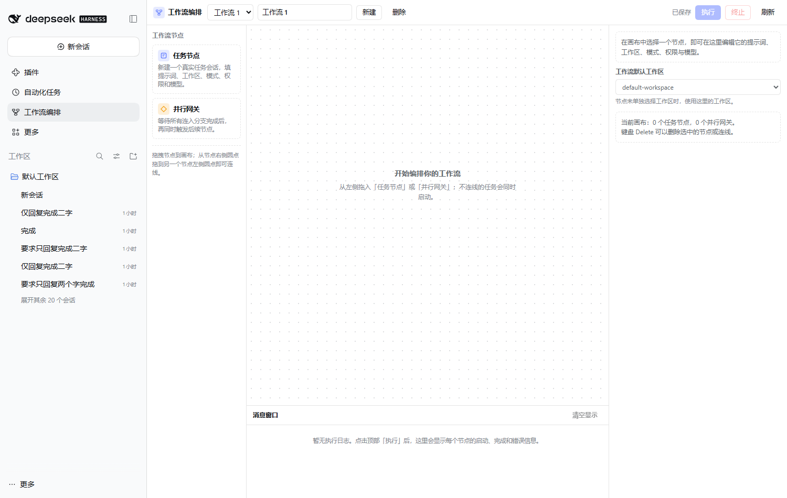
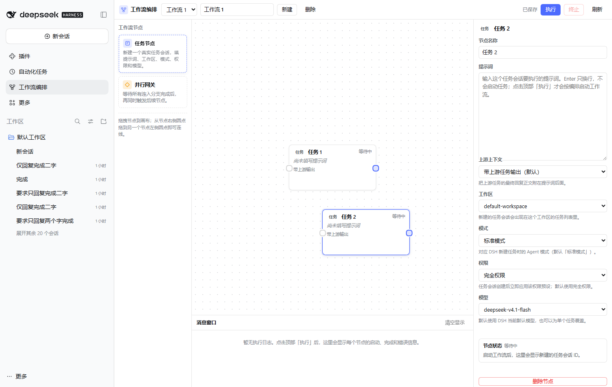
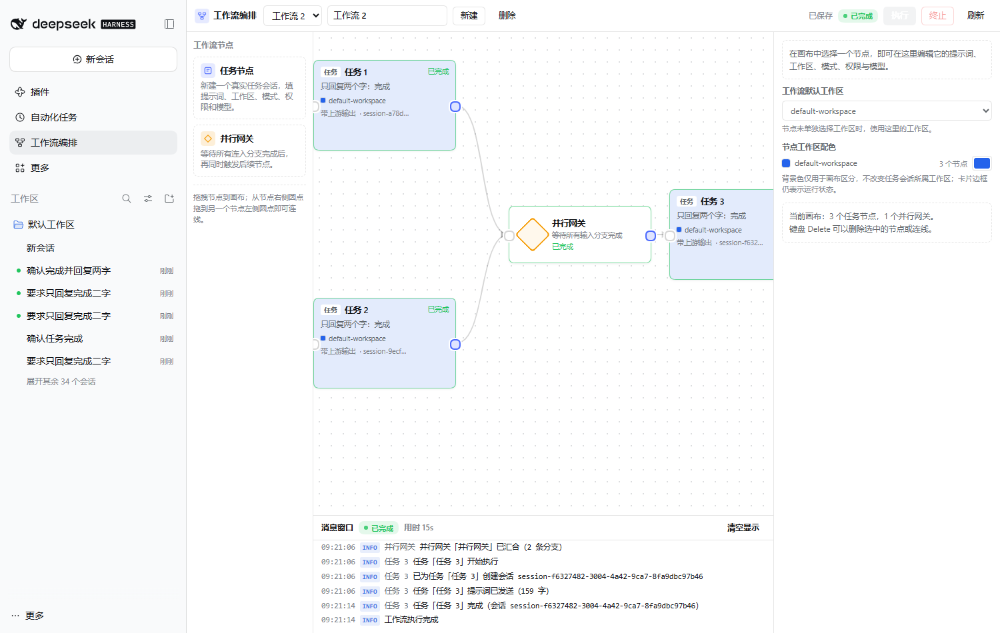
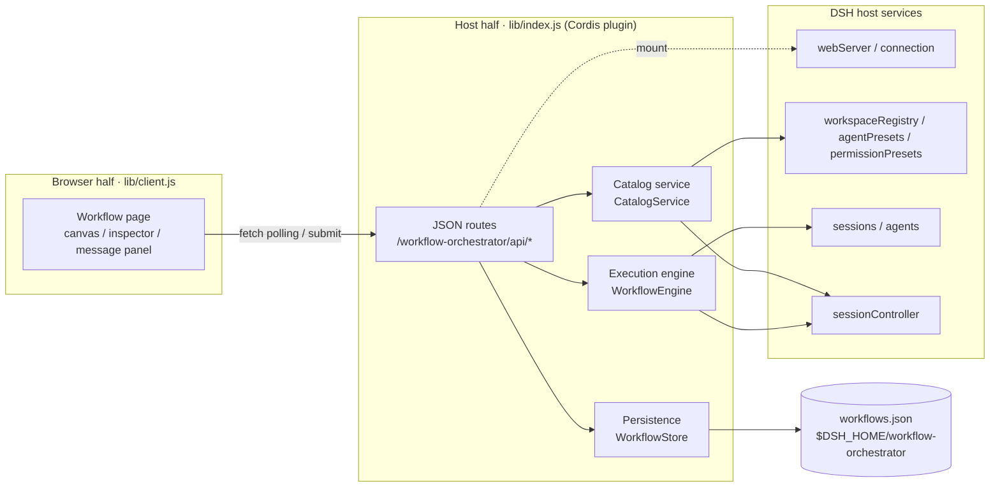
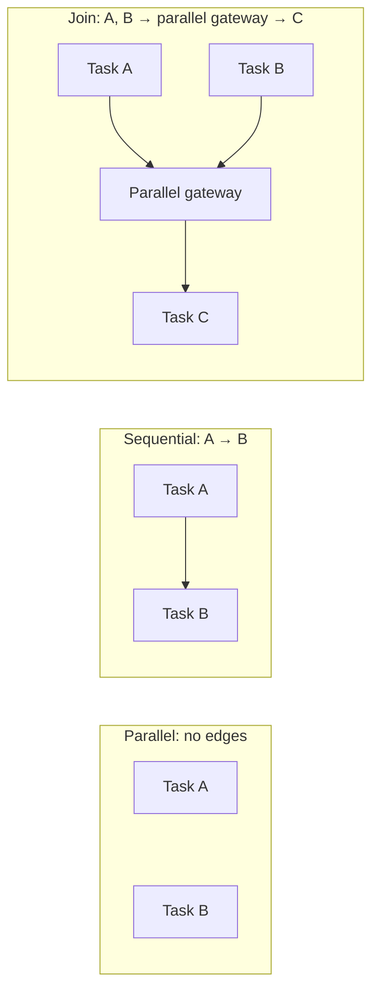

<p align="center">
  <a href="README.md"><strong>简体中文</strong></a> · English
</p>

<p align="center">
  
</p>

<h1 align="center">dsh-workflow-orchestrator</h1>

<p align="center">
  <strong>Orchestrate multiple DSH task sessions into an executable workflow</strong><br />
  Visual workflow plugin for DeepSeek Harness · drag-and-drop canvas · parallel gateway · real task sessions · run log
</p>

<p align="center">
  <a href="https://github.com/czyt1988/dsh-workflow-orchestrator/actions/workflows/ci.yml"></a>
  <a href="LICENSE"></a>
  <a href="package.json">= 20" /></a>
  <a href="docs/user/getting-started.md"></a>
  <a href="CONTRIBUTING.md"></a>
</p>

> **In one sentence**: add a first-level **Workflow Orchestrator** page (「工作流编排」 in the Chinese UI) to the DeepSeek Harness (DSH) sidebar. Drag task nodes onto a canvas, connect them and click **Run**: every task node creates a **real DSH task session** in the selected workspace. Sequential, parallel and joined execution is driven entirely by the edges, and progress streams into the message panel at the bottom.

> **Language note**: the plugin UI and the linked user/developer guides are currently written in Simplified Chinese, so the screenshots show Chinese labels. This file is the English counterpart of [README.md](README.md).

---

## Contents

- [Features](#features)
- [Interface preview](#interface-preview)
- [Architecture](#architecture)
- [Installation](#installation)
- [Quick start](#quick-start)
- [Execution semantics](#execution-semantics)
- [Documentation](#documentation)
- [Repository layout](#repository-layout)
- [Local development and testing](#local-development-and-testing)
- [Known limitations](#known-limitations)
- [Roadmap](#roadmap)
- [Contributing](#contributing)
- [License](#license)

---

## Features

| Capability | Description |
| --- | --- |
| 🧩 Visual canvas | Drag (or click) node cards from the left palette to add nodes, drag nodes to move them, drag from a node's port to connect, and press `Delete` to remove the selected node or edge. |
| 🤖 Real task sessions | When a task node starts it calls `sessionController.create` to create a **real DSH task session** in the target workspace. The session appears in that workspace's task list and can be opened with one click. |
| 🔀 Four topologies | No edges = start together; `A → B` = sequential; `A, B → parallel gateway → C` = join after every branch finishes; `A → judge node` or `A → terminate node` = finish early (the judge evaluates upstream output first). |
| 🛑 Early termination | A judge node uses a real session to evaluate upstream output and decides continue or stop; a terminate node ends the run as soon as it is reached. Remaining nodes are marked "skipped" and the early stop is recorded in the run history. |
| 🎛️ Full inspector | Prompt, upstream context (full output / summary / none), workspace, agent preset, permission preset and model — all read live from the host catalogs. |
| 🎨 Cross-workspace colors | Task cards show their workspace. When a workflow spans several workspaces a banner appears and cards get distinct light backgrounds; colors can be adjusted per node in the inspector, and card borders still express only run status. |
| ▶️ Run from any node | Select a task node and click **Run from this node** at the top of the inspector to run only that node and its downstream nodes. Predecessors and unrelated nodes are marked "not run" and create no task sessions. |
| 💾 Autosave and persistence | Canvas changes are saved to `$DSH_HOME/workflow-orchestrator/workflows.json` and survive refreshes and restarts; the last 20 runs are kept as well. |
| 📜 Run log | The bottom message panel streams INFO / WARN / ERROR per node, including session IDs, durations and failure reasons. |
| ⏹️ Two stop modes | "Stop workflow only" lets in-flight tasks finish; "Stop and cancel tasks" also cancels the running task sessions. |
| 🧪 Testable | `node:test` unit tests cover the engine, store and routes; an isolated `DSH_HOME` + Playwright E2E covers the full path. |

## Interface preview



*Figure 1: the three-column **Workflow Orchestrator** page — node palette on the left, canvas in the middle, run log at the bottom, inspector on the right, with workflow management and run controls in the top toolbar.*



*Figure 2: select a node to edit its properties on the right. `Enter` in the prompt box only inserts a newline, and all changes are saved automatically.*



*Figure 3: `A, B → parallel gateway → C` completed. The gateway joins both branches and then starts C; every node is linked to a real task session.*

More screenshots are available in the [user guide](docs/user/README.md) and the [interface tour](docs/user/interface.md) (both in Chinese).

## Architecture



The plugin is deliberately split into two halves with **zero third-party runtime dependencies**:

- The **host half** (`lib/index.js` + `lib/host/*`) is a regular Cordis plugin. It declares `inject` for `webServer`, `connection`, `sessions`, `agents` and `sessionController`, mounts the JSON API under `/workflow-orchestrator`, and creates and drives real task sessions through `sessionController`.
- The **browser half** (`lib/client.js`) is loaded through DSH's `window.__ModuleLoader__` and reuses the shell's own `react` module. It registers the first-level page and the sidebar entry.
- Catalogs (workspaces / agent presets / permission presets / models) are never hard-coded; they are read from the running host and cached for 60 seconds.

Implementation details are in the [architecture guide](docs/dev/architecture.md) and the [execution engine guide](docs/dev/execution-engine.md) (both in Chinese).

## Installation

**Prerequisites**: DeepSeek Harness desktop must be installed (Node.js ≥ 20 is only needed for local development), and the DSH version must satisfy `engines.dsh` (currently `>=0.2.2-rc.3 <0.3.0-0`).

### Option 1: npm (recommended)

```powershell
dsh plugin --profile desktop add dsh-workflow-orchestrator
```

Replace `desktop` with your profile name (the desktop app uses `desktop` by default). The plugin is written into the current profile and enabled automatically; refresh the page and a first-level **Workflow Orchestrator** entry appears in the sidebar. Published tarballs carry npm provenance, so the source repository and workflow are verifiable on the npm package page.

### Option 2: plugin discovery page

DSH ships no plugin index, so add one index source once (per profile):

1. Open **Plugins → Experimental plugins** and turn on **Custom plugin indexes**.
2. Go to **Discover → Add index source** and paste `https://cdn.jsdelivr.net/npm/dsh-plugin-catalog/index.json`.
3. Search for `workflow` or `dsh-workflow-orchestrator` and click **Install** on the card.

Listed plugins are third-party content; only add index sources you trust. See [Packaging and release](docs/dev/packaging-and-release.md#6-收录到-dsh-插件索引) for how this repository is listed (in Chinese).

### Option 3: plugin manager, local directory (development)

1. Open DSH **Settings → Plugins** (or the "Plugins" page in the sidebar).
2. Click **Add plugin** and choose the local directory (the root of this repository).
3. The plugin is added to the current profile as a `link:` dependency and enabled automatically.
4. Refresh the page; a first-level **Workflow Orchestrator** entry appears in the sidebar.

### Option 4: manual mount

1. Link this repository into the profile's `node_modules` (using the default Windows profile `desktop` as an example):

   ```powershell
   New-Item -ItemType Junction `
     -Path "$env:USERPROFILE\.dsh\profiles\desktop\node_modules\dsh-workflow-orchestrator" `
     -Target "D:\path\to\dsh-workflow-orchestrator"
   ```

2. In the profile's `package.json`, append the package name to `dsh.profile.bundles`:

   ```json
   {
     "dsh": {
       "profile": {
         "bundles": [
           "@deepseek-ai/dsh-base",
           "@deepseek-ai/dsh-web-app",
           "dsh-workflow-orchestrator"
         ]
       }
     }
   }
   ```

3. Refresh the page; if the profile does not have HMR enabled, restart DSH.

### Verify the installation

- The sidebar shows **Workflow Orchestrator** and the page renders its three-column layout.
- The host half writes `loadedAt` to `$DSH_HOME/workflow-orchestrator/host-loaded.json`.
- See [Getting started](docs/user/getting-started.md) and the [FAQ](docs/user/data-and-faq.md) for detailed steps and troubleshooting (both in Chinese).

## Quick start

1. **Open the page**: click **Workflow Orchestrator** (「工作流编排」) in the sidebar.
2. **Add a node**: drag a **task node** onto the canvas (or click the node card to add one).
3. **Write a prompt**: select the node, fill in the prompt on the right, and choose the workspace, agent preset, permissions and model as needed. `Enter` only inserts a newline.
4. **Connect nodes**: drag from the dot on a node's right edge to the dot on another node's left edge.
   - no edge → nodes start together
   - `A → B` → B starts after A completes
   - `A, B → parallel gateway → C` → C starts after both A and B complete
   - `A → judge node → B` → the judge node evaluates A's output; a stop decision ends the whole run early. `A → terminate node` ends the run as soon as it is reached.
5. **Run**: click **Run** in the toolbar for a full run; the message panel streams each node's start, session ID, completion and errors. To run only the second part, select a task node and click **Run from this node** at the top of the inspector; predecessors and unrelated nodes are marked "not run".
6. **Open sessions**: the **Open task session** action in the inspector jumps to the real task session created in the workspace.

## Execution semantics



| Rule | Behavior |
| --- | --- |
| A workflow must be a DAG | Cycles are rejected with an error message. |
| Node start condition | A node starts only after all direct predecessors are `completed`; a node without predecessors can start immediately. |
| Parallel gateway | Creates no task session; it only joins and fans out. It requires at least one incoming and one outgoing edge. |
| Predecessor failed / cancelled / skipped | Downstream nodes are marked `skipped`; the skip cascades only along the failed branch, while unrelated branches keep running. |
| Task completion | The last turn ends as `completed` and the session is quiet (the agent is idle and no background subagents are left to join). Model errors, cancellation, context exhaustion and similar conditions mark the node `failed`. |
| Run from node | Runs only the selected node and the nodes reachable downstream; the rest are marked `not-run` ("not executed"), create no sessions and do not count as failures. |
| Judge node | Creates a real session to evaluate upstream output; a `STOP` decision ends the whole run early. The decision text is transparent to downstream nodes, and an invalid decision degrades to `continue`. |
| Terminate node | Creates no session; reaching it ends the run early. The stop reason and the in-flight task policy are configurable. |
| Early termination | Nodes that never started are `skipped` ("the workflow was terminated early") and do not count as failures; in-flight tasks finish or are cancelled according to configuration; if a real failure happened before termination the run stays `failed`. |
| Cross-workspace | Each task node resolves its effective workspace independently (node → workflow default → host default). Cross-workspace affects only card colors and the banner, never scheduling. |
| Run status | Any task failed → `failed`; manual stop → `cancelled`; early stop → `failed` if something failed before it, otherwise `completed`; otherwise `completed`. |
| Concurrency and timeout | Up to 8 tasks run at the same time; a single task times out after 6 hours by default (the session is then asked to cancel). |
| Upstream context | By default the upstream task's final reply is appended to the prompt; it can be reduced to the session summary or omitted entirely. |

Node and run state machines, together with failure cascade details, are described in [Running and monitoring](docs/user/running-and-monitoring.md), [Stopping and errors](docs/user/stopping-and-errors.md) and the [execution engine guide](docs/dev/execution-engine.md) (all in Chinese).

## Documentation

The documentation is split into **user guides** (for people using the plugin) and **developer guides** (for contributors); the index is [docs/README.md](docs/README.md). All of them are currently written in Simplified Chinese.

### User guides

| Document | What it covers |
| --- | --- |
| [Getting started](docs/user/getting-started.md) | Installation, opening the page, creating and running your first workflow |
| [Interface tour](docs/user/interface.md) | Toolbar, node palette, canvas, message panel and inspector, area by area |
| [Building workflows](docs/user/building-workflows.md) | Node types, edge rules, inspector fields, validation limits |
| [Running and monitoring](docs/user/running-and-monitoring.md) | The four topologies, early stop via judge/terminate nodes, statuses and logs, concurrency and timeouts, real task sessions |
| [Stopping and errors](docs/user/stopping-and-errors.md) | The two stop modes, failure/skip/cancel cascades and troubleshooting |
| [Data and FAQ](docs/user/data-and-faq.md) | Data files, capacity limits, backup and migration, FAQ and known limitations |

### Developer guides

| Document | What it covers |
| --- | --- |
| [Architecture](docs/dev/architecture.md) | The two halves, Cordis services, request and loading paths |
| [Execution engine](docs/dev/execution-engine.md) | DAG scheduling, gateway joins, stop modes, session driving |
| [Data model](docs/dev/data-model.md) | `workflows.json` structure, sanitization rules, atomic writes and limits |
| [HTTP API](docs/dev/http-api.md) | Every JSON route, request/response shape, error codes and the admission gate |
| [Development guide](docs/dev/development.md) | Environment, layout, commands, local debugging, coding and commit conventions |
| [Testing](docs/dev/testing.md) | Unit tests, full-path E2E, evidence capture and CI boundaries |
| [Packaging and release](docs/dev/packaging-and-release.md) | Plugin manifest, four installation methods, versioning, tag-driven automated releases and plugin-index listing |

## Repository layout

```text
dsh-workflow-orchestrator/
├── .github/                  # CI, tag-driven release workflow, issue/PR templates
├── docs/
│   ├── README.md             # documentation index
│   ├── user/                 # user guides (for plugin users)
│   ├── dev/                  # developer guides (for contributors)
│   └── assets/images/        # documentation screenshots
├── lib/
│   ├── index.js              # host half entry (Cordis plugin)
│   ├── client.js             # browser half entry (ModuleLoader module)
│   └── host/                 # store, execution engine, routes, catalogs
├── locale/                   # Chinese/English plugin title and description
├── test/                     # node:test unit tests
├── tools/                    # E2E, package/docs self-checks and release tooling
├── AGENTS.md                 # project guide for AI coding agents
├── CHANGELOG.md
├── CONTRIBUTING.md
├── CODE_OF_CONDUCT.md
├── SECURITY.md
├── LICENSE                   # MIT
├── README.md                 # Chinese README (default)
├── README.en.md              # this English README
├── cordis.patch.yml          # bundle patch: inserts the loader row into the profile
├── icon.svg                  # plugin icon
├── screenshots.json          # screenshots shown on the plugin-market detail page
└── package.json              # DSH manifest + npm metadata
```

> `.e2e/` (E2E output), `internal/` (local troubleshooting material), `.probe/` and similar directories are ignored by `.gitignore` and are not part of the repository.

## Local development and testing

```powershell
# Unit tests (no DSH required, zero dependencies)
npm test

# Package structure and docs self-checks (the same checks CI runs)
npm run check

# Full-path E2E (requires the DSH desktop app, Playwright and model credentials)
npm run test:e2e

# Release: archive the CHANGELOG, bump the version, sync the docs, then verify
npm run release:prepare -- 0.2.0
npm run release:check
```

E2E starts `dsh --profile web` against an isolated `DSH_HOME`, drives a real browser with Playwright and calls real models. Evidence (screenshots, JSON, logs) is written to `.e2e/` and the report is `.e2e/e2e-report.md`. It is slow and machine-dependent, so it does **not** run in CI.

Releases are driven by a `vX.Y.Z` tag in [`.github/workflows/release.yml`](.github/workflows/release.yml): it runs the tests and self-checks, publishes to npm with provenance, and creates a GitHub Release with the tarball attached. See [Packaging and release](docs/dev/packaging-and-release.md#4-自动化发布) for the full flow (in Chinese).

## Known limitations

- The parallel gateway only joins and fans out. A judge node can only "continue" or "stop the whole run"; it cannot route different branches (there is no exclusive gateway or conditional branching).
- Judge nodes rely on the model emitting `WOF_DECISION: CONTINUE|STOP` as specified. When the decision cannot be parsed, the configured fallback applies (continue by default) and nodes are never dropped silently.
- Every task node and judge node runs **only once**: loops, retries and scheduled triggers are not supported.
- "Run from this node" only narrows the scope of the current run; it is not resume-from-checkpoint. Nodes that were not run are not caught up automatically, and the next **Run** executes the whole workflow again.
- The canvas can be edited while a run is in progress, but the run uses the **snapshot taken at start**.
- Task nodes and judge nodes with an empty prompt cannot run ("Run from this node" only validates nodes in the current scope; empty prompts outside the scope do not block it).
- A parallel gateway needs at least one incoming and one outgoing edge; a judge node needs at least one incoming edge and an upstream task; a terminate node needs at least one incoming edge and cannot have outgoing edges.
- Session titles are generated by DSH from the prompt; the plugin does not rename tasks.
- Verified on the DSH desktop `desktop` / `web` profiles. No peer dependency on a DSH version is declared, so rerun E2E after upgrading DSH.

## Roadmap

The following directions are open for discussion or adoption via [Issues](https://github.com/czyt1988/dsh-workflow-orchestrator/issues) (**planned, not a commitment**):

- Conditional branching / exclusive gateway: route a judge result to different branches instead of only continue-or-stop.
- Node-level retries, loops and scheduled triggers.
- A run history panel (review and compare past runs over time).
- Workflow export/import (JSON files) to share templates across a team.
- UI localization (the UI is currently Simplified Chinese; `locale/en.json` already provides English plugin metadata).

## Contributing

Issues, pull requests and documentation improvements are welcome:

1. Read [CONTRIBUTING.md](CONTRIBUTING.md) (development environment, coding conventions, commit conventions).
2. See [CODE_OF_CONDUCT.md](CODE_OF_CONDUCT.md) for the code of conduct.
3. Report security vulnerabilities privately as described in [SECURITY.md](SECURITY.md); do not open a public issue.
4. Before submitting, run `npm test` and `npm run check`. If your change affects execution semantics or the UI, update the documentation and `CHANGELOG.md` as well.

## License

[MIT](LICENSE) © 2026 czyt1988
