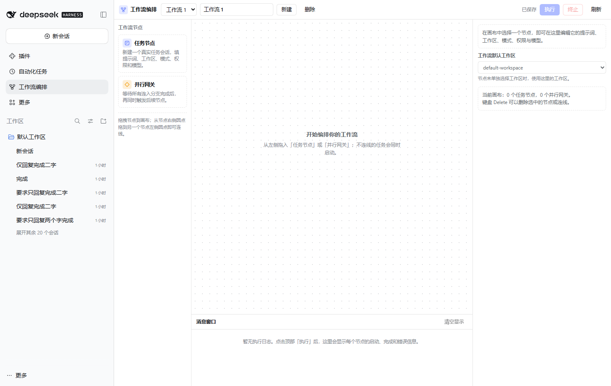
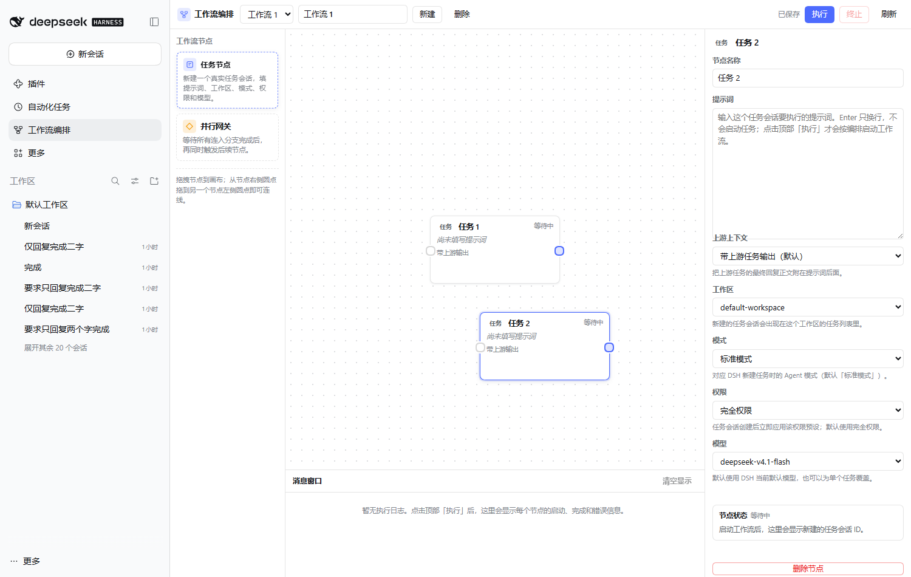
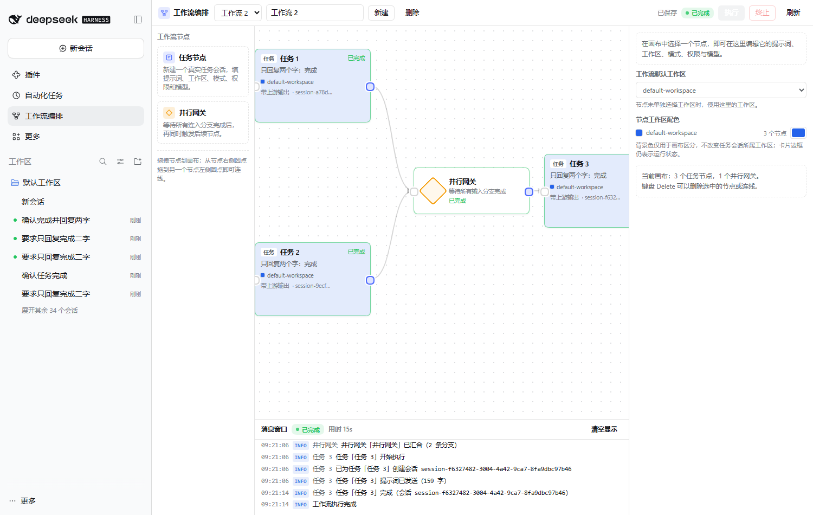
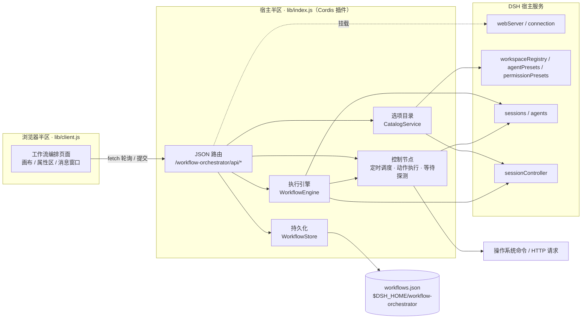
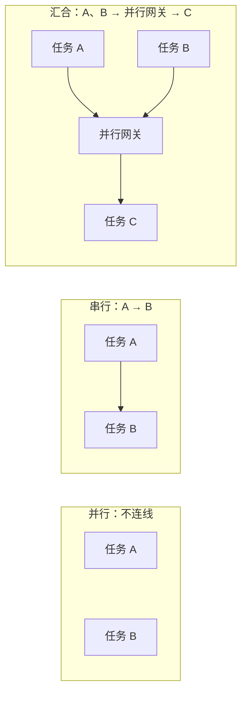

<p align="center">
  简体中文 · <a href="README.en.md"><strong>English</strong></a>
</p>

<p align="center">
  
</p>

<h1 align="center">dsh-workflow-orchestrator</h1>

<p align="center">
  <strong>把多个 DSH 任务会话编排成可执行的工作流</strong><br />
  DeepSeek Harness 可视化工作流编排插件 · 拖拽画布 · 并行网关 · 真实任务会话 · 定时触发 · 系统动作 · 运行日志
</p>

<p align="center">
  <a href="https://github.com/czyt1988/dsh-workflow-orchestrator/actions/workflows/ci.yml"></a>
  <a href="https://www.npmjs.com/package/dsh-workflow-orchestrator"></a>
  <a href="LICENSE"></a>
  <a href="package.json">= 20" /></a>
  <a href="docs/user/getting-started.md"></a>
  <a href="CONTRIBUTING.md"></a>
</p>

> **一句话**：在 DeepSeek Harness（DSH）左侧栏新增一级页面「工作流编排」——在画布上拖入任务节点、连线、点「执行」，每个任务节点都会在指定工作区里**新建一个真实的 DSH 任务会话**，串行、并行与汇合都由连线决定，执行过程实时写进底部消息窗口。还能用**定时节点**在指定时刻或按周期自动启动工作流、用**动作节点**收尾（关机、打开网页、运行命令等）、用**等待任务完成节点**等其它真实任务结束后再继续。

---

## 目录

- [功能特性](#功能特性)
- [界面预览](#界面预览)
- [架构](#架构)
- [安装](#安装)
- [快速开始](#快速开始)
- [执行语义](#执行语义)
- [文档导航](#文档导航)
- [目录结构](#目录结构)
- [本地开发与测试](#本地开发与测试)
- [已知限制](#已知限制)
- [Roadmap](#roadmap)
- [参与贡献](#参与贡献)
- [License](#license)

---

## 功能特性

| 能力 | 说明 |
| --- | --- |
| 🧩 可视化画布 | 左侧节点面板提供七种节点卡片，拖拽（或单击）添加节点，拖动节点、拖动圆点连线，`Delete` 删除选中节点或连线 |
| 🤖 真实任务会话 | 每个任务节点在启动时通过 `sessionController.create` 创建**真实 DSH 任务会话**，出现在对应工作区的任务列表里，可一键跳转 |
| 🔀 四类拓扑 | 不连线 = 同时启动；`A → B` = 串行；`A、B → 并行网关 → C` = 等所有分支完成后汇合；`A → 判断/终止节点` = 评估后提前结束 |
| 🛑 提前终止 | 判断节点用真实会话评估上游输出，判定「继续 / 终止」；终止节点到达即结束。后续节点不再执行，未启动节点标记「已跳过」，运行记录保留提前终止信息 |
| ⏰ 定时触发 | 定时节点支持一次性、每天、每周、每 N 分钟四种触发方式：作为**起始节点**时由宿主调度器到点自动启动整个工作流，放在流程中间时等下一次触发时间再继续下游。周期触发的起始节点会在后台反复启动并消耗 token，面板顶部与左侧栏入口常驻提醒；机器睡眠唤醒后最多补跑一次错过的周期触发 |
| ⚡ 系统动作 | 动作节点不创建会话，执行一次系统或网络动作：关机、重启、睡眠、锁屏、取消已计划的关机/重启、打开网址、打开文件或文件夹、运行命令、发送 HTTP 请求、只写日志。**默认试运行**（只写日志），在属性区取消勾选才会真正执行 |
| ⏳ 等待任务完成 | 从当前仍存活的 DSH 任务会话中勾选最多 30 个等待目标，等它们真正结束（主 Agent 空闲、没有可汇合的后台子 Agent、没有仍在等待回答的提问）后才继续下游；被等待任务失败、会话关闭但无法确认完成、或任务从未产生已结束回合时本节点失败，等待超过 12 小时自动失败 |
| 🎛️ 完整属性面板 | 提示词、上游上下文（完整输出 / 摘要 / 不传）、工作区、Agent 模式、权限预设、模型，全部来自宿主实时目录；定时、动作、等待节点也有各自的专用字段 |
| 🎨 跨工作区配色 | 任务节点卡片显示所属工作区；同一工作流跨多个工作区时显示提示条，不同工作区的卡片用不同浅色背景区分，颜色可在属性区逐个调整，卡片边框仍只表示运行状态 |
| ▶️ 从任意节点开始执行 | 选中任务节点点属性区顶部的「从此节点开始执行」，只运行该节点及其下游，前置与无关节点标记为「未执行」且不创建任务会话 |
| 💾 自动保存与持久化 | 画布改动自动保存到 `$DSH_HOME/workflow-orchestrator/workflows.json`，刷新、重启后仍在；最近 20 次运行记录一并保留 |
| 📜 运行日志 | 底部消息窗口按节点输出 INFO / WARN / ERROR，包含会话 ID、耗时与失败原因 |
| ⏹️ 两种终止方式 | 「仅停止工作流」让运行中的任务跑完；「停止并终止任务」同时取消正在运行的任务会话 |
| 🧪 可测试 | 引擎/存储/路由有 `node:test` 单元测试；另有隔离 `DSH_HOME` + Playwright 的全链路 E2E |

## 界面预览



*图 1：一级页面「工作流编排」的三栏布局——左侧节点面板、中间画布、底部消息窗口、右侧属性区，顶部是工作流管理与执行工具栏。*



*图 2：选中节点后在右侧编辑属性。提示词输入框内 `Enter` 只换行，不会触发执行；所有改动自动保存。*



*图 3：`A、B → 并行网关 → C` 执行完成。网关在两条分支都完成后汇合，随后启动 C，每个节点都关联了真实的任务会话。*

定时节点、动作节点与等待任务完成节点沿用同一套画布与属性区交互。新增节点暂未单独提供界面截图；现有界面截图拍摄于 0.2.0，左侧节点面板尚未包含本次新增的三种节点卡。字段与界面说明见[搭建工作流](docs/user/building-workflows.md#定时节点)与[界面导览](docs/user/interface.md#选中定时节点)。

更多界面截图见[用户文档](docs/user/README.md)与[界面导览](docs/user/interface.md)。

## 架构



插件刻意分成两个半区、**运行时零第三方依赖**：

- **宿主半区**（`lib/index.js` + `lib/host/*`）是一个普通 Cordis 插件，通过 `inject` 使用 `webServer`、`connection`、`sessions`、`agents`、`sessionController` 等服务，挂载 `/workflow-orchestrator` 下的 JSON API，并通过 `sessionController` 创建与驱动真实任务会话。
- **浏览器半区**（`lib/client.js`）通过 DSH 的 `window.__ModuleLoader__` 加载，`react` 复用壳层自带副本，注册一级页面与左侧栏入口。
- **控制节点**（定时 / 动作 / 等待）同样在宿主半区：定时节点由调度器按本机时间表检查并自动启动工作流，动作节点直接执行系统命令或 HTTP 请求，等待节点轮询真实任务会话；三者都不创建任务会话。
- 选项目录（工作区/模式/权限/模型）不硬编码，每次从正在运行的宿主读取并缓存 60 秒。

实现细节见[开发文档 · 架构](docs/dev/architecture.md)与[执行引擎](docs/dev/execution-engine.md)。

## 安装

**前置条件**：已安装 DeepSeek Harness 桌面端（Node.js ≥ 20 仅用于本地开发），DSH 版本需满足 `engines.dsh`（当前 `>=0.2.2-rc.3 <0.3.0-0`）。

### 方式一：npm 安装（推荐）

```powershell
dsh plugin --profile desktop add dsh-workflow-orchestrator
```

把 `desktop` 换成你的 profile 名（桌面端默认 `desktop`）。插件会写入当前 profile 并自动启用，刷新页面后左侧栏出现 **「工作流编排」**。发布包带 npm provenance，可在 npm 包页面核对来源仓库与发布工作流。

> 若提示「这个包没有声明组合包，无法作为插件安装：… declares no dsh.bundle」，通常是所用 npm 镜像源还没同步到最新版本：DSH 安装前会用 `pnpm view` 读包清单里的 `dsh.bundle`，镜像滞后时会拿到旧的占位版本。把插件管理器的**安装源**切到 **npm 官方源** 重试，或等镜像同步后再装，详见 [数据与常见问题 · FAQ 第 24 条](docs/user/data-and-faq.md)。

### 方式二：插件发现页安装

DSH 不内置插件索引，需要先添加一次索引源（属于当前 profile）：

1. **插件 → 实验性插件**，打开 **自定义插件索引**。
2. 进入 **发现 → 添加索引源**，粘贴 `https://cdn.jsdelivr.net/npm/dsh-plugin-catalog/index.json`。
3. 搜索 `workflow` 或 `dsh-workflow-orchestrator`，在卡片上点 **安装**。

索引里的插件来自第三方，只添加你信任的索引源。收录细节见[打包与发布 · 收录到 DSH 插件索引](docs/dev/packaging-and-release.md#6-收录到-dsh-插件索引)。

### 方式三：插件管理器安装本地目录（开发用）

1. 打开 DSH 的 **设置 → 插件**（或左侧「插件」页）。
2. 点击 **添加插件**，选择本地目录（本仓库根目录）。
3. 插件会以 `link:` 方式写入当前 profile 并自动启用。
4. 刷新页面，左侧栏出现 **「工作流编排」** 一级入口。

### 方式四：手动挂载

1. 把本仓库链接进 profile 的 `node_modules`（以 Windows 默认 profile `desktop` 为例）：

   ```powershell
   New-Item -ItemType Junction `
     -Path "$env:USERPROFILE\.dsh\profiles\desktop\node_modules\dsh-workflow-orchestrator" `
     -Target "D:\path\to\dsh-workflow-orchestrator"
   ```

2. 在 profile 的 `package.json` 中，把包名追加到 `dsh.profile.bundles`：

   ```json
   {
     "dsh": {
       "profile": {
         "bundles": [
           "@deepseek-ai/dsh-base",
           "@deepseek-ai/dsh-web-app",
           "dsh-workflow-orchestrator"
         ]
       }
     }
   }
   ```

3. 刷新页面；若 profile 未开启 HMR，重启 DSH 后生效。

### 验证安装

- 左侧栏出现「工作流编排」，页面能加载出三栏布局即成功。
- 宿主半区激活标记：`$DSH_HOME/workflow-orchestrator/host-loaded.json` 中会写入 `loadedAt`。
- 详细步骤与排障见[快速开始](docs/user/getting-started.md)与 [FAQ](docs/user/data-and-faq.md)。

## 快速开始

1. **打开页面**：左侧栏点击 **工作流编排**。
2. **建节点**：把 **任务节点** 拖到画布（或单击节点卡添加）。需要按时间自动跑、在流程里插入系统动作、或等待其它任务结束时，再从左侧拖入 **定时节点**、**动作节点** 或 **等待任务完成** 节点。
3. **写提示词**：选中节点，在右侧填写提示词，并按需选择工作区、模式、权限、模型。`Enter` 只换行。
4. **连线条**：从节点右侧圆点拖到另一个节点左侧圆点。
   - 不连线 → 同时启动
   - `A → B` → A 完成后启动 B
   - `A、B → 并行网关 → C` → A、B 都完成后启动 C
   - `A → 判断节点 → B` → 判断节点评估 A 的输出，判定终止则整次工作流提前结束；`A → 终止节点` 到达即结束
   - `定时节点（起始） → B` → 到点自动启动整个工作流；放在 `A → 定时节点 → B` 中间时，A 完成后等下一次触发时间再继续 B
   - `A → 动作节点` → A 完成后执行一次系统动作（默认试运行，只写日志）；也可以串在中间继续后续节点
   - `A → 等待任务完成 → B` → 等你在属性区勾选的真实任务结束后再继续 B
5. **执行**：点击顶部 **执行**（全量执行），底部消息窗口实时输出每个节点的启动、会话 ID、完成与错误。只想跑后半段时，选中某个任务节点，点属性区顶部的 **从此节点开始执行**，前置与无关节点会标记为「未执行」。定时工作流也可以不点执行：周期触发的起始节点会在后台自动启动并消耗 token，面板顶部与左侧栏入口有常驻提醒；手动执行不会影响周期计划。
6. **查看会话**：节点属性区的「打开任务会话」可跳到工作区里真实创建的任务会话。

## 执行语义



| 规则 | 行为 |
| --- | --- |
| 工作流必须是 DAG | 存在环路时拒绝执行并给出提示 |
| 节点启动条件 | 所有直接前序节点都 `completed` 才启动；无前序节点视为可立即启动 |
| 并行网关 | 不创建任务会话，只做汇合与扇出；必须至少一条输入、一条输出连线 |
| 前序失败/取消/跳过 | 下游节点标记 `skipped`，只沿失败分支级联，不相关分支继续跑完 |
| 任务节点完成判定 | 最后一个回合以 `completed` 结束且会话静默（Agent 空闲、没有仍可汇合的后台子代理）；模型报错、被取消、上下文耗尽等记为 `failed` |
| 从节点开始执行 | 只执行该节点及其通过有向边可达的下游；其余节点记为 `not-run`（未执行），不创建任务会话，也不计入失败 |
| 判断节点 | 创建真实会话评估上游输出；判定 `STOP` 时整次运行提前结束。判定文本对下游透明，无效判定按 `continue` 降级 |
| 终止节点 | 不创建会话；到达即提前结束整次运行。可配置终止原因与在途任务策略 |
| 定时节点（起始节点） | 宿主调度器每 10 秒检查一次时间表，到点自动启动整个工作流；手动点「执行」时该节点立即放行、不等待。一次性触发在计划时间后 10 分钟内仍会补触发一次（包括应用重启后 10 分钟内启动）；超过 10 分钟不补触发，只写 DSH 宿主日志。手动执行不享受宽限：一次性时间已过去（超过 1 分钟）时校验失败 |
| 定时节点（流程中间） | 运行到达后等待下一次触发时间，触发后继续下游；只触发一次，不在本次运行内循环。必须有输出连线 |
| 周期触发 | 只有起始定时节点会自动启动新的运行；工作流正在运行时到点的触发被跳过、不排队；调度器记录的上次触发时间保存在宿主内存，重启 DSH 后从重启时刻重新计算，错过的触发不补；手动执行不重置计划 |
| 动作节点 | 不创建任务会话、不进入下游提示词上下文；执行一次系统或网络动作（默认试运行，只写日志）；动作失败会让节点失败并级联跳过下游 |
| 等待任务完成节点 | 每 10 秒检查一次勾选的真实任务会话，确认真正结束后才继续下游；被等待任务失败会让本节点失败；等待超过 12 小时自动失败 |
| 提前终止 | 未启动节点 `skipped`（「工作流已提前终止」），不计入失败；在途任务默认跑完或按配置取消；终止前已有失败则整体仍 `failed` |
| 跨工作区 | 每个任务节点的有效工作区独立解析（节点指定 → 工作流默认 → 宿主默认）；跨工作区只影响卡片配色与提示，不改变调度 |
| 运行状态 | 任一任务失败 → 整体 `failed`；收到手动终止 → 整体 `cancelled`；提前终止 → 终止前有失败则 `failed`，否则 `completed`；否则 `completed` |
| 并发与超时 | 同时最多 8 个任务执行；单任务默认 6 小时超时（超时后请求取消会话） |
| 上游上下文 | 默认把上游任务的最终回复附在提示词后；可改为只带会话摘要或完全不传 |

节点与运行的状态机、失败级联细节见[用户文档 · 执行与监控](docs/user/running-and-monitoring.md)、[终止与错误](docs/user/stopping-and-errors.md)和[开发文档 · 执行引擎](docs/dev/execution-engine.md)。

## 文档导航

文档分为**应用文档**（面向使用者）与**开发文档**（面向贡献者），入口见 [docs/README.md](docs/README.md)。

### 应用文档

| 文档 | 内容 |
| --- | --- |
| [快速开始](docs/user/getting-started.md) | 安装、打开入口、创建并运行第一个工作流 |
| [界面导览](docs/user/interface.md) | 工具栏、节点面板、画布、消息窗口、属性区的每一块 |
| [搭建工作流](docs/user/building-workflows.md) | 七种节点、连线规则、属性字段、校验限制 |
| [执行与监控](docs/user/running-and-monitoring.md) | 常见拓扑、从节点开始执行的范围、判断/终止节点的提前结束、定时自动触发、动作与等待节点、状态与日志、并发与超时、真实任务会话 |
| [终止与错误处理](docs/user/stopping-and-errors.md) | 两种终止方式、失败/跳过/取消的级联与排查 |
| [数据与 FAQ](docs/user/data-and-faq.md) | 数据文件、容量上限、备份迁移、常见问题与已知限制 |

### 开发文档

| 文档 | 内容 |
| --- | --- |
| [架构](docs/dev/architecture.md) | 两半区结构、Cordis 服务、请求与加载链路 |
| [执行引擎](docs/dev/execution-engine.md) | DAG 调度算法、网关汇合、停止模式、会话驱动 |
| [数据模型](docs/dev/data-model.md) | `workflows.json` 结构、清洗规则、原子写与容量上限 |
| [HTTP API](docs/dev/http-api.md) | 全部 JSON 路由、请求/响应、错误码与准入栅栏 |
| [开发指南](docs/dev/development.md) | 环境、目录、命令、本地联调、编码与提交约定 |
| [测试](docs/dev/testing.md) | 单元测试、E2E 全链路、证据采集与 CI 边界 |
| [打包与发布](docs/dev/packaging-and-release.md) | 插件清单、四种安装方式、SemVer、tag 驱动的自动化发布与插件索引收录 |

## 目录结构

```text
dsh-workflow-orchestrator/
├── .github/                  # CI、tag 触发的发布工作流、Issue/PR 模板
├── docs/
│   ├── README.md             # 文档总索引
│   ├── user/                 # 应用文档（面向使用者）
│   ├── dev/                  # 开发文档（面向贡献者）
│   └── assets/images/        # 文档界面截图
├── lib/
│   ├── index.js              # 宿主半区入口（Cordis 插件）
│   ├── client.js             # 浏览器半区入口（ModuleLoader 模块）
│   └── host/                 # 存储、执行引擎、路由、选项目录、定时/动作/等待节点
├── locale/                   # 插件管理器/设置页的中英文标题与描述
├── test/                     # node:test 单元测试
├── tools/                    # E2E 脚本、包结构/文档自检、发布工具链
├── AGENTS.md                 # AI 编码代理的项目指引
├── CHANGELOG.md
├── CONTRIBUTING.md
├── CODE_OF_CONDUCT.md
├── SECURITY.md
├── LICENSE                   # MIT
├── README.md                 # 中文版 README（默认）
├── README.en.md              # 英文版 README
├── cordis.patch.yml          # bundle patch：向 profile 插入 loader 行
├── icon.svg                  # 插件图标
├── screenshots.json          # 插件市场详情页截图清单
└── package.json              # DSH 清单 + npm 元数据
```

> `.e2e/`（E2E 产物）、`internal/`（本地排障材料）、`.probe/` 等目录已被 `.gitignore` 忽略，不属于仓库内容。

## 本地开发与测试

```powershell
# 单元测试（不需要启动 DSH，零依赖）
npm test

# 包结构与文档自检（CI 同款）
npm run check

# 全链路 E2E（需要 DSH 桌面端 + Playwright + 模型凭据）
npm run test:e2e

# 发布：归档 CHANGELOG + 升版本 + 同步文档，然后校验
npm run release:prepare -- 0.2.0
npm run release:check
```

E2E 会在隔离的 `DSH_HOME` 中启动 `dsh --profile web`，用 Playwright 驱动真实浏览器并调用真实模型，证据（截图/JSON/日志）输出到 `.e2e/`，报告为 `.e2e/e2e-report.md`。它耗时且依赖本机环境，因此**不进入 CI**。

发布由 `vX.Y.Z` tag 触发 [`.github/workflows/release.yml`](.github/workflows/release.yml)：先跑测试与自检，再以 npm provenance 发布并创建带 tarball 附件的 GitHub Release。完整流程见[打包与发布](docs/dev/packaging-and-release.md#4-自动化发布)。

## 已知限制

- 并行网关只有汇合与扇出；判断节点只能「继续 / 全局终止」，不能按判定结果走不同分支（没有排他网关、条件分支）。
- 判断节点依赖模型按契约输出 `WOF_DECISION: CONTINUE|STOP`；无法识别时按配置降级（默认继续），不会静默丢节点。
- 每个任务节点与判断节点在一次运行中**只执行一次**：不提供单次运行内的循环与自动重试；周期执行由定时节点的「每天 / 每周 / 每 N 分钟」以**新的运行**形式提供。
- 定时节点只有作为**起始节点**（没有输入连线）时才会自动启动工作流；放在流程中间只延迟当前运行。同一个工作流同一时间只能有一次运行，到点的周期触发会被跳过、不排队。
- 调度器记录的上次触发时间保存在宿主内存：重启 DSH 后从重启时刻重新计算，错过的周期触发不会补触发。一次性触发在计划时间后 10 分钟内会补触发一次（包括应用重启后 10 分钟内启动），超过 10 分钟不补；手动执行不豁免（一次性时间已过去超过 1 分钟会校验失败）。
- 校验未通过的周期工作流到点会被调度器**跳过**：不会启动、不会产生运行记录，DSH 宿主日志记一条 `WARN`，面板提醒条会显示校验未通过的周期工作流数量（只统计起始周期定时节点，一次性入口节点不计入）。
- 机器睡眠唤醒或系统时钟跳跃后，可能立即补跑一次错过的周期触发并额外消耗 token；插件最多补一次，然后按新计划继续。
- 动作节点**默认试运行**，必须手动取消勾选才会真正执行；自动触发的工作流可能在无人值守时真的关机或重启，请先确认。关机/重启缓冲时间 10–3600 秒（默认 60 秒），可用「取消已计划的关机/重启」动作或系统命令取消；该取消主要适用于 Windows，其他平台的缓冲是插件内本地等待，只有「停止并终止运行中的任务」能中止。
- 动作节点的 `run-command` 在 Windows 用 PowerShell、其它平台用默认 shell；命令退出码非 0、HTTP 非 2xx 或超时都会让节点失败。打开文件/文件夹、关机、睡眠、锁屏等能力依赖宿主所在操作系统。
- 等待任务完成节点只等待**当前仍存活**的 DSH 任务会话（已排除子 Agent 会话），最多选择 30 个；等待超过 12 小时视为失败，任务在提问或仍有后台子 Agent 时不算完成。
- 「从此节点开始执行」只缩小本次运行范围，不做断点续跑：未执行的节点不会自动补跑，下一次「执行」仍会全量执行。
- 工作流运行期间可以继续编辑画布，但本次运行使用**启动时的快照**。
- 提示词为空的任务节点与判断节点不允许执行（「从此节点开始执行」只校验本次执行范围内的节点，范围外的空提示词不阻塞）。
- 并行网关必须至少一条输入与一条输出连线；判断节点必须至少一条输入且上游有任务，终止节点必须至少一条输入且不能有输出连线。
- 会话标题由 DSH 根据提示词自动生成，插件不会重命名任务。
- 已在 DSH 桌面端的 `desktop` / `web` profile 上验证；未声明对 DSH 版本的 peer 依赖，升级 DSH 后请重跑 E2E。

## Roadmap

以下方向欢迎通过 [Issue](https://github.com/czyt1988/dsh-workflow-orchestrator/issues) 讨论或认领（**计划中，不代表承诺**）：

- 条件分支 / 排他网关：让判断结果路由到不同分支，而不是只能全局继续或终止。
- 单次运行内的节点重试与循环（周期执行已由定时节点以新的运行形式提供）。
- 更多动作类型与动作执行前的二次确认（当前动作节点默认试运行，取消勾选即真实执行）。
- 运行历史面板（按时间回看与对比多次运行）。
- 工作流导出 / 导入（JSON 文件），便于团队共享模板。
- 界面文案 i18n（当前 UI 为简体中文，`locale/en.json` 已提供插件元数据英文）。

## 参与贡献

欢迎 Issue、PR 与文档改进：

1. 阅读 [CONTRIBUTING.md](CONTRIBUTING.md)（开发环境、编码约定、提交规范）。
2. 行为准则见 [CODE_OF_CONDUCT.md](CODE_OF_CONDUCT.md)。
3. 安全漏洞请按 [SECURITY.md](SECURITY.md) 私下报告，不要公开开 Issue。
4. 提交前请跑通 `npm test` 与 `npm run check`；涉及执行语义或 UI 的改动请同步更新文档与 `CHANGELOG.md`。

## License

[MIT](LICENSE) © 2026 czyt1988
