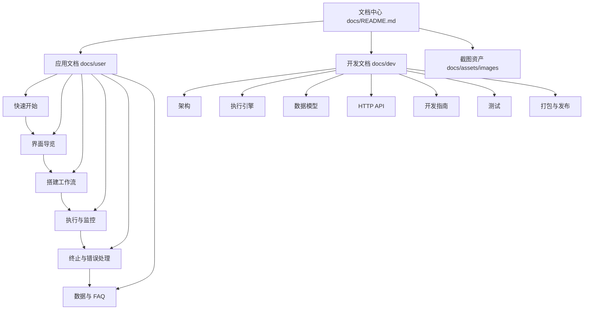

# 文档中心

[项目首页](../README.md) / 文档中心

本仓库文档分为两套：

- **应用文档**（`docs/user/`）——面向使用者，讲清楚怎么安装、怎么搭工作流、怎么执行与排障。
- **开发文档**（`docs/dev/`）——面向贡献者，讲清楚架构、执行引擎、数据与接口契约、测试与发布流程。

> 英文项目介绍见 [README.en.md](../README.en.md)（English）；仓库默认入口仍是中文版 [README.md](../README.md)。本目录下的用户/开发文档目前只有简体中文。

> 文档中的截图均来自真实运行的插件（隔离 `DSH_HOME` + Playwright 全链路 E2E），不是设计稿；
> 图片统一放在 [`docs/assets/images/`](assets/images/)，复现与更新方式见 [开发文档 · 测试](dev/testing.md)。

## 我该看哪一篇？

| 我想…… | 去看 |
| --- | --- |
| 先装上插件、跑通第一个工作流 | [快速开始](user/getting-started.md) |
| 认一认界面上的每个区域 | [界面导览](user/interface.md) |
| 搞懂节点、连线、提示词与各属性字段 | [搭建工作流](user/building-workflows.md) |
| 理解串行/并行/网关的执行语义与日志 | [执行与监控](user/running-and-monitoring.md) |
| 正确终止运行、处理失败与跳过 | [终止与错误处理](user/stopping-and-errors.md) |
| 找到数据文件、备份迁移、查常见问题 | [数据与 FAQ](user/data-and-faq.md) |
| 参与开发、了解两半区架构 | [架构](dev/architecture.md)、[开发指南](dev/development.md) |
| 改调度逻辑或排查执行问题 | [执行引擎](dev/execution-engine.md) |
| 调接口或接入其它前端 | [HTTP API](dev/http-api.md) |
| 改持久化结构或迁移数据 | [数据模型](dev/data-model.md) |
| 跑测试、补 E2E、采集文档截图 | [测试](dev/testing.md) |
| 发版本、发 GitHub Release | [打包与发布](dev/packaging-and-release.md) |

## 文档地图

## 应用文档

| 文档 | 你会看到 |
| --- | --- |
| [快速开始](user/getting-started.md) | 四种安装方式、打开入口、第一个 A→B 工作流、安装验证 |
| [界面导览](user/interface.md) | 工具栏、节点面板、画布、消息窗口、属性区与空态、工作区配色、快捷键 |
| [搭建工作流](user/building-workflows.md) | 任务 / 判断 / 终止 / 并行网关 / 定时 / 动作 / 等待任务完成节点、添加与连线、属性字段逐项说明、执行前校验、从某个节点开始执行 |
| [执行与监控](user/running-and-monitoring.md) | 常见拓扑、定时自动触发、从节点开始执行的范围、判断/终止节点的提前结束、动作节点与等待任务、节点与运行状态、日志、并发上限、真实任务会话 |
| [终止与错误处理](user/stopping-and-errors.md) | 两种手动终止模式、判断/终止节点触发的提前结束、失败/跳过/取消的级联、错误定位 |
| [数据与 FAQ](user/data-and-faq.md) | 数据文件位置与结构、容量上限、备份迁移、卸载重装、已知限制 |

## 开发文档

| 文档 | 你会看到 |
| --- | --- |
| [架构](dev/architecture.md) | 浏览器半区 / 宿主半区、Cordis 服务注入、页面加载与数据流 |
| [执行引擎](dev/execution-engine.md) | DAG 调度算法、范围执行与校验、判断/终止节点与提前终止、定时调度器、动作执行、等待任务探测、并行网关、失败级联、两种停止模式、会话驱动 |
| [数据模型](dev/data-model.md) | `workflows.json` 全字段、运行记录、清洗规则、原子写、上限 |
| [HTTP API](dev/http-api.md) | 全部路由、请求/响应信封、错误码、准入栅栏 |
| [开发指南](dev/development.md) | 环境、目录、命令、本地联调、调试、编码与提交约定 |
| [测试](dev/testing.md) | 单元测试与 E2E 全链路、断言覆盖、证据采集、CI 边界 |
| [打包与发布](dev/packaging-and-release.md) | DSH 插件清单、四种安装方式、SemVer、tag 驱动的自动化发布与插件索引收录 |

## 界面截图资产

| 文件 | 画面 |
| --- | --- |
| [`panel-overview.png`](assets/images/panel-overview.png) | 三栏总览与画布空态 |
| [`add-node.png`](assets/images/add-node.png) | 点击节点卡新增节点 |
| [`inspector.png`](assets/images/inspector.png) | 属性区完整字段 |
| [`connect-edge.png`](assets/images/connect-edge.png) | 两节点之间的连线 |
| [`enter-no-run.png`](assets/images/enter-no-run.png) | 提示词内 `Enter` 只换行 |
| [`persistence.png`](assets/images/persistence.png) | 刷新后画布仍在（自动保存） |
| [`chain-run.png`](assets/images/chain-run.png) | `A → B` 串行执行成功 |
| [`gateway-graph.png`](assets/images/gateway-graph.png) | `A、B → 网关 → C` 拓扑 |
| [`gateway-run.png`](assets/images/gateway-run.png) | 网关汇合后执行完成 |
| [`stop-dialog.png`](assets/images/stop-dialog.png) | 终止对话框的两种模式 |
| [`stop-detach.png`](assets/images/stop-detach.png) | 仅停止工作流 |
| [`stop-cancel.png`](assets/images/stop-cancel.png) | 停止并终止运行中的任务 |
| [`failure.png`](assets/images/failure.png) | 失败节点与 ERROR 日志 |
| [`workspace-colors.png`](assets/images/workspace-colors.png) | 跨工作区提示条、卡片工作区分色与属性区配色设置 |
| [`run-from-node.png`](assets/images/run-from-node.png) | 从节点开始执行后的未执行节点、执行范围与启动日志 |

## 文档约定（贡献者）

- 简体中文、GitHub 风格 Markdown；UTF-8、LF、文件末尾留空行。
- 每篇开头写面包屑：应用文档 `[文档首页](../README.md) / [用户文档](README.md)`；开发文档把末段换成 `[开发文档](README.md)`。
- 截图写法：``，下一行 `*图 N：一句说明。*`；图号按文档系列连续编号（当前应用文档为图 1–15，新增截图顺延），同一张图不要在不同文档里重复编号。
- Mermaid 优先：节点文字包含括号、冒号、斜杠或中文标点时用双引号包起来，例如 `A["POST /api/run"]`。
- 相对链接必须指向真实存在的文件；路径示例用占位符，不写本机绝对路径。
- 涉及代码时给文件相对链接和行号，例如 `[lib/host/engine.js:425](../lib/host/engine.js#L429)`。
- 文档与代码的同步矩阵、截图更新流程见 [AGENTS.md](../AGENTS.md) 第 8、9 节。
