[文档首页](../README.md) / [开发文档](README.md)

# 开发文档

这套文档面向要**读懂、修改、测试或发布** `dsh-workflow-orchestrator` 的开发者。它不重复用户操作说明（那部分在 [用户文档](../user/README.md)），而是回答三个问题：

1. 这个插件由哪两半组成，DSH 是怎么把两半加载起来的？
2. 一次「执行」从点击按钮到真实任务会话结束，中间发生了什么？
3. 我要改代码 / 加测试 / 发版本，应该按什么顺序做、检查什么？

> 文档中的源码行号以仓库当前提交为准；示例路径均为仓库相对路径。

## 推荐阅读顺序

| 顺序 | 文档 | 你会得到 | 核心图 |
| --- | --- | --- | --- |
| 1 | [架构总览](architecture.md) | 宿主半区 / 浏览器半区、5 个注入服务、加载链路 | 分层 flowchart、bootstrap sequenceDiagram |
| 2 | [执行引擎](execution-engine.md) | DAG 调度、判断/终止节点与提前终止、并发与超时、停止语义、真实会话创建 | 状态机、调度决策 flowchart、单任务 sequenceDiagram |
| 3 | [数据模型](data-model.md) | `workflows.json` 结构、清洗规则、容量上限、原子写 | erDiagram、读写 flowchart |
| 4 | [HTTP API](http-api.md) | 全部路由、`{ok,value}` 信封、错误码、准入栅栏 | 请求 sequenceDiagram |
| 5 | [测试](testing.md) | 单测 / 集成 / E2E 分层、79 条断言、截图采集 | 测试金字塔 flowchart |
| 6 | [开发环境](development.md) | 目录结构、命令、link 联调、排障、编码与提交约定 | 开发循环 flowchart |
| 7 | [打包与发布](packaging-and-release.md) | 插件包结构、两种安装、SemVer、发布清单 | 发布流程 flowchart |

如果只想快速改一个 bug，最短路径是：读 [架构总览](architecture.md) 的「服务依赖」一节 → 找到对应文件 → 用 [开发环境](development.md) 的命令跑 `npm test` → 按 [测试](testing.md) 的加法补一个用例。

## 两条主线

```mermaid
flowchart TB
  subgraph A["主线一：插件运行原理"]
    A1["DSH 按 dsh.bundle.patch 加载宿主半区"] --> A2["apply(ctx) 创建 store / catalogs / engine / routes"]
    A2 --> A3["webServer 注册 /workflow-orchestrator 前缀路由"]
    A3 --> A4["浏览器半区经 __ModuleLoader__ 注册 slots 与侧栏入口"]
    A4 --> A5["面板 GET /api/state 加载画布与选项目录"]
    A5 --> A6["编辑节点，600ms 防抖后 POST /api/save"]
    A6 --> A7["POST /api/run 启动 DAG 调度"]
    A7 --> A8["sessionController 创建真实任务会话并等待 turn 结束"]
    A8 --> A9["运行记录 compact 后写回 workflows.json"]
  end
  subgraph B["主线二：参与贡献与发布"]
    B1["本地环境 + link 安装到开发 profile"] --> B2["修改 lib/ 与 test/"]
    B2 --> B3["npm test 与 npm run check"]
    B3 --> B4["按需跑 E2E 并采集文档截图"]
    B4 --> B5["更新 docs/user、docs/dev 与 CHANGELOG"]
    B5 --> B6["SemVer 版本号、git tag、GitHub Release"]
  end
```

## 代码地图

| 路径 | 职责 | 入口 |
| --- | --- | --- |
| [`lib/index.js`](../../lib/index.js) | 宿主半区插件入口：装配 store / catalogs / engine / routes，声明注入服务 | [`apply(ctx)`](../../lib/index.js#L47) |
| [`lib/host/engine.js`](../../lib/host/engine.js) | DAG 校验与调度、真实会话执行、日志与运行快照 | [`WorkflowEngine`](../../lib/host/engine.js#L311) |
| [`lib/host/store.js`](../../lib/host/store.js) | `workflows.json` 的读写、输入清洗、原子持久化、损坏恢复 | [`WorkflowStore`](../../lib/host/store.js#L198) |
| [`lib/host/routes.js`](../../lib/host/routes.js) | 前缀 JSON API、准入栅栏、请求体上限、错误信封 | [`createRouteHandler`](../../lib/host/routes.js#L71) |
| [`lib/host/catalogs.js`](../../lib/host/catalogs.js) | 工作区 / Agent 预设 / 权限预设 / 模型目录的实时聚合与 60s 缓存 | [`CatalogService`](../../lib/host/catalogs.js#L125) |
| [`lib/host/util.js`](../../lib/host/util.js) | 零依赖小工具：ID、截断、克隆、错误信息 | [`newId`](../../lib/host/util.js#L12) |
| [`lib/client.js`](../../lib/client.js) | 浏览器半区：一级页面、画布、属性面板、日志、轮询 | [`__ModuleLoader__.load`](../../lib/client.js#L12) |
| [`test/engine.test.mjs`](../../test/engine.test.mjs) | 调度语义单测（27 个） | 测试接缝 [`executeTask`](../../lib/host/engine.js#L317) |
| [`test/store-routes.test.mjs`](../../test/store-routes.test.mjs) | 存储往返、清洗、路由与准入栅栏（5 个） | 临时 `DSH_HOME` |
| [`tools/e2e-full.cjs`](../../tools/e2e-full.cjs) | 隔离 `DSH_HOME` 的全链路 E2E（79 条断言，配置全部走环境变量） | [`bootstrapEnvironment`](../../tools/e2e-full.cjs#L215) |
| [`tools/verify-package.mjs`](../../tools/verify-package.mjs) | 发布前包结构与仓库文件自检（`npm run check:package`） | [`check`](../../tools/verify-package.mjs#L29) |
| [`tools/check-docs.mjs`](../../tools/check-docs.mjs) | 文档相对链接、图片、Mermaid 与敏感内容自检（`npm run check:docs`） | [`checkDocument`](../../tools/check-docs.mjs#L80) |
| [`cordis.patch.yml`](../../cordis.patch.yml) | Bundle patch：向 profile 插入宿主半区的 loader 行 | [`- insert:`](../../cordis.patch.yml#L6) |
| [`package.json`](../../package.json) | 插件清单：`dsh.bundle` / `dsh.client` / `manifestVersion` / `exports` / `files` | [`dsh`](../../package.json#L29) |

## 事实来源

- **行为**：以 `lib/` 与 `test/` 的当前实现为准；文档中的阈值（并发 8、超时 6h、宽限 8s、日志上限等）都能在源码常量处找到引用。
- **接口**：HTTP 路由以 [`lib/host/routes.js`](../../lib/host/routes.js) 为准；面板实际调用点在同文件的注释与 [`lib/client.js`](../../lib/client.js) 的 `call()`。
- **DSH 侧契约**：插件只通过 Cordis 服务与 `window.__ModuleLoader__` 交互。仓库**没有声明** DSH 或 `peerDependencies` 版本，涉及 DSH 侧行为（slot 名称、`sessionController.prompt` 的 `mode` 取值等）时，文档会注明「需按 DSH 版本确认」。

## 相关文档

- [用户文档](../user/README.md)：安装、画布操作、执行与终止的实际使用说明。
- [仓库 README](../../README.md)：项目定位、界面概览与安装方式。
- [测试](testing.md)：新增用例与 E2E 复跑方式。
- [打包与发布](packaging-and-release.md)：发布前必须通过的检查与占位符替换清单。
