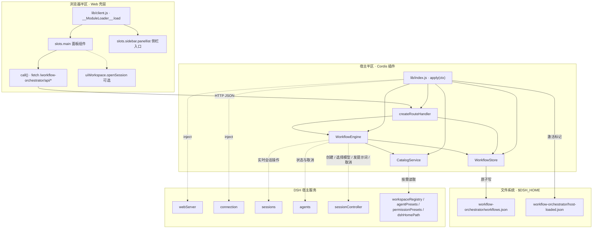
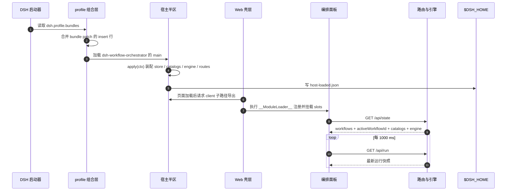

[文档首页](../README.md) / [开发文档](README.md)

# 架构总览

`dsh-workflow-orchestrator` 是一个同时包含**宿主半区**与**浏览器半区**的 DSH 插件：

- **宿主半区**是一个普通 Cordis 插件（[`lib/index.js`](../../lib/index.js)），在 DSH 进程内挂载 JSON API、持有工作流存储并驱动执行引擎。
- **浏览器半区**是一个 `window.__ModuleLoader__` 模块（[`lib/client.js`](../../lib/client.js)），在 Web 壳层里注册一级页面「工作流编排」与左侧栏入口。

两半区之间只通过 `/workflow-orchestrator/api/*` 的 JSON 通信，不共享模块、不互相 import，也没有构建产物。

## 1. 两半区与外部依赖



| 半区 | 运行位置 | 入口 | 职责 |
| --- | --- | --- | --- |
| 宿主半区 | DSH 桌面端 / `dsh web` 进程 | [`apply(ctx)`](../../lib/index.js#L47) | 路由、存储、DAG 调度、真实会话驱动 |
| 浏览器半区 | 渲染进程的 Web 页面 | [`window.__ModuleLoader__.load`](../../lib/client.js#L12) | 画布编辑、属性面板、日志显示、轮询运行状态 |

清单里两半区各自有明确开关：

- 宿主半区：`dsh.bundle.patch` 指向 [`cordis.patch.yml`](../../cordis.patch.yml)，`main` 指向 [`lib/index.js`](../../package.json#L6)。
- 浏览器半区：`dsh.client.platform = "web"`，并通过 `exports["./client"]` 暴露 [`lib/client.js`](../../package.json#L11)。两处声明见 [`package.json:29`](../../package.json#L29)。

## 2. 宿主半区：Cordis 插件

### 2.1 插件契约

宿主入口导出三个符号（[`lib/index.js`](../../lib/index.js)）：

| 导出 | 值 | 作用 |
| --- | --- | --- |
| `name` | `dsh-workflow-orchestrator` | Cordis 插件身份，与包名一致（[`lib/index.js:18`](../../lib/index.js#L18)） |
| `inject` | `webServer`、`connection`、`sessions`、`agents`、`sessionController` | 缺失则插件不激活（[`lib/index.js:21`](../../lib/index.js#L21)） |
| `apply` | 函数 | 装配依赖并注册效应（[`lib/index.js:47`](../../lib/index.js#L47)） |

`apply` 内部的装配顺序是固定的：

1. 创建 `WorkflowStore`、`CatalogService`、`WorkflowEngine`、`createRouteHandler`（[`lib/index.js:48`](../../lib/index.js#L48)）。
2. 把路由以**前缀**方式注册到宿主 Web 服务器：`ctx.webServer.register({ kind: 'prefix', path: ROUTE_PREFIX, handler })`（[`lib/index.js:58`](../../lib/index.js#L58)）。
3. 注册引擎生命周期效应，插件卸载时调用 `engine.dispose()`（[`lib/index.js:69`](../../lib/index.js#L69)）。
4. 写诊断用激活标记 `host-loaded.json`，失败静默（[`lib/index.js:24`](../../lib/index.js#L24)）；随后输出一条 `workflow-orchestrator: mounted (...)` 日志（[`lib/index.js:72`](../../lib/index.js#L72)）。

### 2.2 注入的 5 个服务

| 服务 | 使用点 | 用途 |
| --- | --- | --- |
| `webServer` | [`lib/index.js:59`](../../lib/index.js#L59) | 以前缀方式挂载 `/workflow-orchestrator`，返回 `dispose` |
| `connection` | [`lib/host/routes.js:75`](../../lib/host/routes.js#L75) | `requestRejection(req)` 准入栅栏，复用宿主的浏览器信任判定 |
| `sessions` | [`lib/host/engine.js:566`](../../lib/host/engine.js#L566) | 按会话 ID 取实时会话，读取事件与消息 |
| `agents` | [`lib/host/engine.js:659`](../../lib/host/engine.js#L659) | 读取 Agent 运行状态，判断「空闲」与超时 |
| `sessionController` | [`lib/host/engine.js:559`](../../lib/host/engine.js#L559)、[`:587`](../../lib/host/engine.js#L587)、[`:600`](../../lib/host/engine.js#L600)、[`:325`](../../lib/host/engine.js#L325) | 创建真实任务会话、选择模型、投递提示词、取消会话 |

### 2.3 按需读取的服务

这些服务**不写进 `inject`**，而是运行时 `ctx.get(...)` 读取并逐项降级——缺失时只有对应功能降级，不会让插件整体挂掉：

| 服务 | 读取点 | 缺失时的行为 |
| --- | --- | --- |
| `permissionPresets` | [`lib/host/engine.js:572`](../../lib/host/engine.js#L572)、[`lib/host/catalogs.js:148`](../../lib/host/catalogs.js#L148) | 应用权限预设失败只记 `warn`，沿用会话默认权限 |
| `dshHomePath` | [`lib/index.js:27`](../../lib/index.js#L27)、[`lib/host/store.js:30`](../../lib/host/store.js#L30) | 回退到环境变量 `DSH_HOME`，再回退到 `~/.dsh` |
| `workspaceRegistry` | [`lib/host/catalogs.js:146`](../../lib/host/catalogs.js#L146) | 工作区列表为空，`problems` 里记录 `workspaces` 失败 |
| `agentPresets` | [`lib/host/catalogs.js:147`](../../lib/host/catalogs.js#L147) | 「模式」下拉为空，默认模式缺失 |
| `sessionController.modelCatalog()` | [`lib/host/catalogs.js:172`](../../lib/host/catalogs.js#L172) | 模型目录为空，`modelFailures` 记录失败项 |
| `uiWorkspace`（浏览器半区） | [`lib/client.js:804`](../../lib/client.js#L804) | 「打开任务会话」退化为复制会话 ID 到剪贴板 |
| `slots`（浏览器半区） | [`lib/client.js:1571`](../../lib/client.js#L1571) | 无法注册页面，面板不出现 |

`CatalogService` 把四类目录聚合成一个快照，单项失败写入 `problems`，并缓存 60 秒（[`lib/host/catalogs.js:9`](../../lib/host/catalogs.js#L9)、[`:134`](../../lib/host/catalogs.js#L134)）。

## 3. 浏览器半区：ModuleLoader 模块

浏览器半区不是 npm 依赖，也不是 IIFE 包，而是壳层模块表的注册项（[`lib/client.js:12`](../../lib/client.js#L12)）：

- `factory(require)` 里的 `react` 由壳层模块表提供（[`lib/client.js:15`](../../lib/client.js#L15)），所以文件里没有 React 副本、没有 JSX、没有打包步骤。
- 插件对象导出 `{ name, inject: ['slots'], apply }`（[`lib/client.js:1571`](../../lib/client.js#L1571)）。
- `apply(ctx)` 先注入一份 `<style id="dsh-workflow-orchestrator-style">`（[`lib/client.js:1575`](../../lib/client.js#L1575)），再把同一个面板组件注册到两个 slot：
  - `slots.main`，key 为 `workflow-orchestrator`（[`lib/client.js:1585`](../../lib/client.js#L1585)）；
  - `slots.sidebar.panellist`，`order: 40`，标签函数返回「工作流编排」（[`lib/client.js:1588`](../../lib/client.js#L1588)）。
- 卸载时两个 slot 声明与样式都会被清理（[`lib/client.js:1599`](../../lib/client.js#L1599)）。

面板自身是三栏布局加底部日志（[`lib/client.js:83`](../../lib/client.js#L83) 的 CSS 网格；[`lib/client.js:1505`](../../lib/client.js#L1505) 的渲染树）：左侧节点卡片、中间画布 + 消息窗口、右侧属性区。

### 3.1 API 调用方式

```js
const API_ROOT = 'workflow-orchestrator/api'   // lib/client.js:23
fetch(apiUrl(`${API_ROOT}/${name}`), { ... })  // lib/client.js:207
```

- `apiUrl()` 以页面 `document.baseURI` 为基准解析相对路径，因此插件不假设自己挂在站点根目录（[`lib/client.js:197`](../../lib/client.js#L197)）。
- `call()` 统一 `credentials: 'same-origin'`，并把非 `{ ok: true }` 的响应转成 `Error`（[`lib/client.js:206`](../../lib/client.js#L206)）。

## 4. 安装与加载链路



加载链路的三个关键点：

1. **profile 组合**：插件以包名加入 profile 的 `dsh.profile.bundles`（或由插件管理器以 `link:` 安装），DSH 组合 bundle patch 时把 [`cordis.patch.yml`](../../cordis.patch.yml) 的 `insert` 行插进 Loader 配置。行 `id` 是 `workflow-orchestrator`，`name` 是包名 `dsh-workflow-orchestrator`。
2. **宿主先于页面**：宿主半区随 DSH 进程启动；如果宿主没加载，页面上的 `/api/*` 全部 404，日志里也不会有 `workflow-orchestrator: mounted`。
3. **页面按需挂载**：侧栏出现「工作流编排」后，点击才真正渲染面板组件；面板首次渲染时 `GET /api/state`，若存储里一个工作流都没有，会立刻 `POST /api/create` 建一个「工作流 1」（[`lib/client.js:403`](../../lib/client.js#L403)）。

## 5. 数据与控制流

### 5.1 编辑与保存

- 画布、节点、属性区的每次修改都走 `updateWorkflow()`（[`lib/client.js:463`](../../lib/client.js#L463)），只改内存并调用 `scheduleSave()`。
- `scheduleSave()` 做 **600 ms 防抖**（[`lib/client.js:384`](../../lib/client.js#L384)），随后 `POST /api/save`（[`lib/client.js:371`](../../lib/client.js#L371)）。
- 切换工作流前先 `flushSave()`，再 `POST /api/active` 记住当前视图（[`lib/client.js:472`](../../lib/client.js#L472)）。

### 5.2 执行

- 点击「执行」：先 `flushSave()`，再 `POST /api/run`，请求体同时带 `workflowId` 与当前画布快照 `workflow`（[`lib/client.js:769`](../../lib/client.js#L769)）。
- 宿主侧 `engine.start()` 会**用提交的覆盖版本先保存一次**，然后校验、建运行记录、异步调度（[`lib/host/engine.js:256`](../../lib/host/engine.js#L256)）。
- 终止：`POST /api/stop`，带 `runId` 与 `cancelTasks`（[`lib/client.js:785`](../../lib/client.js#L785)）。

### 5.3 轮询

- 面板只轮询**运行状态**，从不轮询可编辑的工作流定义（源码注释见 [`lib/client.js:436`](../../lib/client.js#L436)）；间隔固定 1000 ms（[`lib/client.js:447`](../../lib/client.js#L447)）。
- 每次 `GET /api/run` 返回 `{ run, engine }`，面板用 `engine` 整体替换本地运行视图（[`lib/client.js:441`](../../lib/client.js#L441)）。
- 运行状态里的 `log` 是**内存中最近日志的切片**；持久化记录是更小的 compact 版本，两者差异见 [数据模型](data-model.md)。

### 5.4 持久化

- 所有工作流定义与最近运行记录都在一个文件里：`$DSH_HOME/workflow-orchestrator/workflows.json`（[`lib/host/store.js:27`](../../lib/host/store.js#L27)）。
- 写入串行化并原子提交：临时文件 + `rename`（[`lib/host/store.js:282`](../../lib/host/store.js#L282)）。
- 同一个 `DSH_HOME` 被两个 DSH 实例同时使用时没有跨进程锁，属于**最后写入者胜**；这是当前实现的明确边界。

## 6. 生命周期与错误边界

| 场景 | 行为 |
| --- | --- |
| 插件卸载 | 注销 Web 路由（[`lib/index.js:58`](../../lib/index.js#L58)）；`engine.dispose()` 对未停止的运行发起 `cancel-tasks` 停止（[`lib/host/engine.js:336`](../../lib/host/engine.js#L336)） |
| 页面关闭 / 组件卸载 | 清除保存定时器、轮询定时器；槽位声明由插件效应统一释放（[`lib/client.js:1599`](../../lib/client.js#L1599)） |
| 路由内业务异常 | 统一 `400 workflow-error`（[`lib/host/routes.js:180`](../../lib/host/routes.js#L180)） |
| 选项目录失败 | `buildState` 用空目录 + `problems` 兜底（[`lib/host/routes.js:52`](../../lib/host/routes.js#L52)）；面板在无工作区时显示横幅提示（[`lib/client.js:1517`](../../lib/client.js#L1517)） |
| 状态文件损坏 | 改名 `.corrupt-<时间戳>` 后以空状态启动（[`lib/host/store.js:208`](../../lib/host/store.js#L208)） |

## 7. 待按 DSH 版本确认的契约

仓库没有声明 DSH 版本或 `peerDependencies`，以下属于**宿主侧契约**，跨 DSH 版本可能变化：

- `ctx.webServer.register({ kind: 'prefix', ... })` 的返回是否始终可调用。
- `connection.requestRejection(req)` 的签名与返回值语义。
- `sessionController.create / selectModel / prompt / cancel` 的参数形状；其中 `prompt` 使用 `mode: 'queue'` 与 `AbortSignal`（[`lib/host/engine.js:600`](../../lib/host/engine.js#L600)）。
- 会话事件 `turn/start`、`turn/end` 与 `turn/end.data.reason` 的结构（[`lib/host/engine.js:155`](../../lib/host/engine.js#L155)）。
- Web 壳层 slot 名称 `main` 与 `sidebar.panellist`（[`lib/client.js:1585`](../../lib/client.js#L1585)）。

遇到升级后行为异常，先核对以上几处，再检查宿主日志里是否有 `workflow-orchestrator:` 前缀的输出。

## 相关文档

- 下一步：[执行引擎](execution-engine.md)
- 数据格式：[数据模型](data-model.md)
- 接口契约：[HTTP API](http-api.md)
- 本地联调与排障：[开发环境](development.md)
