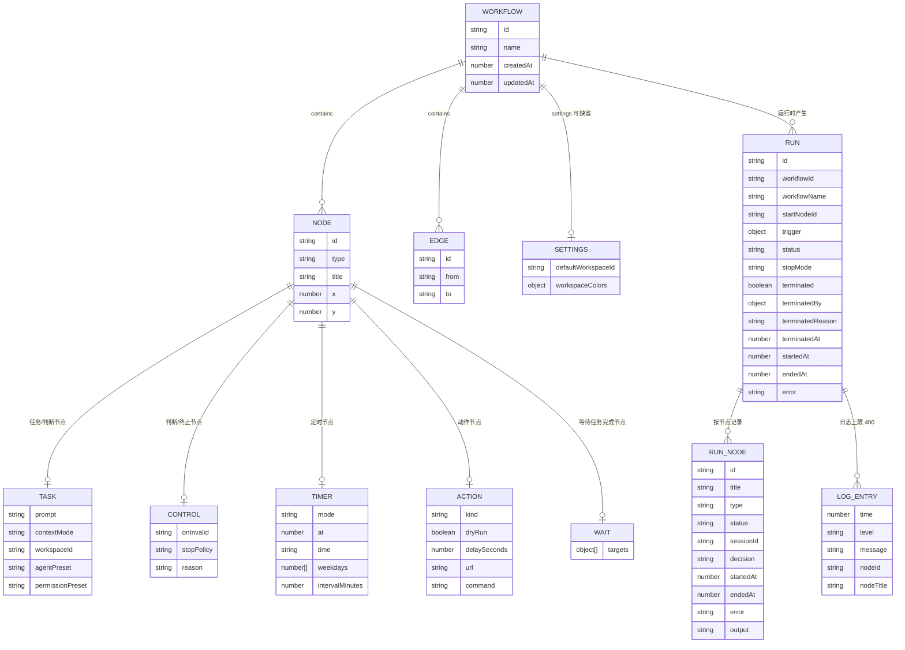
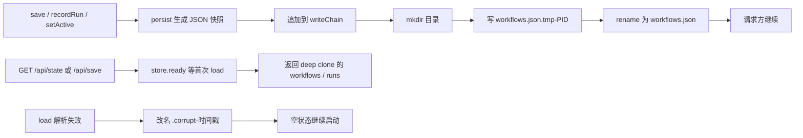

[文档首页](../README.md) / [开发文档](README.md)

# 数据模型

插件的全部持久化状态都在**一个 JSON 文件**里：

```text
$DSH_HOME/workflow-orchestrator/workflows.json
```

它同时保存工作流画布（定义）与最近若干次运行记录。另有一个独立的诊断文件 `host-loaded.json`（激活标记，不属于业务状态）。本文描述字段、清洗规则、容量上限与写入方式，全部对应 [`lib/host/store.js`](../../lib/host/store.js) 的当前实现。

## 1. 文件位置

`resolveDataFile(ctx)` 按以下顺序确定目录（[`lib/host/store.js:41`](../../lib/host/store.js#L39)）：

1. Cordis 服务 `dshHomePath()`（可选的按需服务，[`lib/host/store.js:45`](../../lib/host/store.js#L42)）；
2. 环境变量 `DSH_HOME`；
3. 用户主目录下的 `.dsh`。

文件名固定为 `workflow-orchestrator/workflows.json`，目录不存在时在首次写入前自动 `mkdir -p`。

诊断文件由宿主入口单独写入：`workflow-orchestrator/host-loaded.json`，内容为 `{ pid, plugin, loadedAt }`，失败静默，仅用于确认宿主半区是否激活（[`lib/index.js:24`](../../lib/index.js#L24)）。

## 2. 实体关系



`RUN.workflowId` 是逻辑引用：删除工作流时会把它的历史运行一并删掉（[`lib/host/store.js:440`](../../lib/host/store.js#L418)），但文件里没有外键约束。

`RUN_NODE.status` 取 7 种状态之一：`pending` / `running` / `completed` / `failed` / `cancelled` / `skipped` / `not-run`（未执行，仅范围执行时出现）。判断节点还会在节点状态里携带 `decision`（`CONTINUE` / `STOP`）。`SETTINGS.workspaceColors` 是可缺省的对象，最多 40 项。

## 3. 顶层结构

```json
{
  "version": 1,
  "activeWorkflowId": "wf-1a2b3c4d",
  "workflows": [],
  "runs": []
}
```

| 字段 | 类型 | 说明 |
| --- | --- | --- |
| `version` | number | 当前常量 `STATE_VERSION = 1`（[`lib/host/store.js:21`](../../lib/host/store.js#L21)）。读取时不校验旧值，写回总是 1，暂无迁移逻辑 |
| `activeWorkflowId` | string \| null | 面板上次显示的工作流；加载时若指向不存在的工作流，回退到第一个或 `null`（[`lib/host/store.js:383`](../../lib/host/store.js#L361)） |
| `workflows` | object[] | 工作流定义数组，文档顺序即面板下拉顺序 |
| `runs` | object[] | 已完成运行的 compact 记录，最旧在前 |

## 4. 工作流定义

### 4.1 完整示例

```json
{
  "version": 1,
  "activeWorkflowId": "wf-1a2b3c4d",
  "workflows": [
    {
      "id": "wf-1a2b3c4d",
      "name": "示例工作流",
      "createdAt": 1760000000000,
      "updatedAt": 1760000000000,
      "nodes": [
        {
          "id": "node-a",
          "type": "task",
          "title": "任务 1",
          "x": 80,
          "y": 120,
          "task": {
            "prompt": "总结这份报告",
            "contextMode": "full",
            "workspaceId": "workspace-1",
            "agentPreset": "standard",
            "permissionPreset": "danger-full-access",
            "model": {
              "provider": "example-provider",
              "model": "example-model",
              "reasoningEffort": "high"
            }
          }
        },
        {
          "id": "node-j",
          "type": "judge",
          "title": "判断是否继续",
          "x": 360,
          "y": 120,
          "task": {
            "prompt": "评估总结是否已经覆盖关键结论，足以支撑后续写作。",
            "contextMode": "full"
          },
          "control": {
            "onInvalid": "continue",
            "stopPolicy": "detach"
          }
        },
        {
          "id": "node-t",
          "type": "terminate",
          "title": "提前结束",
          "x": 640,
          "y": 120,
          "control": {
            "stopPolicy": "detach",
            "reason": "报告已足够，不再继续"
          }
        },
        {
          "id": "gw-1",
          "type": "parallel",
          "title": "并行网关",
          "x": 360,
          "y": 240
        },
        {
          "id": "node-c",
          "type": "task",
          "title": "任务 2",
          "x": 640,
          "y": 240,
          "task": {
            "prompt": "基于总结起草正文",
            "contextMode": "summary"
          }
        }
      ],
      "edges": [
        { "id": "edge-1", "from": "node-a", "to": "node-j" },
        { "id": "edge-2", "from": "node-j", "to": "node-t" },
        { "id": "edge-3", "from": "node-a", "to": "gw-1" },
        { "id": "edge-4", "from": "gw-1", "to": "node-c" }
      ],
      "settings": {
        "defaultWorkspaceId": "workspace-1",
        "workspaceColors": { "workspace-1": "#2563eb", "workspace-2": "#16a34a" }
      }
    }
  ],
  "runs": []
}
```

### 4.2 字段表

**Workflow**

| 字段 | 类型 | 清洗/默认规则 |
| --- | --- | --- |
| `id` | string | 缺失时 `newId('wf')`；保存已有工作流时沿用 previous 的 id（[`lib/host/store.js:273`](../../lib/host/store.js#L272)） |
| `name` | string | 空则「未命名工作流」，截断到 120 字 |
| `createdAt` | number | 优先 previous、其次 source 的数字，否则当前时间 |
| `updatedAt` | number | 每次 save 都刷新为当前时间 |
| `nodes` | Node[] | 最多 200 个，超出部分被丢弃 |
| `edges` | Edge[] | 最多 400 条；非法边被丢弃 |
| `settings` | object | 只保留非空的 `defaultWorkspaceId` 与合法的 `workspaceColors`，否则 `{}`（[`lib/host/store.js:285`](../../lib/host/store.js#L265)） |

**Node**

| 字段 | 类型 | 说明 |
| --- | --- | --- |
| `id` | string | 缺失或与前面节点重复时重新生成 `newId('node')`（[`lib/host/store.js:216`](../../lib/host/store.js#L216)） |
| `type` | `'task' \| 'parallel' \| 'judge' \| 'terminate' \| 'timer' \| 'action' \| 'wait'` | 其它值归一为 `task` |
| `title` | string | 空则「并行网关」/「判断节点」/「终止节点」/「定时节点」/「动作节点」/「等待任务完成」/「任务 N」，截断 80 字 |
| `x` / `y` | number | `clampNumber(...)`：x 限制在 -20000..20000，y 限制在 -20000..20000；非数字回退到 `index * 240` / `80` |
| `task` | object | **任务节点与判断节点**才有；其它节点没有该字段 |
| `control` | object | **判断节点与终止节点**才有；见下方 Control |
| `timer` | object | **定时节点**才有；见下方 Timer |
| `action` | object | **动作节点**才有；见下方 Action |
| `wait` | object | **等待任务完成节点**才有；见下方 Wait |

**Task**（任务节点与判断节点的内嵌对象，[`lib/host/store.js:94`](../../lib/host/store.js#L94)）

| 字段 | 类型 | 规则 |
| --- | --- | --- |
| `prompt` | string | 默认 `''`，截断到 200 000 字 |
| `contextMode` | `'full' \| 'summary' \| 'none'` | 其它值归一为 `full` |
| `workspaceId` | string | 可选；只接受非空字符串 |
| `agentPreset` | string | 可选；只接受非空字符串 |
| `permissionPreset` | string | 可选；只接受非空字符串 |
| `model` | object | 可选；必须同时有非空 `provider` 与 `model` 字符串，`reasoningEffort` 可选（[`lib/host/store.js:59`](../../lib/host/store.js#L59)） |

**Control**（判断节点与终止节点的内嵌对象，[`lib/host/store.js:113`](../../lib/host/store.js#L113)）

| 字段 | 类型 | 规则 |
| --- | --- | --- |
| `onInvalid` | `'continue' \| 'stop'` | 仅判断节点；其它值归一为 `continue`（判定输出无法识别时的兜底） |
| `stopPolicy` | `'detach' \| 'cancel-tasks'` | 判断/终止节点都有；其它值归一为 `detach`（提前终止时在途任务的处理方式） |
| `reason` | string | 判断/终止节点都有；可选，去掉首尾空白后最多 500 字，空字符串不写回 |

**Timer**（定时节点的内嵌对象，[`lib/host/store.js`](../../lib/host/store.js) 的 `sanitizeTimer`）

| 字段 | 类型 | 规则 |
| --- | --- | --- |
| `mode` | `'once' \| 'daily' \| 'weekly' \| 'interval'` | 其它值归一为 `daily` |
| `at` | number | 仅 `once`；epoch 毫秒，必须是有限正数，上限 2100-01-01；缺失时不写回（校验会提示） |
| `time` | string | `daily` / `weekly`；合法 `HH:mm`，非法值归一为 `03:00` |
| `weekdays` | number[] | 仅 `weekly`；ISO 星期（1=周一…7=周日），去重排序，最多 7 个；空数组会保存为 `[]`，运行前校验提示「至少选择一天」 |
| `intervalMinutes` | number | 仅 `interval`；1–10080，默认 60 |

只有当前 `mode` 对应的字段会被写回；切换模式时旧字段直接丢弃。注意**入口定时节点**（没有入边的 `timer`）是宿主调度器自动启动工作流的依据，流程中间的定时节点只影响本次运行。

**Action**（动作节点的内嵌对象，[`lib/host/store.js`](../../lib/host/store.js) 的 `sanitizeAction`）

| 字段 | 类型 | 规则 |
| --- | --- | --- |
| `kind` | `'shutdown' \| 'restart' \| 'sleep' \| 'lock' \| 'cancel-shutdown' \| 'open-url' \| 'open-path' \| 'run-command' \| 'http-request' \| 'log'` | 其它值归一为 `log` |
| `dryRun` | boolean | **缺失或非 `false` 一律为 `true`**：默认安全，只写日志、不产生真实动作 |
| `delaySeconds` | number | 仅 `shutdown` / `restart`；10–3600，默认 60 |
| `message` | string | 仅 `shutdown` / `restart`；可选，最多 200 字（系统关机提示） |
| `url` | string | 仅 `open-url` / `http-request`；最多 2000 字，运行时要求 http(s) |
| `method` | `'GET' \| 'POST' \| 'PUT' \| 'PATCH' \| 'DELETE'` | 仅 `http-request`；默认 `GET` |
| `body` | string | 仅 `http-request`；可选，最多 10 000 字，以 JSON 发送 |
| `path` | string | 仅 `open-path`；最多 2000 字 |
| `command` / `cwd` | string | 仅 `run-command`；命令最多 2000 字，`cwd` 可选 |
| `timeoutSeconds` | number | 仅 `run-command` / `http-request`；1–600，默认 60 |
| `text` | string | 仅 `log`；最多 500 字，默认「动作节点已执行」 |

**Wait**（等待任务完成节点的内嵌对象，[`lib/host/store.js`](../../lib/host/store.js) 的 `sanitizeWait`）

| 字段 | 类型 | 规则 |
| --- | --- | --- |
| `targets` | `{ id, title }[]` | 最多 30 个；`id` 是非空字符串的会话 ID，按 `id` 去重；`title` 最多 120 字，缺失时用 `id`；空数组保留（校验会提示还没有选择任务） |

运行时的定时/等待/动作状态只存在于内存快照（节点的 `timerState` / `waitState` / `actionState`），`compactRun()` 不持久化它们。

**Edge**（[`lib/host/store.js:253`](../../lib/host/store.js#L253)）

- `from` / `to` 必须是非空字符串且都指向已存在的节点；
- 禁止自环（`from === to`）；
- 相同 `from → to` 去重；
- `id` 缺失时生成 `newId('edge')`；
- 到达 400 条后停止接收。

**Settings**

| 字段 | 类型 | 清洗规则 |
| --- | --- | --- |
| `defaultWorkspaceId` | string | 可选；只接受非空字符串，否则整个键不写回（[`lib/host/store.js:283`](../../lib/host/store.js#L266)） |
| `workspaceColors` | object | 可选；键为非空工作区 ID，值为合法的十六进制颜色；`#rgb` 缩写会展开为 `#rrggbb` 并统一小写；最多 40 项，非法项丢弃；空对象不写回（[`lib/host/store.js:80`](../../lib/host/store.js#L78)） |

`settings` 里除这两个字段之外的任何键都会被丢弃。范围执行产生的 `run.startNodeId` 不是工作流定义字段，只存在于运行记录中，因此不经过 `sanitizeWorkflow`。

## 5. 运行记录

### 5.1 内存态与持久态

运行中引擎内部保存完整状态（含 `failureSeen`、`summary`、最新 800 行日志，见 [`lib/host/engine.js:1202`](../../lib/host/engine.js#L1202)）。运行结束后 `recordRun()` 调用 `compactRun()`（[`lib/host/store.js:284`](../../lib/host/store.js#L284)）写入文件：

| 字段 | 持久化 | 说明 |
| --- | --- | --- |
| `id`、`workflowId`、`workflowName`、`startedAt`、`endedAt` | 是 | 运行标识与终态 |
| `startNodeId` | 是 | `null` = 全量执行；字符串 = 本次「从节点开始执行」的起始节点 ID |
| `trigger` | 是 | `null` 或 `{ kind: 'timer', nodeId, nodeTitle, scheduledAt, mode }`：本次运行是否由入口定时节点自动触发、由哪个节点与计划时间触发（[`lib/host/store.js`](../../lib/host/store.js) 的 `compactTrigger`） |
| `status` | 是 | 运行终态；节点 `status` 可能是 `not-run` 或提前终止造成的 `skipped` |
| `stopMode` | 是 | `null` / `detach` / `cancel-tasks` |
| `terminated`、`terminatedBy`、`terminatedReason`、`terminatedAt` | 是 | 是否由判断/终止节点提前结束、由哪个节点触发、原因与时间（[`lib/host/store.js:316`](../../lib/host/store.js#L316)） |
| `error` | 是 | 截断 2000 字；成功提前结束时为 `null` |
| `nodes` | 是 | 每个节点保留 `id/title/type/status/sessionId/decision/startedAt/endedAt/error/output`；`not-run` 节点的 `endedAt` 为 `null`、无 `sessionId`；`decision` 仅判断节点有值；`error` 截断 2000 字，`output` 截断 4000 字 |
| `log` | 是 | 只保留最近 400 行 |
| `terminatedHadFailure`、`terminatedPolicy`、`failureSeen`、`stopRequested`、`active`、节点 `summary`、节点 `waitingForUser`、节点 `timerState` / `waitState` / `actionState` | 否 | 仅内存/接口快照使用（`terminatedHadFailure` 决定提前结束后整体是否仍算失败；`timerState` / `waitState` 供面板显示倒计时与等待进度） |

节点 `waitingForUser` 是「等待用户回复」子状态的负载：会话仍在等待 `ask_user_question` 的回答时为 `{ since, questions }`（`questions` 是问题文本的扁平数组，最多 10 条、每条截断 500 字），回答后或节点以任何方式落定时清回 `null`。它只在运行中的 `publicRun()` 快照里出现，`compactRun()` 不持久化它——历史记录里等待状态没有意义，等待片段只留在运行日志（「等待用户回复」/「的用户已回复，继续执行」两行）。

此外面板通过 `GET /api/run` 拿到的是 `publicRun()` 视图：补 `active = status === 'running'`，日志截最近 800 行（[`lib/host/engine.js:569`](../../lib/host/engine.js#L569)）。运行快照合并时只返回最近 10 条（[`lib/host/engine.js:623`](../../lib/host/engine.js#L623)）。

### 5.2 运行示例

```json
{
  "id": "run-1a2b3c4d",
  "workflowId": "wf-1a2b3c4d",
  "workflowName": "示例工作流",
  "startNodeId": null,
  "status": "completed",
  "stopMode": null,
  "terminated": false,
  "terminatedBy": null,
  "terminatedReason": null,
  "terminatedAt": null,
  "startedAt": 1760000001000,
  "endedAt": 1760000009000,
  "error": null,
  "nodes": {
    "node-a": {
      "id": "node-a",
      "title": "任务 1",
      "type": "task",
      "status": "completed",
      "sessionId": "session-example",
      "startedAt": 1760000001000,
      "endedAt": 1760000008000,
      "error": null,
      "output": "报告要点如下……"
    },
    "gw-1": {
      "id": "gw-1",
      "title": "并行网关",
      "type": "parallel",
      "status": "completed",
      "sessionId": null,
      "startedAt": null,
      "endedAt": 1760000009000,
      "error": null,
      "output": null
    }
  },
  "log": [
    { "time": 1760000001000, "level": "info", "message": "工作流「示例工作流」开始执行（2 个节点）" },
    { "time": 1760000001000, "level": "info", "message": "任务「任务 1」开始执行", "nodeId": "node-a", "nodeTitle": "任务 1" }
  ]
}
```

「从节点开始执行」的记录把 `startNodeId` 设为起始节点 id，范围外节点状态为 `not-run`，日志第一条是范围说明：

```json
{
  "id": "run-1a2b3c4d",
  "startNodeId": "node-b",
  "status": "completed",
  "nodes": {
    "node-a": { "id": "node-a", "title": "任务 A", "type": "task", "status": "not-run", "sessionId": null, "startedAt": null, "endedAt": null, "error": null, "output": null },
    "node-b": { "id": "node-b", "title": "任务 B", "type": "task", "status": "completed", "sessionId": "session-example", "startedAt": 1760000001000, "endedAt": 1760000006000, "error": null, "output": "……" }
  },
  "log": [
    { "time": 1760000001000, "level": "info", "message": "从节点「任务 B」开始执行：跳过 1 个不在下游范围内的节点" }
  ]
}
```

判断节点判定 STOP 或终止节点触发时，运行会写入提前终止字段，未启动节点变为 `skipped`：

```json
{
  "id": "run-terminated",
  "status": "completed",
  "terminated": true,
  "terminatedBy": { "nodeId": "node-j", "title": "判断是否继续" },
  "terminatedReason": "判断节点「判断是否继续」判定不再继续",
  "terminatedAt": 1760000005000,
  "error": null,
  "nodes": {
    "node-a": { "id": "node-a", "title": "任务 A", "type": "task", "status": "completed", "sessionId": "s-a", "output": "报告要点……" },
    "node-j": { "id": "node-j", "title": "判断是否继续", "type": "judge", "status": "completed", "sessionId": "s-j", "decision": "STOP", "output": "……\nWOF_DECISION: STOP" },
    "node-b": { "id": "node-b", "title": "任务 B", "type": "task", "status": "skipped", "sessionId": null, "error": "工作流已提前终止", "output": null }
  }
}
```

## 6. 输入清洗

客户端提交的任何内容都视为不可信。`sanitizeWorkflow(input, previous)`（[`lib/host/store.js:273`](../../lib/host/store.js#L256)）是所有写入路径的统一入口：

- `POST /api/save` → `store.save(body.workflow)`；
- `POST /api/create` → 构造空工作流后 `store.save(...)`；
- `POST /api/run` 带 `workflow` 覆盖 → `engine.start()` 内 `store.save(workflowOverride)`；
- 进程启动加载文件 → 对每条 raw workflow 再跑一遍清洗（[`lib/host/store.js:368`](../../lib/host/store.js#L353)）。

因此**手工改坏 JSON 通常不会让插件崩溃**：未知节点类型归一为 `task`、越界坐标被 clamp、坏边被丢弃、重复 ID 被重生成、缺失名称被补默认值、控制字段被归一为合法取值。`settings` 也一样：`defaultWorkspaceId` 只保留非空字符串，`workspaceColors` 只保留「非空工作区 ID → 合法十六进制颜色」的键值对，最多 40 项，非法项直接丢弃。

## 7. 容量上限

| 对象 | 上限 | 实现位置 | 超限行为 |
| --- | --- | --- | --- |
| 工作流 | 80 | [`lib/host/store.js:22`](../../lib/host/store.js#L22) | 保存时删最旧的；加载时只取前 80 个 |
| 每工作流节点 | 200 | [`lib/host/store.js:23`](../../lib/host/store.js#L23) | 超出节点被丢弃 |
| 每工作流连线 | 400 | [`lib/host/store.js:24`](../../lib/host/store.js#L24) | 超出边被丢弃 |
| 单节点提示词 | 200 000 字 | [`lib/host/store.js:25`](../../lib/host/store.js#L25) | 截断并补 `…` |
| 运行记录 | 20 | [`lib/host/store.js:26`](../../lib/host/store.js#L26) | 保存时删最旧的；加载时 `slice(-20)` |
| 工作区自定义颜色 | 40 | [`lib/host/store.js:27`](../../lib/host/store.js#L27) | 超出项被丢弃 |
| 单节点终止原因 | 500 字 | [`lib/host/store.js:28`](../../lib/host/store.js#L28) | 截断 |
| 持久化日志 | 400 行 | [`lib/host/store.js:348`](../../lib/host/store.js#L340) | `slice(-400)` |
| 动作关机提示 / 日志文字 | 200 / 500 字 | [`lib/host/store.js`](../../lib/host/store.js) | 截断 |
| 动作网址 / 路径 / 命令 | 2000 字 | [`lib/host/store.js`](../../lib/host/store.js) | 截断 |
| 动作 HTTP 请求体 | 10 000 字 | [`lib/host/store.js`](../../lib/host/store.js) | 截断 |
| 动作关机缓冲 / 超时 | 10–3600 秒 / 1–600 秒 | [`lib/host/store.js`](../../lib/host/store.js) | clamp |
| 等待目标 | 30 个 | [`lib/host/store.js`](../../lib/host/store.js) | 超出丢弃 |
| 单个等待目标标题 | 120 字 | [`lib/host/store.js`](../../lib/host/store.js) | 截断 |
| 定时一次性时间上界 | 2100-01-01 | [`lib/host/store.js`](../../lib/host/store.js) | clamp |
| 定时重复间隔 | 1–10080 分钟 | [`lib/host/store.js`](../../lib/host/store.js) | clamp |
| 请求体 | 2 MB | [`lib/host/routes.js:21`](../../lib/host/routes.js#L21) | 直接拒绝，返回 400 |
| 内存日志 | 800 行 | [`lib/host/engine.js:75`](../../lib/host/engine.js#L75) | 追加后裁剪 |
| 接口返回的运行 | 10 条 | [`lib/host/engine.js:623`](../../lib/host/engine.js#L623) | `slice(-10)` |
| 单个错误/输出文本 | 2000 / 4000 字 | [`lib/host/store.js:316`](../../lib/host/store.js#L316) | 截断 |
| 请求体 | 2 MB | [`lib/host/routes.js:21`](../../lib/host/routes.js#L21) | 直接拒绝，返回 400 |

## 8. 原子写与并发

`persist()`（[`lib/host/store.js:466`](../../lib/host/store.js#L444)）的写入模型：

1. 调用时立刻 `JSON.stringify(this.state, null, 2)` 生成快照字符串；
2. 挂到 `writeChain`（一条串行 Promise 链）末尾，保证同一进程内写入顺序；
3. 链上依次 `mkdir` 目录 → 写 `${file}.tmp-${pid}` → `rename` 覆盖正式文件；
4. 任一步失败只记 `warn` 日志，链本身吞掉异常，后续写入继续。



注意两点：

- 读取方拿到的都是 `cloneJson` 深拷贝（[`lib/host/store.js:405`](../../lib/host/store.js#L383)），修改返回值不会污染内存状态。
- 没有跨进程文件锁：两个 DSH 实例共享同一个 `DSH_HOME` 时是**最后写入者胜**。

## 9. 损坏文件处理

`load()` 的异常分支（[`lib/host/store.js:368`](../../lib/host/store.js#L346)）：

| 情况 | 行为 |
| --- | --- |
| 文件不存在（`ENOENT`） | 静默使用空状态，不告警 |
| JSON 解析失败 / 顶层不是对象 | 把文件改名为 `workflows.json.corrupt-<时间戳>` 留档，记一条 `warn`，然后用空状态启动 |
| 改名失败 | 忽略（best effort），仍然用空状态启动 |
| 字段缺失或类型错误 | 不视为损坏：逐字段清洗后继续 |

`activeWorkflowId` 在加载后还会再做一次引用校验，避免指向已删除的工作流。

## 10. 与界面/接口的对应关系

| 数据 | 面板读取方式 |
| --- | --- |
| 工作流列表、当前工作流、选项目录 | `GET /api/state` 一次性返回（[`lib/host/routes.js:52`](../../lib/host/routes.js#L52)） |
| 运行状态与日志 | 每 1000 ms `GET /api/run`（[数据流见架构](architecture.md#5-数据与控制流)） |
| 保存 | 画布编辑后 600 ms 防抖 `POST /api/save` |
| 新建/删除/切换 | `POST /api/create`、`/api/delete`、`/api/active` |

## 相关文档

- 调度如何消费这些字段：[执行引擎](execution-engine.md)
- 每个字段对应的接口：[HTTP API](http-api.md)
- 新增字段时要同步的文档：[开发环境](development.md#6-编码约定)
