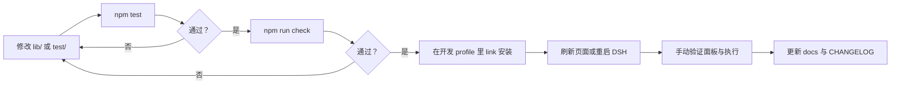

[文档首页](../README.md) / [开发文档](README.md)

# 开发环境与约定

本文把「第一次把仓库跑起来」和「日常改代码」需要的信息放在一起：环境要求、目录结构、命令、link 联调、排障，以及必须遵守的编码/提交/文档约定。

## 1. 环境要求

| 项 | 要求 | 依据 |
| --- | --- | --- |
| Node.js | `>=20`；仓库 `.nvmrc` 建议 22 | [`package.json:18`](../../package.json#L18)、[`.nvmrc`](../../.nvmrc) |
| DSH | 桌面端，或 `dsh web`（用于真实联调/E2E） | 插件通过 Cordis 服务运行，必须挂在 DSH profile 里 |
| Git | 任意近期版本 | 仓库按 GitHub 开源项目组织 |
| Playwright + Chromium | 仅 E2E 需要；脚本通过 `DSH_E2E_PLAYWRIGHT_CORE` / `CHROME_PATH` 定位，未设置时用 Playwright 自带浏览器 | [`tools/e2e-full.cjs`](../../tools/e2e-full.cjs) 顶部 |
| 模型凭据 | 仅 E2E 需要（真实模型轮次） | 环境变量 `DSH_E2E_*` 或 `DSH_E2E_CREDENTIALS` 指向的 `.credentials.yaml` |

E2E 的全部本机配置都走环境变量（`DSH_BIN`、`DSH_E2E_PLAYWRIGHT_CORE`、`CHROME_PATH`、`DSH_E2E_PROVIDER`、`DSH_E2E_MODEL`、`DSH_E2E_BASE_URL`、`DSH_E2E_API_KEY_ENV`、`DSH_E2E_CREDENTIALS`），完整表格见[测试 · 本机化配置](testing.md#35-本机化配置环境变量)。

仓库**没有运行时依赖**，`npm test` / `npm run check` 不需要 `npm install`。不要为了跑测试引入第三方包，这是刻意的零依赖设计（[`lib/host/util.js:1`](../../lib/host/util.js#L1)）。

## 2. 目录结构

```text
dsh-plugin/
├─ lib/
│  ├─ index.js              宿主半区入口（Cordis 插件）
│  ├─ client.js             浏览器半区（__ModuleLoader__ 模块）
│  └─ host/
│     ├─ engine.js          DAG 调度与真实会话执行
│     ├─ store.js           workflows.json 存储、清洗、原子写
│     ├─ routes.js          /workflow-orchestrator/api/* 路由
│     ├─ catalogs.js        工作区/模式/权限/模型目录聚合
│     └─ util.js            零依赖小工具
├─ test/
│  ├─ engine.test.mjs       调度语义单测（12 个）
│  └─ store-routes.test.mjs 存储/清洗/路由/准入单测（5 个）
├─ tools/
│  ├─ e2e-full.cjs          隔离 DSH_HOME 的全链路 E2E
│  ├─ verify-package.mjs    发布前包结构与仓库文件自检
│  └─ check-docs.mjs        文档链接 / Mermaid / 敏感内容自检
├─ locale/                  zh.json / en.json（插件管理器标题与描述）
├─ docs/
│  ├─ README.md             文档首页
│  ├─ user/                 应用文档（面向使用者）
│  ├─ dev/                  开发文档（本目录）
│  └─ assets/images/        文档截图（15 张 PNG）
├─ cordis.patch.yml         bundle patch：插入宿主 loader 行
├─ package.json             插件清单与 npm scripts
├─ README.md                项目说明与安装
├─ AGENTS.md                仓库内编码代理约定
├─ LICENSE / CONTRIBUTING.md / CHANGELOG.md / .github/
└─ .e2e/ .e2e-home/ .probe/ internal/   本地证据与排障材料（已 gitignore）
```

## 3. 常用命令

| 命令 | 实际执行 | 用途 |
| --- | --- | --- |
| `npm test` | `node --test test/engine.test.mjs test/store-routes.test.mjs` | 单测全绿是提交前提（[`package.json:22`](../../package.json#L22)） |
| `npm run test:watch` | 同上加 `--watch` | 改引擎时边写边跑（[`package.json:23`](../../package.json#L23)） |
| `npm run test:e2e` | `node tools/e2e-full.cjs` | 真实 DSH + 浏览器 + 模型的全链路（[`package.json:24`](../../package.json#L24)） |
| `npm run check` | `node tools/verify-package.mjs && node tools/check-docs.mjs` | 包结构 + 文档自检（[`package.json:25`](../../package.json#L25)） |
| `npm run check:package` | `node tools/verify-package.mjs` | 只跑包结构/清单/仓库文件自检（[`package.json:26`](../../package.json#L26)） |
| `npm run check:docs` | `node tools/check-docs.mjs` | 只跑文档链接、Mermaid、敏感内容自检（[`package.json:27`](../../package.json#L27)） |
| `node --test` | Node 内置测试框架直接发现 `test/` | 想跑全部测试文件时可用 |

> `npm test` 的脚本里写死了两个测试文件。新增第三个测试文件后，必须同步修改 [`package.json:22`](../../package.json#L22) 的 `scripts.test`，否则 CI 与本地都不会执行到它。

E2E 的细节（隔离环境、断言、截图采集）见 [测试](testing.md)。`npm run check` 的检查项见 [打包与发布](packaging-and-release.md)。

## 4. 本地联调

### 4.1 方式一：插件管理器安装（推荐）

1. 启动 DSH 桌面端。
2. 打开 **设置 → 插件**（或左侧「插件」页），选择 **添加插件**。
3. 输入仓库目录的绝对路径（例如 `D:\path\to\dsh-workflow-orchestrator`）。
4. 插件会以 `link:` 方式加入当前 profile 并自动启用，Loader 行 id 为 `workflow-orchestrator`。
5. 左侧栏出现「工作流编排」一级页面即安装成功。

### 4.2 方式二：手动挂载

1. 把仓库目录链接进 profile 的 `node_modules`（Windows 用 junction，Linux/macOS 用 symlink）。
2. 在 profile 的 `package.json` 里把 `dsh-workflow-orchestrator` 追加到 `dsh.profile.bundles`。
3. 刷新页面；宿主半区若未热加载，重启 DSH。

具体路径与示例见 [README 的安装章节](../../README.md#安装)。

### 4.3 改完代码后如何生效

| 改动位置 | 生效方式 |
| --- | --- |
| `lib/client.js`、样式、面板交互 | 刷新页面（浏览器半区是页面加载时注册的） |
| `lib/index.js`、`lib/host/*.js` | 通常需要重启 DSH；是否支持宿主 HMR 取决于 DSH/profile 配置，当前仓库未声明 |
| `locale/*.json`、`package.json`、`cordis.patch.yml` | 重启 DSH；必要时在插件管理器里重新启用 |
| `docs/`、`README.md` | 无需重启 |

### 4.4 确认加载成功

- 宿主半区激活标记：`$DSH_HOME/workflow-orchestrator/host-loaded.json`，内容含 `pid`、`plugin`、`loadedAt`（[`lib/index.js:24`](../../lib/index.js#L24)）。
- 宿主日志出现 `workflow-orchestrator: mounted (/workflow-orchestrator)`（[`lib/index.js:72`](../../lib/index.js#L72)）。
- 直接请求 `GET /workflow-orchestrator/api/health` 返回 `{ ok: true, value: { pid, version: 1 } }`。

### 4.5 隔离环境联调

不想污染日常 profile 时，可以直接参考 E2E 的做法：独立 `DSH_HOME` + 独立端口 + profile 里 junction 本仓库 + 用 Playwright 驱动页面。脚本已经把生命周期都封装好了，见 [`tools/e2e-full.cjs`](../../tools/e2e-full.cjs)。



## 5. 排障

| 现象 | 先查什么 | 常见原因 |
| --- | --- | --- |
| 左侧栏没有「工作流编排」 | 插件管理器里 bundle 是否 `enabled/installed`；浏览器控制台有无模块加载错误 | 浏览器半区未加载、`exports["./client"]` 被改坏、profile 未重载 |
| 面板打开但请求全部 404 | `host-loaded.json` 是否存在、宿主日志是否有 `mounted` | 宿主半区没加载、路由前缀被改、Loader 行 `name` 与包名不一致 |
| 面板提示「当前没有可用工作区」 | `GET /api/state` 的 `catalogs.problems`、`catalogs.workspaces` | 宿主没有工作区，或 `workspaceRegistry` 不可用 |
| 保存失败 / 状态回退 | 宿主日志里的 `state write failed`、目录写权限 | `$DSH_HOME` 不可写、磁盘满、文件被杀软占用 |
| 状态文件损坏 | 目录下是否出现 `workflows.json.corrupt-<时间戳>` | 手工编辑出错或写入过程被杀；插件会以空状态启动，需要从备份恢复 |
| 任务一直不开始 | 运行日志里是否出现「已为任务 ... 创建会话」；8 秒后是否报「任务未能开始执行」 | Agent 预设/模型无效、会话未就绪、宿主侧准入拦截 |
| 权限/模型没生效 | 运行日志里的 `warn` | 权限预设或模型选择失败，插件已降级沿用默认值 |
| E2E 起不来 | 端口占用、Chrome 路径、`playwright-core` 路径、凭据文件 | 脚本顶部常量是**本机路径**，换机器要改；用 `--port` 换端口 |

日志统一前缀 `workflow-orchestrator:`（[`lib/host/engine.js:357`](../../lib/host/engine.js#L357)、[`lib/host/store.js:241`](../../lib/host/store.js#L241)），在 DSH 日志里直接搜这个前缀即可。

## 6. 编码约定

### 6.1 语言与风格

- **ESM**：`"type": "module"`，源码统一 `import` / `export`，没有 CommonJS。
- 2 空格缩进、单引号、行尾不加分号、LF 换行（`.editorconfig` / `.gitattributes` 已配置）。
- `lib/` 内注释与 JSDoc 用英文，面向用户的 UI 文案、错误信息用简体中文；不要混用风格。
- 文件头用块注释说明「这个模块为什么存在」，函数用单行 JSDoc 说明契约（现有代码风格可参考 [`lib/host/engine.js:1`](../../lib/host/engine.js#L1)）。

### 6.2 运行时零依赖

- 不引入第三方运行时依赖；`package.json` 里没有 `dependencies`。
- 宿主半区只通过 Cordis 服务拿能力，不 import DSH 包（[`lib/host/util.js:1`](../../lib/host/util.js#L1)）。
- 共享小工具放 [`lib/host/util.js`](../../lib/host/util.js)，不要复制粘贴。
- 浏览器半区的 `react` 来自壳层模块表（[`lib/client.js:15`](../../lib/client.js#L15)），不要自带 React、不要加打包步骤。

### 6.3 输入与安全

- 所有来自客户端的字段都要在 `sanitizeWorkflow` / `sanitizeTask` / `sanitizeEdges` 里清洗并 clamp（[`lib/host/store.js:139`](../../lib/host/store.js#L139)）。
- 新增路由必须：限制方法、复用 2 MB 请求体上限、先过 `connection.requestRejection`，并保持 `{ ok, value }` / `{ ok, error }` 信封（[`lib/host/routes.js:71`](../../lib/host/routes.js#L71)）。
- 不要放宽或绕过准入栅栏；不要把 API 挂到其他前缀。
- 日志用 `ctx.logger?.info/warn`；运行日志用 `engine.log()`，不要直接 `console.log`。

### 6.4 无构建步骤

源码就是发布物：`main` 指向 [`lib/index.js`](../../lib/index.js)，`exports` 指向源文件，`files` 白名单直接收录 `lib/`。新增文件时同步 `exports`（如需要）和 `files`，否则发布包会缺文件。

## 7. 提交规范

采用 [Conventional Commits](https://www.conventionalcommits.org/zh-hans/)：

```text
<type>(<scope>): <subject>
```

- `type`：`feat`、`fix`、`docs`、`test`、`chore`、`ci`、`refactor`、`perf`、`build`。
- `scope` 建议：`engine`、`store`、`routes`、`client`、`catalogs`、`docs`、`repo`、`ci`。
- 一个提交只做一件事；不要夹带无关格式化。
- 用户可见变更写入 `CHANGELOG.md` 的 `[Unreleased]`；版本号只改 `package.json` 与 `CHANGELOG.md` 两处（另见 [打包与发布](packaging-and-release.md#3-版本与-semver)）。
- 不要提交 `.e2e/`、`.e2e-home/`、`.probe/`、`internal/`、`node_modules/`、凭据与 Cookie。

## 8. 文档更新要求

改代码时必须同步对应文档（摘自 [`AGENTS.md`](../../AGENTS.md) 的同步矩阵）：

| 代码改动 | 必须同步 |
| --- | --- |
| 新增/重命名路由、错误码 | [HTTP API](http-api.md)；影响用户时同步 `docs/user/` |
| 字段、上限、文件格式 | [数据模型](data-model.md)、用户文档中的画布/属性说明 |
| 调度/停止/失败语义 | [执行引擎](execution-engine.md)、用户文档的运行与错误章节 |
| UI 文案、布局、交互 | `docs/user/` 对应页面与截图 |
| 安装方式、清单、版本 | `README.md`、[打包与发布](packaging-and-release.md)、`CHANGELOG.md` |
| 命令、工具、CI | `README.md`、本文、[测试](testing.md) |

文档写作规则：

- 简体中文、GitHub 风格 Markdown，UTF-8、LF、无 BOM、无 tab；
- 每篇开头有面包屑，代码引用带相对链接与行号；
- 不写本机绝对路径、token、Cookie、个人会话内容；路径示例用 `D:\path\to\...` 占位；
- 文档改动后至少跑 `npm run check`：`verify-package.mjs` 会检查 `docs/dev/README.md`、`docs/user/README.md`、截图数量等仓库级文件是否齐全（[`tools/verify-package.mjs:188`](../../tools/verify-package.mjs#L188)），`check-docs.mjs` 会扫描全仓库 Markdown 的相对链接、图片、Mermaid 代码块与敏感内容（[`tools/check-docs.mjs:80`](../../tools/check-docs.mjs#L80)）。

## 相关文档

- 测试分层与 E2E 机制：[测试](testing.md)
- 发布检查清单：[打包与发布](packaging-and-release.md)
- 架构与数据流：[架构总览](architecture.md)
