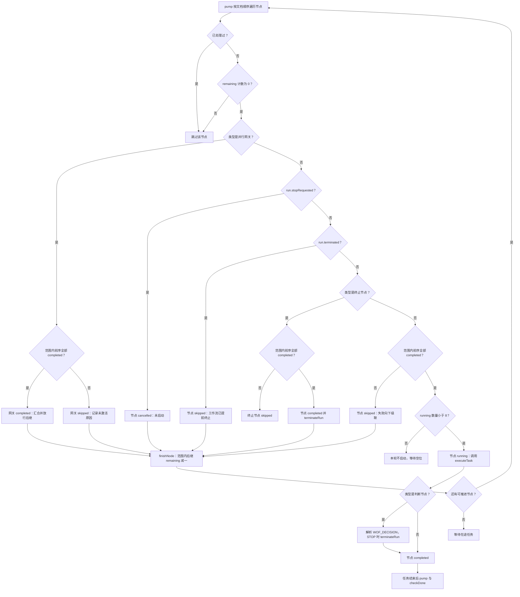
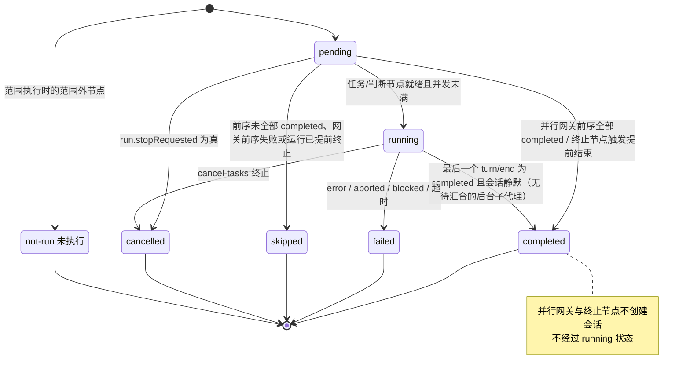
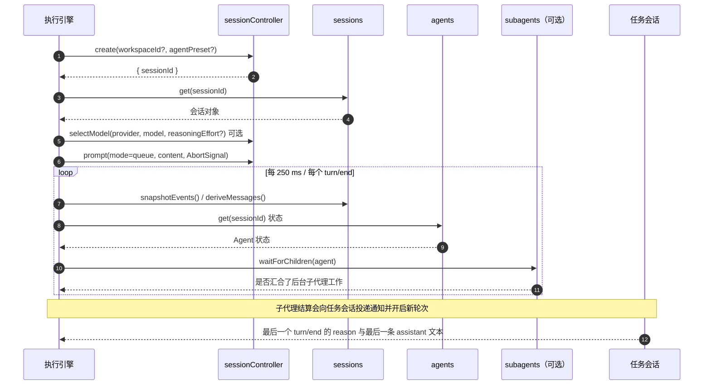

[文档首页](../README.md) / [开发文档](README.md)

# 执行引擎

执行引擎在 [`lib/host/engine.js`](../../lib/host/engine.js)，负责把一个工作流定义变成一次真实运行：校验 DAG、按依赖启动节点、通过 `sessionController` 创建真实任务会话、等待会话静默并收集最终结果、汇总运行状态并写回持久化记录。

本文只讲**调度与执行语义**；接口和数据格式分别见 [HTTP API](http-api.md) 与 [数据模型](data-model.md)。

## 1. 输入、快照与运行记录

`WorkflowEngine.start(workflowId, workflowOverride, options = {})` 的流程（[`lib/host/engine.js:371`](../../lib/host/engine.js#L371)）：

1. 等待存储就绪（`store.ready()`）。
2. 如果请求带了 `workflow` 覆盖版本，先 `store.save(workflowOverride)` 落盘并取得**深拷贝**；否则 `store.get(workflowId)`。因此**运行使用的是启动时快照**，运行中继续编辑画布不会影响本次运行。
3. 同一工作流已有活动运行时直接报错，避免重复执行（[`lib/host/engine.js:375`](../../lib/host/engine.js#L375)）。
4. 归一化 `options.startNodeId`：只有**非空字符串**才视为「从节点开始执行」，其它值（缺失 / `null` / 空串 / 非字符串）都按全量执行（[`lib/host/engine.js:377`](../../lib/host/engine.js#L377)）。
5. `validateWorkflow(workflow, { startNodeId })` 校验失败则抛错，路由层转成 `400 workflow-error`（[`lib/host/engine.js:380`](../../lib/host/engine.js#L380)）。
6. 创建运行记录：`startNodeId`（全量为 `null`）、`status: 'running'`、`stopRequested: false`、`terminated: false`、所有节点初始化为 `pending`、空日志（[`lib/host/engine.js:383`](../../lib/host/engine.js#L383)）。
7. 写启动日志：全量执行是 `工作流「<名称>」开始执行（N 个节点）`；范围执行是 `从节点「<起始节点标题>」开始执行：跳过 N 个不在下游范围内的节点`，两者只有一条（[`lib/host/engine.js:422`](../../lib/host/engine.js#L422)）。
8. 预取一次选项目录（失败不阻塞），然后异步启动调度器 `schedule(run, workflow, catalogs, startNodeId)`；`start()` 立即返回运行快照（[`lib/host/engine.js:434`](../../lib/host/engine.js#L434)）。

调度器抛出的非预期异常由 `abortRun()` 兜底：运行直接标记 `failed`、写一条错误日志、尝试持久化并从活动表移除（[`lib/host/engine.js:494`](../../lib/host/engine.js#L494)）。

## 2. 图构建、执行范围与校验

`buildGraph()` 把定义转成三张表：`nodeById`、`predecessors`、`successors`；端点不存在的边被忽略（[`lib/host/engine.js:81`](../../lib/host/engine.js#L81)）。

`executionScope(workflow, startNodeId)` 从起始节点沿 `successors` 做一次可达遍历，返回「起始节点 + 全部下游可达节点」的集合；起始节点不存在时返回空集合（[`lib/host/engine.js:99`](../../lib/host/engine.js#L99)）。范围执行时，调度与校验都只使用这个集合；全量执行不使用范围（等价于所有节点都在范围内）。

`validateWorkflow(workflow, options)` 在启动前给出人类可读的问题列表（[`lib/host/engine.js:117`](../../lib/host/engine.js#L117)）：

| 检查 | 范围执行时的差异 |
| --- | --- |
| 至少一个节点 | 不变 |
| 起始节点必须存在 | 仅范围执行检查；不存在报 `起始节点不存在：<id>` 并以它结束校验 |
| 任务/判断节点提示词非空 | 只检查**范围内**任务节点与判断节点 |
| 判断节点有输入连线、上游有可评估任务、上游上下文不是「完全不传」 | 只检查**范围内**判断节点；起点本身是判断节点时豁免「上游有可评估任务」要求 |
| 并行网关有入边和出边 | 只检查**范围内**网关；入边只看范围内的前序，起始节点本身是网关时豁免入边要求 |
| 终止节点有输入连线、没有输出连线 | 只检查**范围内**终止节点；起点本身是终止节点时豁免入边要求 |
| 无环 | Kahn 拓扑排序只跑**范围内子图**，访问数不等于范围内节点数即存在环路 |

注意两点：

- **校验与调度都不要求「所有节点都连通」**。没有范围内前序的节点会同时启动，这正是「不连线即并行」的实现基础。
- **范围外节点不参与校验**：范围外的空提示词、悬空网关、环路都不会阻塞范围执行。

## 3. 调度核心

调度器 `schedule(run, workflow, catalogs, startNodeId)`（[`lib/host/engine.js:569`](../../lib/host/engine.js#L569)）用一套很轻量的状态机驱动整个 DAG：

- `scope` / `inScope`：范围执行时的可达集合；全量执行时为 `undefined`（所有节点都在范围内）（[`lib/host/engine.js:571`](../../lib/host/engine.js#L571)）。
- `remaining`：每个节点还剩多少个**范围内**前序没有落定；范围外前序不计数（[`lib/host/engine.js:574`](../../lib/host/engine.js#L574)）。
- `not-run` 预置：范围外节点在调度开始前一次性写入 `status: 'not-run'`，直接计入 `settled`，**不经过 `finishNode()`**，因此不会错误递减范围内节点的 `remaining`（[`lib/host/engine.js:587`](../../lib/host/engine.js#L587)）。
- `started`：已经处理过的节点（启动、跳过、取消、未执行都算），保证每节点只处理一次。
- `running`：正在执行任务的节点集合，用于并发上限。
- `settled`：已经落定的节点数；`settled === 节点总数 && running.size === 0` 时运行结束（[`lib/host/engine.js:602`](../../lib/host/engine.js#L602)）。

`finishNode()` 是范围内节点唯一的「落定」入口：写节点状态、`settled++`、给**范围内**后继的 `remaining` 减一（下限 0）（[`lib/host/engine.js:606`](../../lib/host/engine.js#L606)）。

`pump()` 是可重入保护的启动循环：反复扫描节点，直到某一轮没有任何进展（[`lib/host/engine.js:626`](../../lib/host/engine.js#L626)）。它只把**范围内**前序当作前序；单个任务完成/失败后再次调用 `pump()`，把新就绪的节点放出去。



关键判定：

| 情况 | 结果 |
| --- | --- |
| 范围执行且节点在范围外 | 启动时即为 `not-run`，不创建会话、不写节点日志、不计入失败 |
| 范围执行且范围内节点没有范围内前序 | 视为可立即启动（不会被范围外前序阻塞） |
| 网关所有范围内前序 `completed` | 网关 `completed`，日志「已汇合（N 条分支）」 |
| 网关任一范围内前序未成功 | 网关 `skipped`，错误「前序分支未成功，网关未激活」 |
| 停止请求已发出（`detach` 或 `cancel-tasks`） | 尚未启动的节点 `cancelled`，不再启动 |
| 运行已被提前终止（`run.terminated`） | 尚未启动的节点 `skipped`，错误「工作流已提前终止」，不计入失败 |
| 终止节点范围内前序全部 `completed` | 终止节点 `completed`，触发 `terminateRun()` 提前结束运行 |
| 终止节点前序未全部成功 | 终止节点 `skipped`，错误「前序任务未成功完成」 |
| 判断节点前序未全部成功 | 判断节点 `skipped`，错误「前序任务未成功完成」 |
| 任务/判断节点范围内前序未全部成功 | 节点 `skipped`，错误「前序任务未成功完成」，并继续向下级联 |
| 任务/判断节点范围内前序全部成功且并发未满 | 节点 `running`；判断节点创建会话后还会解析判定 |
| 任务/判断节点范围内前序全部成功但并发已满 | 本轮不处理，等下一次 `pump()` |

并发上限是 `MAX_CONCURRENT_TASKS = 8`（[`lib/host/engine.js:54`](../../lib/host/engine.js#L54)）。判断节点会创建真实会话，因此同样占用并发名额；终止节点与并行网关不占名额。超出的就绪任务保持 `pending`，不会排队占位；只要有在途任务结束触发 `pump()`，就会按文档顺序补位。

## 4. 节点状态机



持久化与界面上的节点状态就是这 7 种（`pending` / `running` / `completed` / `failed` / `cancelled` / `skipped` / `not-run`）。运行整体状态另有 4 种：`running`、`completed`、`failed`、`cancelled`；提前结束的运行仍是 `completed` 或 `failed`，用运行记录的 `terminated` 标记区分（见第 8 节）。

判断节点像任务节点一样经历 `pending → running → completed/failed`，但它还会把判定结果写入节点状态的 `decision`（`CONTINUE` / `STOP`）。终止节点不创建会话，直接从 `pending` 变为 `completed`（触发提前结束）或 `skipped`（前序未成功）。

## 5. 单任务执行

任务节点的真实执行在 `executeTaskReal()`（[`lib/host/engine.js:808`](../../lib/host/engine.js#L808)）。测试通过构造函数选项 `executeTask` 替换它（[`lib/host/engine.js:317`](../../lib/host/engine.js#L317)），单元测试因此不需要启动 DSH。



### 5.1 创建会话

参数来源按优先级合并（[`lib/host/engine.js:808`](../../lib/host/engine.js#L808)）：

| 参数 | 优先级 |
| --- | --- |
| `workspaceId` | 节点 `task.workspaceId` → 工作流 `settings.defaultWorkspaceId` → 选项目录 `defaults.workspaceId` |
| `agentPreset` | 节点 `task.agentPreset` → 选项目录 `defaults.agentPreset` |
| `permissionPreset` | 节点 `task.permissionPreset` → 选项目录 `defaults.permissionPreset` |
| 模型 | 节点 `task.model` → 选项目录 `defaults.model` |

创建成功后必须拿到字符串 `sessionId`，否则抛「创建任务会话失败：未返回会话 ID」；随后把会话 ID 写进节点状态并记日志（[`lib/host/engine.js:821`](../../lib/host/engine.js#L821)）。

### 5.2 应用权限与模型

- 权限：调用 `permissionPresets.resolve(preset)` 与 `permissionPresets.set(session, preset)`；失败只记 `warn`，沿用会话默认权限（[`lib/host/engine.js:834`](../../lib/host/engine.js#L834)）。
- 模型：`sessionController.selectModel({ sessionId, provider, model, reasoningEffort? })`；失败同样只降级（[`lib/host/engine.js:849`](../../lib/host/engine.js#L849)）。

### 5.3 发送提示词

`composePrompt()` 组装最终文本（见第 6 节）；判断节点还会追加判定契约。然后用 `mode: 'queue'` 投递（[`lib/host/engine.js:855`](../../lib/host/engine.js#L855)）：

- 每个节点创建一个 `AbortController`，以 `runId::nodeId` 为键登记到 `promptSignals`；`finally` 中删除（[`lib/host/engine.js:860`](../../lib/host/engine.js#L860)）。
- 中止这个 signal 只会撤回**尚未被准入**的提示词，不会打断已经开始的轮次；真正的停会话由 `sessionController.cancel()` 负责。
- 提示词发送成功记一条带字数的日志（[`lib/host/engine.js:874`](../../lib/host/engine.js#L874)）。

### 5.4 等待完成：轮次边界与会话静默

`waitForTurn()`（[`lib/host/engine.js:900`](../../lib/host/engine.js#L900)）等到任务会话**真正静默**才返回，而不是「第一个轮次结束」就返回：

- 监听 `ctx.on('session/event')`：`turn/start` 记录开始时间；`turn/end` 且 `seq > startSeq` 时触发一次完成检查（[`lib/host/engine.js:1010`](../../lib/host/engine.js#L1010)）。
- 同时每 250 ms 轮询一次 `snapshotEvents()`，作为事件丢失时的兜底（[`lib/host/engine.js:1020`](../../lib/host/engine.js#L1020)）。
- `startSeq` 取自发送提示词前的 `session.seq`（[`lib/host/engine.js:856`](../../lib/host/engine.js#L856)），保证只认本轮之后结束的轮次。

一次完成检查必须同时满足以下条件（与 DSH headless 宿主的完成契约一致）：

1. `startSeq` 之后最近一个 `turn/end` 的 `reason.kind` 是 `completed`；失败/中止的轮次是终态，立即按失败落定，不再等待后台子任务，并尽力停止该回合留下的后台子代理（[`lib/host/engine.js:974`](../../lib/host/engine.js#L974)）；
2. `agents.get(sessionId)` 存在时其 `status === 'idle'`；会话已卸载（取不到 Agent）视为静默；
3. 宿主 `subagents` 服务可用时，`subagents.waitForChildren(agent)` 返回 `false`，即没有仍可汇合的后台子代理工作（[`lib/host/engine.js:988`](../../lib/host/engine.js#L988)）；
4. 检查期间 `session.seq` 没有变化，即没有新的完成通知或轮次插进来（[`lib/host/engine.js:1006`](../../lib/host/engine.js#L1006)）。

不满足就继续等待。后台子代理结算后，DSH 会向任务会话投递结算通知并开启新轮次；下一轮 `turn/end` 后重新检查，直到会话静默。若最后一个回合不是 `completed`，会立即按该回合落定；否则等到会话静默后，取 `startSeq` 之后**最后一个** `turn/end` 的 reason 作为任务结果，`output` 取最后一条 assistant 文本。

`readTurnOutcome()` 扫描事件，取最后一个 `turn/end`，映射 `reason.kind`（[`lib/host/engine.js:270`](../../lib/host/engine.js#L270)）：

| `reason.kind` | 任务结果 | 错误信息 |
| --- | --- | --- |
| `completed` | 成功 | 无 |
| `error` | 失败 | `code: message`（code 为 `UNKNOWN` 时只留 message） |
| `aborted` | 失败 | `已中止（<reason>）` |
| `blocked` | 失败 | `该轮被拦截（会话已归档或未通过准入）` |
| 其它 | 失败 | `轮次结束原因：<kind>` |

成功路径的 `output` 是最后一条 assistant 消息里的文本块拼接（[`lib/host/engine.js:235`](../../lib/host/engine.js#L235)）；派生失败（例如会话正在替换）按「无输出」处理。

### 5.5 后台子代理与完成判定

任务会话里的主 agent 可以用 `subagent` 等工具派发后台子代理，然后先输出一个阶段性结论并结束本轮。此时 `turn/end` 的 reason 仍是 `completed`，但主 agent 的工作并没有结束：子代理结算后宿主会投递完成通知，主 agent 会再开一轮汇总。**只认第一个 `turn/end` 会让下游节点在子代理还在跑时就提前启动**，并把阶段性结论当成任务输出；5.4 的静默检查就是为避免这一点。

实现要点：

- `subagents` 是**可选**宿主服务（`ctx.get('subagents')`）。服务缺失、没有 `waitForChildren` 方法或调用抛错时，等待退化为「第一个结束轮次」的旧行为，不会让任务失败；此时无法感知后台子代理，因此会记一条 `WARN` 日志（每个节点一次）避免静默退化。
- 回合以失败/中止结束时节点立即落定，并尽力停止该回合留下的后台子代理，避免留下无人消费的后台工作。
- 静默检查只针对**本轮之后**的会话状态：历史轮次、其他会话的事件都不参与。
- `cancel-tasks` 终止运行时，正在等待子代理的节点会取消任务会话，并尽力调用 `subagents.drainDescendants(agent)` 停止其后代，然后以「任务已被终止」失败；调度层按 `cancelled` 收尾（[`lib/host/engine.js:947`](../../lib/host/engine.js#L947)）。
- `detach` 终止运行时不打断等待：任务继续执行到静默结束，节点仍可变为「已完成」，整次运行最终记为「已停止」。

## 6. 上游上下文

`upstreamTaskNodes()` 沿前序反向遍历，**穿过并行网关、判断节点与终止节点**（控制节点对下游透明），收集最近的任务祖先（[`lib/host/engine.js:190`](../../lib/host/engine.js#L190)）；多个分支会得到多个上游任务，最终按工作流节点顺序返回。因此「任务 A → 判断节点 → 任务 B」中，B 拿到的仍是 A 的输出，判断节点的判定文本不会混进业务上下文。

`upstreamStates()` 只保留状态为 `completed` 的上游（[`lib/host/engine.js:798`](../../lib/host/engine.js#L798)），全量与范围执行都适用；因此「未执行」、范围外或未完成的上游不会进入下游提示词，也不会被当成有输出。

`composePrompt(node, upstreamStates, mode)` 的规则（[`lib/host/engine.js:212`](../../lib/host/engine.js#L212)）：

| 模式 | 行为 |
| --- | --- |
| `none` | 只发本节点自己的提示词 |
| `full`（默认） | 每个上游输出截断到 30 000 字（`MAX_CONTEXT_OUTPUT_CHARS`，[`lib/host/engine.js:57`](../../lib/host/engine.js#L57)），以「### 任务「标题」（会话 ID）」分块附在 `【上游任务输出】` 下 |
| `summary` | 每个上游只附会话 ID 与 800 字摘要，标题为 `【上游任务会话摘要】` |

没有输出或上游列表为空时直接返回自己的提示词；最终格式是：

```text
<自己的提示词>

---
【上游任务输出】
### 任务「任务 A」（会话 session-xxxx）
<输出正文>
---

```

## 7. 停止与取消

`stop(runId, { cancelTasks })`（[`lib/host/engine.js:439`](../../lib/host/engine.js#L439)）：

- 不传 `runId` 时取第一个活动运行；找不到抛「没有正在运行的工作流」。
- 重复请求直接返回当前快照，不重复取消。
- 设置 `stopRequested = true`，`stopMode` 为 `detach` 或 `cancel-tasks`，并记 `warn` 日志。

| 模式 | 对已运行任务 | 对未启动任务 | 最终运行状态 |
| --- | --- | --- | --- |
| `detach`（仅停止工作流） | 继续执行到结束，节点状态照常 `completed` / `failed` | `cancelled` | `cancelled` |
| `cancel-tasks`（并终止任务） | 先 abort 提示词准入信号，再 `sessionController.cancel({ sessionId })`；任务失败被归类为 `cancelled` | `cancelled` | `cancelled` |

`cancel-tasks` 只对 `status === 'running'` 的节点生效；`not-run` 节点本来就没有会话，不会被取消。插件卸载时 `dispose()` 会对所有未请求停止的活动运行发起一次 `cancel-tasks`。

手动停止与节点提前终止是两套语义：`stop()` 把运行记为 `cancelled`；判断/终止节点触发的提前结束记为 `completed`（或 `failed`，见第 8 节）。运行已经提前终止、仍在收尾时用户再点「终止」，仍按手动停止处理，最终状态变为 `cancelled`。

## 8. 判断节点、终止节点与提前终止

### 8.1 判断节点（`judge`）

判断节点创建一个真实任务会话，可配置的字段与任务节点完全相同（提示词、上游上下文、工作区、模式、权限、模型）。区别只在提示词与结果解释：

- `executeTaskReal()` 在 `composePrompt()` 的结果后追加判定契约 `VERDICT_CONTRACT`，要求模型在最后单独一行输出 `WOF_DECISION: CONTINUE` 或 `WOF_DECISION: STOP`。
- 轮次结束后由 `parseJudgeDecision()`（[`lib/host/engine.js:71`](../../lib/host/engine.js#L71)）解析输出：取**最后一次**匹配（忽略大小写，支持中英文冒号）。
- 判定 `STOP` → `applyJudgeDecision()` 调用 `terminateRun()` 提前结束本次运行；`CONTINUE` → 判断节点正常完成并放行后继。
- 没有识别到判定 → 按节点 `control.onInvalid` 处理（默认 `continue`），并记一条 `WARN`。
- 判定结果写入运行节点状态的 `decision`（`CONTINUE` / `STOP`），日志输出「判断节点「X」判定：继续 / 终止工作流」。
- 判断节点对下游上下文透明：下游任务仍拿被判断任务的上游输出，而不是判定文本。

### 8.2 终止节点（`terminate`）

终止节点不创建会话，到达即提前结束本次运行。它只有控制字段：

| 字段 | 默认 | 说明 |
| --- | --- | --- |
| `control.reason` | 无 | 终止原因，写入日志与运行记录 |
| `control.stopPolicy` | `detach` | `detach` 让在途任务继续跑完；`cancel-tasks` 同时请求取消在途任务会话 |

校验要求：至少 1 条输入连线，且**不允许输出连线**。

### 8.3 提前终止的运行语义

`terminateRun(run, node, reason)`（[`lib/host/engine.js:512`](../../lib/host/engine.js#L512)）：

1. 第一次终止生效，设置运行字段并记一条 `WARN`；后续判断节点再判 `STOP` 直接忽略。
2. 运行记录新增 `terminated`、`terminatedBy`（`{ nodeId, title }`）、`terminatedReason`、`terminatedAt`、`terminatedHadFailure`、`terminatedPolicy`。
3. 尚未启动的节点（任务、判断、网关、终止）在后续 `pump()` 中落定为 `skipped`，错误「工作流已提前终止」，**不计入失败**。
4. 在途任务按 `stopPolicy` 处理：`detach` 继续到结束；`cancel-tasks` 复用停止逻辑取消会话，节点按 `cancelled` 收尾。
5. `terminatedHadFailure` 在终止发生的那一刻快照 `run.failureSeen`：终止前已有真实失败 → 整体仍为 `failed`；终止之后在途任务才失败 → 只记节点 `failed`，不翻转整体成功状态。
6. 终止后整体状态：`stopRequested` 优先 → `cancelled`；否则 `terminatedHadFailure ? 'failed' : 'completed'`。
7. 收尾日志：成功提前结束时显示「工作流提前结束：由「X」触发（原因）」。

完整字段与清洗规则见 [数据模型](data-model.md)。

## 9. 超时与启动宽限

| 常量 | 值 | 作用 |
| --- | --- | --- |
| `NODE_TIMEOUT_MS` | 6 小时 | 最近一次轮次开始后，会话空闲（包括等待后台子代理结算）超过该时长 → 请求取消并失败 |
| `START_GRACE_MS` | 8 秒 | 提示词发出后 8 秒内既无 `turn/start` 又处于空闲 → 判定「任务未能开始执行」 |
| 轮询间隔 | 250 ms | `waitForTurn` 的兜底轮询与静默检查 |
| 总等待上限 | 6 小时 + 8 秒 | 超过即「任务等待超时」 |

判定「空闲」的依据是 `agents.get(sessionId)` 不存在，或其 `status !== 'running'`（[`lib/host/engine.js:1026`](../../lib/host/engine.js#L1026)）。等待后台子代理时主会话本身是空闲的，所以 6 小时超时按最近一次 `turn/start` 起算；即使该事件发生在等待注册监听之前，也会从会话事件日志补齐，避免只依赖总上限。`cancel-tasks` 终止会取消会话并尽力停止其后代。计时器调用了 `unref()`，不会单独阻止进程退出。

## 10. 运行归并与持久化

所有节点落定后：

- **整体状态**（优先级从高到低）：
  1. `stopRequested` → `cancelled`；
  2. `terminated` → `terminatedHadFailure ? 'failed' : 'completed'`（提前终止不算失败）；
  3. 任一节点 `failed` / `skipped` 或 `failureSeen` → `failed`；
  4. 否则 → `completed`。
  **`not-run` 不参与该判定**，因此范围执行中范围外节点不会把运行拖成失败；**提前终止造成的 `skipped` 也不参与**（由第 2 条提前返回）。
- **整体错误**：失败时拼接各 `failed` 节点的 `标题: 错误`；取消时写入对应的停止说明；成功提前结束时为 `null`，终止原因放在 `terminatedReason`。
- 关闭运行记录（`endedAt`），记一条总结日志，调用 `store.recordRun(run)` 做 compact 持久化；存储异常只忽略，不影响内存状态。compact 记录会保留 `startNodeId`、`terminated / terminatedBy / terminatedReason / terminatedAt`、节点 `not-run` 状态与判断节点 `decision`，面板下次轮询仍能还原执行范围与提前终止信息。
- 从活动表移除；面板下一次轮询会看到终态。

## 11. 日志与容量

- `engine.log()` 生成 `{ time, level, message, nodeId?, nodeTitle? }`，内存中最多保留 `MAX_LOG_LINES = 800` 行（[`lib/host/engine.js:357`](../../lib/host/engine.js#L357)）。
- 同时按级别转发到宿主日志：`error` 用 `logger.warn`，其余用 `logger.info`，前缀统一为 `workflow-orchestrator:`。
- 面板看到的运行快照会再截一次最近 800 行，并补 `active` 字段（[`lib/host/engine.js:304`](../../lib/host/engine.js#L304)）。
- 持久化时日志只留最近 400 行（compact 规则见 [数据模型](data-model.md)）。
- `snapshotRuns()` 把持久化记录、各工作流最新运行、活动运行合并，按开始时间排序后只留最近 10 条（[`lib/host/engine.js:326`](../../lib/host/engine.js#L326)）。

## 12. 测试接缝与已知限制

- 单测通过 `new WorkflowEngine(ctx, store, catalogs, { executeTask })` 注入假执行器，覆盖并行启动、串行、网关汇合、失败级联、两种停止模式、校验、prompt 组装、范围执行、判断节点（继续 / 终止 / 无效判定 / 判定解析）、终止节点（detach / cancel-tasks / 终止前后失败归并）、完成判定（后台子代理未结算 / 只认最后轮次 / 无 `subagents` 服务降级 / `waitForChildren` 抛错降级 / 终止等待中的任务）与上游上下文透传（详见 [测试](testing.md)）。
- 每个任务节点**只执行一次**：没有重试、循环、定时触发。
- 网关只有并行网关一种，只做汇合与扇出，不创建会话。
- 判断节点是**全局终止**语义：判定 STOP 结束整次运行；不能按判定结果走不同分支（那需要未来的排他网关 / 条件分支）。
- 运行期间画布可继续编辑，但运行使用启动时快照。
- 同一工作流同时只允许一个活动运行。
- **不做断点续跑**：范围执行只在本次运行跳过范围外节点，下一次全量执行仍会为所有任务节点新建会话。
- 判断节点的判定依赖模型按契约输出；解析失败时按 `onInvalid` 降级，不会静默丢节点。

## 相关文档

- 数据结构与容量上限：[数据模型](data-model.md)
- 触发执行与终止的接口：[HTTP API](http-api.md)
- 如何补调度用例：[测试](testing.md)
