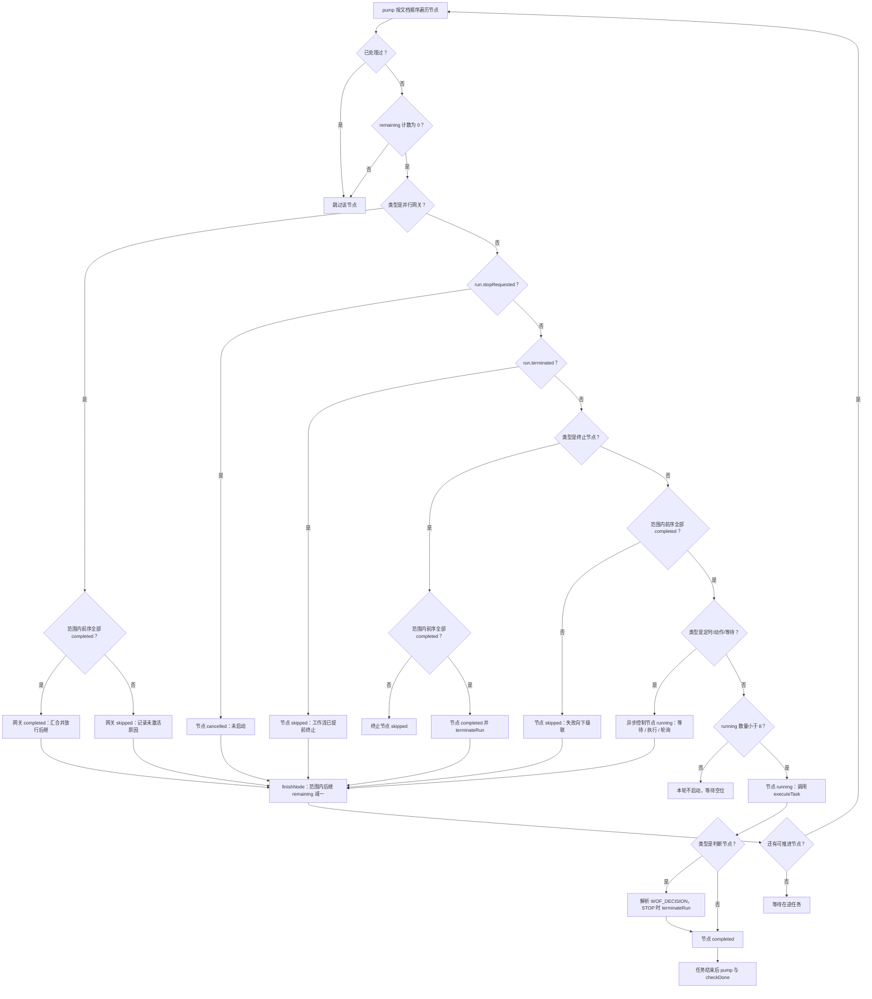
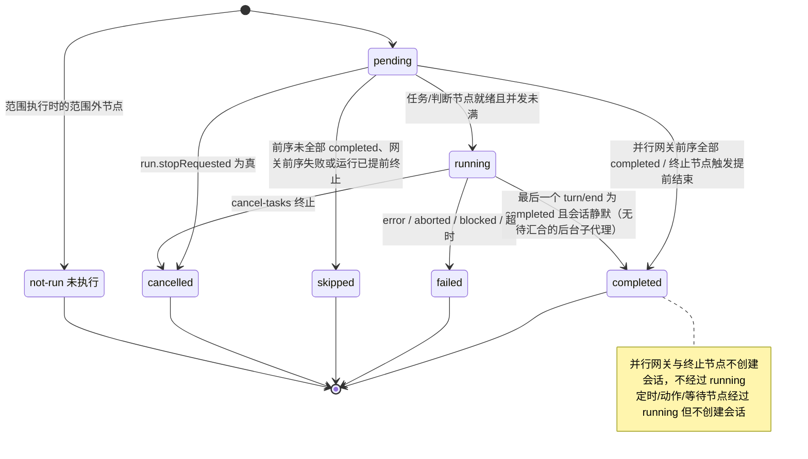
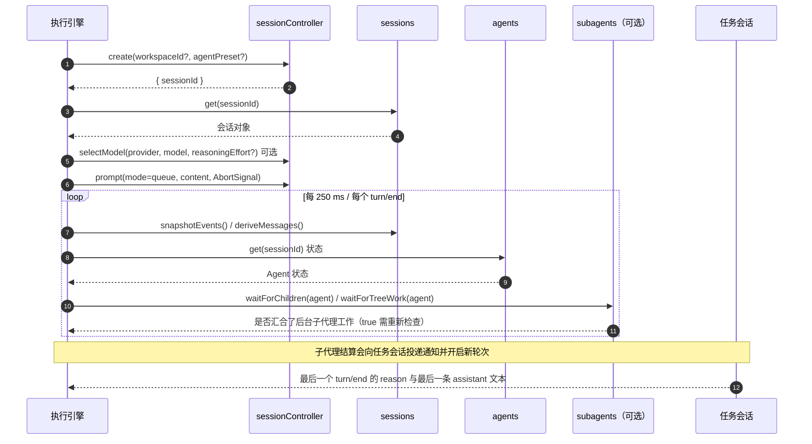

[文档首页](../README.md) / [开发文档](README.md)

# 执行引擎

执行引擎在 [`lib/host/engine.js`](../../lib/host/engine.js)，负责把一个工作流定义变成一次真实运行：校验 DAG、按依赖启动节点、通过 `sessionController` 创建真实任务会话、等待会话静默并收集最终结果、汇总运行状态并写回持久化记录。

除任务、判断、终止与并行网关外，引擎还执行三种**不创建任务会话的控制节点**：定时节点（`timer`，等待时间或触发调度）、动作节点（`action`，执行一次系统/网络动作）与等待任务完成节点（`wait`，轮询外部 DSH 任务直到真正结束）。入口定时节点还由引擎内的**定时调度器**驱动整个工作流自动启动。

本文只讲**调度与执行语义**；接口和数据格式分别见 [HTTP API](http-api.md) 与 [数据模型](data-model.md)。

## 1. 输入、快照与运行记录

`WorkflowEngine.start(workflowId, workflowOverride, options = {})` 的流程（[`lib/host/engine.js:1186`](../../lib/host/engine.js#L1186)）：

1. 等待存储就绪（`store.ready()`）。
2. 如果请求带了 `workflow` 覆盖版本，先 `store.save(workflowOverride)` 落盘并取得**深拷贝**；否则 `store.get(workflowId)`。因此**运行使用的是启动时快照**，运行中继续编辑画布不会影响本次运行。
3. 同一工作流已有活动运行时直接报错，避免重复执行（[`lib/host/engine.js:1190`](../../lib/host/engine.js#L1190)）。
4. 归一化 `options.startNodeId`：只有**非空字符串**才视为「从节点开始执行」，其它值（缺失 / `null` / 空串 / 非字符串）都按全量执行（[`lib/host/engine.js:1192`](../../lib/host/engine.js#L1192)）。`options.trigger` 只由调度器内部传入（`{ kind: 'timer', nodeId, nodeTitle, mode, scheduledAt }`），HTTP 路由不会透传。
5. `validateWorkflow(workflow, { startNodeId })` 校验失败则抛错，路由层转成 `400 workflow-error`（[`lib/host/engine.js:1195`](../../lib/host/engine.js#L1195)）。
6. 创建运行记录：`startNodeId`（全量为 `null`）、`trigger`（手动执行时 `null`）、`status: 'running'`、`stopRequested: false`、`terminated: false`、所有节点初始化为 `pending`、空日志（[`lib/host/engine.js:1202`](../../lib/host/engine.js#L1202)）。
7. 写启动日志：全量执行是 `工作流「<名称>」开始执行（N 个节点）`；范围执行是 `从节点「<起始节点标题>」开始执行：跳过 N 个不在下游范围内的节点`；自动触发再追加一条 `本次运行由定时节点「X」自动触发（计划时间 …）`（[`lib/host/engine.js:1243`](../../lib/host/engine.js#L1243)）。
8. 预取一次选项目录（失败不阻塞），然后异步启动调度器 `schedule(run, workflow, catalogs, startNodeId)`；`start()` 立即返回运行快照（[`lib/host/engine.js:1264`](../../lib/host/engine.js#L1264)）。

调度器抛出的非预期异常由 `abortRun()` 兜底：运行直接标记 `failed`、写一条错误日志、尝试持久化并从活动表移除（[`lib/host/engine.js:1331`](../../lib/host/engine.js#L1331)）。

## 2. 图构建、执行范围与校验

`buildGraph()` 把定义转成三张表：`nodeById`、`predecessors`、`successors`；端点不存在的边被忽略（[`lib/host/engine.js:120`](../../lib/host/engine.js#L120)）。

`executionScope(workflow, startNodeId)` 从起始节点沿 `successors` 做一次可达遍历，返回「起始节点 + 全部下游可达节点」的集合；起始节点不存在时返回空集合（[`lib/host/engine.js:138`](../../lib/host/engine.js#L138)）。范围执行时，调度与校验都只使用这个集合；全量执行不使用范围（等价于所有节点都在范围内）。

`validateWorkflow(workflow, options)` 在启动前给出人类可读的问题列表（[`lib/host/engine.js:227`](../../lib/host/engine.js#L227)）：

| 检查 | 范围执行时的差异 |
| --- | --- |
| 至少一个节点 | 不变 |
| 起始节点必须存在 | 仅范围执行检查；不存在报 `起始节点不存在：<id>` 并以它结束校验 |
| 任务/判断节点提示词非空 | 只检查**范围内**任务节点与判断节点 |
| 判断节点有输入连线、上游有可评估任务、上游上下文不是「完全不传」 | 只检查**范围内**判断节点；起点本身是判断节点时豁免「上游有可评估任务」要求 |
| 并行网关有入边和出边 | 只检查**范围内**网关；入边只看范围内的前序，起始节点本身是网关时豁免入边要求 |
| 终止节点有输入连线、没有输出连线 | 只检查**范围内**终止节点；起点本身是终止节点时豁免入边要求 |
| 定时节点有输出连线、定时配置合法（一次性时间未过期 / 每周至少一天 / 间隔合法） | 只检查**范围内**定时节点；无入边即入口定时节点 |
| 动作节点动作字段合法（网址、路径、命令、HTTP 方法、关机缓冲等） | 只检查**范围内**动作节点 |
| 等待任务完成节点至少选择一个任务、有输出连线 | 只检查**范围内**等待节点；它允许没有输入连线（作为起点先等外部任务） |
| 无环 | Kahn 拓扑排序只跑**范围内子图**，访问数不等于范围内节点数即存在环路 |

注意两点：

- **校验与调度都不要求「所有节点都连通」**。没有范围内前序的节点会同时启动，这正是「不连线即并行」的实现基础。
- **范围外节点不参与校验**：范围外的空提示词、悬空网关、环路都不会阻塞范围执行。

## 3. 调度核心

调度器 `schedule(run, workflow, catalogs, startNodeId)`（[`lib/host/engine.js:1410`](../../lib/host/engine.js#L1410)）用一套很轻量的状态机驱动整个 DAG：

- `scope` / `inScope`：范围执行时的可达集合；全量执行时为 `undefined`（所有节点都在范围内）（[`lib/host/engine.js:1412`](../../lib/host/engine.js#L1412)）。
- `remaining`：每个节点还剩多少个**范围内**前序没有落定；范围外前序不计数（[`lib/host/engine.js:1415`](../../lib/host/engine.js#L1415)）。
- `not-run` 预置：范围外节点在调度开始前一次性写入 `status: 'not-run'`，直接计入 `settled`，**不经过 `finishNode()`**，因此不会错误递减范围内节点的 `remaining`（[`lib/host/engine.js:1426`](../../lib/host/engine.js#L1426)）。
- `started`：已经处理过的节点（启动、跳过、取消、未执行都算），保证每节点只处理一次。
- `running`：正在执行**任务会话**的节点集合，用于并发上限；定时/动作/等待节点不占并发名额。
- `settled`：已经落定的节点数；`settled === 节点总数 && running.size === 0` 时运行结束（[`lib/host/engine.js:1443`](../../lib/host/engine.js#L1443)）。
- `controlCancels`：按运行与节点登记的异步控制节点取消回调（定时等待、等待任务轮询、动作执行）；停止或提前终止时由引擎统一触发，保证异步节点不会把运行挂到未来时间。

`finishNode()` 是范围内节点唯一的「落定」入口：写节点状态、`settled++`、给**范围内**后继的 `remaining` 减一（下限 0）（[`lib/host/engine.js:1447`](../../lib/host/engine.js#L1447)）。异步控制节点用受保护的 `settle` 包装同一个入口，保证「完成」与「被取消」只有一个生效。

`pump()` 是可重入保护的启动循环：反复扫描节点，直到某一轮没有任何进展（[`lib/host/engine.js:1696`](../../lib/host/engine.js#L1696)）。它只把**范围内**前序当作前序；单个任务完成/失败后再次调用 `pump()`，把新就绪的节点放出去。



关键判定：

| 情况 | 结果 |
| --- | --- |
| 范围执行且节点在范围外 | 启动时即为 `not-run`，不创建会话、不写节点日志、不计入失败 |
| 范围执行且范围内节点没有范围内前序 | 视为可立即启动（不会被范围外前序阻塞） |
| 网关所有范围内前序 `completed` | 网关 `completed`，日志「已汇合（N 条分支）」 |
| 网关任一范围内前序未成功 | 网关 `skipped`，错误「前序分支未成功，网关未激活」 |
| 停止请求已发出（`detach` 或 `cancel-tasks`） | 尚未启动的节点 `cancelled`，不再启动 |
| 运行已被提前终止（`run.terminated`） | 尚未启动的节点 `skipped`，错误「工作流已提前终止」，不计入失败 |
| 终止节点范围内前序全部 `completed` | 终止节点 `completed`，触发 `terminateRun()` 提前结束运行 |
| 终止节点前序未全部成功 | 终止节点 `skipped`，错误「前序任务未成功完成」 |
| 判断节点前序未全部成功 | 判断节点 `skipped`，错误「前序任务未成功完成」 |
| 任务/判断节点范围内前序未全部成功 | 节点 `skipped`，错误「前序任务未成功完成」，并继续向下级联 |
| 任务/判断节点范围内前序全部成功且并发未满 | 节点 `running`；判断节点创建会话后还会解析判定 |
| 任务/判断节点范围内前序全部成功但并发已满 | 本轮不处理，等下一次 `pump()` |
| 定时节点范围内前序全部成功 | 有入边的定时节点等待下一次触发时间；**无入边的入口定时节点**立即 `completed`（`trigger` 计划时间已到或手动执行） |
| 动作节点范围内前序全部成功 | `running`，调用动作执行器；不占用并发名额，完成后 `completed` 或 `failed` |
| 等待节点范围内前序全部成功 | `running`，异步轮询所选任务；全部真正完成才 `completed`，任一失败则 `failed` |

并发上限是 `MAX_CONCURRENT_TASKS = 8`（[`lib/host/engine.js:76`](../../lib/host/engine.js#L76)）。判断节点会创建真实会话，因此同样占用并发名额；终止节点与并行网关不占名额。超出的就绪任务保持 `pending`，不会排队占位；只要有在途任务结束触发 `pump()`，就会按文档顺序补位。

## 4. 节点状态机



持久化与界面上的节点状态就是这 7 种（`pending` / `running` / `completed` / `failed` / `cancelled` / `skipped` / `not-run`）。运行整体状态另有 4 种：`running`、`completed`、`failed`、`cancelled`；提前结束的运行仍是 `completed` 或 `failed`，用运行记录的 `terminated` 标记区分（见第 8 节）。

定时节点在等待触发期间、等待任务完成节点在轮询期间、动作节点在执行动作期间都保持 `running`，并分别携带 `timerState`（`waitUntil` / `firedAt`）、`waitState`（目标列表与进度）、`actionState` 负载供面板显示；停止/提前终止会把它们落定为 `cancelled` / `skipped`。

「等待用户回复」不是第 8 种节点状态，而是 `running` 的一个**子状态**：会话仍在等待 `ask_user_question` 的回答时，节点状态保持 `running`，同时携带 `waitingForUser` 负载（见 5.6）；面板据此把「运行中」显示为「等待用户回复」。调度语义完全不变——等待中的节点仍占用并发名额，`cancel-tasks` 也照常取消它的会话。

判断节点像任务节点一样经历 `pending → running → completed/failed`，但它还会把判定结果写入节点状态的 `decision`（`CONTINUE` / `STOP`）。终止节点不创建会话，直接从 `pending` 变为 `completed`（触发提前结束）或 `skipped`（前序未成功）。

## 5. 单任务执行

任务节点的真实执行在 `executeTaskReal()`（[`lib/host/engine.js:1891`](../../lib/host/engine.js#L1891)）。测试通过构造函数选项 `executeTask` 替换它（[`lib/host/engine.js:582`](../../lib/host/engine.js#L582)），单元测试因此不需要启动 DSH。



### 5.1 创建会话

参数来源按优先级合并（[`lib/host/engine.js:1891`](../../lib/host/engine.js#L1891)）：

| 参数 | 优先级 |
| --- | --- |
| `workspaceId` | 节点 `task.workspaceId` → 工作流 `settings.defaultWorkspaceId` → 选项目录 `defaults.workspaceId` |
| `agentPreset` | 节点 `task.agentPreset` → 选项目录 `defaults.agentPreset` |
| `permissionPreset` | 节点 `task.permissionPreset` → 选项目录 `defaults.permissionPreset` |
| 模型 | 节点 `task.model` → 选项目录 `defaults.model` |

创建成功后必须拿到字符串 `sessionId`，否则抛「创建任务会话失败：未返回会话 ID」；随后把会话 ID 写进节点状态并记日志（[`lib/host/engine.js:1904`](../../lib/host/engine.js#L1904)）。

### 5.2 应用权限与模型

- 权限：调用 `permissionPresets.resolve(preset)` 与 `permissionPresets.set(session, preset)`；失败只记 `warn`，沿用会话默认权限（[`lib/host/engine.js:1914`](../../lib/host/engine.js#L1914)）。
- 模型：`sessionController.selectModel({ sessionId, provider, model, reasoningEffort? })`；失败同样只降级（[`lib/host/engine.js:1932`](../../lib/host/engine.js#L1932)）。

### 5.3 发送提示词

`composePrompt()` 组装最终文本（见第 6 节）；判断节点还会追加判定契约。然后用 `mode: 'queue'` 投递（[`lib/host/engine.js:1938`](../../lib/host/engine.js#L1938)）：

- 每个节点创建一个 `AbortController`，以 `runId::nodeId` 为键登记到 `promptSignals`；`finally` 中删除（[`lib/host/engine.js:1943`](../../lib/host/engine.js#L1943)）。
- 中止这个 signal 只会撤回**尚未被准入**的提示词，不会打断已经开始的轮次；真正的停会话由 `sessionController.cancel()` 负责。
- 提示词发送成功记一条带字数的日志（[`lib/host/engine.js:1957`](../../lib/host/engine.js#L1957)）。

### 5.4 等待完成：轮次边界与会话静默

`waitForTurn()`（[`lib/host/engine.js:1992`](../../lib/host/engine.js#L1992)）等到任务会话**真正静默**才返回，而不是「第一个轮次结束」就返回：

- 监听 `ctx.on('session/event')`：`turn/start` 记录开始时间；`turn/end` 且 `seq > startSeq` 时触发一次完成检查（[`lib/host/engine.js:2165`](../../lib/host/engine.js#L2165)）。
- 同时每 250 ms 轮询一次 `snapshotEvents()`，作为事件丢失时的兜底（[`lib/host/engine.js:2175`](../../lib/host/engine.js#L2175)）。
- `startSeq` 取自发送提示词前的 `session.seq`（[`lib/host/engine.js:1939`](../../lib/host/engine.js#L1939)），保证只认本轮之后结束的轮次。

一次完成检查必须同时满足以下条件（与 DSH headless 宿主的完成契约一致）：

1. `startSeq` 之后最近一个 `turn/end` 的 `reason.kind` 是 `completed`；失败/中止的轮次是终态，立即按失败落定，不再等待后台子任务，并尽力停止该回合留下的后台子代理（[`lib/host/engine.js:2125`](../../lib/host/engine.js#L2125)）；
2. `agents.get(sessionId)` 存在时其 `status === 'idle'`；会话已卸载（取不到 Agent）视为静默；
3. 宿主 `subagents` 服务可用时，`subagents.waitForChildren(agent)`（返回“仍有工作”）或较新宿主的 `waitForTreeWork(agent)`（返回“已汇合工作、需要重新检查”）都不再报告需要等待的子代理工作；
4. 会话没有仍在等待用户回答的提问（见 5.6）；等待用户期间不落定，节点显示「等待用户回复」；
5. 检查期间 `session.seq` 没有变化，即没有新的完成通知或轮次插进来（[`lib/host/engine.js:2161`](../../lib/host/engine.js#L2161)）。

不满足就继续等待。后台子代理结算后，DSH 会向任务会话投递结算通知并开启新轮次；下一轮 `turn/end` 后重新检查，直到会话静默。若最后一个回合不是 `completed`，会立即按该回合落定；否则等到会话静默后，取 `startSeq` 之后**最后一个** `turn/end` 的 reason 作为任务结果，`output` 取最后一条 assistant 文本。

`readTurnOutcome()` 扫描事件，取最后一个 `turn/end`，映射 `reason.kind`（[`lib/host/engine.js:535`](../../lib/host/engine.js#L535)）：

| `reason.kind` | 任务结果 | 错误信息 |
| --- | --- | --- |
| `completed` | 成功 | 无 |
| `error` | 失败 | `code: message`（code 为 `UNKNOWN` 时只留 message） |
| `aborted` | 失败 | `已中止（<reason>）` |
| `blocked` | 失败 | `该轮被拦截（会话已归档或未通过准入）` |
| 其它 | 失败 | `轮次结束原因：<kind>` |

成功路径的 `output` 是最后一条 assistant 消息里的文本块拼接（[`lib/host/engine.js:364`](../../lib/host/engine.js#L364)）；派生失败（例如会话正在替换）按「无输出」处理。

### 5.5 后台子代理与完成判定

任务会话里的主 agent 可以用 `subagent` 等工具派发后台子代理，然后先输出一个阶段性结论并结束本轮。此时 `turn/end` 的 reason 仍是 `completed`，但主 agent 的工作并没有结束：子代理结算后宿主会投递完成通知，主 agent 会再开一轮汇总。**只认第一个 `turn/end` 会让下游节点在子代理还在跑时就提前启动**，并把阶段性结论当成任务输出；5.4 的静默检查就是为避免这一点。

实现要点：

- `subagents` 是**可选**宿主服务（`ctx.get('subagents')`）。服务缺失、两种等待方法都缺失或调用抛错时，等待退化为「第一个结束轮次」的旧行为，不会让任务失败；此时无法感知后台子代理，因此会记一条 `WARN` 日志（每个节点一次）避免静默退化。两种 API 的返回语义不同：旧 `waitForChildren()` 返回“仍有工作”，新 `waitForTreeWork()` 返回“已汇合工作、宿主需重新检查”，引擎统一按“需要继续检查”处理，宁可多等一个轮询也不误判完成。
- 回合以失败/中止结束时节点立即落定，并尽力停止该回合留下的后台子代理，避免留下无人消费的后台工作。
- 静默检查只针对**本轮之后**的会话状态：历史轮次、其他会话的事件都不参与。
- `cancel-tasks` 终止运行时，正在等待子代理的节点会取消任务会话，并尽力调用 `subagents.drainDescendants(agent)` 停止其后代，然后以「任务已被终止」失败；调度层按 `cancelled` 收尾（[`lib/host/engine.js:2097`](../../lib/host/engine.js#L2097)）。
- `detach` 终止运行时不打断等待：任务继续执行到静默结束，节点仍可变为「已完成」，整次运行最终记为「已停止」。

### 5.6 等待用户回复

任务/判断节点里的 agent 可以用 `ask_user_question` 向用户提问。提问未回答时**不是**节点结果：轮次可能仍卡在提问的工具调用上，也可能已经结束（限时提问超时后返回 pending 结果，模型先输出一段「等待回复」的阶段性文本）。`waitForTurn()` 因此把「会话仍在等待用户回答」并入静默契约（5.4 的第 4 条），检测由 `pendingUserQuestions()`（[`lib/host/engine.js:495`](../../lib/host/engine.js#L495)）完成，两个独立信号覆盖宿主的两种提问模式：

| 信号 | 覆盖场景 | 来源 |
| --- | --- | --- |
| `startSeq` 之后存在没有 `tool/result` 的 `ask_user_question` 调用 | 阻塞式提问（默认模式）：提问卡住当前轮次，Agent 一直 `running`；限时提问的前台等待期同样命中 | 会话事件日志（`tool/call` / `tool/result` / `tool/ptc-dispatch` 反向扫描） |
| 宿主 `userQuestions` 会话投影里有 `active` 提问（`open` / `continued`） | 限时提问：前台等待超时后返回 pending 结果、轮次已结束，但提问仍可回答 | 可选服务 `ctx.get('sessionProjections')` 的 `stateOf(session, 'userQuestions')` |

两个信号按 `callId` 去重合并。行为要点：

- 检测到等待时，节点状态写入 `waitingForUser: { since, questions }`（问题文本截断、数量封顶），面板据此把「运行中」显示为「等待用户回复」；每个等待片段记一条 `INFO` 日志（`任务「X」等待用户回复：<首个问题>`），用户回答后记一条 `任务「X」的用户已回复，继续执行`。
- 完成判定被等待挂起：即使轮次以 `completed` 结束，只要仍有待回答提问就不落定；用户回答会作为 `user-question-reply` 用户消息进入会话并开启新轮次，**新轮次**的结果才是节点结果。
- 等待期间单节点超时与总等待上限**暂停计时**（[`lib/host/engine.js`](../../lib/host/engine.js) 的轮询在 `waiting` 非空时跳过两个超时分支）：等待多久由用户决定，唯一的退出方式是回答或手动「终止」。
- `sessionProjections` 是可选服务：缺失时只有第一种信号生效，限时提问超时后的「仍可回答」状态感知不到，节点会在阶段性回复后按旧行为落定，并记一条 `WARN` 日志（每个节点一次）。
- `stop({ cancelTasks: true })` 与提前终止的 `cancel-tasks` 照常取消等待中的会话：节点按 `cancelled` 收尾，`waitingForUser` 在 `waitForTurn` 的收尾路径上统一清空。
- 判断节点同样适用：等待判定的是它的任务会话，与判定契约无关。

## 6. 上游上下文

`upstreamTaskNodes()` 沿前序反向遍历，**穿过并行网关、判断节点与终止节点**（控制节点对下游透明），收集最近的任务祖先（[`lib/host/engine.js:319`](../../lib/host/engine.js#L319)）；多个分支会得到多个上游任务，最终按工作流节点顺序返回。因此「任务 A → 判断节点 → 任务 B」中，B 拿到的仍是 A 的输出，判断节点的判定文本不会混进业务上下文。

`upstreamStates()` 只保留状态为 `completed` 的上游（[`lib/host/engine.js:1881`](../../lib/host/engine.js#L1881)），全量与范围执行都适用；因此「未执行」、范围外或未完成的上游不会进入下游提示词，也不会被当成有输出。

`composePrompt(node, upstreamStates, mode)` 的规则（[`lib/host/engine.js:341`](../../lib/host/engine.js#L341)）：

| 模式 | 行为 |
| --- | --- |
| `none` | 只发本节点自己的提示词 |
| `full`（默认） | 每个上游输出截断到 30 000 字（`MAX_CONTEXT_OUTPUT_CHARS`，[`lib/host/engine.js:79`](../../lib/host/engine.js#L79)），以「### 任务「标题」（会话 ID）」分块附在 `【上游任务输出】` 下 |
| `summary` | 每个上游只附会话 ID 与 800 字摘要，标题为 `【上游任务会话摘要】` |

没有输出或上游列表为空时直接返回自己的提示词；最终格式是：

```text
<自己的提示词>

---
【上游任务输出】
### 任务「任务 A」（会话 session-xxxx）
<输出正文>
---

```

## 7. 停止与取消

`stop(runId, { cancelTasks })`（[`lib/host/engine.js:1269`](../../lib/host/engine.js#L1269)）：

- 不传 `runId` 时取第一个活动运行；找不到抛「没有正在运行的工作流」。
- 重复请求直接返回当前快照，不重复取消。
- 设置 `stopRequested = true`，`stopMode` 为 `detach` 或 `cancel-tasks`，并记 `warn` 日志。

| 模式 | 对已运行任务 | 对未启动任务 | 最终运行状态 |
| --- | --- | --- | --- |
| `detach`（仅停止工作流） | 继续执行到结束，节点状态照常 `completed` / `failed` | `cancelled` | `cancelled` |
| `cancel-tasks`（并终止任务） | 先 abort 提示词准入信号，再 `sessionController.cancel({ sessionId })`；任务失败被归类为 `cancelled` | `cancelled` | `cancelled` |

`cancel-tasks` 只对 `status === 'running'` 的节点生效；`not-run` 节点本来就没有会话，不会被取消。插件卸载时 `dispose()` 会清理定时调度器并对所有未请求停止的活动运行发起一次 `cancel-tasks`。

异步控制节点不依赖会话，停止时会通过 `controlCancels` 立即取消：定时等待与等待任务轮询两种模式都落定为 `cancelled`，避免运行挂到未来触发时间；动作节点在 `detach` 下继续执行到完成（保持「让在途工作跑完」的语义），只有 `cancel-tasks` 才 abort 它。提前终止时：定时/等待节点按「已跳过」收尾，动作节点同样遵循终止节点的 `stopPolicy`（`detach` 跑完、`cancel-tasks` 取消）。

手动停止与节点提前终止是两套语义：`stop()` 把运行记为 `cancelled`；判断/终止节点触发的提前结束记为 `completed`（或 `failed`，见第 8 节）。运行已经提前终止、仍在收尾时用户再点「终止」，仍按手动停止处理，最终状态变为 `cancelled`。

## 8. 判断节点、终止节点与提前终止

### 8.1 判断节点（`judge`）

判断节点创建一个真实任务会话，可配置的字段与任务节点完全相同（提示词、上游上下文、工作区、模式、权限、模型）。区别只在提示词与结果解释：

- `executeTaskReal()` 在 `composePrompt()` 的结果后追加判定契约 `VERDICT_CONTRACT`，要求模型在最后单独一行输出 `WOF_DECISION: CONTINUE` 或 `WOF_DECISION: STOP`。
- 轮次结束后由 `parseJudgeDecision()`（[`lib/host/engine.js:110`](../../lib/host/engine.js#L110)）解析输出：取**最后一次**匹配（忽略大小写，支持中英文冒号）。
- 判定 `STOP` → `applyJudgeDecision()` 调用 `terminateRun()` 提前结束本次运行；`CONTINUE` → 判断节点正常完成并放行后继。
- 没有识别到判定 → 按节点 `control.onInvalid` 处理（默认 `continue`），并记一条 `WARN`。
- 判定结果写入运行节点状态的 `decision`（`CONTINUE` / `STOP`），日志输出「判断节点「X」判定：继续 / 终止工作流」。
- 判断节点对下游上下文透明：下游任务仍拿被判断任务的上游输出，而不是判定文本。

### 8.2 终止节点（`terminate`）

终止节点不创建会话，到达即提前结束本次运行。它只有控制字段：

| 字段 | 默认 | 说明 |
| --- | --- | --- |
| `control.reason` | 无 | 终止原因，写入日志与运行记录 |
| `control.stopPolicy` | `detach` | `detach` 让在途任务继续跑完；`cancel-tasks` 同时请求取消在途任务会话 |

校验要求：至少 1 条输入连线，且**不允许输出连线**。

### 8.3 提前终止的运行语义

`terminateRun(run, node, reason)`（[`lib/host/engine.js:1350`](../../lib/host/engine.js#L1350)）：

1. 第一次终止生效，设置运行字段并记一条 `WARN`；后续判断节点再判 `STOP` 直接忽略。
2. 运行记录新增 `terminated`、`terminatedBy`（`{ nodeId, title }`）、`terminatedReason`、`terminatedAt`、`terminatedHadFailure`、`terminatedPolicy`。
3. 尚未启动的节点（任务、判断、网关、终止）在后续 `pump()` 中落定为 `skipped`，错误「工作流已提前终止」，**不计入失败**。
4. 在途任务按 `stopPolicy` 处理：`detach` 继续到结束；`cancel-tasks` 复用停止逻辑取消会话，节点按 `cancelled` 收尾。
5. `terminatedHadFailure` 在终止发生的那一刻快照 `run.failureSeen`：终止前已有真实失败 → 整体仍为 `failed`；终止之后在途任务才失败 → 只记节点 `failed`，不翻转整体成功状态。
6. 终止后整体状态：`stopRequested` 优先 → `cancelled`；否则 `terminatedHadFailure ? 'failed' : 'completed'`。
7. 收尾日志：成功提前结束时显示「工作流提前结束：由「X」触发（原因）」。

完整字段与清洗规则见 [数据模型](data-model.md)。

## 9. 定时节点与定时调度器

### 9.1 定时节点（`timer`）

定时节点不创建任务会话。它的 payload 有四种模式（计算逻辑在 [`lib/host/recurrence.js`](../../lib/host/recurrence.js)，全部使用宿主本地时区）：

| 模式 | 字段 | 说明 |
| --- | --- | --- |
| `once` | `at`（epoch ms） | 一次性触发；校验要求时间未过期 |
| `daily` | `time`（`HH:mm`） | 每天同一本地时刻 |
| `weekly` | `time` + `weekdays`（ISO 1=周一…7=周日） | 每周选中日期的同一时刻，至少选一天 |
| `interval` | `intervalMinutes`（1–10080） | 从参照时刻起按固定分钟重复 |

执行语义按**是否有入边**分成两类：

- **入口定时节点（无入边）**：不等待——手动执行时它立即 `completed`（日志「起始节点立即触发（手动执行）」），调度器自动启动时也立即 `completed`（日志记录计划时间）。真正的时间等待发生在调度器（见 9.2）。
- **流程中间定时节点**：`pump()` 放行后计算 `nextOccurrence()`（`once` 为 `at`，周期模式为当前时刻之后的下一次），节点进入 `running` 并等待；到点后 `completed` 并放行后继。运行到达时如果一次性时间已过去（校验通常会先拦截），会立即放行并写入日志。周期模式在流程中间**只触发一次**，不会在该次运行内循环。

等待期间节点状态携带 `timerState: { mode, waitUntil, firedAt }`，面板显示倒计时。等待用一小时分片的可取消 `setTimeout`，系统时钟变化会在下一分片生效。

### 9.2 自动触发调度器

`WorkflowEngine` 构造时启动每 `SCHEDULER_INTERVAL_MS = 10 秒` 一次的调度循环（`unref()`，不阻止宿主退出），也可通过构造选项 `schedulerEnabled: false` / `schedulerIntervalMs` 关闭或调整（测试用）：

1. `tickSchedules()` 等待 `store.ready()`，用 `buildScheduleState(now)` 读取当前工作流定义并计算每个**入口定时节点**的下一次触发时间与是否有到期的触发。
2. 到期的周期触发：如果工作流正在运行或已有自动启动在途，**跳过本次**（宿主日志 `WARN`），并记下计划时间，下一次按新计划继续；工作流没有运行时用 `start(workflowId, undefined, { trigger })` 启动一次完整运行。
3. 到期的一次性触发：在计划时间后 10 分钟宽限内启动一次（包括应用重启后 10 分钟内）；错过窗口则只记一条 `WARN`、不再补触发。工作流忙时会在宽限期内下一次 tick 重试。
4. `trigger` 写入运行记录并出现在启动日志中；入口定时节点在该次运行中立即完成，下游照常执行。
5. 周期触发错过多个周期时**最多补触发一次**：处理完就把它锚点推进到“现在”，下一次 tick 从未来算起，避免睡眠唤醒后连续补跑多个周期；工作流校验失败时每个周期只报一次 WARN，不调用 `start()`、不产生运行记录。
6. 一次性触发只有在 `start()` 成功后才记为已触发；启动失败会在宽限期内重试。

调度状态通过 `engine.snapshot().periodic`（`GET /api/run` 每秒轮询）与 `GET /api/periodic`（面板侧栏徽标，每 20 秒）暴露：`{ count, onceCount, workflows: [{ workflowId, workflowName, nodeId, nodeTitle, mode, periodic, nextAt, valid, problems }] }`。`count` 是含**周期**入口定时节点的工作流数，面板据此显示顶部警告条与侧栏黄色徽标。

边界：

- 调度器只认**入口**定时节点；流程中间的定时节点不会自行启动工作流。
- 同一工作流仍遵循单运行约束：周期触发撞上运行中的工作流时跳过而不是排队。
- `lastFired` 只存在内存：应用重启后从重启时刻重新计算；停机期间错过的一次性触发只有落在「计划时间后 10 分钟」窗口内才会补触发。进程存活期间系统睡眠唤醒后，**最多补触发一次**错过的周期触发。
- 一个工作流可以有多个入口定时节点：任一到点会启动整个工作流，本次运行中**其它入口定时节点**同样无入边，因此也立即完成。

## 10. 动作节点（`action`）

动作节点不创建任务会话，`pump()` 放行后进入 `running` 并调用动作执行器（构造选项 `executeAction` 是测试 seam，默认实现在 [`lib/host/actions.js`](../../lib/host/actions.js)）：

| 类别 | `kind` | 行为 |
| --- | --- | --- |
| 电源/会话 | `shutdown` / `restart` / `sleep` / `lock` | 调用平台命令；关机/重启有 `delaySeconds`（10–3600 秒，默认 60）缓冲，可用 `cancel-shutdown` 或系统命令取消 |
| 取消 | `cancel-shutdown` | Windows `shutdown /a`；其它平台尽力而为 |
| 打开 | `open-url` / `open-path` | 用系统默认浏览器/文件管理器打开 http(s) 网址或本地路径 |
| 自定义 | `run-command` | Windows 用 PowerShell、其它平台用默认 shell 执行命令，超时或退出码非 0 视为失败 |
| 网络 | `http-request` | 内置 `fetch` 发送 GET/POST/PUT/PATCH/DELETE，非 2xx 或超时视为失败 |
| 安全占位 | `log` | 只写运行日志，不做任何系统动作 |

安全与语义：

- **`dryRun` 默认 `true`**：输入清洗时缺失或非 `false` 都归一为试运行，只写「将执行……」日志，不产生真实动作；只有显式 `dryRun: false` 才会执行系统操作。
- 动作成功后把执行结果摘要写入节点 `output`，同时出现在运行日志与属性区；动作节点对下游提示词**透明**（不计入上游上下文）。
- 动作失败会把节点标记 `failed` 并沿失败分支级联；运行整体按普通失败处理。
- `detach` 停止让在途动作执行完；`cancel-tasks` 会通过 `AbortController` 取消正在执行的动作（`cancelled`）。
- 关机/重启只是**计划**系统动作：Windows 下 `shutdown /s /t` 立即返回，工作流可正常收尾；非 Windows 平台在主机内先等待缓冲时间再执行立即关机命令。

## 11. 等待任务完成节点（`wait`）

等待节点不创建任务会话，也不要求有入边：它常见用法是作为**起始节点**（睡觉前手动执行，等其它任务真正结束后再触发下游）。payload 是 `wait.targets: [{ id, title }]`（最多 30 个，来自属性区的任务勾选列表）。

启动后节点进入 `running`，携带 `waitState: { targets: [{ id, title, status, note }], waiting, lastPollAt, polls }`，并每隔 `WAIT_NODE_POLL_MS = 10 秒`（构造选项 `waitPollMs` 可缩短，测试用）执行一次 `evaluateWaitTargets()`：

1. 目标会话与 Agent 都取不到时，连续两次后不再视为自动完成：只有本次等待期间最后观测到的回合是 `completed` 才算完成（备注「会话已关闭（最后一次观测为完成）」）；否则节点 `failed`（「任务会话已关闭，无法确认任务已完成」），避免把被关闭/中止的任务当成成功。
2. 会话仍有仍然 `open` 的 `ask_user_question`（阻塞式提问或宿主的可回答提问投影）→ 继续等待，不误判完成。`continued`（限时提问超时后仍可回答、但模型已经继续工作）不再阻止完成，否则等待节点会等到 12 小时超时。
3. Agent 仍 `running` → 继续等待。
4. Agent 空闲时再问宿主子代理服务：`waitForChildren(agent)`（旧 API，返回「仍有工作」）或 `waitForTreeWork(agent)`（较新宿主，返回「已汇合工作、需要重新检查」）。任一返回 true 都继续等待并重新检查；服务缺失或抛错时降级为不检查子代理并记一条 `WARN`（每个节点一次）。
5. 以上都静默后，还要求**连续两次检查之间会话序号不变**，才取最后一个 `turn/end`（先按本次等待开始时的会话序号水位扫描，必要时回退到整个日志）：
   - `completed` → 该目标完成；
   - 其它原因（`error` / `aborted` / `blocked` / 未知）→ 节点立即 `failed`，错误写明哪个任务失败，不再等待剩余目标；
   - 完全没有可用的回合（任务从未产生已结束轮次）→ 继续等待，约 6 次静默轮询后 `failed`（「任务没有产生可确认的运行轮次」）。
6. 全部目标完成 → 节点 `completed`，`output` 为「等待的任务均已完成：…」，放行后继。
7. 等待超过 12 小时 → 节点 `failed`（防止永久挂起）；每 30 次轮询写一条「仍在等待」心跳日志。

失败/超时/异常都会设置 `run.failureSeen`：即使之后另一分支的终止节点触发提前结束，整次运行仍记为 `failed`，不会被「提前终止不算失败」吞掉。

停止/提前终止通过 `controlCancels` 立即取消轮询：`detach` 下节点 `cancelled`，提前终止下 `skipped`（原因「工作流已提前终止」）。被等待的**外部任务会话不会被取消**——等待节点从不触碰目标的会话。

任务候选列表由 `engine.listWaitCandidates()`（`GET /api/tasks`）生成：优先遍历 `ctx.agents.list()` 的存活 Agent，排除 `session.header.origin === 'subagent'` 或 `delegationDepth > 0` 的子 Agent 会话；标题优先用插件运行中的「工作流 / 节点」名，其次可选 `sessionTitle` 服务，最后回退会话 ID；状态为 `running` / `waiting-user` / `idle`（空闲也会列出，便于选择刚结束或暂时空闲的任务）；Agent 注册表不可用时退回插件自身运行节点里的活动会话；最多返回 100 条。

## 12. 超时与启动宽限

| 常量 | 值 | 作用 |
| --- | --- | --- |
| `NODE_TIMEOUT_MS` | 6 小时 | 最近一次轮次开始后，会话空闲（包括等待后台子代理结算）超过该时长 → 请求取消并失败 |
| `START_GRACE_MS` | 8 秒 | 提示词发出后 8 秒内既无 `turn/start` 又处于空闲 → 判定「任务未能开始执行」 |
| 轮询间隔 | 250 ms | `waitForTurn` 的兜底轮询与静默检查 |
| 总等待上限 | 6 小时 + 8 秒 | 超过即「任务等待超时」 |

判定「空闲」的依据是 `agents.get(sessionId)` 不存在，或其 `status !== 'running'`（[`lib/host/engine.js:2182`](../../lib/host/engine.js#L2182)）。等待后台子代理时主会话本身是空闲的，所以 6 小时超时按最近一次 `turn/start` 起算；即使该事件发生在等待注册监听之前，也会从会话事件日志补齐，避免只依赖总上限。`cancel-tasks` 终止会取消会话并尽力停止其后代。计时器调用了 `unref()`，不会单独阻止进程退出。

**等待用户回复期间，上表两个超时暂停计时**：轮询发现仍有待回答提问时直接跳过单节点超时与总等待上限两个分支（见 5.6）。等待多久由用户决定，唯一的退出方式是回答或手动「终止」；这也是「等待用户回复」不会像后台子代理那样被 6 小时上限收尾的原因。

## 13. 运行归并与持久化

所有节点落定后：

- **整体状态**（优先级从高到低）：
  1. `stopRequested` → `cancelled`；
  2. `terminated` → `terminatedHadFailure ? 'failed' : 'completed'`（提前终止不算失败）；
  3. 任一节点 `failed` / `skipped` 或 `failureSeen` → `failed`；
  4. 否则 → `completed`。
  **`not-run` 不参与该判定**，因此范围执行中范围外节点不会把运行拖成失败；**提前终止造成的 `skipped` 也不参与**（由第 2 条提前返回）。
- **整体错误**：失败时拼接各 `failed` 节点的 `标题: 错误`；取消时写入对应的停止说明；成功提前结束时为 `null`，终止原因放在 `terminatedReason`。
- 关闭运行记录（`endedAt`），记一条总结日志，调用 `store.recordRun(run)` 做 compact 持久化；存储异常只忽略，不影响内存状态。compact 记录会保留 `startNodeId`、`trigger`（自动触发来源）、`terminated / terminatedBy / terminatedReason / terminatedAt`、节点 `not-run` 状态与判断节点 `decision`，面板下次轮询仍能还原执行范围、自动触发与提前终止信息。
- 从活动表移除；面板下一次轮询会看到终态。

## 14. 日志与容量

- `engine.log()` 生成 `{ time, level, message, nodeId?, nodeTitle? }`，内存中最多保留 `MAX_LOG_LINES = 800` 行（[`lib/host/engine.js:988`](../../lib/host/engine.js#L988)）。
- 同时按级别转发到宿主日志：`error` 用 `logger.warn`，其余用 `logger.info`，前缀统一为 `workflow-orchestrator:`。
- 面板看到的运行快照会再截一次最近 800 行，并补 `active` 字段（[`lib/host/engine.js:569`](../../lib/host/engine.js#L569)）。
- 持久化时日志只留最近 400 行（compact 规则见 [数据模型](data-model.md)）。
- `snapshotRuns()` 把持久化记录、各工作流最新运行、活动运行合并，按开始时间排序后只留最近 10 条（[`lib/host/engine.js:623`](../../lib/host/engine.js#L623)）。

## 15. 测试接缝与已知限制

- 单测通过 `new WorkflowEngine(ctx, store, catalogs, { executeTask })` 注入假执行器，覆盖并行启动、串行、网关汇合、失败级联、两种停止模式、校验、prompt 组装、范围执行、判断节点（继续 / 终止 / 无效判定 / 判定解析）、终止节点（detach / cancel-tasks / 终止前后失败归并）、完成判定（后台子代理未结算 / 只认最后轮次 / 无 `subagents` 服务降级 / `waitForChildren` 与 `waitForTreeWork` 两种 API / 终止等待中的任务）、等待用户回复（`pendingUserQuestions` 信号解析 / 阻塞式提问挂起完成 / 限时提问超时后等待迟到回复 / 无投影服务降级 / 等待中终止清空状态）与上游上下文透传。
- 定时/动作/等待节点另有构造选项 seam：`executeAction`（假动作执行器，测试绝不真的关机）、`waitPollMs`（缩短轮询间隔）、`now`（注入时钟）、`schedulerEnabled: false` + 手动调用 `tickSchedules()`（可控的调度器测试）。覆盖一次性与流程中间定时、手动执行入口定时立即放行、10 分钟补触发窗口内/外、周期补触发只补一次、等待中停止/提前终止取消、动作成功/失败、真实动作执行器的 dryRun 安全默认、等待节点真正静默（含子 Agent 与提问）、等待失败/超时/会话关闭、候选任务列表、调度器自动启动与运行中跳过、`rootTimerNodes()`。
- 每个任务节点**只执行一次**：没有重试与循环；周期性由**入口定时节点 + 调度器启动新的运行**实现，单次运行内不会循环。
- 网关只有并行网关一种，只做汇合与扇出，不创建会话。
- 判断节点是**全局终止**语义：判定 STOP 结束整次运行；不能按判定结果走不同分支（那需要未来的排他网关 / 条件分支）。
- 运行期间画布可继续编辑，但运行使用启动时快照。
- 同一工作流同时只允许一个活动运行；周期触发撞上运行中的工作流会跳过，不排队；多个工作流同一时刻到点时会各自启动（没有全局并发上限）。
- 定时/等待/动作节点不占用 `MAX_CONCURRENT_TASKS` 名额；长等待本身没有单节点超时，只有等待节点的 12 小时上限与手动停止。
- **不做断点续跑**：范围执行只在本次运行跳过范围外节点，下一次全量执行仍会为所有任务节点新建会话。
- 判断节点的判定依赖模型按契约输出；解析失败时按 `onInvalid` 降级，不会静默丢节点。
- 定时触发依赖宿主进程存活：应用重启后从重启时刻重新计算，停机期间错过的一次性触发只在计划时间后 10 分钟窗口内补触发；进程存活但系统睡眠时，周期触发**最多补触发一次**（额外消耗 token）。
- 等待节点判定后台子代理依赖宿主可选服务（`waitForChildren` 或 `waitForTreeWork`）：服务缺失时退回「主 Agent 空闲 + open 提问检查」的判定并记 `WARN`，可能把仍在等待子 Agent 的任务当成已完成。
- 动作节点的平台命令（关机/重启/睡眠/锁屏/打开路径/命令）直接作用于运行 DSH 的机器；默认试运行是唯一的安全网，关闭前请确认编排。HTTP 动作只读取响应体前 4 KB，GET 请求不允许带请求体。
- 动作节点在 `detach` 停止/提前终止下会执行完（不立即取消），只有 `cancel-tasks` 会 abort；非 Windows 平台的关机/重启缓冲是插件内本地等待，`cancel-shutdown` 无法撤回，只能通过 `cancel-tasks` 停止运行。

## 相关文档

- 数据结构与容量上限：[数据模型](data-model.md)
- 触发执行与终止的接口：[HTTP API](http-api.md)
- 如何补调度用例：[测试](testing.md)
