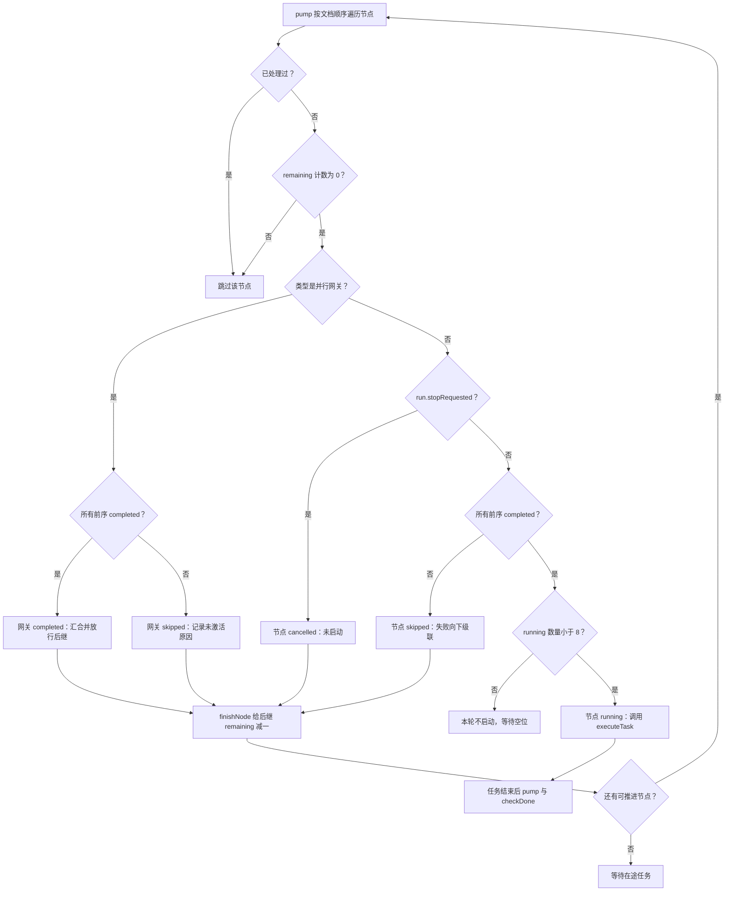
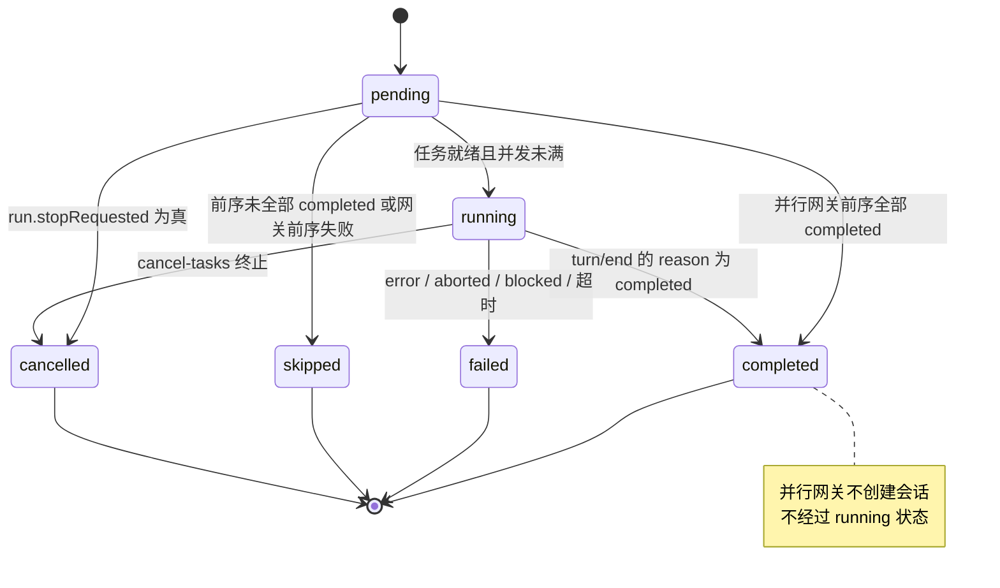
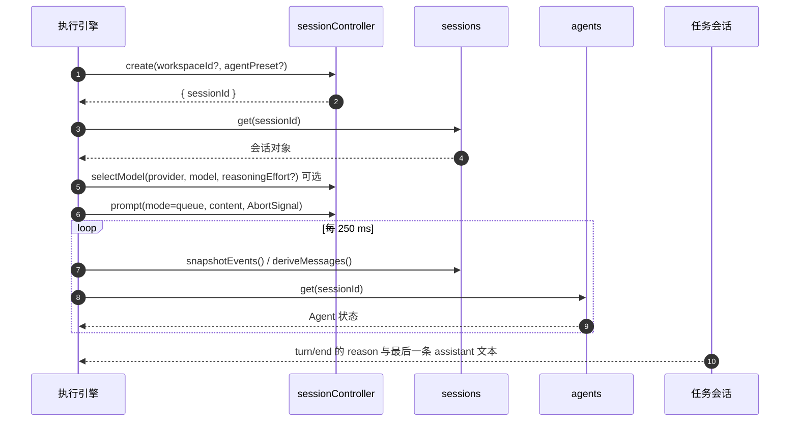

[文档首页](../README.md) / [开发文档](README.md)

# 执行引擎

执行引擎在 [`lib/host/engine.js`](../../lib/host/engine.js)，负责把一个工作流定义变成一次真实运行：校验 DAG、按依赖启动节点、通过 `sessionController` 创建真实任务会话、等待轮次结束、汇总运行状态并写回持久化记录。

本文只讲**调度与执行语义**；接口和数据格式分别见 [HTTP API](http-api.md) 与 [数据模型](data-model.md)。

## 1. 输入、快照与运行记录

`WorkflowEngine.start(workflowId, workflowOverride)` 的流程（[`lib/host/engine.js:256`](../../lib/host/engine.js#L256)）：

1. 等待存储就绪（`store.ready()`）。
2. 如果请求带了 `workflow` 覆盖版本，先 `store.save(workflowOverride)` 落盘并取得**深拷贝**；否则 `store.get(workflowId)`。因此**运行使用的是启动时快照**，运行中继续编辑画布不会影响本次运行。
3. 同一工作流已有活动运行时直接报错，避免重复执行（[`lib/host/engine.js:260`](../../lib/host/engine.js#L260)）。
4. `validateWorkflow()` 校验失败则抛错，路由层转成 `400 workflow-error`。
5. 创建运行记录：`status: 'running'`、`stopRequested: false`、所有节点初始化为 `pending`、空日志（[`lib/host/engine.js:265`](../../lib/host/engine.js#L265)）。
6. 预取一次选项目录（失败不阻塞），然后异步启动调度器；`start()` 立即返回运行快照（[`lib/host/engine.js:297`](../../lib/host/engine.js#L297)）。

调度器抛出的非预期异常由 `abortRun()` 兜底：运行直接标记 `failed`、写一条错误日志、尝试持久化并从活动表移除（[`lib/host/engine.js:358`](../../lib/host/engine.js#L358)）。

## 2. 图构建与校验

`buildGraph()` 把定义转成三张表：`nodeById`、`predecessors`、`successors`；端点不存在的边被忽略（[`lib/host/engine.js:38`](../../lib/host/engine.js#L38)）。

`validateWorkflow()` 在启动前给出人类可读的问题列表（[`lib/host/engine.js:56`](../../lib/host/engine.js#L56)）：

| 检查 | 说明 |
| --- | --- |
| 至少一个节点 | 空工作流不可执行 |
| 任务节点提示词非空 | `task.prompt.trim() === ''` 报「还没有填写提示词」 |
| 并行网关有入边和出边 | 缺任一报错 |
| 无环 | Kahn 拓扑排序，访问数不等于节点数即存在环路 |

注意：**校验与调度都不要求「所有节点都连通」**。没有前序的节点会同时启动，这正是「不连线即并行」的实现基础。

## 3. 调度核心

调度器 `schedule()`（[`lib/host/engine.js:373`](../../lib/host/engine.js#L373)）用一套很轻量的状态机驱动整个 DAG：

- `remaining`：每个节点还剩多少个前序没有落定（初始为入度，[`lib/host/engine.js:376`](../../lib/host/engine.js#L376)）。
- `started`：已经处理过的节点（启动、跳过或取消都算），保证每节点只处理一次。
- `running`：正在执行任务的节点集合，用于并发上限。
- `settled`：已经落定的节点数；`settled === 节点总数 && running.size === 0` 时运行结束（[`lib/host/engine.js:386`](../../lib/host/engine.js#L386)）。

`finishNode()` 是唯一的「落定」入口：写节点状态、`settled++`、给所有后继的 `remaining` 减一（下限 0）（[`lib/host/engine.js:390`](../../lib/host/engine.js#L390)）。

`pump()` 是可重入保护的启动循环：反复扫描节点，直到某一轮没有任何进展（[`lib/host/engine.js:409`](../../lib/host/engine.js#L409)）。单个任务完成/失败后再次调用 `pump()`，把新就绪的节点放出去（[`lib/host/engine.js:492`](../../lib/host/engine.js#L492)）。



关键判定：

| 情况 | 结果 |
| --- | --- |
| 网关所有前序 `completed` | 网关 `completed`，日志「已汇合（N 条分支）」 |
| 网关任前序未成功 | 网关 `skipped`，错误「前序分支未成功，网关未激活」 |
| 停止请求已发出（`detach` 或 `cancel-tasks`） | 尚未启动的任务 `cancelled`，不再启动 |
| 任务前序未全部成功 | 任务 `skipped`，错误「前序任务未成功完成」，并继续向下级联 |
| 任务前序全部成功且并发未满 | 任务 `running`，创建真实会话 |
| 任务前序全部成功但并发已满 | 本轮不处理，等下一次 `pump()` |

并发上限是 `MAX_CONCURRENT_TASKS = 8`（[`lib/host/engine.js:32`](../../lib/host/engine.js#L32)）。超出的就绪任务保持 `pending`，不会排队占位；只要有在途任务结束触发 `pump()`，就会按文档顺序补位。

## 4. 节点状态机



持久化与界面上的节点状态就是这 6 种。运行整体状态另有 4 种：`running`、`completed`、`failed`、`cancelled`。

## 5. 单任务执行

任务节点的真实执行在 `executeTaskReal()`（[`lib/host/engine.js:547`](../../lib/host/engine.js#L547)）。测试通过构造函数选项 `executeTask` 替换它（[`lib/host/engine.js:202`](../../lib/host/engine.js#L202)），单元测试因此不需要启动 DSH。



### 5.1 创建会话

参数来源按优先级合并（[`lib/host/engine.js:553`](../../lib/host/engine.js#L553)）：

| 参数 | 优先级 |
| --- | --- |
| `workspaceId` | 节点 `task.workspaceId` → 工作流 `settings.defaultWorkspaceId` → 选项目录 `defaults.workspaceId` |
| `agentPreset` | 节点 `task.agentPreset` → 选项目录 `defaults.agentPreset` |
| `permissionPreset` | 节点 `task.permissionPreset` → 选项目录 `defaults.permissionPreset` |
| 模型 | 节点 `task.model` → 选项目录 `defaults.model` |

创建成功后必须拿到字符串 `sessionId`，否则抛「创建任务会话失败：未返回会话 ID」；随后把会话 ID 写进节点状态并记日志（[`lib/host/engine.js:559`](../../lib/host/engine.js#L559)）。

### 5.2 应用权限与模型

- 权限：调用 `permissionPresets.resolve(preset)` 与 `permissionPresets.set(session, preset)`；失败只记 `warn`，沿用会话默认权限（[`lib/host/engine.js:569`](../../lib/host/engine.js#L569)）。
- 模型：`sessionController.selectModel({ sessionId, provider, model, reasoningEffort? })`；失败同样只降级（[`lib/host/engine.js:582`](../../lib/host/engine.js#L582)）。

### 5.3 发送提示词

`composePrompt()` 组装最终文本（见第 6 节），然后用 `mode: 'queue'` 投递（[`lib/host/engine.js:600`](../../lib/host/engine.js#L600)）：

- 每个节点创建一个 `AbortController`，以 `runId::nodeId` 为键登记到 `promptSignals`；`finally` 中删除（[`lib/host/engine.js:597`](../../lib/host/engine.js#L597)）。
- 中止这个 signal 只会撤回**尚未被准入**的提示词，不会打断已经开始的轮次；真正的停会话由 `sessionController.cancel()` 负责。
- 提示词发送成功记一条带字数的日志（[`lib/host/engine.js:612`](../../lib/host/engine.js#L612)）。

### 5.4 等待轮次结束

`waitForTurn()`（[`lib/host/engine.js:624`](../../lib/host/engine.js#L624)）先做一次「是否已有结束轮次」的即时检查（`readTurnOutcome`），没有才进入等待：

- 监听 `ctx.on('session/event')`：`turn/start` 记录开始时间；`turn/end` 且 `seq > startSeq` 时读取结果（[`lib/host/engine.js:642`](../../lib/host/engine.js#L642)）。
- 同时每 250 ms 轮询一次 `snapshotEvents()`，作为事件丢失时的兜底（[`lib/host/engine.js:653`](../../lib/host/engine.js#L653)）。
- `startSeq` 取自发送提示词前的 `session.seq`（[`lib/host/engine.js:594`](../../lib/host/engine.js#L594)），保证只认本轮之后结束的轮次。

`readTurnOutcome()` 扫描事件，取最后一个 `turn/end`，映射 `reason.kind`（[`lib/host/engine.js:155`](../../lib/host/engine.js#L155)）：

| `reason.kind` | 任务结果 | 错误信息 |
| --- | --- | --- |
| `completed` | 成功 | 无 |
| `error` | 失败 | `code: message`（code 为 `UNKNOWN` 时只留 message） |
| `aborted` | 失败 | `已中止（<reason>）` |
| `blocked` | 失败 | `该轮被拦截（会话已归档或未通过准入）` |
| 其它 | 失败 | `轮次结束原因：<kind>` |

成功路径的 `output` 是最后一条 assistant 消息里的文本块拼接（[`lib/host/engine.js:136`](../../lib/host/engine.js#L136)）；派生失败（例如会话正在替换）按「无输出」处理。

## 6. 上游上下文

`upstreamTaskNodes()` 沿前序反向遍历，**只穿过并行网关**，收集最近的任务祖先（[`lib/host/engine.js:91`](../../lib/host/engine.js#L91)）；多个分支会得到多个上游任务，最终按工作流节点顺序返回。

`composePrompt(node, upstreamStates, mode)` 的规则（[`lib/host/engine.js:113`](../../lib/host/engine.js#L113)）：

| 模式 | 行为 |
| --- | --- |
| `none` | 只发本节点自己的提示词 |
| `full`（默认） | 每个上游输出截断到 30 000 字（`MAX_CONTEXT_OUTPUT_CHARS`，[`lib/host/engine.js:35`](../../lib/host/engine.js#L35)），以「### 任务「标题」（会话 ID）」分块附在 `【上游任务输出】` 下 |
| `summary` | 每个上游只附会话 ID 与 800 字摘要，标题为 `【上游任务会话摘要】` |

没有输出或上游列表为空时直接返回自己的提示词；最终格式是：

```text
<自己的提示词>

---
【上游任务输出】
### 任务「任务 A」（会话 session-xxxx）
<输出正文>
---

```

## 7. 停止与取消

`stop(runId, { cancelTasks })`（[`lib/host/engine.js:303`](../../lib/host/engine.js#L303)）：

- 不传 `runId` 时取第一个活动运行；找不到抛「没有正在运行的工作流」。
- 重复请求直接返回当前快照，不重复取消。
- 设置 `stopRequested = true`，`stopMode` 为 `detach` 或 `cancel-tasks`，并记 `warn` 日志。

| 模式 | 对已运行任务 | 对未启动任务 | 最终运行状态 |
| --- | --- | --- | --- |
| `detach`（仅停止工作流） | 继续执行到结束，节点状态照常 `completed` / `failed` | `cancelled` | `cancelled` |
| `cancel-tasks`（并终止任务） | 先 abort 提示词准入信号，再 `sessionController.cancel({ sessionId })`；任务失败被归类为 `cancelled` | `cancelled` | `cancelled` |

`cancel-tasks` 只对 `status === 'running'` 的节点生效（[`lib/host/engine.js:319`](../../lib/host/engine.js#L319)）。插件卸载时 `dispose()` 会对所有未请求停止的活动运行发起一次 `cancel-tasks`（[`lib/host/engine.js:336`](../../lib/host/engine.js#L336)）。

## 8. 超时与启动宽限

| 常量 | 值 | 作用 |
| --- | --- | --- |
| `NODE_TIMEOUT_MS` | 6 小时 | 轮次已开始但会话持续空闲超过该时长 → 请求取消并失败 |
| `START_GRACE_MS` | 8 秒 | 提示词发出后 8 秒内既无 `turn/start` 又处于空闲 → 判定「任务未能开始执行」 |
| 轮询间隔 | 250 ms | `waitForTurn` 的兜底轮询 |
| 总等待上限 | 6 小时 + 8 秒 | 超过即「任务等待超时」 |

判定「空闲」的依据是 `agents.get(sessionId)` 不存在，或其 `status !== 'running'`（[`lib/host/engine.js:659`](../../lib/host/engine.js#L659)）。计时器调用了 `unref()`，不会单独阻止进程退出。

## 9. 运行归并与持久化

所有节点落定后（[`lib/host/engine.js:508`](../../lib/host/engine.js#L508)）：

- **整体状态**：`stopRequested` → `cancelled`；否则任一节点 `failed`/`skipped` 或 `failureSeen` → `failed`；否则 `completed`。
- **整体错误**：失败时拼接各失败节点的 `标题: 错误`；取消时写入对应的停止说明。
- 关闭运行记录（`endedAt`），记一条总结日志，调用 `store.recordRun(run)` 做 compact 持久化；存储异常只忽略，不影响内存状态（[`lib/host/engine.js:527`](../../lib/host/engine.js#L527)）。
- 从活动表移除；面板下一次轮询会看到终态。

## 10. 日志与容量

- `engine.log()` 生成 `{ time, level, message, nodeId?, nodeTitle? }`，内存中最多保留 `MAX_LOG_LINES = 800` 行（[`lib/host/engine.js:242`](../../lib/host/engine.js#L242)）。
- 同时按级别转发到宿主日志：`error` 用 `logger.warn`，其余用 `logger.info`，前缀统一为 `workflow-orchestrator:`（[`lib/host/engine.js:251`](../../lib/host/engine.js#L251)）。
- 面板看到的运行快照会再截一次最近 800 行，并补 `active` 字段（[`lib/host/engine.js:189`](../../lib/host/engine.js#L189)）。
- 持久化时日志只留最近 400 行（compact 规则见 [数据模型](data-model.md)）。
- `snapshotRuns()` 把持久化记录、各工作流最新运行、活动运行合并，按开始时间排序后只留最近 10 条（[`lib/host/engine.js:211`](../../lib/host/engine.js#L211)）。

## 11. 测试接缝与已知限制

- 单测通过 `new WorkflowEngine(ctx, store, catalogs, { executeTask })` 注入假执行器，覆盖并行启动、串行、网关汇合、失败级联、两种停止模式、校验和 prompt 组装（详见 [测试](testing.md)）。
- 每个任务节点**只执行一次**：没有重试、循环、定时触发。
- 网关只有并行网关一种，只做汇合与扇出，不创建会话。
- 运行期间画布可继续编辑，但运行使用启动时快照。
- 同一工作流同时只允许一个活动运行。

## 相关文档

- 数据结构与容量上限：[数据模型](data-model.md)
- 触发执行与终止的接口：[HTTP API](http-api.md)
- 如何补调度用例：[测试](testing.md)
