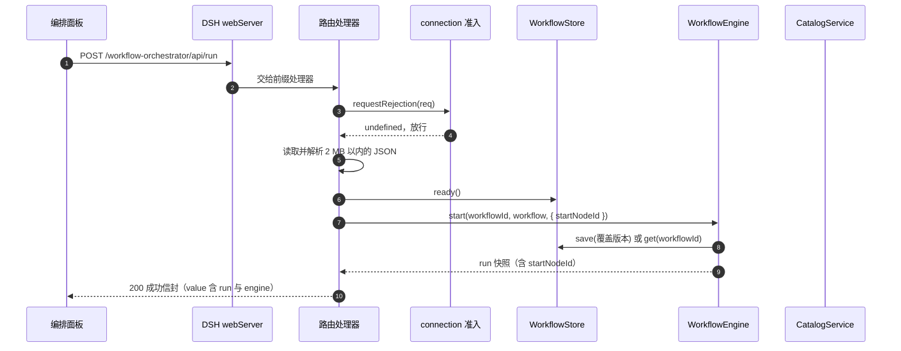

[文档首页](../README.md) / [开发文档](README.md)

# HTTP API

宿主半区把 JSON API 以前缀方式挂到 DSH 自己的 Web 服务器上：

```text
/workflow-orchestrator/api/*
```

路由实现只有一份：[`lib/host/routes.js`](../../lib/host/routes.js)。它不实现独立鉴权，而是先经过宿主 `connection` 服务的准入栅栏——面板因此不需要第二套认证方案。

## 1. 通用行为

### 1.1 响应信封

所有响应都是 JSON，成功与失败两种形状：

```json
{ "ok": true, "value": {} }
```

```json
{ "ok": false, "error": { "code": "workflow-error", "message": "工作流不存在" } }
```

固定响应头（[`lib/host/routes.js:24`](../../lib/host/routes.js#L24)）：

| 头 | 值 |
| --- | --- |
| `content-type` | `application/json; charset=utf-8` |
| `cache-control` | `no-store` |
| `content-length` | 响应体字节数 |

面板侧用 `payload?.ok !== true` 判定失败，并把 `error.message` 直接显示成横幅（[`lib/client.js:329`](../../lib/client.js#L329)）。

### 1.2 准入栅栏

每个请求（包括 404 路径）都会先调用 `connection.requestRejection(req)`（[`lib/host/routes.js:77`](../../lib/host/routes.js#L77)）：

- 返回非 `undefined` → `403 forbidden`，消息固定为 `request rejected by the host connection policy`；
- 调用本身抛异常 → 同样按拒绝处理。

插件的路由**不得**绕过这道栅栏，这是 [AGENTS.md 第 4 节](../../AGENTS.md) 的硬性约定。

### 1.3 请求体

- 只有 POST 路由读取请求体；上限 `2 * 1024 * 1024` 字节（[`lib/host/routes.js:21`](../../lib/host/routes.js#L21)）。
- 超限抛「请求体过大」，最终是 **400 `workflow-error`**，而不是 413。
- 空请求体按 `{}` 处理；非空但不是合法 JSON 会解析失败，同样是 400。
- 顶层不是对象（例如 `[]`、`null`）时按 `{}` 处理（[`lib/host/routes.js:48`](../../lib/host/routes.js#L48)）。

### 1.4 方法与路径分派

分派顺序（[`lib/host/routes.js:91`](../../lib/host/routes.js#L91)）：

1. `GET /api/health`、`GET /api/state`、`GET /api/run`、`GET /api/periodic`、`GET /api/tasks` 单独匹配；
2. 其余命中 `GET_ONLY_ROUTES` 的请求 → **405 `method-error`**；
3. 不在 `POST_ROUTES` 里的路径 → **404 `not-found`**；
4. 命中 POST 路由但不是 POST 方法 → **405 `method-error`**；
5. 进入对应处理器，任何抛出异常 → **400 `workflow-error`**。

因此：`PUT /api/state` 是 405，`GET /api/save` 是 405，`GET /api/nope` 是 404。

## 2. 路由总表

| 方法 | 路径 | 请求体/参数 | 成功 `value` |
| --- | --- | --- | --- |
| GET | `/api/health` | 无 | `{ pid, version }` |
| GET | `/api/state` | 查询参数 `refresh=1` 可选 | `{ workflows, activeWorkflowId, catalogs, engine }` |
| GET | `/api/run` | 查询参数 `runId` 可选 | `{ run, engine }` |
| GET | `/api/periodic` | 无 | `{ count, onceCount, workflows, checkedAt }` |
| GET | `/api/tasks` | 无 | `{ tasks }` |
| POST | `/api/create` | `{ name?, workspaceId? }` | `{ workflow, activeWorkflowId }` |
| POST | `/api/save` | `{ workflow }` | `{ workflow }` |
| POST | `/api/delete` | `{ workflowId }` | `{ removed, activeWorkflowId }` |
| POST | `/api/active` | `{ workflowId }` | `{ activeWorkflowId }` |
| POST | `/api/run` | `{ workflowId?, workflow?, startNodeId? }` | `{ run, engine }` |
| POST | `/api/stop` | `{ runId?, cancelTasks? }` | `{ run, engine }` |



## 3. 各路由说明

### 3.1 `GET /api/health`

最小健康检查，返回进程信息（[`lib/host/routes.js:91`](../../lib/host/routes.js#L91)）：

```json
{ "ok": true, "value": { "pid": 12345, "version": 1 } }
```

`version` 目前是硬编码的 API 版本 `1`，与包版本无关。

### 3.2 `GET /api/state`

面板 bootstrap 的唯一入口（[`lib/host/routes.js:95`](../../lib/host/routes.js#L95)）。`refresh=1` 会强制重建选项目录缓存；不带参数时用 60 秒缓存（[`lib/host/catalogs.js:134`](../../lib/host/catalogs.js#L134)）。

```json
{
  "ok": true,
  "value": {
    "workflows": [
      {
        "id": "wf-1a2b3c4d",
        "name": "示例工作流",
        "createdAt": 1760000000000,
        "updatedAt": 1760000000000,
        "nodes": [],
        "edges": [],
        "settings": {}
      }
    ],
    "activeWorkflowId": "wf-1a2b3c4d",
    "catalogs": {
      "workspaces": [
        { "id": "workspace-1", "title": "默认工作区", "path": "D:/path/to/workspace" }
      ],
      "agentPresets": [
        { "id": "standard", "name": "标准模式", "isDefault": true }
      ],
      "permissions": [
        { "value": "danger-full-access", "name": "完全权限" }
      ],
      "modelProviders": [
        {
          "id": "example-provider",
          "name": "示例 provider",
          "models": [
            { "id": "example-model", "name": "example-model", "reasoningEfforts": [] }
          ]
        }
      ],
      "modelFailures": [],
      "defaults": {
        "workspaceId": "workspace-1",
        "agentPreset": "standard",
        "permissionPreset": "danger-full-access",
        "model": { "provider": "example-provider", "model": "example-model" }
      },
      "problems": [],
      "fetchedAt": 1760000000000
    },
    "engine": {
      "running": [],
      "runs": []
    }
  }
}
```

`catalogs` 的字段由 [`CatalogService.build()`](../../lib/host/catalogs.js#L144) 聚合：

| 字段 | 来源 | 备注 |
| --- | --- | --- |
| `workspaces` | `workspaceRegistry.list()` | `{ id, title, path }` |
| `agentPresets` | `agentPresets.remoteExportList()` | 过滤坏项；`name` 缺失时回退内置中文标签 |
| `permissions` | `permissionPresets.catalog()` | `{ value, name, description? }` |
| `modelProviders` | `sessionController.modelCatalog()` | 按 provider 分组，含 `reasoningEfforts`、`defaultEffort` |
| `modelFailures` | 模型目录的失败项 | `{ id, name, message }` |
| `defaults` | 上述四项的首选值 | 权限默认优先 `danger-full-access` |
| `problems` | 各分区读取失败 | `{ section, message }`，面板据此显示提示 |

### 3.3 `GET /api/run`

轮询接口（[`lib/host/routes.js:100`](../../lib/host/routes.js#L100)）：

- 不带 `runId`：返回 `engine.snapshotRuns().slice(-1)[0]`，即最近开始的一条运行；
- 带 `runId`：返回该运行（内存优先，其次持久化历史），找不到时 `run: null`。

```json
{
  "ok": true,
  "value": {
    "run": {
      "id": "run-1a2b3c4d",
      "workflowId": "wf-1a2b3c4d",
      "workflowName": "示例工作流",
      "startNodeId": null,
      "status": "running",
      "stopRequested": false,
      "stopMode": null,
      "terminated": false,
      "terminatedBy": null,
      "terminatedReason": null,
      "terminatedAt": null,
      "startedAt": 1760000001000,
      "endedAt": null,
      "error": null,
      "failureSeen": false,
      "active": true,
      "nodes": {
        "node-a": {
          "id": "node-a",
          "title": "任务 1",
          "type": "task",
          "status": "running",
          "sessionId": "session-example",
          "decision": null,
          "startedAt": 1760000001000,
          "endedAt": null,
          "error": null,
          "output": null,
          "summary": null
        }
      },
      "log": [
        { "time": 1760000001000, "level": "info", "message": "工作流「示例工作流」开始执行（1 个节点）" }
      ]
    },
    "engine": {
      "running": [
        {
          "runId": "run-1a2b3c4d",
          "workflowId": "wf-1a2b3c4d",
          "workflowName": "示例工作流",
          "startedAt": 1760000001000,
          "status": "running"
        }
      ],
      "runs": []
    }
  }
}
```

`run` 是 `publicRun()` 视图：比持久化记录多 `terminatedHadFailure`、`terminatedPolicy`、`failureSeen`、节点 `summary`，日志只保留最近 800 行（[`lib/host/engine.js:569`](../../lib/host/engine.js#L569)）。`run.startNodeId` 为 `null` 表示全量执行，为字符串表示本次从该节点开始执行；此时不在范围内的节点状态为 `not-run`。判断节点在节点状态里带 `decision`（`CONTINUE` / `STOP`）；提前终止的运行带 `terminated / terminatedBy / terminatedReason / terminatedAt`。`engine.runs` 最多 10 条。

### 3.4 `POST /api/create`

新建空白工作流并切换为当前工作流（[`lib/host/routes.js:142`](../../lib/host/routes.js#L142)）。

请求：

```json
{ "name": "工作流 1", "workspaceId": "workspace-1" }
```

- `name` 为空时用「未命名工作流」；
- `workspaceId` 为空时用选项目录的 `defaults.workspaceId`；
- 新工作流 `nodes`、`edges` 为空，`settings` 里只放默认工作区。

响应：

```json
{
  "ok": true,
  "value": {
    "workflow": {
      "id": "wf-1a2b3c4d",
      "name": "工作流 1",
      "createdAt": 1760000000000,
      "updatedAt": 1760000000000,
      "nodes": [],
      "edges": [],
      "settings": { "defaultWorkspaceId": "workspace-1" }
    },
    "activeWorkflowId": "wf-1a2b3c4d"
  }
}
```

### 3.5 `POST /api/save`

保存（插入或替换）一个工作流定义（[`lib/host/routes.js:159`](../../lib/host/routes.js#L159)）。请求体里的 `workflow` 会完整经过清洗，响应返回**清洗后**的定义：

```json
{ "workflow": { "id": "wf-1a2b3c4d", "name": "示例工作流", "nodes": [], "edges": [] } }
```

```json
{ "ok": true, "value": { "workflow": { "id": "wf-1a2b3c4d", "name": "示例工作流", "createdAt": 1760000000000, "updatedAt": 1760000003000, "nodes": [], "edges": [], "settings": {} } } }
```

面板不依赖响应内容，它相信 600 ms 防抖后再读 `GET /api/state` 的结果。

### 3.6 `POST /api/delete`

删除工作流及其运行记录（[`lib/host/routes.js:165`](../../lib/host/routes.js#L165)）：

```json
{ "workflowId": "wf-1a2b3c4d" }
```

```json
{ "ok": true, "value": { "removed": true, "activeWorkflowId": "wf-00000000" } }
```

- `workflowId` 不是字符串 → 400 `workflow-error`「缺少 workflowId」；
- 删除不存在的 id → `removed: false`，不报错；
- 删除的是当前工作流 → `activeWorkflowId` 切到剩余的第一个或 `null`。

### 3.7 `POST /api/active`

记住面板当前显示的工作流（[`lib/host/routes.js:172`](../../lib/host/routes.js#L172)）：

```json
{ "workflowId": "wf-1a2b3c4d" }
```

```json
{ "ok": true, "value": { "activeWorkflowId": "wf-1a2b3c4d" } }
```

不存在的 id 会被 `store.setActive()` 静默忽略，响应里返回真实的当前值。

### 3.8 `POST /api/run`

启动一次运行（[`lib/host/routes.js:179`](../../lib/host/routes.js#L179)）。两种请求形态：

```json
{ "workflowId": "wf-1a2b3c4d", "workflow": { "id": "wf-1a2b3c4d", "name": "示例工作流", "nodes": [], "edges": [] } }
```

```json
{ "workflowId": "wf-1a2b3c4d" }
```

从某个节点开始执行时，额外带 `startNodeId`：

```json
{ "workflowId": "wf-1a2b3c4d", "startNodeId": "node-b" }
```

| 字段 | 类型 | 说明 |
| --- | --- | --- |
| `workflowId` | string | 已保存工作流的 id；与 `workflow` 至少提供一个 |
| `workflow` | object | 可选；当前画布覆盖版本，引擎会先保存这份定义再运行（[`lib/host/engine.js:1188`](../../lib/host/engine.js#L1188)） |
| `startNodeId` | string | 可选；`null` / `undefined` / 空字符串都视为全量执行。非字符串（且非 `null`）→ 400 `workflow-error`「起始节点 ID 无效」（[`lib/host/routes.js:182`](../../lib/host/routes.js#L182)） |

行为：

- 带 `workflow` 时，引擎会先把这份覆盖版本保存下来，因此面板可以「边编辑边执行」当前画布；
- 两者都没有 → 400「缺少 workflowId」；
- 工作流已存在活动运行 → 400「该工作流正在运行（run ...）」；
- 校验失败 → 400，消息以「工作流校验失败：」开头；`startNodeId` 指向不存在的节点时是「工作流校验失败：起始节点不存在：&lt;id&gt;」；
- 带 `startNodeId` 时只执行该节点及其下游可达节点，范围外节点在运行快照里状态为 `not-run`，`run.startNodeId` 记录起始节点 id；
- 判断节点的 `STOP` 判定或终止节点触发时，`run.terminated` 为 `true`，`terminatedBy` / `terminatedReason` / `terminatedAt` 记录触发节点、原因与时间。

响应是 `{ run, engine }`，结构同 [`GET /api/run`](#33-get-apirun)。

### 3.9 `POST /api/stop`

请求停止（[`lib/host/routes.js:191`](../../lib/host/routes.js#L191)）：

```json
{ "runId": "run-1a2b3c4d", "cancelTasks": true }
```

| 字段 | 说明 |
| --- | --- |
| `runId` | 可选；不是字符串时引擎取第一个活动运行 |
| `cancelTasks` | 只有严格等于 `true` 才是「并终止运行中的任务」；其余都按 `detach` 处理 |

响应 `{ run, engine }`。没有活动运行 → 400「没有正在运行的工作流」；重复 stop 不报错，直接返回当前快照。

### 3.10 `GET /api/periodic`

周期触发摘要，供面板顶部警告条与左侧栏黄色徽标使用（[`lib/host/routes.js`](../../lib/host/routes.js)）。处理器先调用 `engine.refreshSchedulerSummary()` 重新读取当前工作流定义，再返回缓存的 `schedulerSnapshot()`：

```json
{
  "ok": true,
  "value": {
    "count": 2,
    "onceCount": 1,
    "workflows": [
      {
        "workflowId": "wf-1a2b3c4d",
        "workflowName": "每日报告",
        "nodeId": "node-t",
        "nodeTitle": "每天三点",
        "mode": "daily",
        "periodic": true,
        "nextAt": 1760000000000,
        "valid": true,
        "problems": []
      }
    ],
    "checkedAt": 1760000000000
  }
}
```

| 字段 | 说明 |
| --- | --- |
| `count` | 含**周期入口定时节点**的工作流数量（侧栏徽标显示的数字） |
| `onceCount` | 含尚未触发的一次性入口定时节点的工作流数量 |
| `workflows` | 每个入口定时节点一条记录（最多 30 条）；`nextAt` 为下一次触发时间，`valid` / `problems` 来自运行前校验 |
| `checkedAt` | 本次计算使用的时刻 |

方法不对（例如 POST）→ 405；准入栅栏与其它路由一致。

### 3.11 `GET /api/tasks`

等待任务完成节点的候选列表（[`lib/host/routes.js`](../../lib/host/routes.js) 调 `engine.listWaitCandidates()`）：

```json
{
  "ok": true,
  "value": {
    "tasks": [
      {
        "sessionId": "session-abc",
        "title": "每日报告 / 收集数据",
        "status": "running",
        "waitingQuestions": 0,
        "cwd": "D:/work/project"
      }
    ]
  }
}
```

| 字段 | 说明 |
| --- | --- |
| `sessionId` | 真实 DSH 任务会话 ID，勾选后写入等待节点的 `wait.targets` |
| `title` | 插件运行节点的「工作流 / 节点」名，其次会话标题，最后回退会话 ID |
| `status` | `running` / `waiting-user` / `idle`；宿主已按“运行中 → 等待用户回复 → 空闲”排序，面板按返回顺序渲染 |
| `waitingQuestions` | 该会话当前待回答的提问数量（>0 时状态为 `waiting-user`） |
| `cwd` | 会话创建时的工作目录（可选，面板显示最后一级目录帮助区分同名任务） |

已排除子 Agent 会话（`session.header.origin === 'subagent'` 或 `delegationDepth > 0`），最多返回 100 条；宿主 `agents` 服务不可用时退回插件运行中的任务会话。方法不对 → 405。

## 4. 错误码

| HTTP | `error.code` | 触发条件 |
| --- | --- | --- |
| 403 | `forbidden` | `connection.requestRejection(req)` 拒绝或抛错 |
| 405 | `method-error` | 已知路径但方法不对（GET-only 被 POST，或 POST 路由被 GET/PUT） |
| 404 | `not-found` | 未知子路径，消息包含子路径 |
| 400 | `workflow-error` | 业务异常、参数缺失、请求体超限或非法 JSON |

400 的 `message` 直接来自 `errorMessage(error)`（[`lib/host/util.js:41`](../../lib/host/util.js#L41)），会保留错误码前缀（如 `code: message`）与会话/工作流相关的中文说明。

## 5. 安全与边界

- 没有 CORS 头，也没有独立 token：面板与 API 同源，信任由宿主的准入栅栏负责。
- 请求体上限 2 MB 是为了防止误把大文件塞进 `workflow`；真正的定义体积还有 200 节点 / 400 边 / 200 000 字提示词等清洗上限。
- `GET /api/state` 会返回全部工作流定义，不区分权限；能访问该前缀即等于能读画布。
- 接口版本字段只有 `GET /api/health` 的 `version: 1`；路径本身没有 `/v1` 前缀，破坏性变更需要同步改面板与文档。

## 相关文档

- 被这些接口触发的调度逻辑：[执行引擎](execution-engine.md)
- 请求/响应里的数据结构：[数据模型](data-model.md)
- 面板如何调用：[架构总览](architecture.md#31-api-调用方式)
