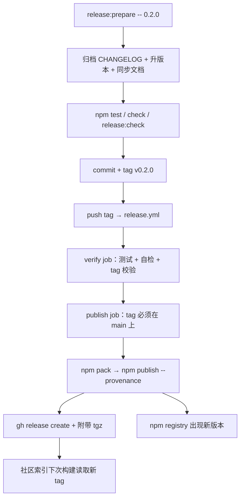

[文档首页](../README.md) / [开发文档](README.md)

# 打包与发布

本文覆盖：插件包结构、四种安装方式、版本与 SemVer、**tag 驱动的自动化发布流水线**、收录到 DSH 社区插件索引，以及兼容性声明。

## 1. 插件包结构

DSH 插件包的「可加载性」由 [`package.json`](../../package.json) 的 `dsh` 字段和 [`cordis.patch.yml`](../../cordis.patch.yml) 共同声明：

| 清单字段 | 当前值 | 作用 |
| --- | --- | --- |
| `name` | `dsh-workflow-orchestrator` | 包名；与 Loader 行 `name` 一致（[`package.json:2`](../../package.json#L2)） |
| `version` | `0.2.0` | SemVer 版本（[`package.json:3`](../../package.json#L3)） |
| `type` | `module` | 全 ESM，入口即源码（[`package.json:5`](../../package.json#L5)） |
| `main` | `lib/index.js` | 宿主半区入口（[`package.json:6`](../../package.json#L6)） |
| `exports` | `.`、`./client`、`./locale/*.json`、`./icon`、`./package.json` | 子路径导出；`./client` 是浏览器半区入口（[`package.json:7`](../../package.json#L7)） |
| `engines.node` | `>=20` | Node 版本要求（[`package.json:19`](../../package.json#L19)） |
| `engines.dsh` | `>=0.2.2-rc.3 <0.3.0-0` | DSH 兼容范围；插件市场与插件管理器据此判断能否安装（[`package.json:20`](../../package.json#L20)） |
| `dsh.bundle.patch` | `./cordis.patch.yml` | Bundle patch 文件（[`package.json:33`](../../package.json#L33)） |
| `dsh.client.platform` | `web` | 浏览器半区只面向 Web 壳层（[`package.json:39`](../../package.json#L39)） |
| `dsh.manifestVersion` | `1` | 插件清单版本（[`package.json:41`](../../package.json#L41)） |
| `files` | `lib/index.js`、`lib/host`、`lib/client.js`、`cordis.patch.yml`、`locale/*.json`、`icon.svg`、`README.md`、`README.en.md`、`LICENSE` | npm 发布白名单（[`package.json:43`](../../package.json#L43)） |

### 1.1 Bundle patch 的 insert 行

[`cordis.patch.yml`](../../cordis.patch.yml) 只有一个 `insert`，向 profile 的 Loader 配置插入一行：

```yaml
- insert:
    - id: workflow-orchestrator
      name: 'dsh-workflow-orchestrator'
```

- `id` 是 Loader 行 id（`workflow-orchestrator`），用于诊断与覆盖；`name` 是包名，必须能被 profile 的 `node_modules` 解析到本包。
- 行 id 固定为 `workflow-orchestrator`，`name` 是包名 `dsh-workflow-orchestrator`；两者都要保持稳定——改动会影响已安装 profile 的识别与覆盖，`npm run check` 会分别校验它们（[`tools/verify-package.mjs:117`](../../tools/verify-package.mjs#L117)）。
- 不要在 patch 里写 `config` 或重复插入其它行；所有业务配置都在运行期通过 Cordis 服务读取。

### 1.2 两半区如何被解析

| 半区 | 解析路径 |
| --- | --- |
| 宿主半区 | Bundle patch 的 `insert` 行 → 包名 → `main` / `exports["."]` → [`lib/index.js`](../../lib/index.js) |
| 浏览器半区 | `dsh.client.platform = "web"` + `exports["./client"]` → [`lib/client.js`](../../lib/client.js)，由 Web 壳层以 `window.__ModuleLoader__` 模块加载 |

`exports` 里还有：

- `./locale/*.json`：插件管理器/设置页读取的标题与描述；
- `./icon`：侧栏/设置页图标 [`icon.svg`](../../icon.svg)；
- `./package.json`：允许宿主读取清单。

### 1.3 发布物边界

- `files` 白名单决定 `npm pack` 的内容：`lib/`、清单、locale、图标、README、LICENSE。
- `test/`、`tools/`、`docs/`、`.github/` **不会**进入 npm tarball，但会进入 GitHub 仓库；仓库级自检（`npm run check`）会检查这些文件是否齐全、文档链接是否有效。
- 仓库没有构建步骤：发布物就是源码；修改 `lib/` 后不需要编译或打包。
- 运行时零依赖：`package.json` 没有 `dependencies` / `peerDependencies` / `devDependencies`，Node 内置模块 + Cordis 服务即可运行。

## 2. 安装方式

### 2.1 npm 安装（推荐）

```powershell
dsh plugin --profile desktop add dsh-workflow-orchestrator@0.2.0
```

- 把 `desktop` 换成你的 profile 名（桌面端默认 `desktop`，`dsh web` 常用 `web`）。
- 插件管理器会把它写进 profile 的 `package.json` 依赖与 `dsh.profile.bundles`，刷新页面即可在左侧栏看到「工作流编排」；未开 HMR 时重启 DSH。
- npm 包带 `provenance`（来源证明），可在 npm 包页面核对发布它的仓库与工作流。

### 2.2 插件发现页安装

DSH 不内置插件索引，需要先添加索引源（只加一次，属于当前 profile）：

1. **插件 → 实验性插件**，打开 **自定义插件索引**（旧版本叫「自定义插件市场」）。
2. 进入 **发现**，点击 **添加索引源**，粘贴：

   ```text
   https://cdn.jsdelivr.net/npm/dsh-plugin-catalog/index.json
   ```

3. 搜索 `workflow` 或 `dsh-workflow-orchestrator`，在卡片上点 **安装**；确认框会显示来源（npm 包与版本）。

本仓库收录进该索引的流程见[第 6 节](#6-收录到-dsh-插件索引)。索引里的插件来自第三方，只添加你信任的索引源。

### 2.3 插件管理器安装本地目录（开发用）

DSH **设置 → 插件 → 添加插件**，输入本仓库目录的绝对路径。插件管理器会把包以 `link:` 方式加入当前 profile 并自动启用；改代码后按[开发环境](development.md#43-改完代码后如何生效)刷新/重启即可生效。注意本地目录安装同样会校验 `engines.dsh`。

### 2.4 手动挂载

1. 把仓库目录链接到 profile 的 `node_modules/dsh-workflow-orchestrator`（Windows 用 junction，Unix 用 symlink）；
2. 在 profile 的 `package.json` 里把包名加入 `dsh.profile.bundles`；
3. 刷新页面；宿主半区未热加载时重启 DSH。

### 2.5 升级与卸载

- **npm 安装**：在插件页的已安装列表里点 **更新**，或运行 `dsh plugin --profile <profile> add dsh-workflow-orchestrator@<新版本>`。
- **Git 安装**：只能卸载后重装（没有版本列表）。
- **卸载**：`dsh plugin --profile <profile> remove dsh-workflow-orchestrator`，或在插件页关闭并移除；工作流数据仍保存在 `$DSH_HOME/workflow-orchestrator/`，重装后继续可用。

## 3. 版本与 SemVer

当前版本 `0.2.0`，阶段为 pre-1.0。建议的升级规则：

| 变更 | 版本位 |
| --- | --- |
| 不兼容的接口/数据格式变更 | minor（0.x 阶段可包含破坏性变更） |
| 向后兼容的新功能 | minor |
| 向后兼容的修复、文档、测试 | patch |

发布时以 [`package.json:3`](../../package.json#L3) 为唯一机器可读版本，同时同步 [`CHANGELOG.md`](../../CHANGELOG.md) 的版本标题与日期；文档里的版本描述由 `npm run release:prepare` 统一改写，不要手工漏改。

`npm run check` 会校验：`version` 符合 SemVer、`CHANGELOG.md` 包含 `[当前版本]`（[`tools/verify-package.mjs:90`](../../tools/verify-package.mjs#L90)、[`:270`](../../tools/verify-package.mjs#L270)）。发布时另外打 `vX.Y.Z` tag，并让 GitHub Release 标题与 tag 一致。

## 4. 自动化发布

发布由 **tag 触发**，不在本地手工执行 `npm publish`。这样每次发布的产物、来源证明与 Release 都来自同一条可重跑、可审计的流水线。

### 4.1 一条命令准备发布

```powershell
npm run release:prepare -- 0.2.0          # 归档 CHANGELOG、升版本、同步文档里的版本描述
npm run release:prepare -- 0.2.0 --dry-run # 只看会改什么，不落盘
```

它做四件事：

1. 校验新版本是合法 SemVer 且大于当前版本；
2. 把 `[Unreleased]` 的内容归档到 `## [0.2.0] - YYYY-MM-DD`，清空 `[Unreleased]`，把 compare 链接前移到新 tag，并补 `[0.2.0]` 的 release 链接；
3. 改写 `package.json` 的 `version`；
4. 按内置规则同步 `AGENTS.md`、`SECURITY.md`、`docs/user/*`、本篇文档里的版本描述；**任何一条规则匹配不到就报错退出**，避免留下过期的版本号。

准备完之后本地把关：

```powershell
npm test            # 含发布工具的单测（test/release.test.mjs）
npm run check       # 包结构 + 文档自检
npm run release:check   # 版本、CHANGELOG、engines.dsh、tag 一致性
```

### 4.2 发布流程图



```powershell
git add -A
git commit -m "chore(release): v0.2.0"
git tag v0.2.0
git push origin main v0.2.0
```

> **不要用 `git push --tags`**：每个 `v*.*.*` tag 都会触发一次发布工作流。仓库里若还留着从未发布过的历史 tag（例如本仓库早期的 `v0.1.0`），推上去会触发一次版本号对不上的运行，在 verify 阶段失败。推分支时显式带上本次 tag 即可。

### 4.3 release.yml 的两个 job

[`.github/workflows/release.yml`](../../.github/workflows/release.yml) 只由 `v*.*.*` tag 触发，权限默认只读：

| job | 权限 | 做什么 |
| --- | --- | --- |
| `verify` | `contents: read` | `npm test`、`npm run check`、`node tools/verify-release.mjs --tag "$GITHUB_REF_NAME"` |
| `publish` | `contents: write`、`id-token: write` | 确认 tag 提交在 `main` 上 → 升级 npm（≥ 11.5.1，OIDC 所需）→ `npm pack` → `npm publish --provenance --access public` → `gh release create` 并把 tgz 作为附件 |

发布门禁 [`tools/verify-release.mjs`](../../tools/verify-release.mjs) 会核对：

- `name` / `version` / `license` / `repository` 齐全，`private` 不为 `true`；
- `engines.dsh` 已声明且形如 SemVer 范围（插件市场与插件管理器都依赖它）；
- `files` 白名单包含 LICENSE、README、bundle patch、图标、locale 与两个入口；
- CHANGELOG 有对应版本段与日期、`[Unreleased]` 已清空、compare 与 release 链接指向该版本；
- 传入的 tag 与 `package.json` 版本完全一致。

### 4.4 首次发布与切换到 OIDC

npm 只允许给**已存在**的包配置 Trusted Publisher，所以第一次发布需要一个一次性令牌，之后不再需要：

1. 在 npm 生成令牌（2026-11 起默认是 **Granular Access Token**，旧的 Automation 类型逐步下线）：<https://www.npmjs.com/settings/~/tokens> → **Generate New Token** →
   - **Permissions**：`Read and write (publish and stage)`（不要选 stage only，那是「先暂存等人工批准」的新流程）；
   - **Select packages**：`All packages` —— 新包还没有版本可选，只勾已有包会导致发布会 404；
   - **Bypass two-factor authentication**：勾选，否则 CI 发布会被要求输入 OTP 而失败；
   - **Organizations / IP ranges**：留空。
2. 把令牌存进仓库 **Settings → Secrets and variables → Actions**，名为 `NPM_TOKEN`（必须是 *Repository secret*，不是 Environment secret）。
3. 推送 `vX.Y.Z` tag，`release.yml` 用这个令牌完成首发（仍然带 `--provenance`）。
4. 打开 npm 包页面 → **Settings → Trusted Publisher**，填写：仓库 `OWNER/REPO`、工作流文件名 `release.yml`、允许的动作 `npm publish`（若你给工作流配了 environment，这里也要填同名 environment）；
5. **删除 `NPM_TOKEN` secret**。此后发布靠 GitHub OIDC 换取短期凭据，仓库里不再有任何长期 npm 凭据。

两个容易踩的坑：

- **npm 只从 `.npmrc` 读凭据**：单独设置 `NODE_AUTH_TOKEN` 环境变量是无效的（`npm whoami` 仍返回 `ENEEDAUTH`）。工作流在检测到 `NPM_TOKEN` 时把它写进 `~/.npmrc`，并先跑一次 `npm whoami` 预检；令牌无效会直接给出明确错误，而不是让 `npm publish` 模糊失败。
- **首次发布会多出一个 `0.0.0-stage` 版本**：这是 npm 给带 stage 权限的 granular token 自动创建的占位版本（描述为 *Temporary package placeholder for staged publishing*），不是发布失败，也不会成为 `latest`，通常无需处理。

> 首次发布也可以在本地用 `npm publish` 完成，但产物就会与 CI 走两条路径，且没有 provenance；推荐仍用上面的 CI 路径。

### 4.5 失败与重跑

- `npm publish` 前会先 `npm view name@version`：**同版本已发布就跳过**，重跑同一个 tag 不会失败。
- `gh release create` 前会先 `gh release view`：Release 已存在也跳过。
- 已发布的版本号**不能复用**（npm 不允许覆盖），修问题要发新 patch 版本；确实需要撤下内容时用 `npm deprecate`。
- 如果 npm 成功而 GitHub Release 失败，重跑 workflow 只会补 Release，不会重复发布。

## 5. 发布前检查清单

- [ ] `npm run release:prepare -- <version>`（或手工归档）已完成，`[Unreleased]` 为空。
- [ ] `npm test` 全绿（引擎 61 + 存储/路由 11 + 发布工具 8）。
- [ ] `npm run check`：包清单、`exports` 目标、bundle patch、locale、必备仓库文件、截图、`screenshots.json`，以及文档相对链接、图片、Mermaid 与敏感内容全部通过。
- [ ] `npm run release:check`：版本、CHANGELOG、`engines.dsh` 一致。
- [ ] `npm run test:e2e`（或最近一次可信的 E2E 结果）：79/79 通过，无 `pageerror` / `console.error`。
- [ ] 改过 UI 时截图已更新，且与文案一致。
- [ ] `package.json`、`CHANGELOG.md`、`AGENTS.md`、`SECURITY.md`、`docs/user/*` 的版本描述一致。
- [ ] `npm pack --dry-run` 确认白名单内容正确（包含 LICENSE、图标、locale、两个 README）。
- [ ] 工作区没有 `.e2e/`、`.e2e-home/`、`.probe/`、`internal/`、凭据等不该提交的内容。
- [ ] tag 打在 `main` 上；Release 标题为 `vX.Y.Z`。
- [ ] 发布后在干净 profile 里装一次，确认侧栏入口、`/api/health` 与一次最小执行正常。

`npm run check` 由两个脚本串行组成：`npm run check:package`（[`tools/verify-package.mjs`](../../tools/verify-package.mjs)）与 `npm run check:docs`（[`tools/check-docs.mjs`](../../tools/check-docs.mjs)）。前者覆盖的关键项：

| 区 | 检查 |
| --- | --- |
| 清单 | 名称、SemVer、MIT、ESM、`engines.node`、repository、`private` 不为 true、`scripts.test` / `scripts.check`、keywords（[`tools/verify-package.mjs:90`](../../tools/verify-package.mjs#L90)） |
| DSH 声明 | `manifestVersion`、`client.platform`、`bundle.patch`、patch 的 `insert`/id/name（[`tools/verify-package.mjs:103`](../../tools/verify-package.mjs#L103)） |
| 兼容与工具链 | `engines.dsh`、发布脚本、`release.yml`、`screenshots.json` 是否齐全（[`tools/verify-package.mjs:123`](../../tools/verify-package.mjs#L123)） |
| 入口 | `main` 存在、宿主导出 `name`/`inject`/`apply`、浏览器半区使用 `__ModuleLoader__`、`exports["./client"]` 指向正确（[`tools/verify-package.mjs:149`](../../tools/verify-package.mjs#L149)） |
| 发布白名单 | `files` 非空、含 LICENSE/README、每条都真实存在（[`tools/verify-package.mjs:181`](../../tools/verify-package.mjs#L181)） |
| locale/图标 | `zh`/`en` 可解析且含标题描述、`icon.svg` 合法（[`tools/verify-package.mjs:193`](../../tools/verify-package.mjs#L193)） |
| 仓库文件 | README、AGENTS、LICENSE、CONTRIBUTING、CODE_OF_CONDUCT、SECURITY、CHANGELOG、docs 索引、`.github` 模板与两个 workflow 等（[`tools/verify-package.mjs:212`](../../tools/verify-package.mjs#L212)） |
| 截图 | `docs/assets/images/` 至少 8 张 PNG；`screenshots.json` 为 1–8 条且路径都存在（[`tools/verify-package.mjs:239`](../../tools/verify-package.mjs#L239)） |
| 文档 lint | 全仓库 Markdown 的相对链接、图片位置、Mermaid 非空/闭合、本机绝对路径与凭据模式（[`tools/check-docs.mjs:80`](../../tools/check-docs.mjs#L80)） |

CI（[`.github/workflows/ci.yml`](../../.github/workflows/ci.yml)）在 `ubuntu-latest` / `windows-latest` × Node 20 / 22 上跑 `npm test` 与 `npm run check`，权限只读、超时 10 分钟。E2E 与发布都不进 CI 的日常检查：E2E 需要真实模型凭据与浏览器，发布由 tag 单独触发。

## 6. 收录到 DSH 插件索引

### 6.1 索引是什么

DSH 没有中心市场，只有 **format 1 的 JSON 索引**：一个静态文件，列出可安装的 bundle、标题/描述/图标、版本与安装源。用户在自己的 profile 里添加索引 URL 后，「发现」页与 Creator 模式的 `plugin_market` 工具就能读到它。

社区事实标准是 [awesome-dsh-plugin](https://github.com/awesome-dsh-plugin/awesome-dsh-plugin)，它的索引发布为 npm 包 `dsh-plugin-catalog`：

```text
https://cdn.jsdelivr.net/npm/dsh-plugin-catalog/index.json
```

收录是**一次性的 PR**：条目合入后，站点与索引在每次构建时自动读取仓库的新 tag，**后续发版不需要再提 PR**。

### 6.2 提交条目

在 awesome-dsh-plugin 仓库新增一个文件 `data/plugins/<owner>__<repo>.yml`（一个 PR 最多 3 条）：

```yaml
url: https://github.com/czyt1988/dsh-workflow-orchestrator
name: czyt1988/dsh-workflow-orchestrator
category: workflow
description:
  en: 'Visual workflow orchestrator: chain real DSH task sessions on a canvas with sequential, parallel and gateway-joined graphs, plus a live run log.'
  zh: '可视化工作流编排：在画布上把真实 DSH 任务会话串成串行、并行与网关汇合的工作流，并实时输出运行日志。'
```

检查通过的关键项：

| 项 | 本仓库现状 |
| --- | --- |
| `package.json` 声明 `dsh.bundle`（只声明 `dsh.client` 不可安装） | ✅ |
| 仓库创建满 1 天 | 首次投稿时注意（新建仓库当天会被 CI 拒绝） |
| 仓库带 `dsh-plugin` topic | ✅ |
| 描述只说功能、与代码一致 | 投稿时按实际能力写，不要写营销词 |
| 分类贴合 | `workflow` |

收录后，在索引里搜索 `workflow` 或包名即可看到卡片；卡片图标可以省略（回退到作者头像），也可以给条目加 `icon:`——必须是 **GitHub 托管的 png/jpg/webp**，SVG 与第三方图床会被拒绝。

### 6.3 `screenshots.json`

市场详情页会展示仓库根的 [`screenshots.json`](../../screenshots.json)（1–8 张，路径相对该文件）：

```json
[
  "docs/assets/images/panel-overview.png",
  "docs/assets/images/inspector.png"
]
```

图片放在本仓库里，换图推自己的仓库即可，不需要再提 PR；`npm run check` 会校验每一条路径都存在、且不跳出仓库目录。

### 6.4 收录后的版本更新

- **npm 版本**：社区索引按仓库 `vX.Y.Z` tag 读取；发版后索引构建会自动发现新版本，插件页显示「有新版本」，用户点一次即可更新。
- **Git 安装**：没有版本列表，只能卸载重装。
- 索引缓存默认 10 分钟；刚推的 tag 等下一轮构建即可。

## 7. GitHub 仓库发布占位符替换清单

把仓库从「本机开发状态」变成「公开仓库」前，逐项替换下面的占位符。当前仓库已统一使用 `czyt1988` 与 `https://github.com/czyt1988/dsh-workflow-orchestrator`，若换 owner 需要全量替换：

| 类别 | 位置 | 需要替换为 |
| --- | --- | --- |
| 仓库地址 | [`package.json:68`](../../package.json#L68) 的 `repository.url`、[`:71`](../../package.json#L71) 的 `bugs`、[`:73`](../../package.json#L73) 的 `homepage` | 你的 `OWNER/REPO` |
| 自检硬编码 | [`tools/verify-package.mjs:96`](../../tools/verify-package.mjs#L96) 里写死了 `github.com/czyt1988/dsh-workflow-orchestrator` | 与新仓库地址保持一致，否则 `npm run check` 失败 |
| 发布工作流 | [`.github/workflows/release.yml`](../../.github/workflows/release.yml) 的 npm Trusted Publisher 配置（在 npm 网站上填写 `OWNER/REPO` 与 `release.yml`） | 新 `OWNER/REPO` |
| CHANGELOG 链接 | [`CHANGELOG.md`](../../CHANGELOG.md) 底部的 compare 与 release 链接 | 指向新 `OWNER/REPO` 的 tag |
| 安装示例 | `README.md` / `README.en.md` 安装章节的路径示例 | 确认使用 `D:\path\to\dsh-workflow-orchestrator` 这类占位符，没有遗留本机路径 |
| 徽章 | `README.md` 顶部 `<p align="center">` 中的 CI / License / Node / DSH / PRs 徽章 | 换 owner 时同步 actions badge 的 `OWNER/REPO` 与 shields.io 链接 |
| 安全报告 | `SECURITY.md` 里的 Security Advisories 链接与邮箱占位 | 新仓库地址 + 维护者真实邮箱（替换 `security@example.com`） |
| 行为准则 | `CODE_OF_CONDUCT.md` 里的联系方式占位（`conduct@example.com`） | 维护者真实可用邮箱 |
| 贡献入口 | `CONTRIBUTING.md` 里的 issue / pull 链接 | 新仓库地址 |
| Issue 模板 | `.github/ISSUE_TEMPLATE/` 里的仓库/联系链接 | 新仓库地址 |
| 作者与版权 | [`package.json:64`](../../package.json#L64)、`LICENSE` 的版权行 | 实际作者/版权人 |
| E2E 本机配置 | [`tools/e2e-full.cjs`](../../tools/e2e-full.cjs) 已通过环境变量注入：`DSH_BIN`、`DSH_E2E_PLAYWRIGHT_CORE`、`CHROME_PATH`、`DSH_E2E_CREDENTIALS` | 无需替换；仓库内不保存本机路径与凭据 |
| E2E 模型配置 | [`tools/e2e-full.cjs:187`](../../tools/e2e-full.cjs#L187) 的 `PROFILE_PATCH` 使用 `DSH_E2E_PROVIDER` / `DSH_E2E_MODEL` / `DSH_E2E_BASE_URL` / `DSH_E2E_API_KEY_ENV` | 用环境变量注入真实网关，不要把内网地址写回仓库 |
| 本地材料 | `.e2e/`、`.e2e-home/`、`.probe/`、`internal/` | 保持 gitignore，不提交 |

> `tools/e2e-full.cjs` 已在本仓库发布前完成脱敏：仓库根由 `__dirname` 推导，Playwright、DSH CLI、浏览器、凭据来源与模型网关全部通过环境变量提供，默认值是中性占位；E2E 报告只在本地 `.e2e/` 生成（已 gitignore），不会进入公开仓库。

## 8. 兼容性说明

| 项 | 当前声明/事实 |
| --- | --- |
| Node.js | `engines.node >= 20`；`.nvmrc` 为 22；CI 覆盖 20/22 |
| DSH 版本 | `engines.dsh = ">=0.2.2-rc.3 <0.3.0-0"`：0.2.2-rc.3 是最近一次全链路验证的版本，0.3 起需重新验证后放宽（[`package.json:20`](../../package.json#L20)） |
| 运行平台 | `dsh.client.platform = "web"`，即浏览器半区面向 DSH Web 壳层 |
| 运行时依赖 | 无（`dependencies` / `peerDependencies` 均为空） |
| 清单版本 | `dsh.manifestVersion = 1` |
| 已验证环境 | 2026-11-18 在 Windows 桌面端 + 隔离 `dsh --profile web` + 真实模型下完成全链路 E2E（证据与报告见 gitignore 的 `.e2e/`；断言数 79） |

`engines.dsh` 为什么带预发布下限：npm 的 SemVer 规则要求范围里至少有一个带预发布标签的比较符、且与被测版本处于同一 `major.minor.patch`，预发布版本才算匹配；直接写 `>=0.2.2` 会漏掉 `0.2.2-rc.3` 这类版本。上限写成 `<0.3.0-0` 而不是 `<0.3.0`，是因为在 `includePrerelease` 语义下 `0.3.0-rc.1 < 0.3.0` 会被判为满足，而 `<0.3.0-0` 能把 0.3 的预发布也挡在门外。写法与社区目录对 peer 依赖的建议一致。

因为 DSH 侧契约仍可能变化，以下内容在 DSH 升级后需要重新确认（详见 [架构总览](architecture.md#7-待按-dsh-版本确认的契约)）：

- Cordis 服务 `webServer`、`connection`、`sessions`、`agents`、`sessionController` 的方法签名；
- `sessionController.prompt` 的 `mode: 'queue'` 与 `AbortSignal` 语义；
- `turn/start`、`turn/end`、`turn/end.data.reason` 的结构；
- Web 壳层 slot 名称 `main`、`sidebar.panellist`；
- `window.__ModuleLoader__.load({ id, factory })` 的加载约定。

建议在 DSH 大版本升级后至少跑一遍 `npm test` + 一次最小手工验证；涉及会话行为的改动再跑 E2E，确认后再修改 `engines.dsh` 的上限。

## 相关文档

- 包自检与测试：[测试](testing.md)
- 本地 link 联调：[开发环境](development.md)
- 架构与宿主契约：[架构总览](architecture.md)
