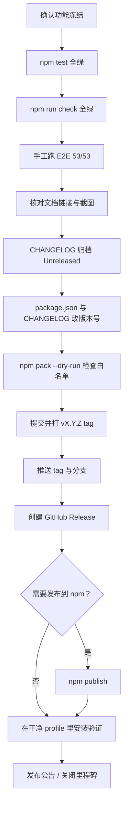

[文档首页](../README.md) / [开发文档](README.md)

# 打包与发布

本仓库既是一个可直接被 DSH 加载的插件包，也是一个按 GitHub 开源项目组织的仓库。本文覆盖：包结构、两种安装方式、版本与 SemVer、发布前检查清单、GitHub 发布占位符替换，以及兼容性声明。

## 1. 插件包结构

DSH 插件包的「可加载性」由 [`package.json`](../../package.json) 的 `dsh` 字段和 [`cordis.patch.yml`](../../cordis.patch.yml) 共同声明：

| 清单字段 | 当前值 | 作用 |
| --- | --- | --- |
| `name` | `dsh-workflow-orchestrator` | 包名；与 Loader 行 `name` 一致（[`package.json:2`](../../package.json#L2)） |
| `version` | `0.1.0` | SemVer 版本（[`package.json:3`](../../package.json#L3)） |
| `type` | `module` | 全 ESM，入口即源码（[`package.json:5`](../../package.json#L5)） |
| `main` | `lib/index.js` | 宿主半区入口（[`package.json:6`](../../package.json#L6)） |
| `exports` | `.`、`./client`、`./locale/*.json`、`./icon`、`./package.json` | 子路径导出；`./client` 是浏览器半区入口（[`package.json:7`](../../package.json#L7)） |
| `engines.node` | `>=20` | Node 版本要求（[`package.json:18`](../../package.json#L18)） |
| `dsh.bundle.patch` | `./cordis.patch.yml` | Bundle patch 文件（[`package.json:29`](../../package.json#L29)） |
| `dsh.client.platform` | `web` | 浏览器半区只面向 Web 壳层（[`package.json:35`](../../package.json#L35)） |
| `dsh.manifestVersion` | `1` | 插件清单版本（[`package.json:37`](../../package.json#L37)） |
| `files` | `lib/index.js`、`lib/host`、`lib/client.js`、`cordis.patch.yml`、`locale/*.json`、`icon.svg`、`README.md`、`README.en.md`、`LICENSE` | npm 发布白名单（[`package.json:39`](../../package.json#L39)） |

### 1.1 Bundle patch 的 insert 行

[`cordis.patch.yml`](../../cordis.patch.yml) 只有一个 `insert`，向 profile 的 Loader 配置插入一行：

```yaml
- insert:
    - id: workflow-orchestrator
      name: 'dsh-workflow-orchestrator'
```

- `id` 是 Loader 行 id（`workflow-orchestrator`），用于诊断与覆盖；`name` 是包名，必须能被 profile 的 `node_modules` 解析到本包。
- 行 id 固定为 `workflow-orchestrator`，`name` 是包名 `dsh-workflow-orchestrator`；两者都要保持稳定——改动会影响已安装 profile 的识别与覆盖，`npm run check` 会分别校验它们（[`tools/verify-package.mjs:117`](../../tools/verify-package.mjs#L117)）。
- 不要在 patch 里写 `config` 或重复插入其它行；所有业务配置都在运行期通过 Cordis 服务读取。

### 1.2 两半区如何被解析

| 半区 | 解析路径 |
| --- | --- |
| 宿主半区 | Bundle patch 的 `insert` 行 → 包名 → `main` / `exports["."]` → [`lib/index.js`](../../lib/index.js) |
| 浏览器半区 | `dsh.client.platform = "web"` + `exports["./client"]` → [`lib/client.js`](../../lib/client.js)，由 Web 壳层以 `window.__ModuleLoader__` 模块加载 |

`exports` 里还有：

- `./locale/*.json`：插件管理器/设置页读取的标题与描述；
- `./icon`：侧栏/设置页图标 [`icon.svg`](../../icon.svg)；
- `./package.json`：允许宿主读取清单。

### 1.3 发布物边界

- `files` 白名单决定 `npm pack` 的内容：`lib/`、清单、locale、图标、README、LICENSE。
- `test/`、`tools/`、`docs/`、`.github/` **不会**进入 npm tarball，但会进入 GitHub 仓库；仓库级自检（`npm run check:package` 与 `npm run check:docs`）会检查这些文件是否齐全、文档链接是否有效。
- 仓库没有构建步骤：发布物就是源码；修改 `lib/` 后不需要编译或打包。
- 运行时零依赖：`package.json` 没有 `dependencies` / `peerDependencies` / `devDependencies`，Node 内置模块 + Cordis 服务即可运行。

## 2. 两种安装方式

### 2.1 插件管理器安装（推荐）

DSH **设置 → 插件 → 添加插件**，输入本仓库目录的绝对路径。插件管理器会把包以 `link:` 方式加入当前 profile 并自动启用。

### 2.2 手动挂载

1. 把仓库目录链接到 profile 的 `node_modules/dsh-workflow-orchestrator`（Windows 用 junction，Unix 用 symlink）；
2. 在 profile 的 `package.json` 里把包名加入 `dsh.profile.bundles`；
3. 刷新页面；宿主半区未热加载时重启 DSH。

两种方式都不复制源码，改仓库文件后按 [开发环境](development.md#43-改完代码后如何生效) 刷新/重启即可生效。

> 如果将来把插件发布到 npm，也可以按普通依赖安装到 profile；当前仓库以本地 `link:` 方式为主，`npm publish` 是可选步骤。

## 3. 版本与 SemVer

当前版本 `0.1.0`，阶段为 pre-1.0。建议的升级规则：

| 变更 | 版本位 |
| --- | --- |
| 不兼容的接口/数据格式变更 | minor（0.x 阶段可包含破坏性变更） |
| 向后兼容的新功能 | minor |
| 向后兼容的修复、文档、测试 | patch |

发布时以 [`package.json:3`](../../package.json#L3) 为唯一机器可读版本，同时同步 [`CHANGELOG.md`](../../CHANGELOG.md) 的版本标题与日期；`AGENTS.md` 等文档里也写了「当前版本 0.1.0」，改版本时一并检查。

`npm run check` 会校验：`version` 符合 SemVer、`CHANGELOG.md` 包含 `[当前版本]`（[`tools/verify-package.mjs:92`](../../tools/verify-package.mjs#L92)、[`:225`](../../tools/verify-package.mjs#L225)）。发布时另外打 `vX.Y.Z` tag，并让 GitHub Release 标题与 tag 一致。

## 4. 发布流程



## 5. 发布前检查清单

- [ ] `npm test`：引擎 12 个 + 存储/路由 5 个用例全部通过。
- [ ] `npm run check`：包清单、`exports` 目标、bundle patch、locale、必备仓库文件、截图数量，以及文档相对链接、图片、Mermaid 与敏感内容全部通过。
- [ ] `npm run test:e2e`（或最近一次可信的 E2E 结果）：53/53 通过，无 `pageerror` / `console.error`。
- [ ] `docs/` 下相对链接与截图都存在；改过 UI 时截图已更新且与文案一致。
- [ ] `CHANGELOG.md` 把 `[Unreleased]` 内容归档到新版本标题下，补日期与底部 compare/release 链接。
- [ ] `package.json` 与 `CHANGELOG.md` 版本号一致；`AGENTS.md` 等文档里的版本描述也已同步。
- [ ] `npm pack --dry-run` 确认 `files` 白名单内容正确（包含 LICENSE、图标、locale）。
- [ ] 提交信息符合 Conventional Commits；工作区没有 `.e2e/`、`.e2e-home/`、`.probe/`、`internal/`、凭据等不该提交的内容。
- [ ] 打 tag：`git tag vX.Y.Z`，推送分支与 tag。
- [ ] GitHub Release：标题 `vX.Y.Z`，正文取自 CHANGELOG 对应条目。
- [ ] （可选）`npm publish`：确认已登录、registry 正确、版本未被占用，且 `private` 不为 `true`（当前已移除）。
- [ ] 在干净 profile 里用 `link:` 或 registry 安装一次，确认侧栏入口、`/api/health`、一次最小执行都正常。

`npm run check` 由两个脚本串行组成：`npm run check:package`（[`tools/verify-package.mjs`](../../tools/verify-package.mjs)）与 `npm run check:docs`（[`tools/check-docs.mjs`](../../tools/check-docs.mjs)）。前者覆盖的关键项：

| 区 | 检查 |
| --- | --- |
| 清单 | 名称、SemVer、MIT、ESM、`engines.node`、repository、`private` 不为 true、`scripts.test` / `scripts.check`、keywords（[`tools/verify-package.mjs:90`](../../tools/verify-package.mjs#L90)） |
| DSH 声明 | `manifestVersion`、`client.platform`、`bundle.patch`、patch 的 `insert`/id/name（[`tools/verify-package.mjs:105`](../../tools/verify-package.mjs#L105)） |
| 入口 | `main` 存在、宿主导出 `name`/`inject`/`apply`、浏览器半区使用 `__ModuleLoader__`、`exports["./client"]` 指向正确（[`tools/verify-package.mjs:125`](../../tools/verify-package.mjs#L125)） |
| 发布白名单 | `files` 非空、含 LICENSE/README、每条都真实存在（[`tools/verify-package.mjs:158`](../../tools/verify-package.mjs#L158)） |
| locale/图标 | `zh`/`en` 可解析且含标题描述、`icon.svg` 合法（[`tools/verify-package.mjs:169`](../../tools/verify-package.mjs#L169)） |
| 仓库文件 | README、AGENTS、LICENSE、CONTRIBUTING、CODE_OF_CONDUCT、SECURITY、CHANGELOG、docs 索引与截图、`.github` 模板与 CI 等（[`tools/verify-package.mjs:188`](../../tools/verify-package.mjs#L188)） |
| 截图 | `docs/assets/images/` 至少 8 张 PNG（[`tools/verify-package.mjs:212`](../../tools/verify-package.mjs#L212)） |
| 文档 lint | 全仓库 Markdown 的相对链接、图片位置、Mermaid 非空/闭合、本机绝对路径与凭据模式（[`tools/check-docs.mjs:80`](../../tools/check-docs.mjs#L80)） |

CI（[`.github/workflows/ci.yml`](../../.github/workflows/ci.yml)）在 `ubuntu-latest` / `windows-latest` × Node 20 / 22 上跑 `npm test` 与 `npm run check`（后者同时覆盖包结构与文档自检），权限只读、超时 10 分钟。E2E 因需要真实模型凭据与浏览器，不进 CI。

## 6. GitHub 仓库发布占位符替换清单

把仓库从「本机开发状态」变成「公开仓库」前，逐项替换下面的占位符。当前仓库已统一使用 `czyt1988` 与 `https://github.com/czyt1988/dsh-workflow-orchestrator`，若换 owner 需要全量替换：

| 类别 | 位置 | 需要替换为 |
| --- | --- | --- |
| 仓库地址 | [`package.json:62`](../../package.json#L62) 的 `repository`、[`:67`](../../package.json#L67) 的 `bugs`、[`:69`](../../package.json#L69) 的 `homepage` | 你的 `OWNER/REPO` |
| 自检硬编码 | [`tools/verify-package.mjs:96`](../../tools/verify-package.mjs#L96) 里写死了 `github.com/czyt1988/dsh-workflow-orchestrator` | 与新仓库地址保持一致，否则 `npm run check` 失败 |
| CHANGELOG 链接 | [`CHANGELOG.md:52`](../../CHANGELOG.md#L52) 的 compare 与 release 链接 | 指向新 `OWNER/REPO` 的 tag |
| 安装示例 | [`README.md`](../../README.md) 与 [`README.en.md`](../../README.en.md) 安装章节的路径示例 | 确认使用 `D:\path\to\dsh-workflow-orchestrator` 这类占位符，没有遗留本机路径 |
| 徽章 | [`README.md`](../../README.md) 与 [`README.en.md`](../../README.en.md) 顶部 `<p align="center">` 中的 CI / License / Node / DSH / PRs 徽章 | 换 owner 时同步 actions badge 的 `OWNER/REPO` 与 shields.io 链接 |
| 安全报告 | `SECURITY.md` 里的 Security Advisories 链接与邮箱占位 | 新仓库地址 + 维护者真实邮箱（替换 `security@example.com`） |
| 行为准则 | `CODE_OF_CONDUCT.md` 里的联系方式占位（`conduct@example.com`） | 维护者真实可用邮箱 |
| 贡献入口 | `CONTRIBUTING.md` 里的 issue / pull 链接 | 新仓库地址 |
| Issue 模板 | `.github/ISSUE_TEMPLATE/` 里的仓库/联系链接 | 新仓库地址 |
| 作者与版权 | [`package.json:60`](../../package.json#L60)、`LICENSE` 的版权行 | 实际作者/版权人 |
| E2E 本机配置 | [`tools/e2e-full.cjs`](../../tools/e2e-full.cjs) 已通过环境变量注入：`DSH_BIN`、`DSH_E2E_PLAYWRIGHT_CORE`、`CHROME_PATH`、`DSH_E2E_CREDENTIALS` | 无需替换；仓库内不保存本机路径与凭据 |
| E2E 模型配置 | [`tools/e2e-full.cjs:187`](../../tools/e2e-full.cjs#L187) 的 `PROFILE_PATCH` 使用 `DSH_E2E_PROVIDER` / `DSH_E2E_MODEL` / `DSH_E2E_BASE_URL` / `DSH_E2E_API_KEY_ENV` | 用环境变量注入真实网关，不要把内网地址写回仓库 |
| 本地材料 | `.e2e/`、`.e2e-home/`、`.probe/`、`internal/` | 保持 gitignore，不提交 |

> `tools/e2e-full.cjs` 已在本仓库发布前完成脱敏：仓库根由 `__dirname` 推导，Playwright、DSH CLI、浏览器、凭据来源与模型网关全部通过环境变量提供，默认值是中性占位；E2E 报告只在本地 `.e2e/` 生成（已 gitignore），不会进入公开仓库。

## 7. 兼容性说明

| 项 | 当前声明/事实 |
| --- | --- |
| Node.js | `engines.node >= 20`；`.nvmrc` 为 22；CI 覆盖 20/22 |
| 运行平台 | `dsh.client.platform = "web"`，即浏览器半区面向 DSH Web 壳层 |
| DSH 版本 | **未声明** `peerDependencies` 或 DSH 版本范围 |
| 运行时依赖 | 无（`dependencies` / `peerDependencies` 均为空） |
| 清单版本 | `dsh.manifestVersion = 1` |
| 已验证环境 | 2026-11-06 在 Windows 桌面端 + 隔离 `dsh --profile web` + 真实模型下完成全链路 E2E（证据与报告见 gitignore 的 `.e2e/`；断言数 53） |

因为未声明 DSH 版本，以下宿主契约在 DSH 升级后需要重新确认（详见 [架构总览](architecture.md#7-待按-dsh-版本确认的契约)）：

- Cordis 服务 `webServer`、`connection`、`sessions`、`agents`、`sessionController` 的方法签名；
- `sessionController.prompt` 的 `mode: 'queue'` 与 `AbortSignal` 语义；
- `turn/start`、`turn/end`、`turn/end.data.reason` 的结构；
- Web 壳层 slot 名称 `main`、`sidebar.panellist`；
- `window.__ModuleLoader__.load({ id, factory })` 的加载约定。

建议在 DSH 大版本升级后至少跑一遍 `npm test` + 一次最小手工验证；涉及会话行为的改动再跑 E2E。

## 相关文档

- 包自检与测试：[测试](testing.md)
- 本地 link 联调：[开发环境](development.md)
- 架构与宿主契约：[架构总览](architecture.md)
