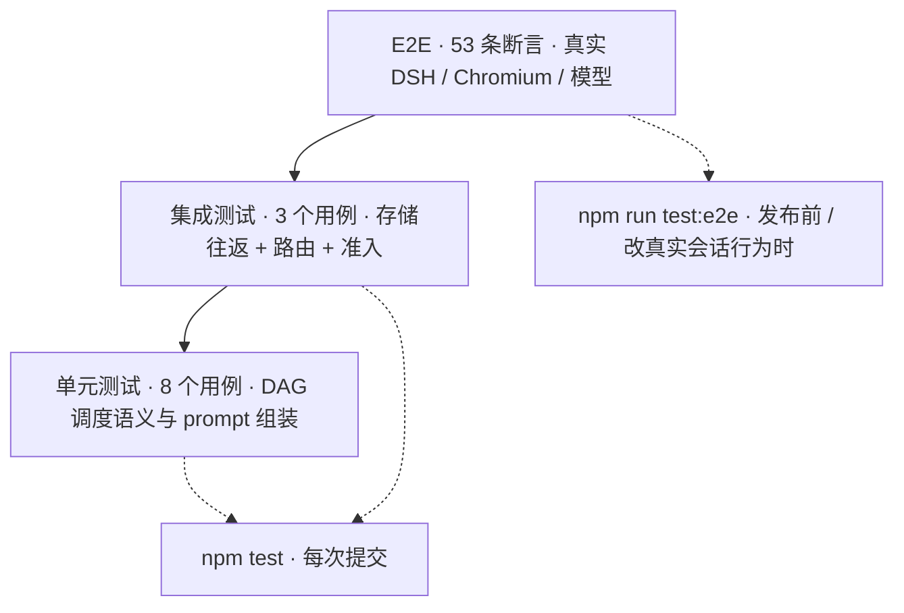
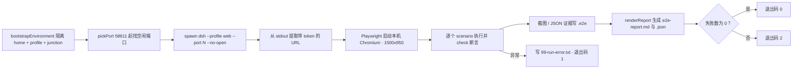

[文档首页](../README.md) / [开发文档](README.md)

# 测试

测试分三层，越往下越快、越往上越接近真实 DSH：

| 层级 | 文件 | 数量 | 需要 DSH？ | 典型耗时 |
| --- | --- | --- | --- | --- |
| 引擎单元测试 | [`test/engine.test.mjs`](../../test/engine.test.mjs) | 8 个用例 | 否（用假执行器） | 秒级 |
| 存储/路由集成测试 | [`test/store-routes.test.mjs`](../../test/store-routes.test.mjs) | 3 个用例 | 否（临时目录 + 假 req/res） | 秒级 |
| 全链路 E2E | [`tools/e2e-full.cjs`](../../tools/e2e-full.cjs) | 53 条断言 | 是（隔离 `DSH_HOME` + 真实模型） | 分钟级 |



## 1. 单元测试：执行引擎

运行：

```powershell
npm test
# 等价于
node --test test/engine.test.mjs test/store-routes.test.mjs
```

引擎单测不启动 DSH：`WorkflowEngine` 构造函数接受 `options.executeTask` 作为测试接缝（[`lib/host/engine.js:202`](../../lib/host/engine.js#L202)），测试用 `createHarness()` 注入假执行器（[`test/engine.test.mjs:32`](../../test/engine.test.mjs#L32)）。假执行器返回 `{ sessionId, output }`，用 `deferred()` 控制完成时机，从而精确断言「谁先启动、谁在等谁」。

| 用例 | 覆盖语义 | 位置 |
| --- | --- | --- |
| 两个不连线任务同时启动 | 无前序节点并发启动 | [`test/engine.test.mjs:97`](../../test/engine.test.mjs#L97) |
| 链式任务等待前序 | `A → B` 串行 | [`test/engine.test.mjs:119`](../../test/engine.test.mjs#L119) |
| 并行网关等待所有输入分支 | 汇合语义：分支未全完成时后继不启动 | [`test/engine.test.mjs:134`](../../test/engine.test.mjs#L134) |
| 失败只级联本分支，独立任务跑完 | `failed` → 下游 `skipped`，无关节点 `completed` | [`test/engine.test.mjs:168`](../../test/engine.test.mjs#L168) |
| `detach` 停止：停调度不停任务 | 运行中任务完成，未启动节点 `cancelled`，整体 `cancelled` | [`test/engine.test.mjs:192`](../../test/engine.test.mjs#L192) |
| `cancel-tasks` 停止：取消所有会话 | 每个运行中节点都调用 `sessionController.cancel` | [`test/engine.test.mjs:214`](../../test/engine.test.mjs#L214) |
| 校验拒绝环、空提示词、悬空网关 | `validateWorkflow` 的三类问题 | [`test/engine.test.mjs:240`](../../test/engine.test.mjs#L240) |
| 上游上下文穿过网关并区分模式 | `upstreamTaskNodes` + `composePrompt` 的 full/summary/none | [`test/engine.test.mjs:257`](../../test/engine.test.mjs#L257) |

## 2. 集成测试：存储与路由

同样不需要 DSH。测试用 `mkdtemp` 建临时目录，把 `dshHomePath` 伪造成该目录（[`test/store-routes.test.mjs:13`](../../test/store-routes.test.mjs#L13)），并手写极简的 `req` / `res` 对象（[`test/store-routes.test.mjs:23`](../../test/store-routes.test.mjs#L23)、[`:37`](../../test/store-routes.test.mjs#L37)）驱动路由处理器。

| 用例 | 覆盖点 | 位置 |
| --- | --- | --- |
| 定义持久化并可重新加载 | `save` → 原子写 → 新实例 `load`；非法边/自环被丢弃；运行记录往返；删除 | [`test/store-routes.test.mjs:67`](../../test/store-routes.test.mjs#L67) |
| `sanitizeWorkflow` 修复恶意输入 | 默认名称、坐标 clamp、`contextMode` 归一、重复 id 重生成、坏边丢弃、settings 归一 | [`test/store-routes.test.mjs:119`](../../test/store-routes.test.mjs#L119) |
| 路由覆盖与准入栅栏 | 403、state/create/save/run/stop、404、405 | [`test/store-routes.test.mjs:138`](../../test/store-routes.test.mjs#L138) |

注意：测试在删除临时目录前会重试等待最后一次写入落盘（[`test/store-routes.test.mjs:49`](../../test/store-routes.test.mjs#L49)），这是 Windows 上原子写 + 异步清理的已知需要。

### 未覆盖的部分（改这些代码时优先跑 E2E 或补用例）

- `waitForTurn()` 的真实事件等待、8 秒启动宽限、6 小时超时分支；
- `executeTaskReal()` 里对 `sessionController` 的真实调用（创建/权限/模型/提示词）；
- 浏览器半区的 React 组件逻辑（当前只由 E2E 覆盖）；
- 状态文件损坏后的 `.corrupt-*` 恢复路径。

## 3. E2E：隔离环境全链路

E2E 不碰日常 profile，所有状态都在仓库下的 `.e2e-home/` 里重建；证据写到 `.e2e/`（两者都已 gitignore）。

### 3.1 环境准备

[`bootstrapEnvironment()`](../../tools/e2e-full.cjs#L215) 依次做这些事：

1. 清空并重建 `.e2e-home/` 与 `.e2e/`，写入 `e2e-run.log`；
2. 准备隔离 home 的 `.credentials.yaml`：若设置了 `DSH_E2E_CREDENTIALS` 则复制该文件（**不读取内容**），否则依赖环境变量或已有凭据；
3. 用 `dsh --profile web --dump-config` 初始化 profile 模板；
4. 写入隔离 profile 的 `cordis.patch.yml`：挂一个 OpenAI 兼容 provider、默认模型、默认权限 `danger-full-access`；
5. 写入 profile 的 `package.json`，`dsh.profile.bundles` 包含 base、web-app 与本插件；
6. 用 `mklink /J` 把仓库目录 junction 到 profile 的 `node_modules/dsh-workflow-orchestrator`（[`ensureJunction`](../../tools/e2e-full.cjs#L169)）；
7. 删除隔离 home 里的 `workflows.json`，保证每次从空状态开始。

### 3.2 启动与驱动



- 端口：优先 `--port`（默认 58611），被占用时向上扫最多 40 个（[`tools/e2e-full.cjs:277`](../../tools/e2e-full.cjs#L277)）。
- 服务生命周期：脚本自己 spawn `dsh web`，结束（或失败）时 `taskkill` 清理；`--keep-server` 可保留现场（[`tools/e2e-full.cjs:91`](../../tools/e2e-full.cjs#L91)）。
- 浏览器：`chromium.launch({ ...(CHROME ? { executablePath: CHROME } : {}), headless: true })`，视口 1500×950（[`tools/e2e-full.cjs:1092`](../../tools/e2e-full.cjs#L1092)）。未设置 `CHROME_PATH` 时使用 Playwright 自带的 Chromium。
- 页面 API 调用：通过 `page.evaluate` 在页面上下文里 `fetch`，因此走的是真实的同源路径与准入栅栏。
- 失败证据：任何未捕获异常写 `.e2e/99-run-error.txt`，并尽量仍生成报告（[`tools/e2e-full.cjs:1127`](../../tools/e2e-full.cjs#L1127)）。

### 3.3 断言分布（53 条）

| 组 | 断言数 | 覆盖内容 |
| --- | --- | --- |
| `1-page` | 3 | 侧栏入口、三栏布局、日志位于中间列 |
| `2-palette` | 1 | 左侧只有任务节点与并行网关两张卡片 |
| `3-node` | 3 | 点击添加、拖放添加、提示词 textarea 出现 |
| `3-inspector` | 6 | 模式/权限/模型/工作区的默认值、模型分组、字段齐全 |
| `4-enter` | 5 | Enter 只换行；无运行记录/无日志/终止按钮禁用/无新会话 |
| `5-save` | 1 | 属性修改自动保存（无需点保存） |
| `6-edge` | 2 | 拖圆点建边、SVG 连接线渲染 |
| `5-persist` | 4 | 刷新后节点、连线、提示词仍在，日志未被伪造 |
| `7-chain` | 8 | A→B 串行完成、会话 ID、日志、会话文件、工作区任务列表即时/刷新后新增 |
| `8-gateway` | 6 | 拓扑、整体完成、四节点完成、C 在 A/B 之后启动、汇合日志、空画布 |
| `9-stop` | 8 | 终止对话框、detach 四断言、cancel-tasks 三断言 |
| `10-failure` | 4 | 失败节点状态、错误信息、ERROR 日志、工作流失败 |
| `11-console` | 2 | 无 `pageerror`、无 `console.error` |
| **合计** | **53** | 报告写入 `.e2e/e2e-report.md` 与 `.e2e/e2e-report.json` |

断言由脚本内的 `check(group, name, pass, detail)` 记录（[`tools/e2e-full.cjs:106`](../../tools/e2e-full.cjs#L106)），报告由 [`renderReport()`](../../tools/e2e-full.cjs#L1040) 生成。

### 3.4 为什么 E2E 不进 CI

- 需要**真实模型凭据**与可访问的模型网关，CI 环境没有；
- 需要本机 Chrome 与 `playwright-core`，还要拉起完整 DSH 进程；
- 单个场景要等真实模型轮次，整轮是分钟级，且失败排查依赖截图/JSON 证据；
- CI 目前只跑 `npm test` 与 `npm run check` 这类无需外部凭据的检查。

因此 **E2E 是发布前或改动真实会话行为时的手工验证步骤**，不是每次提交的必跑项。

### 3.5 本机化配置（环境变量）

脚本不含任何本机绝对路径，仓库根由 `__dirname` 推导；换机器或接自己的模型网关时，用下面的环境变量注入即可：

| 环境变量 | 用途 | 默认值 |
| --- | --- | --- |
| `DSH_BIN` | DSH CLI 入口 `lib/bin.js` | 从 `@deepseek-ai/dsh` 模块解析 |
| `DSH_E2E_PLAYWRIGHT_CORE` | `playwright-core` 包路径 | 按模块名解析 `playwright-core` / `playwright` |
| `CHROME_PATH` | 浏览器可执行文件 | Playwright 自带 Chromium |
| `DSH_E2E_PROVIDER` / `DSH_E2E_PROVIDER_DISPLAY` | 隔离 profile 的模型 provider id / 显示名 | `e2e` / `E2E` |
| `DSH_E2E_MODEL` | 模型 id | `e2e-model` |
| `DSH_E2E_BASE_URL` | OpenAI 兼容网关地址 | `https://api.example.com/v1` |
| `DSH_E2E_API_KEY_ENV` | API Key 所在环境变量名 | `DSH_E2E_API_KEY` |
| `DSH_E2E_CREDENTIALS` | 复制进隔离 home 的 `.credentials.yaml` | 不复制 |

断言里的模型分组与默认模型会跟随上述变量（`${provider}::${model}`），因此换 provider 不需要改脚本。

## 4. 如何新增测试

### 4.1 加引擎用例

1. 在 [`test/engine.test.mjs`](../../test/engine.test.mjs) 里用 `createHarness({ executeTask })` 建引擎；
2. 用 `task()` / `gateway()` / `workflow()` 构造定义；
3. 用 `deferred()` 控制假执行器的完成时机，用 `waitFor()` 等状态；
4. 断言运行结果（`recorded[0]`）与节点状态，必要时断言 `cancels`。

要求：用例之间不共享状态；不依赖真实计时器精度；每个用例只验证一条调度语义。

### 4.2 加存储/路由用例

1. 用 `withTempDir()` + `fakeCtx(dir)` 建独立 `DSH_HOME`；
2. 存储用例直接 `new WorkflowStore(...)`，路由用例用 `createRouteHandler({ store, engine, catalogs, connection })`；
3. `call(method, path, body)` 风格断言 `status` 与 `payload`（参考现有第三个用例）；
4. 断言后记得 `persist()` / 等待写入，避免 Windows 上临时目录删除失败。

### 4.3 加 E2E 场景

1. 在 [`tools/e2e-full.cjs`](../../tools/e2e-full.cjs) 里新增 `scenarioXxx()`，用 `check()` 记录断言；
2. 需要证据时用 `screenshot(name)` 与 `writeEvidence(name, value)`，命名沿用 `NN-name`；
3. 在文件底部的主流程里按顺序调用（[`tools/e2e-full.cjs:1085`](../../tools/e2e-full.cjs#L1085)）；
4. 断言必须来自真实界面/接口行为，禁止手写固定 JSON 冒充结果；
5. 新增断言会改变报告总数，同步更新本文的分布表。

> 新增测试文件后，记得把它加入 [`package.json:22`](../../package.json#L22) 的 `scripts.test`，否则 `npm test` 不会执行。

## 5. 采集文档截图

文档截图来自真实 E2E 运行（或真实手工操作），**不要用设计稿或拼接图冒充实现**。

1. 跑 `npm run test:e2e`，在 `.e2e/` 得到 `NN-name.png` 与同名 `.txt` 证据；
2. 按内容挑选对应场景，复制到 [`docs/assets/images/`](../assets/images/) 并改成文档用名。当前映射（见 [`AGENTS.md`](../../AGENTS.md) 第 9 节）：

| 文档用图 | E2E 来源 | 内容 |
| --- | --- | --- |
| `panel-overview.png` | `10-panel.png` | 三栏总览 + 空态 |
| `add-node.png` | `11-node.png` | 点击节点卡新增节点 |
| `inspector.png` | `12-inspector.png` | 属性区完整字段 |
| `connect-edge.png` | `13-edge.png` | 节点连线 |
| `enter-no-run.png` | `13-enter-no-run.png` | Enter 只换行 |
| `persistence.png` | `14-persistence.png` | 刷新后仍持久化 |
| `chain-run.png` | `15-chain-run.png` | A→B 串行成功 |
| `gateway-graph.png` | `17-gateway-graph.png` | 网关拓扑 |
| `gateway-run.png` | `18-gateway-run.png` | 网关汇合执行 |
| `stop-dialog.png` | `19-stop-dialog.png` | 终止对话框 |
| `stop-detach.png` | `20-stop-detach.png` | 仅停止工作流 |
| `stop-cancel.png` | `21-stop-cancel.png` | 停止并终止任务 |
| `failure.png` | `22-failure.png` | 失败节点与 ERROR 日志 |

3. 保持 1500×950 的界面比例与中文文案；截图里不要出现真实会话内容、个人路径或凭据；
4. `npm run check` 会校验截图目录至少 8 张 PNG（[`tools/verify-package.mjs:212`](../../tools/verify-package.mjs#L212)），并检查 `docs/` 下的必备文件；其中的 `npm run check:docs` 还会校验所有文档的相对链接、图片、Mermaid 块与敏感内容（[`tools/check-docs.mjs:80`](../../tools/check-docs.mjs#L80)）；
5. 用户文档引用截图时使用标准 Markdown 图片语法：路径指向 `../assets/images/` 下的 PNG，alt 用中文，下一行写 `*图 N：一句话说明。*`。

## 相关文档

- 本地命令与排障：[开发环境](development.md)
- CI 与发布检查：[打包与发布](packaging-and-release.md)
- 调度语义细节：[执行引擎](execution-engine.md)
