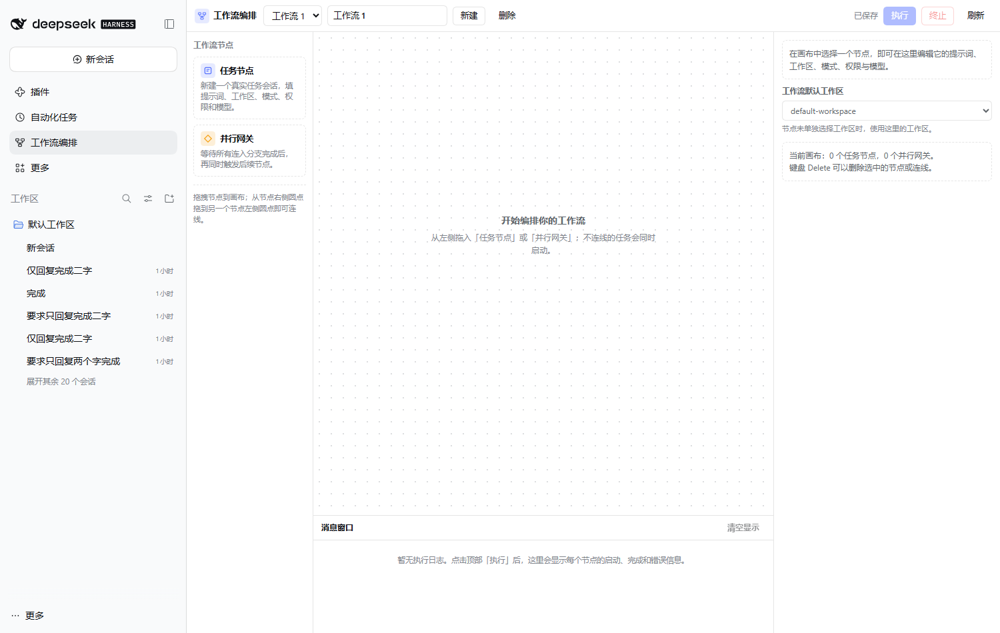

[文档首页](../README.md) / [用户文档](README.md)

# 用户文档

`dsh-workflow-orchestrator`（界面上的中文名是「工作流编排」）是 DSH（DeepSeek Harness）的可视化工作流插件，当前版本 **0.4.0**。它把多个 DSH 任务串成一条可执行的工作流：每个任务节点在运行时新建一个**真实的任务会话**，任务之间可以串行、并行，也可以用并行网关汇合；画布和已结束的运行记录保存在 DSH 的数据目录里，刷新页面或重启 DSH 后仍在。

本页是用户文档的索引。第一次使用请从 [快速开始](getting-started.md) 读起；已经装好插件、只想查某个功能，可以按下面的表格直接跳转。

*图 1：打开「工作流编排」后的完整界面：顶部工具栏、左侧节点面板、中间画布、底部消息窗口与右侧属性区。*

## 一句话定位

**在画布上把若干 DSH 任务按连线顺序编排，一键执行，并观察每个任务节点创建的任务会话、运行状态与日志。**

## 建议阅读顺序

按使用顺序阅读，大约 30 分钟可以读完前四篇：

| 顺序 | 文档 | 读完后你会知道 |
| --- | --- | --- |
| 1 | [快速开始](getting-started.md) | 如何安装插件、打开入口，并跑通第一个 `A → B` 工作流 |
| 2 | [界面导览](interface.md) | 顶部工具栏、左侧节点面板、画布、消息窗口、属性区分别是什么 |
| 3 | [搭建工作流](building-workflows.md) | 七种节点、怎么连线、属性字段的含义和校验规则 |
| 4 | [执行与监控](running-and-monitoring.md) | 常见拓扑和从节点开始执行的范围、定时自动触发、判断/终止节点的提前结束、动作节点、等待任务完成、节点状态、日志、任务会话与并发上限 |
| 5 | [终止与错误处理](stopping-and-errors.md) | 手动终止与提前结束的差别、失败为什么会让下游「已跳过」、常见错误怎么办 |
| 6 | [数据与常见问题](data-and-faq.md) | 数据存在哪里、容量上限、备份迁移、清空与卸载、FAQ |

## 文档一览

| 文档 | 内容 | 什么时候读 |
| --- | --- | --- |
| [快速开始](getting-started.md) | 安装（插件管理器 / 手动 junction）、验证安装、创建并执行第一个工作流 | 首次使用 |
| [界面导览](interface.md) | 三栏布局、空态、按钮、快捷键 Delete、自动保存状态、消息窗口、跨工作区提示与配色 | 刚打开页面、找不到功能时 |
| [搭建工作流](building-workflows.md) | 任务 / 判断 / 终止 / 并行网关 / 定时 / 动作 / 等待任务完成节点、拖放/点击添加、连线规则、节点名称/提示词/上游上下文/工作区（含配色）/模式/权限/模型、从某个节点开始执行 | 编排具体业务流程时 |
| [执行与监控](running-and-monitoring.md) | 无连线并行、`A → B` 串行、`A、B → 网关 → C` 汇合、判断/终止节点提前结束、定时自动触发、动作节点、等待任务完成、并发 8、6 小时超时、日志列、任务会话 | 点「执行」前后 |
| [终止与错误处理](stopping-and-errors.md) | `detach` / `cancel-tasks`、判断/终止节点提前结束、失败与跳过级联、错误呈现、常见错误示例 | 运行不顺利时 |
| [数据与常见问题](data-and-faq.md) | `workflows.json`、容量上限、备份/迁移/清空、卸载重装、FAQ、已知限制 | 想备份数据或排查环境问题时 |

## 图例与约定

- 界面上的按钮、菜单和提示文字用「」括起，例如「执行」「终止」「消息窗口」。
- **节点状态**：等待中、运行中、已完成、失败、已取消、已跳过、未执行（「未执行」只出现在「从此节点开始执行」的运行中）。带颜色的状态同时出现在画布节点、属性区和消息窗口标题栏。
- **运行状态**：运行中、已完成、失败、已停止。运行状态是整条工作流的结果，不是单个节点的状态。
- 日志级别：`INFO`（正常进展）、`WARN`（警告或主动停止）、`ERROR`（失败）。
- 路径示例使用占位写法，例如 `D:\path\to\plugin`；实际路径以你的机器为准。
- 文档对应插件版本 **0.4.0**；不同版本的界面文案或上限可能变化。

## 相关文档

- 开发与实现细节（两半区结构、调度算法、数据模型、HTTP 接口）见 [开发文档](../dev/architecture.md)。
- 插件的项目介绍与安装状态见仓库根目录的 [README](../../README.md)。
- 已知限制的统一清单在 [数据与常见问题：已知限制](data-and-faq.md#已知限制)。
