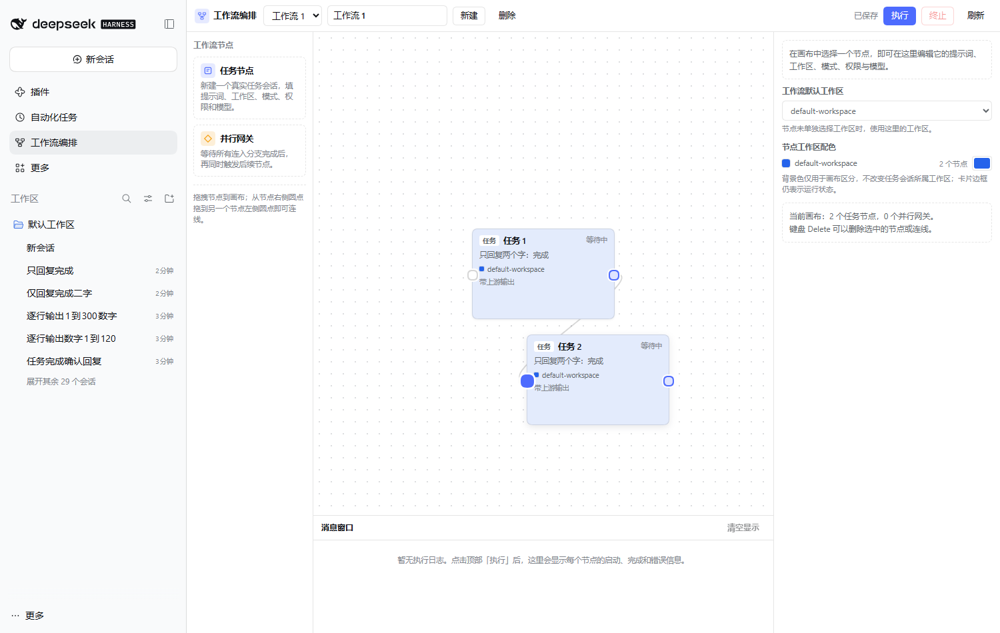
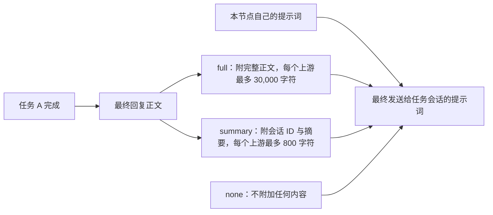
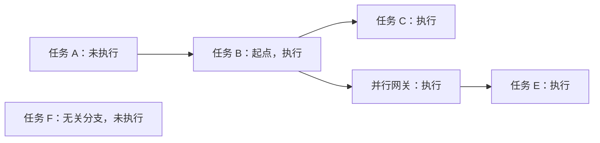

[文档首页](../README.md) / [用户文档](README.md)

# 搭建工作流

工作流由**节点**和**连线**组成：节点描述要执行什么，连线描述先后与汇合关系。这篇文档说明两种节点、如何添加和连线、每个属性字段的含义，以及执行前的校验规则。

## 两种节点

| 节点类型 | 是否创建任务会话 | 作用 | 必填/约束 |
| --- | --- | --- | --- |
| 任务节点 | 是，每个节点创建 1 个真实会话 | 把提示词发给一个新任务会话，等待本轮结束并收集最终回复 | 提示词不能为空 |
| 并行网关 | 否 | 汇合多条分支：所有连入分支都完成后，才激活后续节点 | 至少 1 条输入连线和 1 条输出连线 |

- 任务节点默认名为「任务 1」「任务 2」……；并行网关默认名为「并行网关」。
- 任务节点可以设置工作区、模式（Agent 预设）、权限、模型；网关没有这些字段。
- 网关只做汇合与扇出，不产生会话，因此不会有自己的「任务会话」ID。

## 添加节点

有两种方式：

1. **点击卡片**：点击左侧「任务节点」或「并行网关」，节点会加在画布可见区域中央；连续添加会按固定偏移错开。
2. **拖拽卡片**：把卡片拖到画布上的目标位置松开，节点以鼠标位置为中心放置。

添加后可以按住节点拖动调整位置，位置会自动保存。删除节点：选中后按 `Delete`，或点属性区底部的「删除节点」/「删除网关」；删除节点会同时删除与它相连的连线。

## 连线规则

连线表示执行顺序和依赖关系：

- 从节点**右侧的输出端口**按住，拖到另一个节点**左侧的输入端口**后松开。
- 只能从输出端口连到输入端口；不能从自己的输出端口连回自己的输入端口。
- 同一对节点之间不允许重复连线，已连过会提示「这两个节点已经连过线了」。
- 点击连线可以选中它，按 `Delete` 删除。
- 画布允许连出环，但环在工作流校验时会被拒绝（见下方校验规则），所以最终能执行的工作流一定是**有向无环图**。

*图 5：从「任务 1」右侧圆点拖到「任务 2」左侧圆点，创建一条带箭头的连线。*

### 连线决定执行语义

| 拓扑 | 执行语义 |
| --- | --- |
| 两个任务**不连线** | 没有前序依赖，执行时同时启动（受并发上限约束） |
| `A → B` | A 完成后才启动 B；A 失败/取消/跳过时 B 不会启动 |
| `A → B` 且 `A → C` | A 完成后 B、C 同时启动（扇出） |
| `A、B → 并行网关 → C` | A、B 同时执行，**都完成**后网关汇合，再启动 C |
| 多个任务连到同一任务 | 该任务要等所有前序都完成才启动；任一前序未成功则整节点跳过 |

## 属性字段逐项说明

选中任务节点后，右侧属性区从上到下是以下字段。

### 节点名称

- 任意文本，默认「任务 N」；用于画布显示、日志和错误信息。
- 保存到数据文件时会截断到 80 个字符。

### 提示词

- 任务会话要执行的指令，可多行；`Enter` 只换行，不会启动任务，只有顶部「执行」才启动工作流。
- 执行时提示词不能为空（去掉首尾空白后为空会校验失败）。
- 数据文件最多保存 200,000 个字符，超出部分会被截断。

*图 6：在提示词里多次按 Enter 只产生空行，消息窗口仍为空、「终止」仍禁用，没有新的任务会话。*

### 上游上下文

决定下游节点收到提示词时，是否附带它上游任务的结果。三个选项：

| 选项 | 行为 |
| --- | --- |
| `带上游任务输出（默认）` | 把上游任务最终回复的正文附在本节点提示词后面，每个上游最多 30,000 字符 |
| `带上游任务会话摘要` | 只附加「会话 ID + 一段摘要」，每个上游最多 800 字符，节省上下文 |
| `完全不传` | 只发送本节点自己的提示词 |

补充规则：

- 「上游」指**最近的、跨过并行网关仍然可达的任务节点**；网关本身不产生输出，只作为中间层被穿过。
- 只有输出非空的上游任务才会被附加；没有任何可附加内容时，发送的就是本节点自己的提示词。
- 运行时日志里的「提示词已发送（N 字）」是**拼接后**的字符数，所以带上下文的下游节点字数会大于你在输入框里写的字数。

### 工作区

同一个工作流里的任务节点可以属于不同的工作区；工作流本身不要求所有节点用同一个工作区。

- 新建的任务会话会出现在该节点**有效工作区**的任务列表里。
- 有效工作区的解析顺序：节点单独选择的 `task.workspaceId` → 工作流设置里的默认工作区 `settings.defaultWorkspaceId` → 宿主提供的工作区列表中的第一个。
- 新节点通常已选中宿主的默认工作区；也可以改选「使用工作流默认工作区」，由工作流设置里的默认工作区决定。
- 迁移数据到另一台机器后，旧的工作区 ID 可能不存在，建议重新选择工作区；配色同样按工作区 ID 保存，迁移后需要重新调整。

#### 节点卡片上的工作区行

每个任务卡片在提示词预览下方都有一行工作区信息：

- 左侧是 7×7 的圆角色块，颜色即该工作区的配色；右侧是工作区标题（过长会省略）。
- 节点继承工作流默认工作区时，标题后追加浅色小字「默认」。
- 整个工作流没有可用工作区时，这一行显示「未设置工作区」（灰色、无色块）；并行网关卡片没有工作区行。

#### 跨工作区提示与配色

- 当前画布任务节点的有效工作区去重后**超过 1 个**时，工具栏下方会显示常驻提示条：「当前工作流跨 N 个工作区：A、B。节点卡片已用不同背景色区分，可在右侧「节点工作区配色」中调整。」它只是提示，**不阻塞执行**。
- 不同工作区的卡片使用不同浅色背景，便于在画布上区分；默认调色板有 8 种颜色，按工作区在画布任务节点中**首次出现的顺序**依次分配，超出后循环取色。
- 修改颜色：不选中任何节点，在右侧属性区「节点工作区配色」里点颜色选择器即可，改动会自动保存；被改过的工作区旁边会出现「恢复默认」按钮，点击删除该工作区的自定义颜色。
- 自定义颜色保存在工作流的 `settings.workspaceColors` 里（键是工作区 ID，值是 `#rrggbb`），只保存你改过的那几个；最多保存 40 项，超出或格式不合法的值会被丢弃。
- 背景色**只用于画布区分**，不改变任务会话所属工作区；卡片**边框颜色仍只表示运行状态**（运行中 / 已完成 / 失败等）。

### 模式

- 对应 DSH 新建任务时的 **Agent 预设**，默认「标准模式」（如果 DSH 标记了默认预设，则使用标记的那个）。
- 选项来自运行中的 DSH，不是写死的列表；选项为空时保留「使用默认模式」。

### 权限

- 权限预设决定任务会话可以做什么，默认「完全权限」（`danger-full-access`）。
- 会话创建成功后立即应用；如果应用失败，日志里会出现一条 `WARN`，任务改用会话默认权限继续执行。

### 模型

- 默认「使用默认模型」，即 DSH 当前的默认模型。
- 也可以按提供商分组为单个任务覆盖模型；选项格式是 `提供商::模型`，面板只保存提供商和模型两个字段。
- 模型选择失败时记录 `WARN` 并沿用默认模型，不会让节点直接失败。

### 节点状态与任务会话

- **节点状态**：等待中 / 运行中 / 已完成 / 失败 / 已取消 / 已跳过 / 未执行（「未执行」只出现在「从此节点开始执行」的运行中，表示不在本次执行范围）。
- **任务会话**：运行后显示真实会话 ID，可点「打开任务会话」跳转，或「复制 ID」；「未执行」的节点没有会话 ID。
- 失败时错误原因以红色文字显示在节点状态下方；运行卡片还会显示本次「执行范围」（「全部节点」或「从「X」开始（跳过 N 个节点）」）。

### 工作流默认工作区

没有选中节点时，属性区显示「工作流默认工作区」。它作为所有未单独指定工作区的任务节点的兜底；新建工作流时会尽量使用宿主默认工作区。

## 从某个节点开始执行

除了顶部工具栏的全量「执行」，还可以从任意**任务节点**开始跑：选中节点后，点属性区最顶部的「从此节点开始执行」。

### 执行范围怎么算

本次执行范围 = 该节点 + 从它出发、沿有向边可达的**全部下游节点**（包括跨过并行网关到达的任务和网关）。范围之外的前置节点、无关分支都不会运行。

以上图为例，从「任务 B」开始执行时：B、C、D、E 会启动；A 和 F 保持「未执行」，**不会创建任务会话**。

要点：

- 触发前会先保存当前画布，和使用「执行」时一样以提交时的快照为准。
- 范围外的节点显示「未执行」（`not-run`），不算失败、不参与整体状态判定；范围内的节点全部完成时，整次运行仍是「已完成」。
- 只有**范围内**节点参与调度：范围外前序视为不存在，不会被等待，也不会因为范围外节点失败而阻塞。
- 上游上下文只收集**范围内已完成**的上游任务输出；「未执行」或范围外的上游不会进入下游提示词。
- 消息窗口第一行日志会说明范围：`从节点「任务 B」开始执行：跳过 N 个不在下游范围内的节点`。
- 属性区运行卡片的「执行范围」一行显示本次是「全部节点」还是「从「任务 B」开始（跳过 N 个节点）」。

### 校验范围

启动前只校验本次执行范围内的节点：

- 范围内任务节点的提示词不能为空；
- 范围内并行网关至少有 1 条范围内的输入边（如果起点本身就是并行网关则豁免）和至少 1 条范围内的输出边；
- 范围内子图不能有环。

范围外节点的空提示词、悬空网关、环路**不阻塞**这次范围执行。起点节点不存在时（例如通过 API 指定了一个已删除的 id）会启动失败：`工作流校验失败：起始节点不存在：<id>`。

### 限制

- 属性区只对**任务节点**提供这个按钮；通过 JSON API 可以把并行网关当起点（引擎允许），界面不提供。
- 这不是断点续跑：未执行的节点不会在下一次运行里自动补跑。下一次点顶部「执行」仍会全量执行，所有节点都会创建新的任务会话。

## 校验规则

点击「执行」时，宿主会先校验整个工作流；点「从此节点开始执行」时只校验本次执行范围内的节点。校验不通过不会产生运行记录，面板顶部会显示「启动失败：工作流校验失败：…」。

| 规则 | 失败提示 |
| --- | --- |
| 至少有一个节点 | 至少需要一个节点 |
| 范围内任务提示词非空（全量执行时即全部任务节点） | 任务「X」还没有填写提示词 |
| 范围内并行网关有输入连线（起始节点是网关时豁免） | 并行网关「X」缺少输入连线 |
| 范围内并行网关有输出连线 | 并行网关「X」缺少输出连线 |
| 范围内子图不能有环 | 工作流中存在环路，无法执行 |
| 起始节点必须存在（仅范围执行） | 起始节点不存在：<id> |

其他启动失败提示：

- `该工作流正在运行（run …）`：同一工作流同一时间只能有一次运行，先终止当前运行。
- `工作流不存在`：工作流已被删除或数据文件被清空，刷新后重新创建。
- `工作流校验失败：…`：把上面多条问题用「；」连接在一起。

## 限制与边界

- 只提供**并行网关**一种网关（没有排他网关、条件分支等）。
- 每个任务节点在一次运行中只执行**一次**，不提供循环、重试、定时触发。
- 画布没有撤销/重做，也没有复制粘贴；删除节点会立即自动保存。
- 一个工作流最多 200 个节点、400 条连线；最多保留 80 个工作流（超出时最旧的会被丢弃）。
- 工作流名称最多 120 个字符，节点名称最多 80 个字符，提示词最多 200,000 个字符。
- 运行期间继续编辑画布不会影响**本次**运行，运行使用的是点击「执行」（或「从此节点开始执行」）时的快照。
- 「从此节点开始执行」只缩小本次运行范围，不做断点续跑：未执行的节点不会自动补跑，下一次「执行」仍会全量执行。
- 每个任务节点的有效工作区在运行时解析；范围外的节点即使工作区不存在，也不会影响本次范围执行。

## 下一步

- 看执行时状态怎么变化、日志怎么读：读 [执行与监控](running-and-monitoring.md)。
- 想了解上游上下文在运行时的实际效果：同样在 [执行与监控](running-and-monitoring.md) 的日志示例里能看到发送字数。
- 校验或运行失败：读 [终止与错误处理](stopping-and-errors.md)。
