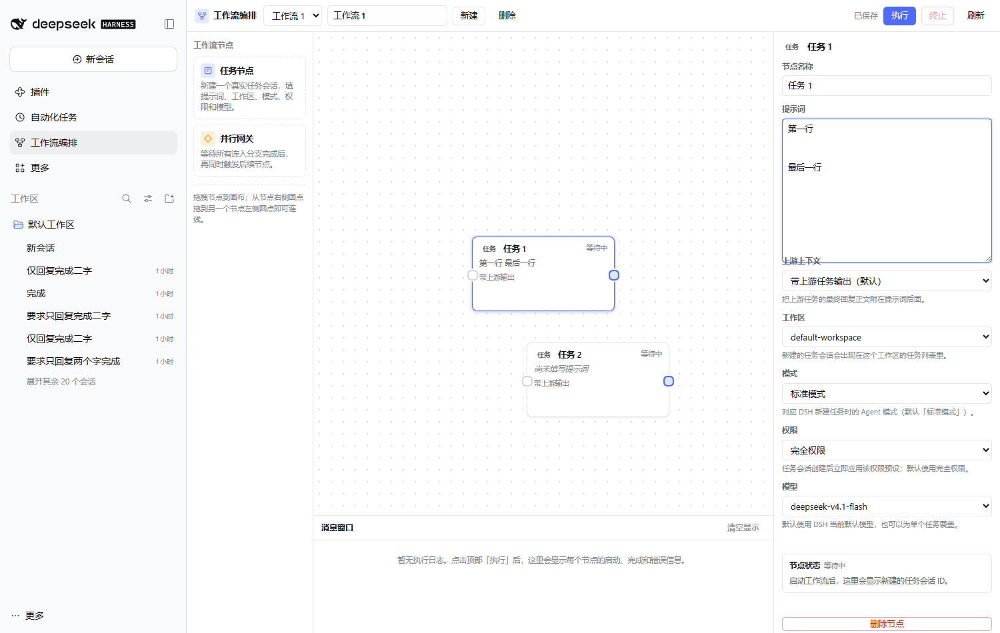
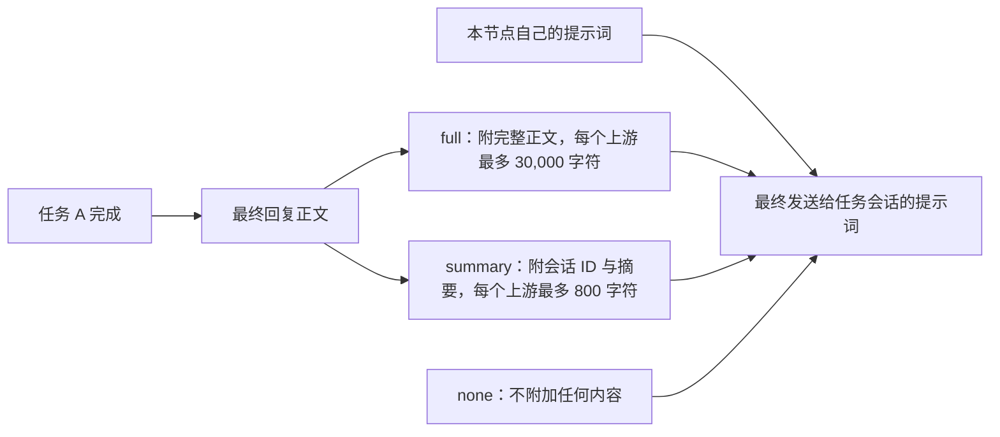
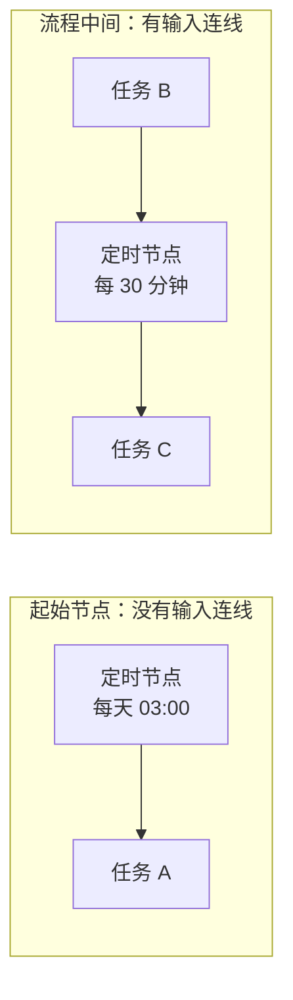
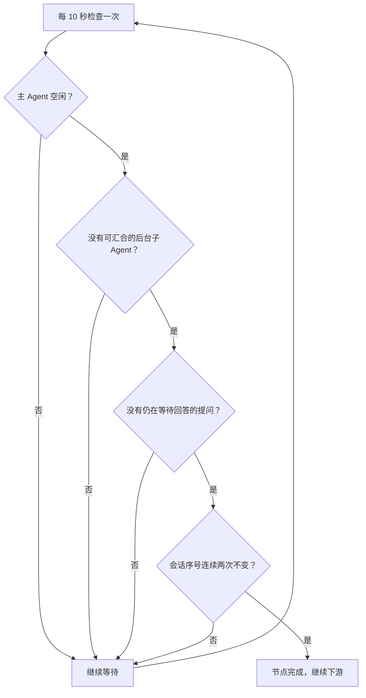
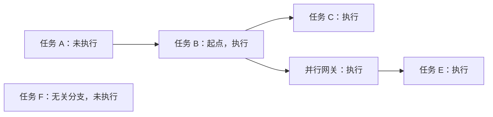

[文档首页](../README.md) / [用户文档](README.md)

# 搭建工作流

工作流由**节点**和**连线**组成：节点描述要执行什么，连线描述先后与汇合关系。这篇文档说明七种节点、如何添加和连线、每个属性字段的含义，以及执行前的校验规则。

## 七种节点

| 节点类型 | 是否创建任务会话 | 作用 | 必填/约束 |
| --- | --- | --- | --- |
| 任务节点 | 是，每个节点创建 1 个真实会话 | 把提示词发给一个新任务会话，等待本轮结束并收集最终回复 | 提示词不能为空 |
| 判断节点 | 是，1 个真实会话 | 评估上游任务输出，判定继续或提前结束整次工作流 | 提示词非空；上游上下文不能「完全不传」；至少 1 条输入连线，且上游能找到任务 |
| 终止节点 | 否 | 到达即提前结束本次工作流，后续节点不再执行 | 至少 1 条输入连线；不能有输出连线 |
| 并行网关 | 否 | 汇合多条分支：所有连入分支都完成后，才激活后续节点 | 至少 1 条输入连线和 1 条输出连线 |
| 定时节点 | 否 | 按时间表触发：作为起始节点时到点自动启动整个工作流；放在流程中间时等待下一次触发时间，再继续下游 | 至少 1 条输出连线；一次性时间必须是将来；每周至少选一天；重复间隔 1–10,080 分钟 |
| 动作节点 | 否 | 到达时执行一次系统或网络动作（关机、重启、睡眠、锁屏、取消关机/重启、打开网址、打开文件或文件夹、运行命令、HTTP 请求、写日志） | 按动作类型填写必填字段；关机/重启缓冲 10–3,600 秒；默认试运行 |
| 等待任务完成节点 | 否 | 轮询你勾选的 DSH 任务会话，等它们真正结束后再继续下游 | 至少 1 条输出连线；至少勾选一个任务；最多 30 个 |

- 任务节点默认名为「任务 1」「任务 2」……；判断节点默认「判断 1」……；终止节点默认「终止节点」；并行网关默认「并行网关」；定时节点默认「定时 1」……；动作节点默认「动作 1」……；等待任务完成节点默认「等待任务完成 1」……。
- 任务节点与判断节点可以设置工作区、模式（Agent 预设）、权限、模型；终止节点、网关、定时节点、动作节点与等待节点没有这些字段。
- 判断节点与终止节点都不产生业务输出：判断节点的判定文本不会传给下游，终止节点没有输出端口；网关只做汇合与扇出。
- 定时、动作、等待节点都属于**控制节点**：不创建任务会话，也不会把自己的文本传给下游提示词；它们通过改变「什么时候继续」或「做什么系统动作」来影响流程。

## 添加节点

有两种方式：

1. **点击卡片**：点击左侧「任务节点」「判断节点」「终止节点」「并行网关」「定时节点」「动作节点」或「等待任务完成」，节点会加在画布可见区域中央；连续添加会按固定偏移错开。
2. **拖拽卡片**：把卡片拖到画布上的目标位置松开，节点以鼠标位置为中心放置。

添加后可以按住节点拖动调整位置，位置会自动保存。删除节点：选中后按 `Delete`，或点属性区底部的「删除节点」/「删除网关」；删除节点会同时删除与它相连的连线。

## 连线规则

连线表示执行顺序和依赖关系：

- 从节点**右侧的输出端口**按住，拖到另一个节点**左侧的输入端口**后松开。
- 只能从输出端口连到输入端口；不能从自己的输出端口连回自己的输入端口。
- 同一对节点之间不允许重复连线，已连过会提示「这两个节点已经连过线了」。
- 点击连线可以选中它，按 `Delete` 删除。
- 画布允许连出环，但环在工作流校验时会被拒绝（见下方校验规则），所以最终能执行的工作流一定是**有向无环图**。

*图 5：从「任务 1」右侧圆点拖到「任务 2」左侧圆点，创建一条带箭头的连线。*

### 连线决定执行语义

| 拓扑 | 执行语义 |
| --- | --- |
| 两个任务**不连线** | 没有前序依赖，执行时同时启动（受并发上限约束） |
| `A → B` | A 完成后才启动 B；A 失败/取消/跳过时 B 不会启动 |
| `A → B` 且 `A → C` | A 完成后 B、C 同时启动（扇出） |
| `A、B → 并行网关 → C` | A、B 同时执行，**都完成**后网关汇合，再启动 C |
| 多个任务连到同一任务 | 该任务要等所有前序都完成才启动；任一前序未成功则整节点跳过 |
| `A → 判断节点 → B` | A 完成后判断节点评估 A 的输出；判定继续才启动 B，判定终止则整次工作流提前结束 |
| `A → 终止节点` | A 完成后立即提前结束整次工作流，尚未启动的节点全部不执行 |
| `定时节点（起始，无输入） → B` | 宿主调度器到点自动启动整个工作流，从定时节点开始往下执行 |
| `A → 定时节点 → B` | A 完成后，本次运行停在定时节点等待下一次触发时间，到点再启动 B（只触发一次，不在本次运行中循环） |
| `A → 动作节点` 或 `A → 动作节点 → B` | A 完成后执行一次动作；动作完成后继续下游，也可放在链尾收尾。动作节点不产生上下文，下游看不到它的执行结果 |
| `等待任务完成 → B` 或 `A → 等待任务完成 → B` | 等到你勾选的任务真正结束后再启动 B；可作为起始节点，也可以放在流程中间 |

## 属性字段逐项说明

下面按节点类型说明右侧属性区的字段。选中任务节点后，从上到下是节点名称、提示词、上游上下文、工作区、模式、权限、模型等任务字段。

### 节点名称

- 任意文本，默认「任务 N」；用于画布显示、日志和错误信息。
- 保存到数据文件时会截断到 80 个字符。

### 提示词

- 任务会话要执行的指令，可多行；`Enter` 只换行，不会启动任务，只有顶部「执行」才启动工作流。
- 执行时提示词不能为空（去掉首尾空白后为空会校验失败）。
- 数据文件最多保存 200,000 个字符，超出部分会被截断。
- 提示词里可以写「如有不确定之处先用 `ask_user_question` 向我确认」这类指令：任务会话是真实会话，agent 提问时节点会进入「等待用户回复」，你回答后它继续执行（见 [执行与监控：等待用户回复](running-and-monitoring.md#等待用户回复)）。需要无人值守的流程则应写明「不要提问，自行决策」。

*图 6：在提示词里多次按 Enter 只产生空行，消息窗口仍为空、「终止」仍禁用，没有新的任务会话。*

### 上游上下文

决定下游节点收到提示词时，是否附带它上游任务的结果。三个选项：

| 选项 | 行为 |
| --- | --- |
| `带上游任务输出（默认）` | 把上游任务最终回复的正文附在本节点提示词后面，每个上游最多 30,000 字符 |
| `带上游任务会话摘要` | 只附加「会话 ID + 一段摘要」，每个上游最多 800 字符，节省上下文 |
| `完全不传` | 只发送本节点自己的提示词 |

补充规则：

- 「上游」指**最近的、跨过并行网关仍然可达的任务节点**；网关本身不产生输出，只作为中间层被穿过。
- 只有输出非空的上游任务才会被附加；没有任何可附加内容时，发送的就是本节点自己的提示词。
- 运行时日志里的「提示词已发送（N 字）」是**拼接后**的字符数，所以带上下文的下游节点字数会大于你在输入框里写的字数。

### 工作区

同一个工作流里的任务节点可以属于不同的工作区；工作流本身不要求所有节点用同一个工作区。

- 新建的任务会话会出现在该节点**有效工作区**的任务列表里。
- 有效工作区的解析顺序：节点单独选择的 `task.workspaceId` → 工作流设置里的默认工作区 `settings.defaultWorkspaceId` → 宿主提供的工作区列表中的第一个。
- 新节点通常已选中宿主的默认工作区；也可以改选「使用工作流默认工作区」，由工作流设置里的默认工作区决定。
- 迁移数据到另一台机器后，旧的工作区 ID 可能不存在，建议重新选择工作区；配色同样按工作区 ID 保存，迁移后需要重新调整。

#### 节点卡片上的工作区行

每个任务卡片在提示词预览下方都有一行工作区信息：

- 左侧是 7×7 的圆角色块，颜色即该工作区的配色；右侧是工作区标题（过长会省略）。
- 节点继承工作流默认工作区时，标题后追加浅色小字「默认」。
- 整个工作流没有可用工作区时，这一行显示「未设置工作区」（灰色、无色块）；并行网关卡片没有工作区行。

#### 跨工作区提示与配色

- 当前画布任务节点的有效工作区去重后**超过 1 个**时，工具栏下方会显示常驻提示条：「当前工作流跨 N 个工作区：A、B。节点卡片已用不同背景色区分，可在右侧「节点工作区配色」中调整。」它只是提示，**不阻塞执行**。
- 不同工作区的卡片使用不同浅色背景，便于在画布上区分；默认调色板有 8 种颜色，按工作区在画布任务节点中**首次出现的顺序**依次分配，超出后循环取色。
- 修改颜色：不选中任何节点，在右侧属性区「节点工作区配色」里点颜色选择器即可，改动会自动保存；被改过的工作区旁边会出现「恢复默认」按钮，点击删除该工作区的自定义颜色。
- 自定义颜色保存在工作流的 `settings.workspaceColors` 里（键是工作区 ID，值是 `#rrggbb`），只保存你改过的那几个；最多保存 40 项，超出或格式不合法的值会被丢弃。
- 背景色**只用于画布区分**，不改变任务会话所属工作区；卡片**边框颜色仍只表示运行状态**（运行中 / 已完成 / 失败等）。

### 模式

- 对应 DSH 新建任务时的 **Agent 预设**，默认「标准模式」（如果 DSH 标记了默认预设，则使用标记的那个）。
- 选项来自运行中的 DSH，不是写死的列表；选项为空时保留「使用默认模式」。

### 权限

- 权限预设决定任务会话可以做什么，默认「完全权限」（`danger-full-access`）。
- 会话创建成功后立即应用；如果应用失败，日志里会出现一条 `WARN`，任务改用会话默认权限继续执行。

### 模型

- 默认「使用默认模型」，即 DSH 当前的默认模型。
- 也可以按提供商分组为单个任务覆盖模型；选项格式是 `提供商::模型`，面板只保存提供商和模型两个字段。
- 模型选择失败时记录 `WARN` 并沿用默认模型，不会让节点直接失败。

### 判断节点

判断节点会创建一个真实任务会话，用提示词里的评估标准判断「上游结果还值不值得继续」，然后决定整次工作流的走向。它的提示词、上游上下文、工作区、模式、权限、模型字段与任务节点相同，额外有三条规则：

- **判定输出由引擎追加**：发送提示词时，引擎会在末尾自动追加一段契约，要求模型在最后单独一行输出 `WOF_DECISION: CONTINUE`（继续）或 `WOF_DECISION: STOP`（不再继续）。你只需要把评估标准写清楚，不用自己写这段格式。
- **判定终止 = 整次工作流提前结束**：判定 `STOP` 后，尚未启动的节点全部标记为「已跳过」（原因「工作流已提前终止」），不算失败；已经在运行的其他分支按下面的「判定为终止时」策略处理。判定 `CONTINUE` 时下游正常启动。
- **判定结果对下游透明**：下游任务拿到的仍然是判断节点上游任务的输出，而不是判断节点的判定文本；判定结果会显示在判断节点卡片和属性区（「判定：继续 / 判定：终止」）。

判断节点专有字段：

| 字段 | 选项 | 说明 |
| --- | --- | --- |
| 上游上下文 | 带输出 / 带摘要 | 判断节点必须能看到上游输出，因此**不能选「完全不传」** |
| 无效判定处理 | 继续（默认）/ 终止工作流 | 模型没有按格式输出 `WOF_DECISION` 时怎么办；默认按继续处理并记一条 `WARN` |
| 判定为终止时 | 让在途任务继续跑完（默认）/ 同时终止在途任务会话 | 判定 STOP 后，其他分支上已经在跑的任务怎么处理；选择「同时终止」会请求取消这些会话 |

### 终止节点

终止节点不创建任务会话，所有前序完成后立即提前结束整次工作流。它适合放在「到这里就没必要继续」的位置，或作为判断结果的兜底终点。字段只有三个：

- **节点名称**：默认「终止节点」。
- **终止原因**：可选，例如「结果已足够，无需继续」；会写入消息窗口和运行记录。
- **终止后在途任务**：与判断节点的「判定为终止时」相同，默认让在途任务继续跑完。

终止节点没有输出端口，**不能连出到其他节点**；提前终止后，尚未启动的节点全部显示「已跳过」，整体运行仍记为「已完成」（除非终止前已经发生过真实失败）。

### 定时节点

定时节点按**本机本地时间**触发，不创建任务会话。它的行为取决于它在画布上的位置：

| 位置 | 判断方式 | 行为 |
| --- | --- | --- |
| 起始节点 | 没有输入连线 | 宿主调度器每 10 秒检查一次时间表，到点**自动启动整个工作流**；手动点顶部「执行」时它立即放行、不等待（方便测试） |
| 流程中间 | 有输入连线 | 运行到达该节点后等待下一次触发时间，到点后继续下游；只触发一次，不会在本次运行中循环 |

一个工作流里可以有多个起始定时节点，各自按自己的时间表自动启动；但同一个工作流同一时间只能有一次运行，到点时如果已有运行，本次触发会被跳过（不排队）。

#### 触发方式

| 触发方式 | 需要填写 | 说明 |
| --- | --- | --- |
| `一次性触发` | 触发时间（本地日期时间） | 只在指定时刻触发一次；不能选过去的时间 |
| `每天固定时间` | 触发时间 `HH:mm` | 每天同一本地时刻触发；跨夏令时仍按本地钟表时间 |
| `每周固定时间` | 触发时间 `HH:mm` + 星期几（可多选） | 每周在选中的星期几、同一时刻触发；至少选一天 |
| `每 N 分钟` | 重复间隔（分钟，1–10,080） | 从上一次触发（或应用启动、节点开始等待）时刻起算；10,080 分钟 = 7 天 |

切换触发方式时，属性区只保留当前方式需要的字段（例如从「每周」切到「每天」会丢掉已选的星期几）。新建的定时节点默认使用「每天固定时间 03:00」。

#### 周期提醒与补触发

- **起始节点 + 周期触发**：会在后台**反复自动启动**工作流，每次触发都创建新的任务会话并消耗 token。面板顶部会出现常驻的黄色提醒条，显示数量、工作流名、下一次自动触发（计划时间）和校验失败的工作流数；左侧栏「工作流编排」入口图标右上角显示黄色数字徽标（含起始周期定时节点的工作流数，每 20 秒刷新；一次性触发不计入），属性区还有「这是周期重复触发」警示卡。只想跑一次就把触发方式改成「一次性触发」。
- **流程中间 + 周期触发**：不会自动启动新运行；每次运行到达这里都会等下一次触发时间，然后继续下游。
- **一次性起始节点**：到点自动启动一次。如果应用在计划时间之后才启动或重启，计划时间后 **10 分钟内仍会补触发一次**；超过 10 分钟不会补触发，只写一条 DSH 宿主日志 `WARN`。手动点「执行」**不享受**这个宽限：一次性时间已过去（超过 1 分钟）时会校验失败。
- **手动执行不影响计划**：手动点「执行」不会重置、暂停或消耗周期计划，下次到点仍会自动启动。
- **校验不通过的周期工作流会被跳过**：到点不会启动、不会产生运行记录，DSH 宿主日志记一条 `WARN`；面板提醒条会显示「校验未通过」的周期工作流数量（只统计**起始周期**定时节点，一次性入口定时节点不计入）。一次性入口定时节点校验失败时同样会被跳过，但不会计入提醒条。

#### 属性区字段

- **节点名称**：默认「定时 N」。
- **触发方式**：下拉选择上面四种之一，下方显示该方式的说明。
- **触发时间 / 星期几 / 重复间隔**：随触发方式切换出现。
- **下次触发**：只读显示下一次触发时间与倒计时（周期模式）。
- **节点位置**：只读显示「起始节点（到点自动启动整个工作流）」或「流程中间（到达后等待下一次触发时间再继续）」。
- **周期警示卡**：周期触发时出现，提示面板顶部与侧栏入口的提醒。
- **节点状态**：等待中 / 运行中（等待触发，显示倒计时与触发时间）/ 已完成 / 已取消 / 已跳过 / 未执行。
- **删除定时节点**。

校验：必须有输出连线（否则到点触发却无下游可走）；一次性时间不能在过去（手动执行或普通校验时，超过 1 分钟的过去时间会校验失败；宿主调度器另有 10 分钟补触发宽限）；每周至少选一天；重复间隔 1–10,080 分钟。

### 动作节点

动作节点不创建任务会话，也不会进入下游任务的提示词上下文。运行到它时执行一次系统或网络动作，完成后继续下游；可以放在链尾收尾，也可以串在中间。新建的动作节点默认是「自动关机」并保持试运行。

#### 动作类型

| 动作 | 必填/配置 | 行为 |
| --- | --- | --- |
| `自动关机` | 缓冲时间（10–3,600 秒，默认 60）、关机提示文字（可选，≤200 字） | 请求系统在缓冲时间后关机；缓冲期内可取消 |
| `自动重启` | 同上 | 请求系统在缓冲时间后重启；缓冲期内可取消 |
| `进入睡眠` | 无 | 让电脑进入睡眠 |
| `锁定屏幕` | 无 | 锁定当前屏幕（macOS 用关闭显示器的等价操作） |
| `取消已计划的关机/重启` | 无 | 撤销已计划的关机/重启（Windows 下为 `shutdown /a`；其他平台主要依赖「停止并终止运行中的任务」中止本地缓冲） |
| `打开网址` | 网址（`http://` 或 `https://`） | 用默认浏览器打开网址 |
| `打开文件或文件夹` | 文件或文件夹路径 | 用系统默认方式打开本地文件或文件夹 |
| `运行自定义命令` | 命令、工作目录（可选）、超时（1–600 秒） | Windows 通过 PowerShell 执行，其它平台通过默认 shell；退出码非 0 或超时会让节点失败 |
| `发送 HTTP 请求` | 网址、方法（GET / POST / PUT / PATCH / DELETE）、请求体（JSON，可选；GET 时不能填写）、超时（1–600 秒） | 非 2xx 或超时会让节点失败；响应状态与内容写入运行日志 |
| `只写一条日志` | 日志文字（≤500 字） | 不做任何系统操作，只在运行日志写一行，适合先跑通流程 |

#### 试运行（默认开启）

- 新动作节点默认 **`试运行`**：只往运行日志写一行「试运行，未执行实际动作：…」，不会关机、打开网页或运行命令。
- 属性区勾选行显示「试运行（不会产生实际动作）」；**取消勾选**后变为「真实执行（会产生实际动作）」，真正执行。
- 关机/重启/睡眠/锁屏这类危险动作在关闭试运行后会出现红色警示卡，提示自动触发的工作流可能在无人值守时真的执行这些动作。
- 数据文件里 `action.dryRun` 缺省按 `true` 处理，只有显式保存为 `false` 才会真实执行。

#### 失败与平台差异

- 命令退出码非 0、HTTP 非 2xx 或超时、打开网址失败等会让**动作节点失败**，下游节点被「已跳过」。打开文件或文件夹在 Windows 上只有进程无法启动才会失败，路径不存在不会让节点失败。
- 关机/重启的缓冲时间到期前，可以用「取消已计划的关机/重启」动作或系统命令取消。该取消主要适用于 **Windows**（`shutdown /a`）；macOS / Linux 上缓冲是插件内的本地等待，`取消已计划的关机/重启` 无法撤回，只有「停止并终止正在运行的任务」能中止。
- 动作的具体能力取决于宿主操作系统；不支持的平台命令会执行失败并写入运行日志。

### 等待任务完成节点

等待节点不创建任务会话，而是轮询你在属性区勾选的、**当前仍存活的 DSH 任务会话**（已排除子 Agent 会话），等它们真正结束后再继续下游。新建的等待节点默认没有选择任务。它可以作为起始节点（例如睡前拖一个等待节点加后续任务，手动执行后由它等其它任务真正结束再触发下游），也可以放在流程中间。

#### 选择要等待的任务

- 属性区「选择要等待的任务」会读取宿主当前的任务列表，带状态（运行中 / 等待用户回复 / 空闲（可能已完成））、工作目录、待回答问题数与会话 ID 前缀。
- 勾选一个或多个任务，最多 30 个；列表每 15 秒自动刷新，也可以点「刷新列表」。
- 已选中的任务暂时不在当前列表里时仍会保留显示，可手动取消勾选。

#### 怎样才算完成

节点每 10 秒检查一次，只有**同时满足**以下条件才算目标任务真正完成：

- 主 Agent 空闲；
- 没有仍在执行、可汇合的后台子 Agent（依赖宿主子代理服务，兼容旧 `waitForChildren` 与新 `waitForTreeWork` 两种 API）；
- 没有**仍在等待回答**的 `ask_user_question` 提问（限时提问超时后已经继续的「历史提问」不再阻止完成）；
- 会话序号连续两次检查保持稳定。

- 任务还在向你提问时**不算完成**；限时提问超时后已继续的提问不会让节点永远等待。等子 Agent 阶段也不会被误判为完成。宿主子代理服务不可用时，运行日志会记一条 `WARN`。
- 被等待的任务**失败或中止**时，本节点失败，下游不继续。
- **被等待任务会话关闭**：如果最后一次观测到的回合是正常完成，视为结束；否则本节点失败（错误「任务会话已关闭，无法确认任务已完成」），不会静默放行下游。
- **任务从未产生已结束的回合**：连续约 6 次检查（约 1 分钟）后本节点失败（错误「任务没有产生可确认的运行轮次」），而不是一直等下去或误判完成。
- 等待超过 **12 小时** 节点失败，避免永久挂起。
- 运行中属性区显示每个目标任务的进度（等待中 / 已完成 / 失败）、剩余数量与最近一次检查时间。

校验：必须有输出连线，且至少勾选一个任务。

### 节点状态与任务会话

- **节点状态**：等待中 / 运行中 / 已完成 / 失败 / 已取消 / 已跳过 / 未执行（「未执行」只出现在「从此节点开始执行」的运行中，表示不在本次执行范围）。
- **任务会话**：运行后显示真实会话 ID，可点「打开任务会话」跳转，或「复制 ID」；「未执行」的节点没有会话 ID。
- 失败时错误原因以红色文字显示在节点状态下方；运行卡片还会显示本次「执行范围」（「全部节点」或「从「X」开始（跳过 N 个节点）」）。
- **定时 / 动作 / 等待节点没有任务会话**：它们的「运行中」分别表示「等待触发」「正在执行动作」「等待目标任务」，属性区运行卡片会显示对应的倒计时、执行结果或等待进度，不会出现会话 ID。

### 工作流默认工作区

没有选中节点时，属性区显示「工作流默认工作区」。它作为所有未单独指定工作区的任务节点的兜底；新建工作流时会尽量使用宿主默认工作区。

## 从某个节点开始执行

除了顶部工具栏的全量「执行」，还可以从任意**任务节点**开始跑：选中节点后，点属性区最顶部的「从此节点开始执行」。

### 执行范围怎么算

本次执行范围 = 该节点 + 从它出发、沿有向边可达的**全部下游节点**（包括跨过并行网关到达的任务和网关）。范围之外的前置节点、无关分支都不会运行。

以上图为例，从「任务 B」开始执行时：B、C、D、E 会启动；A 和 F 保持「未执行」，**不会创建任务会话**。

要点：

- 触发前会先保存当前画布，和使用「执行」时一样以提交时的快照为准。
- 范围外的节点显示「未执行」（`not-run`），不算失败、不参与整体状态判定；范围内的节点全部完成时，整次运行仍是「已完成」。
- 只有**范围内**节点参与调度：范围外前序视为不存在，不会被等待，也不会因为范围外节点失败而阻塞。
- 上游上下文只收集**范围内已完成**的上游任务输出；「未执行」或范围外的上游不会进入下游提示词。
- 消息窗口第一行日志会说明范围：`从节点「任务 B」开始执行：跳过 N 个不在下游范围内的节点`。
- 属性区运行卡片的「执行范围」一行显示本次是「全部节点」还是「从「任务 B」开始（跳过 N 个节点）」。

### 校验范围

启动前只校验本次执行范围内的节点：

- 范围内任务节点与判断节点的提示词不能为空；
- 范围内判断节点必须有输入连线、上游能找到任务，且上游上下文不能选「完全不传」；
- 范围内终止节点必须有输入连线，且不能有输出连线；
- 范围内并行网关至少有 1 条范围内的输入边（如果起点本身就是并行网关则豁免）和至少 1 条范围内的输出边；
- 范围内定时节点必须有输出连线，且时间配置有效；
- 范围内动作节点按动作类型补齐必填字段（网址、路径、命令、HTTP 方法等）；
- 范围内等待任务完成节点必须有输出连线，且至少勾选一个任务；
- 范围内子图不能有环。

范围外节点的空提示词、悬空网关、环路**不阻塞**这次范围执行。起点节点不存在时（例如通过 API 指定了一个已删除的 id）会启动失败：`工作流校验失败：起始节点不存在：<id>`。

### 限制

- 属性区只对**任务节点**提供这个按钮；判断节点、终止节点、并行网关、定时节点、动作节点与等待任务完成节点不提供（通过 JSON API 仍可指定它们作为起点，但通常没有意义）。
- 这不是断点续跑：未执行的节点不会在下一次运行里自动补跑。下一次点顶部「执行」仍会全量执行，所有节点都会创建新的任务会话。

## 校验规则

点击「执行」时，宿主会先校验整个工作流；点「从此节点开始执行」时只校验本次执行范围内的节点。校验不通过不会产生运行记录，面板顶部会显示「启动失败：工作流校验失败：…」。

| 规则 | 失败提示 |
| --- | --- |
| 至少有一个节点 | 至少需要一个节点 |
| 范围内任务/判断提示词非空（全量执行时即全部任务与判断节点） | 任务「X」还没有填写提示词 / 判断节点「X」还没有填写提示词 |
| 范围内判断节点有输入连线，且上游有可评估任务 | 判断节点「X」缺少输入连线 / 判断节点「X」的上游没有可评估的任务 |
| 范围内判断节点上游上下文不是「完全不传」 | 判断节点「X」的上游上下文不能选择「完全不传」 |
| 范围内终止节点有输入连线 | 终止节点「X」缺少输入连线 |
| 范围内终止节点不能有输出连线 | 终止节点「X」不应有输出连线 |
| 范围内并行网关有输入连线（起始节点是网关时豁免） | 并行网关「X」缺少输入连线 |
| 范围内并行网关有输出连线 | 并行网关「X」缺少输出连线 |
| 范围内定时节点有输出连线 | 定时节点「X」缺少输出连线 |
| 一次性触发时间不是过去 | 定时节点「X」一次性触发时间已过去，请改为未来的时间或切换为周期重复 |
| 每周触发至少选择一天 | 定时节点「X」每周触发需要至少选择一天 |
| 重复间隔在 1–10,080 分钟之间 | 定时节点「X」重复间隔必须大于 0 分钟 / 定时节点「X」重复间隔不能超过 7 天 |
| 动作节点按类型补齐必填字段 | 动作节点「X」需要填写以 http:// 或 https:// 开头的有效网址 / 动作节点「X」需要填写要打开的文件或文件夹路径 / 动作节点「X」需要填写要运行的命令 / 动作节点「X」HTTP 方法只能是 GET / POST / PUT / PATCH / DELETE / 动作节点「X」GET 请求不能带请求体，请改用 POST/PUT/PATCH / 动作节点「X」关机/重启的缓冲时间至少 10 秒 |
| 等待任务完成节点至少选择一个任务 | 等待任务完成节点「X」还没有选择要等待的任务 |
| 范围内等待任务完成节点有输出连线 | 等待任务完成节点「X」缺少输出连线 |
| 范围内子图不能有环 | 工作流中存在环路，无法执行 |
| 起始节点必须存在（仅范围执行） | 起始节点不存在：<id> |

其他启动失败提示：

- `该工作流正在运行（run …）`：同一工作流同一时间只能有一次运行，先终止当前运行。
- `工作流不存在`：工作流已被删除或数据文件被清空，刷新后重新创建。
- `工作流校验失败：…`：把上面多条问题用「；」连接在一起。

## 限制与边界

- 并行网关只有汇合与扇出；判断节点只能「继续 / 全局终止」，**不能按判定结果走不同分支**（没有排他网关 / 条件分支）。
- 提前终止是**整次运行**级别的：判定/终止节点不会只结束自己所在的分支；未启动的节点标记「已跳过」，不算失败。
- 每个任务节点与判断节点在一次运行中只执行**一次**，不提供单次运行内的循环与自动重试；周期执行由定时节点的「每天 / 每周 / 每 N 分钟」以**新的运行**形式提供。
- 定时节点只有作为**起始节点**（没有输入连线）时才会自动启动工作流；放在流程中间只延迟当前运行。同一个工作流同一时间只能有一次运行，到点的周期触发会被跳过、不排队。
- 调度器记录的上次触发时间保存在宿主内存：重启 DSH 后从重启时刻重新计算，错过的周期触发不会补触发；一次性触发在计划时间后 10 分钟内会补触发一次（含应用重启后 10 分钟内启动），超过 10 分钟不补；手动执行不豁免（一次性时间已过去超过 1 分钟会校验失败）。
- 校验未通过的周期工作流到点会被调度器跳过：不会启动、不产生运行记录，只写 DSH 宿主日志 `WARN`；面板提醒条统计的是校验未通过的**起始周期**定时节点（一次性入口节点不计入）。
- 机器睡眠唤醒或系统时钟跳跃后，可能立即补跑一次错过的周期触发并额外消耗 token；插件最多补一次，然后按新计划继续。
- 动作节点默认**试运行**，必须手动取消勾选才会真正执行；自动触发的工作流可能在无人值守时真的关机或重启。动作的可用性依赖宿主操作系统。
- 等待任务完成节点只等待当前仍存活的 DSH 任务会话（已排除子 Agent 会话），最多选择 30 个；等待超过 12 小时视为失败；任务在提问或仍有后台子 Agent 时不算完成。
- 画布没有撤销/重做，也没有复制粘贴；删除节点会立即自动保存。
- 一个工作流最多 200 个节点、400 条连线；最多保留 80 个工作流（超出时最旧的会被丢弃）。
- 工作流名称最多 120 个字符，节点名称最多 80 个字符，提示词最多 200,000 个字符。
- 运行期间继续编辑画布不会影响**本次**运行，运行使用的是点击「执行」（或「从此节点开始执行」）时的快照。
- 「从此节点开始执行」只缩小本次运行范围，不做断点续跑：未执行的节点不会自动补跑，下一次「执行」仍会全量执行。
- 每个任务节点的有效工作区在运行时解析；范围外的节点即使工作区不存在，也不会影响本次范围执行。

## 下一步

- 看执行时状态怎么变化、日志怎么读：读 [执行与监控](running-and-monitoring.md)。
- 想了解上游上下文在运行时的实际效果：同样在 [执行与监控](running-and-monitoring.md) 的日志示例里能看到发送字数。
- 校验或运行失败：读 [终止与错误处理](stopping-and-errors.md)。
