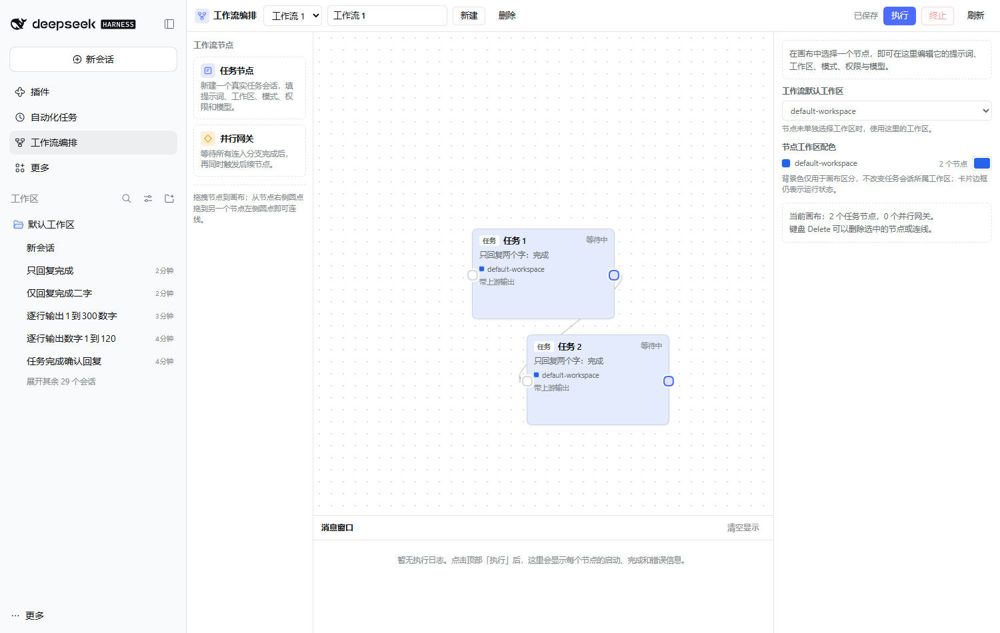

[文档首页](../README.md) / [用户文档](README.md)

# 数据与常见问题

工作流的画布和运行记录都保存在 DSH 数据目录下的一个 JSON 文件里，不依赖浏览器本地存储。这篇文档说明数据文件的位置与结构、容量上限、备份/迁移/清空、卸载重装，以及常见问题和已知限制。

## 数据文件

所有持久化数据都在 `$DSH_HOME\workflow-orchestrator\` 下：

| 文件 | 作用 | 是否必须保留 |
| --- | --- | --- |
| `workflows.json` | 工作流画布（节点、连线、设置）与最近 20 次运行记录 | 是，用户数据 |
| `host-loaded.json` | 宿主半区激活标记：`pid`、`plugin`、`loadedAt`，仅用于诊断 | 否，每次加载会重写 |

`$DSH_HOME` 的解析顺序：

1. DSH 宿主提供的 `dshHomePath()`；
2. 环境变量 `DSH_HOME`（非空时）；
3. 默认 `C:\Users\<你的用户名>\.dsh`（Windows）。

因此 Windows 上常见位置是：

```text
C:\Users\<你的用户名>\.dsh\workflow-orchestrator\workflows.json
```

如果使用隔离环境（例如设置了自定义 `DSH_HOME`），文件会出现在该目录下。

### `workflows.json` 结构

文件是带版本号的 JSON，写入方式为「临时文件 + rename」的原子写，并有串行写链，所以正常退出或页面刷新不会写出半个文件：

```json
{
  "version": 1,
  "activeWorkflowId": "wf-3051fc5b",
  "workflows": [
    {
      "id": "wf-3051fc5b",
      "name": "工作流 1",
      "createdAt": 1793940622275,
      "updatedAt": 1793940633051,
      "nodes": [
        {
          "id": "node-zw50hi3a",
          "type": "task",
          "title": "任务 1",
          "x": 238,
          "y": 307,
          "task": {
            "prompt": "只回复两个字：完成",
            "contextMode": "full",
            "workspaceId": "…",
            "agentPreset": "standard",
            "permissionPreset": "danger-full-access",
            "model": { "provider": "your-provider", "model": "your-model" }
          }
        }
      ],
      "edges": [{ "id": "edge-yu3jyq2v", "from": "node-zw50hi3a", "to": "node-eao5ah23" }],
      "settings": {
        "defaultWorkspaceId": "…",
        "workspaceColors": { "workspace-…": "#2563eb" }
      }
    }
  ],
  "runs": [
    {
      "id": "run-2f3b50f6",
      "workflowId": "wf-3051fc5b",
      "startNodeId": null,
      "status": "completed",
      "nodes": { "node-zw50hi3a": { "status": "completed", "sessionId": "session-…" } },
      "log": [{ "time": 1793940641216, "level": "info", "message": "…" }]
    }
  ]
}
```

- `activeWorkflowId` 记住面板上次显示的工作流。
- 运行记录（`runs`）在运行结束时写入；`nodes` 里保留每个节点的状态、会话 ID、错误和输出片段。
- `settings.workspaceColors` 保存你在「节点工作区配色」里改过的颜色（键是工作区 ID，值是 `#rrggbb`）；没改过的工作区不会出现在这里，默认颜色由面板按固定调色板计算。最多保存 40 项。
- `runs[].startNodeId` 为 `null` 表示全量执行，非空字符串表示这次是「从此节点开始执行」，值是起始节点 ID；此时 `nodes` 里不在执行范围的节点状态是 `not-run`（界面上显示「未执行」）。
- 数据文件被外部改动或损坏时，读取失败的文件会被改名为 `workflows.json.corrupt-<时间戳>`，然后以空状态启动；日志里会有一条警告。

## 容量上限

插件对数据做了硬性上限，避免文件无限增长：

| 项目 | 上限 | 说明 |
| --- | --- | --- |
| 工作流数量 | 80 | 超出时最旧的会被丢弃 |
| 每个工作流节点数 | 200 | 超出部分不保存 |
| 每个工作流连线数 | 400 | 超出部分不保存 |
| 提示词长度 | 200,000 字符 | 超出会被截断 |
| 工作流名称 | 120 字符 | 超出会被截断 |
| 节点名称 | 80 字符 | 超出会被截断 |
| 持久化运行记录 | 20 次 | 超出时最旧的被丢弃；面板运行快照展示最近 10 次 |
| 单次运行日志（内存） | 800 行 | 面板显示上限，超出时旧行丢弃 |
| 单次运行日志（持久化） | 400 行 | 运行记录里保留的尾部日志 |
| 节点错误（持久化） | 2,000 字符 | 超出会被截断 |
| 节点输出（持久化） | 4,000 字符 | 超出会被截断 |
| HTTP 请求体 | 2 MiB | 保存/执行请求过大时被拒绝 |
| 节点坐标 | -20,000 ~ 20,000 | 画布坐标被限制在该范围内 |
| 工作区自定义颜色 | 40 项 | `settings.workspaceColors` 最多保留 40 个合法颜色；非法值被丢弃 |

删除工作流会同时删除它的运行记录；工作流被删到 0 个时面板会自动新建「工作流 1」，所以数据文件里通常至少有一个空工作流。

## 备份、恢复与迁移

### 备份

最稳妥的做法是先退出 DSH，再复制文件：

```powershell
$dshHome = if ($env:DSH_HOME) { $env:DSH_HOME } else { Join-Path $env:USERPROFILE '.dsh' }
$dataDir = Join-Path $dshHome 'workflow-orchestrator'
Copy-Item (Join-Path $dataDir 'workflows.json') (Join-Path $dataDir 'workflows.backup.json')
```

原子写意味着运行中直接复制通常也能拿到一份完整文件，但为了拿到一致的时间点，建议先停 DSH 或至少先停止正在运行的工作流。

### 恢复

```powershell
$dshHome = if ($env:DSH_HOME) { $env:DSH_HOME } else { Join-Path $env:USERPROFILE '.dsh' }
$dataDir = Join-Path $dshHome 'workflow-orchestrator'
Copy-Item (Join-Path $dataDir 'workflows.backup.json') (Join-Path $dataDir 'workflows.json') -Force
```

覆盖后重启 DSH（或刷新页面）即可看到备份时的画布与运行记录。

### 迁移到另一台机器 / 另一个 profile

1. 把 `workflows.json` 复制到目标机器的 `$DSH_HOME\workflow-orchestrator\`；
2. 重启 DSH；
3. 打开面板检查工作流是否完整。

注意：节点、`settings.defaultWorkspaceId` 和 `settings.workspaceColors` 的键里保存的都是**源机器的 DSH 工作区 ID**。目标机器的工作区 ID 不同时，任务可能无法在预期工作区创建会话，配色也会因为 ID 对不上而失效。迁移后建议逐个工作流重新选择工作区（工作流默认工作区 + 每个任务节点），或直接在数据文件里替换 ID。

### 刷新后数据还在

正常刷新页面时，画布上的节点、连线、提示词、名称和工作流设置都会从 `workflows.json` 重新加载。自动保存是无感的：修改后约 600 毫秒写入，顶部显示「已保存」。


*图 13：刷新页面后，画布中的两个任务节点、连线和提示词仍然存在；消息窗口为空，因为没有执行过运行。*

## 清空数据

有两种方式：

### 在界面里清空

逐个选中工作流点「删除」。删除会同时删除该工作流的运行记录；删到最后一个时会自动新建空工作流。工作区里已经创建的历史任务会话**不会**被删除。

### 直接删除文件

先退出 DSH，再删除数据文件（或整个插件数据目录）：

```powershell
$dshHome = if ($env:DSH_HOME) { $env:DSH_HOME } else { Join-Path $env:USERPROFILE '.dsh' }
Remove-Item (Join-Path $dshHome 'workflow-orchestrator\workflows.json') -Force
```

下次打开面板会以空状态启动并自动创建「工作流 1」。`host-loaded.json` 会在下次加载时重新生成。此操作不可撤销，建议先备份。

## 卸载与重装

### 用插件管理器卸载

在「插件」页找到 `dsh-workflow-orchestrator`（显示名「工作流编排」），选择移除/停用，然后刷新页面或重启 DSH。卸载只移除插件本身，`workflows.json` 会保留。

### 手动卸载

1. 从 profile 的 `package.json` 中移除 `dsh.profile.bundles` 里的 `dsh-workflow-orchestrator`；
2. 删除 profile 的 `node_modules` 下的链接（确认它是 junction/符号链接，而不是真实目录）：

   ```powershell
   Remove-Item "$env:USERPROFILE\.dsh\profiles\desktop\node_modules\dsh-workflow-orchestrator" -Force
   ```

3. 重启 DSH。

### 重装

重新按 [快速开始：安装插件](getting-started.md#安装插件) 操作即可。只要 `$DSH_HOME\workflow-orchestrator\workflows.json` 还在，原来的画布与运行记录会继续使用。

## 常见问题（FAQ）

### 1. 为什么「执行」按钮是灰的？

三种原因：没有选中工作流、画布上没有任何节点，或当前工作流正在运行。添加节点、等待运行结束即可恢复。

### 2. 为什么没有「保存」按钮？

画布编辑是自动保存的：修改后约 600 毫秒写入文件，顶部状态从「保存中…」变为「已保存」。切换工作流、新建、执行前还会额外保存一次。

### 3. 刷新页面后画布还在，为什么消息窗口有时候是空的？

消息窗口显示的是**当前工作流最近一次运行**的日志。没有运行过（或运行记录已被删除、被 20 条上限淘汰）时就是空态；画布本身持久化在 `workflows.json`，与日志无关。已结束的运行会保留节点状态和最近 400 行日志；进行中的运行只在宿主内存里，DSH 重启后无法恢复该次运行。

### 4. 为什么任务会话的标题和节点名称不一样？

节点名称是插件里的标签；任务会话标题由 DSH 根据提示词自动生成，插件不会重命名会话。两者不同是正常现象，用会话 ID 对照最准确。

### 5. 节点为什么显示「已跳过」？

它的某个前序节点没有成功完成（失败、取消或跳过），或者它前面的并行网关因为分支未全部完成而关闭。看消息窗口的 `WARN` 行可确认原因；失败根因在更早的 `ERROR` 行。

### 6. 上游上下文为什么没生效？

检查：该节点的「上游上下文」是否被设成了「完全不传」；它的前序任务输出是否为空；它与上游之间是否只隔着并行网关（插件只会收集最近的、可穿过网关到达的任务节点）。日志里的「提示词已发送（N 字）」能反映实际发送长度。

### 7. 能循环、重试或定时执行吗？

不能。每个任务节点在一次运行中只执行一次；没有循环、自动重试、定时触发或断点续跑。需要重跑就再点一次「执行」，所有节点会以新的任务会话重新执行。

### 8. 可以同时运行多个工作流吗？

可以，不同工作流互不影响；同一个工作流同一时间只允许一次运行。面板一次显示一个工作流的运行，切换工作流即可查看各自记录。

### 9. 删除工作流会删除工作区里的任务会话吗？

不会。删除只清理插件里的画布和运行记录；DSH 任务会话仍保留在工作区中，需要时可在工作区里自行管理。

### 10. 权限或模型选了却没生效？

权限和模型在会话创建后应用；应用失败时任务会继续执行，并在消息窗口留下 `WARN`（如「权限预设「…」应用失败，沿用会话默认权限」「模型选择失败，沿用默认模型」）。检查对应预设/模型是否仍然存在。

### 11. 多开窗口同时编辑同一个工作流会怎样？

运行状态每秒轮询，但画布编辑不会实时同步。两个窗口各自自动保存，后保存的会覆盖先保存的。建议同一时间只在一个窗口编辑画布。

### 12. 数据文件损坏了怎么办？

插件读取失败时会把坏文件改名为 `workflows.json.corrupt-<时间戳>`，然后以空状态启动。可以从备份恢复，或检查 DSH 日志里的警告信息。

### 13. 安装后左侧栏没有入口？

确认插件在当前 profile 中已启用、页面已刷新或 DSH 已重启，并检查 `$DSH_HOME\workflow-orchestrator\host-loaded.json` 是否存在且 `loadedAt` 是最近时间。详见 [快速开始：验证安装是否生效](getting-started.md#验证安装是否生效)。

### 14. 节点卡片为什么有不同背景色？

同一工作流里的任务节点可以属于不同的工作区。跨多个工作区时，卡片用不同浅色背景 + 工作区行的颜色圆点区分，工具栏下方还会出现提示条。

- 背景色只用于画布区分，不改变任务会话所属工作区，也不改变卡片边框含义——**边框仍然只表示运行状态**。
- 想换颜色：不选中节点，在右侧「节点工作区配色」里点颜色选择器，改动会自动保存到 `workflows.json` 的 `settings.workspaceColors`；点「恢复默认」清除该工作区的自定义颜色。
- 自定义颜色最多保存 40 个，非法值会被丢弃。

### 15. 节点为什么显示「未执行」？

「未执行」（`not-run`）是「从此节点开始执行」的产物：这次运行只跑起点及其下游，其余节点不会创建任务会话，状态记为「未执行」。

- 「未执行」不算失败；范围内节点全部完成时，整次运行仍显示「已完成」。
- 这些节点没有会话 ID，不会出现在工作区任务列表里。
- 下一次点顶部「执行」会全量执行，它们会正常创建新会话。

### 16. 从中间节点执行后，前面的节点会自动补跑吗？

不会。插件不提供断点续跑：范围外的节点这次就是「未执行」，下次「执行」仍从整个工作流重新开始，所有节点都会新建会话。想复用上次结果，只能重新全量执行；下游的上游上下文会重新收集**本次运行中已完成**的上游输出。

## 已知限制

- 只提供**并行网关**一种网关，没有条件分支、排他网关等。
- 每个任务节点在一次运行中只执行一次：不提供循环、重试、定时触发和断点续跑。
- 工作流运行期间可以继续编辑画布，但**本次运行使用的是点击「执行」时的快照**，修改只对下一次执行生效。
- 任务节点提示词为空时不允许启动（范围执行时只检查本次范围内的节点）；并行网关必须至少有一条输入连线和一条输出连线；范围内子图不能有环。
- 「从此节点开始执行」只缩小本次运行范围，不做断点续跑：范围外节点显示「未执行」，不创建会话，也不会在下一次运行中自动补跑。
- 会话标题由 DSH 根据提示词生成，插件不会重命名任务。
- 画布没有撤销/重做，也没有复制粘贴；节点删除立即自动保存。
- 同一个工作流同一时间只能运行一次；多个窗口同时编辑同一工作流时不会实时同步，后保存者覆盖。
- 数据仅保存在本机 `$DSH_HOME` 的单个 JSON 文件里，不支持多机共享或云同步；迁移时需注意工作区 ID 不一致的问题。
- 界面与文档对应版本 **0.1.0**，后续版本可能调整字段、上限与文案。

## 下一步

- 回到用户文档索引：[用户文档](README.md)。
- 安装与首次使用：[快速开始](getting-started.md)。
- 执行与错误语义：[执行与监控](running-and-monitoring.md)、[终止与错误处理](stopping-and-errors.md)。
- 字段与校验：[搭建工作流](building-workflows.md)。
