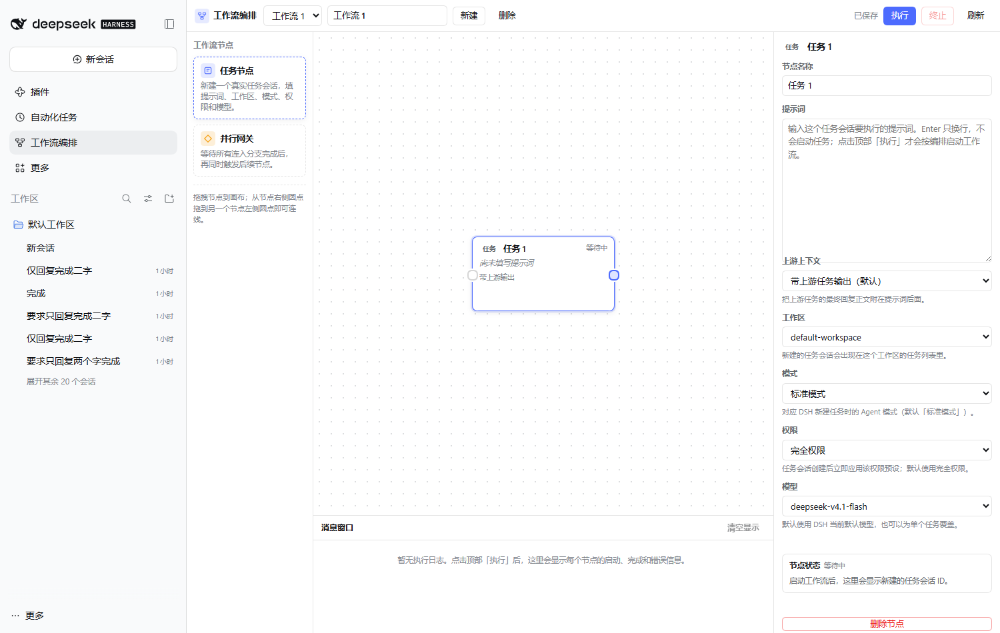
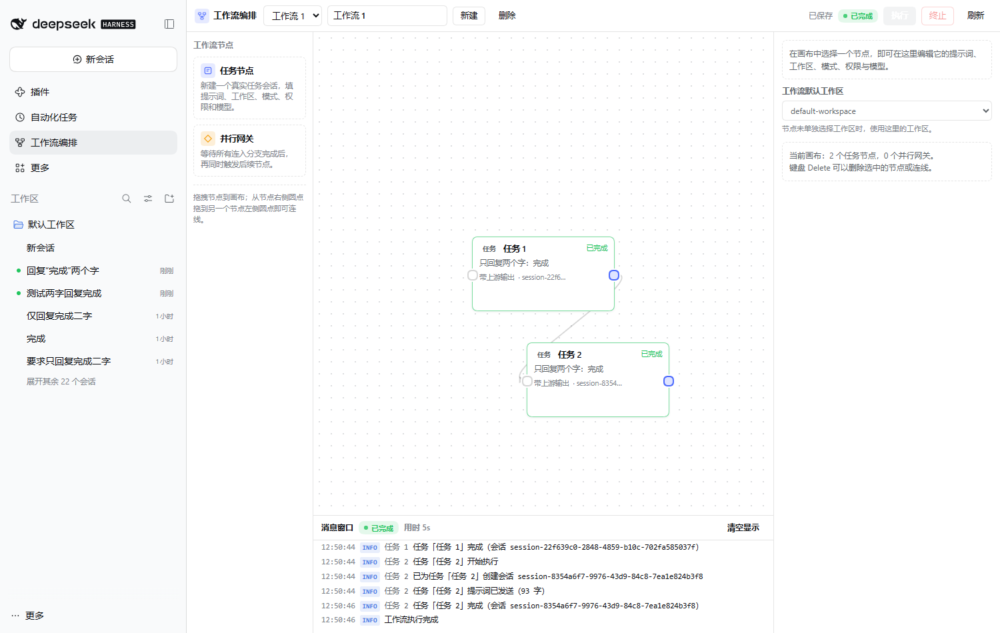

[文档首页](../README.md) / [用户文档](README.md)

# 快速开始

这篇文档带你完成第一次使用：安装插件、打开入口、创建并执行一个 `任务 A → 任务 B` 的工作流，最后在消息窗口里确认执行结果。全程不需要写代码。

## 前置条件

开始之前请确认：

1. 已安装并运行支持第三方插件的 **DSH**（桌面版，或带 Web 界面的 profile）。插件包版本为 **0.1.0**。
2. DSH 中至少有一个**工作区**。任务节点执行时会在工作区里新建任务会话，没有工作区时面板会提示「当前没有可用工作区」。
3. DSH 里已配置可用的模型（至少一个模型提供商）。执行时会使用节点上选择的模型，未单独选择时使用 DSH 的默认模型。
4. 如果你要手动挂载插件，请准备 PowerShell；插件的宿主运行在 DSH 自带的 Node.js 中（`package.json` 声明 `node >= 20`）。
5. 插件目录：本文用 `D:\path\to\plugin` 作为占位，请替换成你本机插件所在的真实目录。

## 安装插件

插件是一个**本地目录插件**，通过 `package.json` 的 `dsh.bundle.patch` 与 `dsh.client` 声明自己。下面两种方式任选其一。

### 方式一：插件管理器安装（推荐）

1. 打开 DSH，在左侧栏进入「插件」页（也可以从设置进入「插件」）。
2. 选择「添加插件」，输入或选择本地插件目录，例如 `D:\path\to\plugin`。
3. 选择**本地目录**安装。插件会以 `link:` 的方式加入当前 profile 并在安装后启用。
4. 刷新页面；如果当前 profile 未开启热更新，请重启 DSH 后再打开。

### 方式二：手动挂载（junction + profile bundles）

适合插件管理器不可用，或你希望自己控制 profile 的场景。假设使用默认的桌面 profile `desktop`：

```powershell
# 1. 把插件目录链接到 profile 的 node_modules
New-Item -ItemType Junction `
  -Path "$env:USERPROFILE\.dsh\profiles\desktop\node_modules\dsh-workflow-orchestrator" `
  -Target "D:\path\to\plugin"
```

2. 编辑 profile 的 `package.json`，把插件名加入 `dsh.profile.bundles`（下面是相关片段）：

```json
"dsh": {
  "profile": {
    "bundles": [
      "@deepseek-ai/dsh-base",
      "@deepseek-ai/dsh-web-app",
      "dsh-workflow-orchestrator"
    ]
  }
}
```

3. 重新加载页面；若未生效，重启 DSH。

> 提示：`$env:USERPROFILE\.dsh` 是默认的 DSH 数据目录。如果你自定义过 `DSH_HOME`，请把路径换成 `$env:DSH_HOME` 指向的目录；profile 名也可能不是 `desktop`，以你本机的 profile 为准。

## 验证安装是否生效

安装完成后，用下面三项确认插件真的加载了：

1. **左侧栏出现入口**：DSH 左侧栏出现「工作流编排」一项，图标是三个方块组成的流程图。
2. **页面能打开**：点击「工作流编排」，出现三栏界面（左侧节点面板、中间画布、右侧属性区），底部有「消息窗口」。
3. **宿主半区已加载**：数据目录下出现激活标记文件：

   ```text
   $DSH_HOME\workflow-orchestrator\host-loaded.json
   ```

   文件里有 `plugin`、`pid`、`loadedAt` 三个字段。Windows 默认位置是 `C:\Users\<你的用户名>\.dsh\workflow-orchestrator\host-loaded.json`。这个文件只用于诊断，缺失通常说明宿主半区没有加载。

如果入口没有出现，先确认插件在当前 profile 中已启用，并已刷新页面或重启 DSH。

## 打开入口

点击左侧栏「工作流编排」。第一次打开时面板会自动创建并选中一个名为「工作流 1」的工作流，画布为空，显示空态提示「开始编排你的工作流」。

## 创建第一个工作流：任务 A → 任务 B

下面用一个最小例子走完整流程：任务 A 生成内容，任务 B 在 A 完成后接着处理。

### 第 1 步：添加两个任务节点

1. 点击左侧「工作流节点」里的「任务节点」卡片，画布中央会新增一个节点，默认名为「任务 1」。
2. 再点一次，新增「任务 2」。
3. 节点可以按住拖动来调整位置；两个节点不要重叠，方便连线。

也可以把卡片直接拖到画布上的目标位置。


*图 2：点击「任务节点」新增节点后，右侧属性区出现节点名称、提示词、上游上下文、工作区、模式、权限、模型等字段。*

### 第 2 步：填写提示词

1. 点击「任务 1」选中它，在右侧「提示词」里输入，例如：`用三句话介绍一下 DSH 是什么。`
2. 点击「任务 2」，输入：`把上面的内容改写成三条要点，每条不超过 20 字。`
3. 其余字段保持默认即可：工作区使用默认工作区，模式「标准模式」，权限「完全权限」，模型使用当前默认模型。

提示词输入框里按 **Enter 只换行**，不会启动任务；要执行必须点顶部「执行」。

### 第 3 步：把 A 连到 B

1. 把鼠标移到「任务 1」右侧的圆点（输出端口）上，按住并拖到「任务 2」左侧的圆点（输入端口）后松开。
2. 出现一条带箭头的连线，表示 A 完成之后才启动 B。

如果连错方向或想改结构，选中连线后按 `Delete` 删除，再重新连。

### 第 4 步：执行

1. 确认顶部保存状态显示「已保存」（修改后通常 1 秒内自动保存）。
2. 点击顶部「执行」。
3. 观察画布：任务 1 先变为「运行中」，完成后任务 2 才开始；两个节点都变为「已完成」时，整条工作流完成。
4. 看底部「消息窗口」：每个节点创建会话、发送提示词、完成或失败都会有一行日志，日志里包含 `session-...` 形式的会话 ID。


*图 3：`任务 1 → 任务 2` 串行执行完成；两个节点显示「已完成」，消息窗口记录了会话 ID 与发送的提示词字数。*

### 第 5 步：查看任务会话

选中一个已完成的节点，右侧「节点状态」下方会显示「任务会话」的会话 ID，并提供两个按钮：

- **打开任务会话**：跳转到该任务会话（工作区里也能找到它，标题由 DSH 根据提示词生成）。
- **复制 ID**：把会话 ID 复制到剪贴板。

同一工作区的任务列表中也会出现这两个新会话；刷新页面后仍然存在。

## 验证是否生效

第一次跑通后，可以用这个清单确认环境正常：

- [ ] 左侧栏有「工作流编排」，页面三栏布局和空态正常。
- [ ] 添加节点、拖动位置、连线后，顶部显示「已保存」。
- [ ] 刷新页面，节点、连线和提示词都还在。
- [ ] 点「执行」后节点依次变为「运行中 → 已完成」，消息窗口出现 `INFO` 日志和会话 ID。
- [ ] 工作区任务列表里出现对应数量的新任务会话。
- [ ] 选中节点后在属性区点「打开任务会话」，能跳到该会话。

## 接下来

- 想了解每个区域和按钮：读 [界面导览](interface.md)。
- 想搭更复杂的流程（并行分支、网关汇合、不同权限/模型）：读 [搭建工作流](building-workflows.md)。
- 想知道执行细节与日志含义：读 [执行与监控](running-and-monitoring.md)。
- 执行失败或想中途停止：读 [终止与错误处理](stopping-and-errors.md)。

## 常见起步问题

| 现象 | 可能原因与处理 |
| --- | --- |
| 左侧栏没有「工作流编排」 | 插件未启用，或 profile/页面未重新加载；确认安装后重启 DSH，再检查 `host-loaded.json` |
| 「执行」按钮是灰的 | 没有选中工作流、画布上没有节点，或该工作流正在运行；添加节点并等待当前运行结束 |
| 提示「当前没有可用工作区」 | 先在 DSH 左侧栏添加一个工作区；任务是真实会话，必须落在工作区里 |
| 点「执行」后提示「工作流校验失败」 | 有任务没填提示词、网关缺少输入/输出连线，或连线形成了环；按提示修正后再执行 |
| 节点一直不动、下游「已跳过」 | 前序任务失败或被取消；到「消息窗口」看 `ERROR` 日志，详见 [终止与错误处理](stopping-and-errors.md) |
