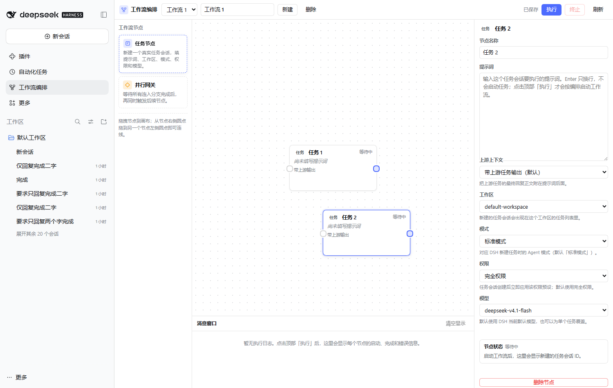
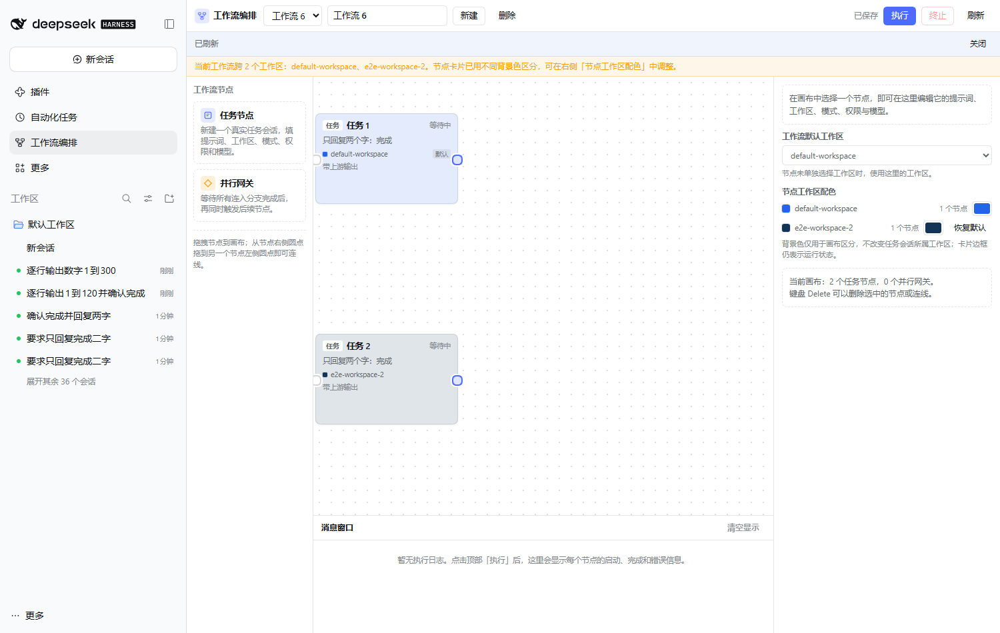
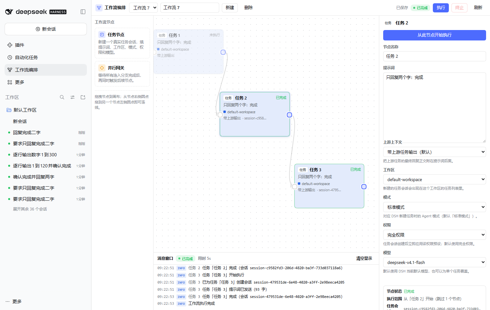

[文档首页](../README.md) / [用户文档](README.md)

# 界面导览

「工作流编排」是一个一级页面，整体分五个区域：顶部工具栏、左侧节点面板、中间画布、底部消息窗口、右侧属性区。本页逐区说明每个控件的用途、空态提示和常用快捷键。

## 区域总览

```text
┌────────────────────────────────────────────────────────────────────┐
│ 顶部工具栏：工作流选择、名称、新建/删除、保存状态、执行、终止、刷新│
├──────────────┬─────────────────────────────────┬───────────────────┤
│ 左侧面板     │ 中间画布（节点与连线）          │ 右侧属性区        │
│ 工作流节点   ├─────────────────────────────────┤ 选中节点后编辑    │
│ 任务节点     │ 底部消息窗口（日志）            │ 提示词/工作区/…   │
│ 判断节点     │                                 │                   │
│ 终止节点     │                                 │                   │
│ 并行网关     │                                 │                   │
│ 定时节点     │                                 │                   │
│ 动作节点     │                                 │                   │
│ 等待任务完成 │                                 │                   │
└──────────────┴─────────────────────────────────┴───────────────────┘
```

- **顶部工具栏**：管理当前工作流、启动与终止运行；跨工作区时工具栏下方会出现提示条，存在周期性触发的工作流时会出现常驻黄色提醒条。
- **左侧节点面板**：提供「任务节点」「判断节点」「终止节点」「并行网关」「定时节点」「动作节点」「等待任务完成」七种可添加的节点。
- **中间画布**：放置节点、连线、查看节点运行状态；任务与判断卡片上还会显示所属工作区，定时/动作/等待卡片显示各自的配置摘要与运行进度。画布下方是消息窗口。
- **右侧属性区**：编辑当前选中节点的属性（包括定时、动作、等待节点的专有字段），或查看运行状态与任务会话、调整工作区配色。

## 顶部工具栏

从左到右依次是：

| 控件 | 作用 |
| --- | --- |
| 「工作流编排」标题与图标 | 页面标识 |
| 工作流下拉框 | 切换当前工作流；切换时会先保存当前画布 |
| 名称输入框 | 重命名当前工作流，输入即生效（自动保存） |
| 「新建」 | 新建一个空工作流，默认名为「工作流 N」 |
| 「删除」 | 删除当前工作流及其运行记录；运行中的工作流不能删除，会提示先终止 |
| 保存状态 | 「保存中…」「已保存」「保存失败」三态，见下方「自动保存」 |
| 运行状态徽标 | 「运行中」「已完成」「失败」「已停止」；提前结束时旁边额外显示「提前终止（由「X」）」；没有运行记录时不显示 |
| 「执行」 | 按当前画布启动一次运行，**始终执行全部节点**；没有节点或正在运行时禁用。只想执行某个节点及其下游时，用属性区顶部的「从此节点开始执行」 |
| 「终止」 | 打开终止对话框；没有正在运行的运行时禁用 |
| 「刷新」 | 重新拉取工作流与运行状态，成功时提示「已刷新」；选项目录（工作区/模式/权限/模型）有约 60 秒缓存，不会强制刷新 |

窗口较窄时工具栏会自动换行，按钮顺序不变。

### 跨工作区提示条

当当前画布上的任务节点涉及**多个不同工作区**时，工具栏下方会出现一条常驻的黄色（warn）提示条：

> 当前工作流跨 N 个工作区：A、B。节点卡片已用不同背景色区分，可在右侧「节点工作区配色」中调整。

- 它只做提示，**不阻塞执行**；涉及 0 个或 1 个工作区时不显示。
- 工作区数量按任务节点的**有效工作区**去重统计：节点单独指定的优先，否则继承工作流默认工作区，再否则用宿主默认工作区。
- 想调整卡片背景色：不选中任何节点，在右侧属性区的「节点工作区配色」里修改（见下文与图 14）。

### 周期触发提醒条

当有工作流包含**作为起始节点的周期定时节点**（每天 / 每周 / 每 N 分钟）时，顶部工具栏下方会出现一条常驻的黄色（warn）提醒条：

> 当前有 N 个周期性触发的工作流会自动启动并消耗 token：工作流 A、工作流 B。下一次自动触发（计划时间）：2026-11-23 03:00。如不需要周期执行，请在定时节点属性里改成「一次性触发」，或删除该定时节点。

- 它会一直显示，直到你把相关定时节点改成「一次性触发」或删除；和 5 秒后自动消失的普通通知条不是一回事。
- 提醒条里的「下一次自动触发（计划时间）」显示的是各周期定时节点中**最近的下一次计划时间**。
- 工作流名最多列出 5 个，更多时显示「等 N 个」；右侧「查看」按钮会切换到第一个周期性触发的工作流。
- 如果其中有工作流校验不通过，提醒条会追加「其中 N 个工作流校验未通过，自动触发会失败」；实际行为是到点被**跳过**（不启动、不产生运行记录，只写 DSH 宿主日志）。这里的统计只含**起始周期**定时节点，一次性入口定时节点不计入。
- 左侧栏「工作流编排」入口图标右上角还有一个黄色数字徽标，数字 = 含**起始周期定时节点**（没有输入连线）的工作流数；一次性起始定时节点不计入。它每 20 秒刷新一次，面板没有打开时也会更新。点图标进入面板即可查看与修改。

## 左侧节点面板

「工作流节点」区域有七种卡片：

| 卡片 | 说明 |
| --- | --- |
| 任务节点 | 新建一个真实任务会话，填写提示词、工作区、模式、权限和模型 |
| 判断节点 | 新建一个真实任务会话评估上游输出，判定继续或提前结束工作流 |
| 终止节点 | 不创建会话，到达即提前结束本次工作流 |
| 并行网关 | 等待所有连入分支完成后，再同时触发后续节点 |
| 定时节点 | 按时间表触发：作为起始节点时到点自动启动工作流，放在流程中间时等待下一次触发再继续 |
| 动作节点 | 执行一次系统或网络动作（关机、重启、打开网址、运行命令、HTTP 请求等），默认试运行 |
| 等待任务完成 | 勾选一个或多个当前存活的任务，等它们真正结束后再继续下游 |

两种添加方式：

- **点击卡片**：在画布可见区域中央新增节点，多个节点会按固定偏移错开。
- **拖拽卡片到画布**：节点落在鼠标松开的位置，更适合精确布局。

面板底部有一行提示：「拖拽节点到画布；从节点右侧圆点拖到另一个节点左侧圆点即可连线。」

## 中间画布

画布是带点阵背景的可滚动区域：

- 节点按住即可拖动，位置会自动保存。
- 节点左侧的小圆点是**输入端口**，右侧的小圆点是**输出端口**；从输出端口拖到另一个节点的输入端口完成连线，拖动过程中会显示一条跟随鼠标的临时连线。
- 连线渲染为带箭头的曲线；点击连线会选中它（高亮显示），再按 `Delete` 删除。
- 点击节点选中它，右侧属性区随选择变化；点击画布空白处取消选择。
- 删除节点时，与它相连的所有连线会一起删除。

### 节点长什么样

- **任务节点**（从上到下）：
  - **标题栏**：「任务」徽标、节点名称和运行状态；
  - **提示词预览**：最多两行，没填时显示「尚未填写提示词」；
  - **工作区行**：左侧 7×7 的圆角色块（背景是该工作区的配色），右侧是工作区标题；节点没有单独指定工作区、继承工作流默认工作区时，名字后面还有一个浅色小字「默认」；整个工作流没有任何可用工作区时，这一行显示灰色的「未设置工作区」，没有色块。鼠标悬停可看到「工作区：<标题>（节点指定 / 继承工作流默认）」；
  - **底部**：上游上下文策略（带上游输出 / 带上游摘要 / 不带上游），运行后还会显示会话 ID 的前 12 个字符。
- **判断节点**：主体与任务卡片一致（提示词预览、工作区行、上游上下文），但徽标是绿色的「判断」；运行后底部还会显示「判定：继续 / 判定：终止」。判断节点对下游透明，判定文本不会传给下游。
- **终止节点**：红色方形停止图标 + 标题 + 「到达即提前结束工作流」+ 状态；没有输出端口，不能连出到其他节点，也不显示工作区行。
- **并行网关**：菱形图标 + 「并行网关」标题 + 「等待所有输入分支完成」+ 状态。网关不创建任务会话，只做汇合，**不显示工作区行**。
- **定时节点**：蓝色「定时」徽标 + 标题 + 触发方式描述（如「每天 03:00」「每 30 分钟」「一次性 · 2026-11-23 03:00」）；未运行时显示「起始节点 · 到点自动启动工作流」或「到达后等待触发时间」；运行中显示等待触发的倒计时与计划时间，触发后显示「已触发」。定时节点不创建会话，不显示工作区行。
- **动作节点**：橙色「动作」徽标 + 标题 + 动作名称；默认试运行时显示「· 试运行」，关闭试运行后显示「· 会真实执行」，关机/重启还显示缓冲秒数。运行中和完成后会显示执行结果摘要；不创建会话，不显示工作区行。
- **等待任务完成**：绿色「等待」徽标 + 标题 + 「等待 N 个任务真正完成」（未选择时显示「尚未选择要等待的任务」）；运行中显示「已完成 N/M」「· 每 10 秒检查」与运行进度；不创建会话，不显示工作区行。
- **配色只是辅助**：同一工作区的任务卡片背景色相同，不同工作区不同；卡片**边框颜色仍只表示运行状态**（运行中 / 等待用户回复 / 已完成 / 失败等），两套语义不混用。工作区背景色可以在右侧属性区修改。
- **等待用户回复的节点**：任务会话向用户提问且尚未回答时，节点状态显示琥珀色的「等待用户回复」，边框同步变为琥珀色；在任务会话里回答后自动恢复「运行中」并继续执行。
- **未执行节点**：用「从此节点开始执行」启动后，不在本次执行范围内的节点显示「未执行」，卡片变为虚线边框并整体变淡，方便一眼看出本次实际跑了哪些节点。

### 画布空态

画布没有任何节点时，中央显示：

> **开始编排你的工作流**
> 从左侧拖入「任务节点」「判断节点」「终止节点」「并行网关」「定时节点」「动作节点」或「等待任务完成」；不连线的任务会同时启动。

## 底部消息窗口

消息窗口固定在画布下方，高度约 176 像素，用于展示当前工作流最近一次运行的日志。

- **标题栏**：显示「消息窗口」、运行状态徽标、「用时 Xs/Xm」（运行中时持续计时），右侧「清空显示」按钮。
- **日志行**：每行依次是时间 `HH:mm:ss`、级别 `INFO` / `WARN` / `ERROR`、节点名（工作流级日志没有这一列）、消息正文。
- **空态**：没有任何日志时显示「暂无执行日志。点击顶部「执行」后，这里会显示每个节点的启动、完成和错误信息。」
- **自动滚动**：有新日志时自动滚到最新一行。
- **「清空显示」**：只清除当前屏幕上的日志显示，不删除运行记录；清空后新产生的日志仍会出现。没有可清空的日志时按钮禁用。
- 运行状态、用时和日志都来自宿主半区，面板每秒刷新一次运行状态。
- **自动触发的运行**：由起始定时节点自动启动时，消息窗口先出现「工作流「名称」开始执行（N 个节点）」，紧接着出现「本次运行由定时节点「X」自动触发（计划时间 YYYY-MM-DD HH:mm）」；定时/动作/等待节点各自的日志见 [执行与监控：消息窗口怎么读](running-and-monitoring.md#消息窗口怎么读)。

## 右侧属性区

属性区随画布选择变化，下面按选中对象分别说明。

### 没有选中节点

显示：

- 提示卡「在画布中选择一个节点，即可在这里编辑它的提示词、工作区、模式、权限与模型。」
- **工作流默认工作区**下拉框：节点没有单独选择工作区时使用这里的工作区；可以选「未设置」，此时退回宿主提供的工作区列表中的第一个。
- **节点工作区配色**：只列出当前画布**实际用到**的有效工作区（按首次出现顺序）。每行依次是颜色块、工作区标题、节点数（如「3 个节点」）、颜色选择器；如果该工作区颜色被改过，还会出现「恢复默认」小按钮。点颜色选择器修改后立即自动保存；「恢复默认」删除自定义颜色、回到默认调色板。
  - 下方提示：「背景色仅用于画布区分，不改变任务会话所属工作区；卡片边框仍表示运行状态。」
  - 画布中还没有使用工作区的任务节点或判断节点时，显示一行浅色说明「画布中还没有使用工作区的任务节点或判断节点」。效果见下方图 14。
- 画布统计：「当前画布：N 个任务节点，M 个判断节点，K 个终止节点，L 个并行网关，P 个定时节点，Q 个动作节点，R 个等待任务节点。」
- 快捷键提示：「键盘 Delete 可以删除选中的节点或连线。」

### 选中任务节点


*图 4：选中任务节点后的属性区，包含顶部「从此节点开始执行」按钮，以及节点名称、提示词、上游上下文、工作区、模式、权限、模型、节点状态、任务会话与删除节点。*

属性区**最顶部**是「从此节点开始执行」主按钮：

- **「从此节点开始执行」**：先保存当前画布，然后只执行**该节点及其下游可达节点**，该节点之前和无关的节点不会启动、不会创建任务会话，状态显示为「未执行」。
- 鼠标悬停提示：「跳过该节点之前的所有节点，从该节点及其下游开始执行」。
- 正在运行、或该节点提示词为空时按钮禁用，悬停会说明原因。
- 顶部工具栏的「执行」始终是**全量执行**，两者互不影响。从节点开始执行后的画布与运行卡片见下方图 15。

字段依次为：

1. **节点名称**：输入框，可重命名；默认「任务 N」。
2. **提示词**：多行输入框；Enter 只换行，不会执行；未填写时不能参与执行或作为「从此节点开始执行」的起点（范围外的空提示词不阻塞范围执行）。
3. **上游上下文**：`带上游任务输出（默认）` / `带上游任务会话摘要` / `完全不传`，下方有一行说明。
4. **工作区**：选择任务会话所属工作区；新节点默认选中宿主默认工作区，也可以改选「使用工作流默认工作区」。当前工作流涉及多个工作区时，字段下方会追加一句提示：「当前工作流涉及 N 个工作区，卡片背景色用于区分。」
5. **模式**：DSH 的 Agent 预设（默认「标准模式」）。
6. **权限**：权限预设（默认「完全权限」），创建会话后立即应用。
7. **模型**：「使用默认模型」或按提供商分组的模型列表，可为单个任务覆盖。
8. **节点状态**：等待中 / 运行中 / 等待用户回复 / 已完成 / 失败 / 已取消 / 已跳过 / 未执行（「未执行」只出现在「从此节点开始执行」的运行中，表示该节点不在本次执行范围）。
9. **执行范围**：显示当前运行的范围——普通「执行」显示「全部节点」；「从此节点开始执行」显示「从「<起始节点标题>」开始（跳过 N 个节点）」。
10. **任务会话**：运行后显示会话 ID，并提供「打开任务会话」「复制 ID」；未运行时显示「启动工作流后，这里会显示新建的任务会话 ID。」「未执行」的节点没有会话 ID。
11. **等待用户回复**：节点处于「等待用户回复」时，状态下方出现琥珀色提示块，列出任务会话里待回答的问题（含选项），并提示「回答后节点会继续执行；不想等了可以点顶部「终止」」；配合「打开任务会话」按钮前去回答。
12. **错误信息**：节点失败时以红色文字显示在状态下方。
13. **「删除节点」**：删除节点及相连的连线。

### 选中判断节点

判断节点的属性区与任务节点类似，但没有「从此节点开始执行」按钮，并多出判定相关设置：

1. **节点名称**：默认「判断 N」。
2. **判定提示词**：写清楚评估标准（什么情况继续、什么情况终止）；引擎会在末尾自动追加 `WOF_DECISION` 输出契约。
3. **上游上下文**：只能选「带上游任务输出」或「带上游任务会话摘要」；判断节点必须能看到上游输出。
4. **判定输出契约**：只读说明卡，解释引擎追加的输出格式与 STOP 的后果。
5. **无效判定处理**：模型没有按格式输出判定时，「继续（默认）」或「终止工作流」。
6. **工作区 / 模式 / 权限 / 模型**：与任务节点相同，判断节点会创建真实会话。
7. **判定为终止时**：在途任务继续跑完（默认）或同时终止会话。
8. **节点状态 / 执行范围 / 任务会话 / 错误信息 / 判定结果**：判定结果一行显示「继续」或「终止工作流」。
9. **「删除节点」**：删除判断节点及相连连线。

### 选中终止节点

终止节点只有三个字段和一段说明：

- **节点名称**：默认「终止节点」。
- **终止原因**：可选文本，写入日志与运行记录。
- **终止后在途任务**：让在途任务继续跑完（默认）/ 同时终止在途任务会话。
- **「删除终止节点」**：删除节点及相连连线。

### 选中定时节点

属性区顶部是「定时」徽标与节点名称，然后依次是：

1. **节点名称**：默认「定时 N」。
2. **触发方式**：下拉选择 `一次性触发` / `每天固定时间` / `每周固定时间` / `每 N 分钟`，下方显示该方式的说明。
3. **触发时间 / 星期几 / 重复间隔**：随触发方式切换出现。一次性用日期时间输入框；每天/每周用时间输入框；每周还可点「周一」到「周日」的按钮多选；每 N 分钟填 1–10,080。
4. **下次触发**：只读显示下一次触发时间（周期模式还显示倒计时）。
5. **节点位置**：只读显示「起始节点（到点自动启动整个工作流）」或「流程中间（到达后等待下一次触发时间再继续）」。
6. **周期警示卡**：周期重复触发时出现，提示会在后台反复自动启动并消耗 token，以及面板顶部/侧栏入口的提醒。
7. **运行卡片**：节点状态；等待触发时显示倒计时与计划时间；已触发时显示触发时间；失败时显示错误。
8. **「删除定时节点」**。

### 选中动作节点

1. **节点名称**：默认「动作 N」。
2. **动作类型**：下拉选择十种动作之一，下方显示该动作的说明。
3. **试运行勾选行**：默认勾选，显示「试运行（不会产生实际动作）」；取消勾选后显示「真实执行（会产生实际动作）」。
4. **按动作类型出现的字段**：
   - 自动关机 / 自动重启：缓冲时间（10–3,600 秒，默认 60）、关机提示文字（可选，≤200 字）；
   - 打开网址 / 发送 HTTP 请求：网址（必须是 `http://` 或 `https://`）；HTTP 请求还可以选 GET / POST / PUT / PATCH / DELETE、填写 JSON 请求体（GET 时不能填写请求体）；
   - 打开文件或文件夹：路径；
   - 运行自定义命令：命令、工作目录（可选）、超时时间（1–600 秒）；
   - 只写一条日志：日志文字（≤500 字）。
5. **警示卡**：危险动作（关机/重启/睡眠/锁屏）在关闭试运行时显示红色警示；仍为试运行时显示「当前为试运行」。
6. **说明卡**：说明动作节点不创建任务会话、不进入下游上下文，通常放在最后收尾。
7. **运行卡片**：节点状态、执行结果、错误信息。
8. **「删除动作节点」**。

### 选中等待任务完成节点

1. **节点名称**：默认「等待任务完成 N」。
2. **选择要等待的任务**：列出宿主当前仍存活的任务会话（已排除子 Agent 会话），每行有复选框、标题、状态（运行中 / 等待用户回复 / 空闲（可能已完成））、工作目录、待回答问题数和会话 ID 前缀；列表每 15 秒自动刷新，右上角有「刷新列表」和「已选 N 个任务」。
3. **未选择任务的警示卡**：没有勾选任务时出现，提示运行前校验会阻止启动。
4. **说明卡**：说明节点每 10 秒检查一次，主 Agent 空闲、没有后台子 Agent、没有仍在等待回答的提问才算真正完成；被等待任务失败、会话关闭但无法确认完成、任务从未产生已结束回合时本节点失败。
5. **运行卡片**：节点状态；等待中显示「等待进度：剩余 N 个」、每个目标任务的状态（等待中 / 已完成 / 失败）与「最近一次检查」时间；完成后显示结果；失败时显示错误。
6. **「删除等待节点」**。

### 跨工作区与范围执行示例


*图 14：同一工作流涉及 2 个工作区：工具栏下方出现黄色（warn）提示条，两个任务卡片用不同浅色背景与工作区行区分，继承工作流默认工作区的节点标注「默认」；右侧属性区「节点工作区配色」逐行列出颜色块、工作区标题、节点数与颜色选择器，改过颜色的工作区旁出现「恢复默认」。*


*图 15：`任务 1 → 任务 2 → 任务 3` 从「任务 2」开始执行：`任务 1` 显示「未执行」（虚线弱化、没有任务会话），`任务 2`、`任务 3` 已完成；属性区顶部是「从此节点开始执行」，运行卡片「执行范围」显示「从「任务 2」开始（跳过 1 个节点）」，消息窗口显示本次运行的完成日志。*

### 选中并行网关

只有节点名称可以编辑：

- **节点名称**：默认「并行网关」。
- **说明卡**：「并行网关不创建任务会话，只负责汇合：所有连入分支都完成后，它才会激活后续节点。」
- **「删除网关」**：删除网关及相连的连线。

网关的运行状态只显示在画布节点上，属性区不重复显示。

## 交互与快捷键

| 操作 | 效果 |
| --- | --- |
| 单击节点 | 选中节点，属性区显示该节点 |
| 单击连线 | 选中连线（高亮） |
| 单击画布空白 | 取消选择 |
| 拖动节点 | 移动位置，自动保存 |
| 右侧输出端口 → 左侧输入端口 | 创建连线 |
| `Delete` / `Backspace` | 删除选中的节点或连线；焦点在输入框、文本域、下拉框或可编辑区域时不生效 |
| 提示词输入框内 `Enter` | 只换行，不触发执行 |
| 点击「执行」 | 按当前画布全量启动运行（必须先保存，客户端会自动先保存） |
| 点击「从此节点开始执行」 | 先保存当前画布，再从选中节点启动运行，只执行它和它的下游 |
| 修改「节点工作区配色」 | 立即改画布卡片背景色并自动保存；点「恢复默认」清除该工作区的自定义颜色 |

## 自动保存与通知

- 画布编辑**没有保存按钮**：任何修改（新增/删除节点、移动、连线、改名、改字段）都会在约 600 毫秒后自动保存。
- 顶部保存状态不是装饰：`保存中…` 表示正在写入，`已保存` 表示已落盘，`保存失败` 表示写文件失败，同时顶部会出现红色通知条。
- 切换工作流、新建工作流、点击「执行」前都会先保存一次当前画布，避免丢失最后一次编辑。
- 顶部通知条分 `info` / `error` 两种，5 秒后自动消失，也可以点「关闭」立即收起；周期触发提醒条是**常驻**的，不受这个计时影响。
- 页面加载中会显示「正在加载工作流…」。
- 若选项目录读取到了问题且没有任何工作区，会显示红色提示条「当前没有可用工作区：请先在 DSH 左侧栏添加一个工作区，工作流任务才会出现在任务列表中。」

## 空态一览

| 区域 | 空态文案 |
| --- | --- |
| 画布 | 开始编排你的工作流 / 从左侧拖入「任务节点」「判断节点」「终止节点」「并行网关」「定时节点」「动作节点」或「等待任务完成」；不连线的任务会同时启动。 |
| 属性区 | 在画布中选择一个节点，即可在这里编辑它的提示词、工作区、模式、权限与模型。 |
| 节点工作区配色 | 画布中还没有使用工作区的任务节点或判断节点 |
| 消息窗口 | 暂无执行日志。点击顶部「执行」后，这里会显示每个节点的启动、完成和错误信息。 |
| 周期触发提醒条 | 没有周期性触发的工作流时不显示；有则一直显示，直到改成一次性或删除对应定时节点 |
| 工作流列表 | 首次打开时自动创建并选中「工作流 1」，不会出现空列表 |

## 下一步

- 每个字段的详细含义：读 [搭建工作流](building-workflows.md)。
- 执行时状态如何变化：读 [执行与监控](running-and-monitoring.md)。
- 自动保存的数据落在哪个文件：读 [数据与常见问题](data-and-faq.md)。
