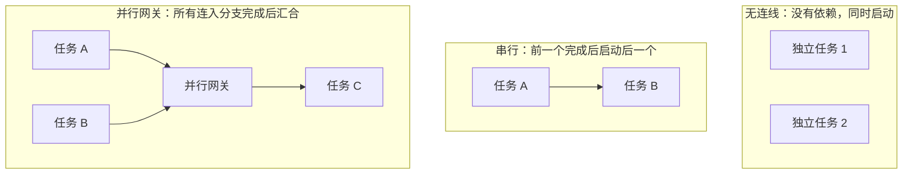
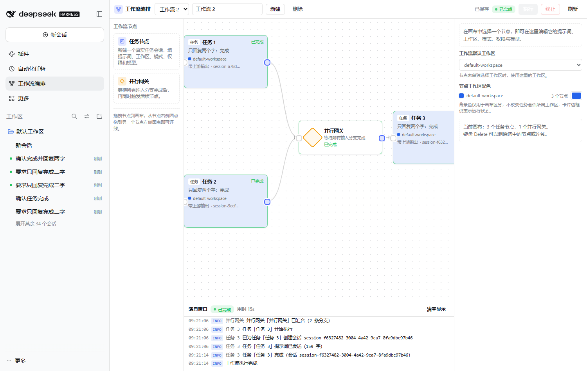
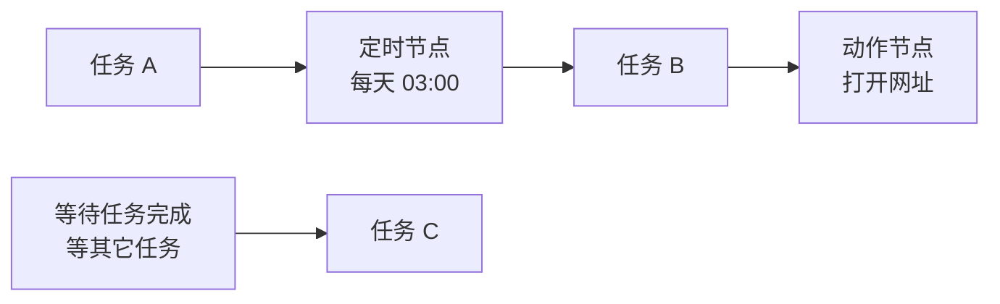
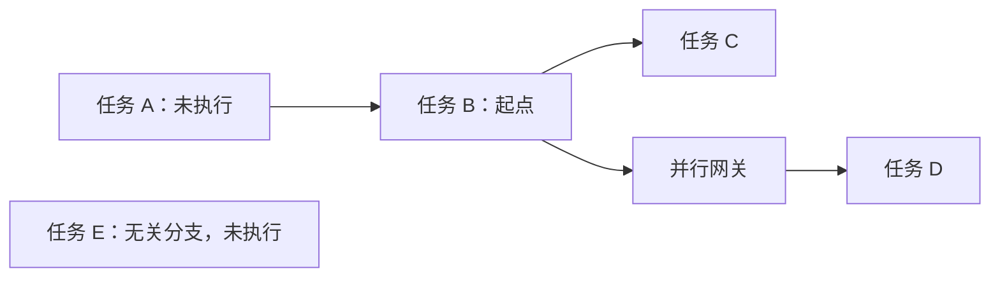
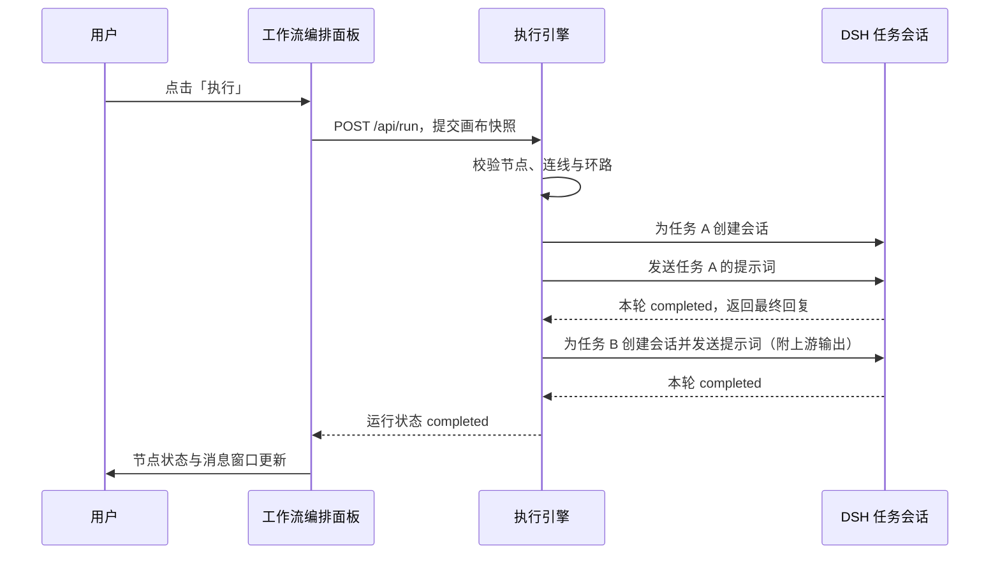

[文档首页](../README.md) / [用户文档](README.md)

# 执行与监控

点击顶部「执行」（全量）、属性区的「从此节点开始执行」（范围），或到了起始定时节点的计划时间后，宿主半区会按画布快照调度任务节点、创建真实任务会话，并把每一步写进消息窗口。这篇文档说明常见拓扑、定时自动触发的规则、从节点开始执行的范围、判断/终止节点带来的提前结束、动作与等待节点的执行、节点与运行状态、并发与超时、日志怎么读，以及运行中的编辑和刷新会发生什么。

## 启动一次运行

有三个启动入口：

- **顶部工具栏「执行」**：全量执行，画布上的所有节点都参与本次运行。
- **属性区「从此节点开始执行」**：只执行选中任务节点及其下游可达节点，其余节点标记为「未执行」（见下文「从节点开始执行的范围」）。
- **起始定时节点自动触发**：工作流里有作为起始节点的定时节点时，宿主调度器会在计划时间自动启动一次运行，不需要点击（见下文「定时自动触发」）。

以「执行」为例：

1. 确认画布结构正确、任务都有提示词。
2. 点击「执行」。客户端会先保存当前画布，再把**当前定义的一份快照**提交给宿主。
3. 宿主校验工作流（见 [搭建工作流：校验规则](building-workflows.md#校验规则)）；不通过时顶部显示「启动失败：工作流校验失败：…」，不会创建任何会话。
4. 校验通过后，消息窗口立刻出现第一行日志：全量执行是 `工作流「名称」开始执行（N 个节点）`；从节点开始时第一行是范围说明 `从节点「X」开始执行：跳过 N 个不在下游范围内的节点`（见下文）。
5. 画布节点从「等待中」进入「运行中」，本次执行范围内的节点都结束后，运行状态变为「已完成」「失败」或「已停止」。如果中途命中判断节点的 `STOP` 判定或终止节点，运行会提前收尾，面板额外显示「提前终止」徽标。

约束：

- 同一个工作流同一时间只能有一次运行；运行中再点「执行」会被拒绝（面板上按钮本身就是禁用的）。
- 不同工作流可以同时运行；面板一次只展示**当前选中工作流**最近一次运行，切回其他工作流可以看到它自己的运行记录。
- 运行中「终止」才可用，运行结束后自动恢复为禁用。

## 定时自动触发

工作流里有**起始定时节点**（没有输入连线）时，宿主调度器会按它的时间表自动启动工作流，不需要打开面板。相关规则：

- **检查频率**：宿主每 10 秒检查一次时间表，到点后启动一次运行。
- **触发来源会记录**：自动触发的运行会在消息窗口多一行「本次运行由定时节点「X」自动触发（计划时间 YYYY-MM-DD HH:mm）」，运行记录里也保存触发节点、计划时间与触发方式。
- **只有起始定时节点会启动工作流**：放在流程中间的定时节点不会自动启动新运行，只在当前运行到达时等待下一次触发时间。判断方式是「有没有输入连线」。
- **一次只跑一次**：同一个工作流同一时间只能有一次运行；到点时若该工作流正在运行，本次周期触发被**跳过**（不排队、不补跑），DSH 宿主日志记一条 `WARN`。
- **一次性触发**：到点自动启动一次；如果应用在计划时间之后才启动或重启，计划时间后 **10 分钟内仍会补触发一次**，超过 10 分钟不会补触发（只写 DSH 宿主日志 `WARN`）。到点时如果该工作流正在运行，会在宽限期内等它结束后补触发一次；宽限期过了仍没空出就放弃并记 `WARN`。手动执行**不享受**这个宽限：一次性时间已过去（超过 1 分钟）时校验失败。
- **周期触发**：每天 / 每周 / 每 N 分钟会反复启动新的运行，每次都会创建任务会话并消耗 token。面板顶部与左侧栏入口会常驻提醒；不需要时把触发方式改成「一次性触发」或删除定时节点。
- **睡眠唤醒补跑**：机器睡眠唤醒或系统时钟跳跃后，可能立即补跑**一次**错过的周期触发并额外消耗 token；插件最多补一次，然后按新计划继续。
- **手动执行不影响计划**：手动点「执行」不会重置、暂停或消耗周期计划；手动运行和自动触发运行使用同一份画布配置。
- **重启 DSH**：调度器记录的上次触发时间保存在宿主内存，重启后从重启时刻重新计算下一次触发；期间错过的周期触发不会补。
- **校验不通过**：到点会被调度器**跳过**——不会启动、不会产生运行记录，DSH 宿主日志记一条 `WARN`。面板提醒条会显示校验未通过的周期工作流数量（只统计**起始周期**定时节点，一次性入口定时节点不计入）。

## 常见拓扑与控制节点

### 1. 不连线：同时启动

没有输入连线的任务节点互为独立分支，运行开始时一起进入调度。实际同时运行的任务数受并发上限约束（见下文）。

### 2. `A → B`：串行

A 完成后才启动 B。B 的提示词默认会带上 A 的最终回复（上游上下文为 `带上游任务输出（默认）` 时）。

### 3. `A、B → 并行网关 → C`：汇合

A、B 同时启动；并行网关要等**所有**连入分支都成功完成才激活，然后同时触发它后面的节点（这里是 C）。只要有一条分支未成功（失败、取消或跳过），网关就不会激活，它后面的节点会被跳过。

### 4. `A → 判断节点 → B`：提前结束

A 完成后，判断节点创建一个真实任务会话来评估 A 的输出：判定继续才启动 B；判定终止则整次工作流提前结束，B 以及所有尚未启动的节点标记为「已跳过」（原因「工作流已提前终止」），但**不算失败**。终止节点同理，只是不需要模型判定，到达即结束。




*图 7：`任务 1`、`任务 2` 分别连入并行网关，网关再连到 `任务 3`；属性区显示「3 个任务节点，1 个并行网关」。*


*图 8：`任务 1`、`任务 2` 都完成后，并行网关记录「已汇合（2 条分支）」，随后 `任务 3` 启动并完成。*

### 5. 定时 / 动作 / 等待节点串在流程中

控制节点可以放在任何位置，不改变其他拓扑的语义：



- 定时节点在流程中间时，运行到达后等待下一次触发时间，然后继续 B；它只触发一次，不会在本次运行中循环。
- 动作节点完成动作后继续下游；失败会让节点失败并跳过下游。
- 等待任务完成节点作为起始节点时，手动执行后会等待你勾选的任务真正结束，再启动 C；放在中间时同理。

## 从节点开始执行的范围

选中任务节点、点属性区最顶部的「从此节点开始执行」后，本次运行的范围是：

- 起点节点本身；
- 从起点沿连线可达的**全部下游节点**，包括跨过的并行网关。

范围之外的前置节点、以及不在这条下游链路上的无关分支，在运行开始时统一标记为「未执行」（`not-run`）：**不会创建任务会话**，也不会产生该节点的执行日志。范围外前序不会被等待，也不会让运行失败。



以上图为例，从「任务 B」开始：B、C、网关、D 会执行；A、E 显示「未执行」，整次运行在范围内节点全部完成后记为「已完成」。

范围执行的日志第一条就是范围说明，而不是「工作流开始执行（N 个节点）」：

```text
12:50:41  INFO   从节点「任务 B」开始执行：跳过 2 个不在下游范围内的节点
12:50:41  INFO   任务 B   任务「任务 B」开始执行
...
12:50:45  INFO   工作流执行完成
```

- 顶部「执行」触发的全量运行第一条日志仍是 `工作流「工作流 1」开始执行（N 个节点）`，没有范围说明。
- 属性区运行卡片的「执行范围」一行也会显示「从「任务 B」开始（跳过 2 个节点）」；全量运行时显示「全部节点」。
- 整体状态只由范围内节点决定：「未执行」不算失败，也不会把运行拖成失败。

## 节点状态

| 状态 | 含义 |
| --- | --- |
| 等待中 | 还没轮到执行：前序未完成、在并发队列中，或尚未启动 |
| 运行中 | 已创建任务会话并发送提示词，等待会话真正完成（判断节点同样会创建会话） |
| 等待用户回复 | 「运行中」的子状态：任务会话里的 agent 用 `ask_user_question` 向你提了问，正在等你的回答；回答后节点自动继续执行（见下文「等待用户回复」） |
| 已完成 | 最后一个轮次以 `completed` 结束且会话已静默，最终回复被收集为输出；判断节点还会记录判定结果 |
| 失败 | 创建会话失败、模型报错、轮次中止、超时等（错误原因写在节点和日志里） |
| 已取消 | 工作流被终止且该节点正在运行（`cancel-tasks` 模式），或终止时尚未启动 |
| 已跳过 | 前序节点未成功完成，或网关存在未完成的前序分支，或工作流已被判断/终止节点提前结束 |
| 未执行 | 只出现在「从此节点开始执行」的运行中：该节点不在本次执行范围，不会创建会话；「未执行」不算失败 |

并行网关、终止节点没有「运行中」阶段：网关要么等待，要么直接变为「已完成」（所有分支都成功）或「已跳过」（存在未成功分支）；终止节点在前序全部完成后直接「已完成」并触发提前结束，前序失败时变「已跳过」。判断节点则和任务节点一样经历「运行中」。范围执行时，网关的判定只看**范围内**的前序分支；范围外分支不参与。

定时、动作、等待节点都会显示「运行中」，但含义不同：定时节点是**等待触发**（属性区显示倒计时与计划时间），动作节点是**正在执行动作**，等待节点是**正在等待目标任务**（属性区显示每个目标的状态与最近检查时间）。三者都不创建任务会话，也不占用任务并发名额；停止或提前终止会立即结束定时、等待节点的等待，动作节点的处理见[终止与错误处理](stopping-and-errors.md)。

**后台子代理不会让节点提前完成。** 当前 DSH 宿主上，任务会话里的主 agent 可以并发派发后台子代理，然后先输出一个阶段性结论并结束本轮；这时节点会继续显示「运行中」，等子代理结算、主 agent 处理完后续轮次、会话真正空闲后，才用**最后一次**回复作为节点输出。因此看到节点「运行中」但消息窗口暂时没有新日志，可能只是主 agent 在等子代理，属于正常现象。判断节点同样遵循这个规则。如果宿主版本不提供子代理管理能力，插件无法感知后台子代理，完成判定会退回旧行为，并在运行日志里记一条 `WARN`。

## 等待用户回复

任务节点的工作是交给真实 DSH 任务会话执行的，会话里的 agent 可以像普通对话一样**向你提问**（调用 `ask_user_question`）。提问未回答时，节点会显示琥珀色的「等待用户回复」，而不是被误判为失败或提前完成：

1. **在哪里看到**：画布上该节点的状态变为「等待用户回复」（边框同时变琥珀色）；选中节点后，属性区运行卡片列出待回答的问题（含选项），并提供「打开任务会话」按钮；消息窗口记一条 `任务「X」等待用户回复：<问题>`。
2. **怎么回答**：点「打开任务会话」跳到该会话（或到工作区任务列表里按标题找到它），在会话里的提问卡片上选择或输入回答。回答会作为一条用户消息进入会话，agent 继续工作。
3. **回答之后**：节点自动回到「运行中」，等会话完成新的轮次后正常收尾；消息窗口记一条 `任务「X」的用户已回复，继续执行`。**你回复之后产生的那次输出**才是节点结果，提问前的阶段性文本不会传给下游。
4. **等多久都行**：等待用户回复期间，该节点的 6 小时超时**暂停计时**——等待时长由你决定。不想再等就点顶部「终止」（`cancel-tasks` 会同时取消该任务会话，节点变为「已取消」）。

两种宿主提问模式都被覆盖：默认的阻塞式提问（问题卡住轮次，会话显示运行中）和限时提问（超时后先返回「等待中」结果，但问题仍可回答，你稍后回答同样能唤醒节点继续）。如果宿主缺少会话投影服务，限时提问超时后的「仍可回答」状态感知不到，节点可能在阶段性回复后提前完成，并在日志里记一条 `WARN`；提问从未被任何界面接住时（会话从未打开且为阻塞式提问），工具会直接报错，节点按模型的后续输出收尾。

## 运行状态

整条工作流的最终状态只有三种结果值（运行中不算结果）：

| 状态 | 判定 |
| --- | --- |
| 已完成 | 本次执行范围内的所有节点都成功完成（范围外的「未执行」不影响）；判断/终止节点造成的提前结束也记为「已完成」 |
| 失败 | 范围内有任务失败，或有节点因前序失败被跳过；错误写入运行记录。如果提前终止之前已经发生过真实失败，整体仍为「失败」 |
| 已停止 | 收到过手动终止请求（`detach` 或 `cancel-tasks` 都算） |

终止优先于失败：只要收到过手动终止请求，最终状态就是「已停止」。「未执行」（`not-run`）不会被判定为失败；提前终止造成的「已跳过」也不会——它们由运行记录的 `terminated` 字段单独标记。

提前终止后的运行：
- 面板运行状态徽标仍是「已完成」或「失败」，旁边额外显示「提前终止（由「判断节点 X」）」徽标；
- 节点卡片上，判断节点显示判定结果（`判定：终止`），未启动节点显示「已跳过」，原因「工作流已提前终止」；
- 运行记录保留 `terminated / terminatedBy / terminatedReason / terminatedAt`，刷新页面后仍能看到。

## 并发上限与超时

- **并发上限 8**：最多 8 个任务节点同时运行。就绪节点多于 8 个时排队，等有任务结束后再按节点在画布定义中的顺序启动。
- **单节点超时 6 小时**：从最近一次轮次开始算起，如果会话长时间空闲（包括在等后台子代理结算）超过 6 小时，宿主会请求取消该会话，节点记为失败，错误为「任务超时（超过 360 分钟），已请求终止」。
- **启动宽限 8 秒**：会话创建后 8 秒内既没有进入新轮次、会话又处于空闲状态，节点直接失败，错误为「任务未能开始执行：会话处于空闲状态且没有新的轮次」。
- **等待上限 6 小时 8 秒**：从节点启动到收到结果的等待总时长超过该值仍未结束，节点以「任务等待超时」失败。
- **等待用户回复不计时**：节点处于「等待用户回复」时，上面两个超时暂停计时，等多久由你决定；不想等就「终止」（见上文「等待用户回复」）。
- **控制节点不计入并发上限**：定时、动作、等待节点不占用 8 个任务并发名额。
- **等待任务完成节点超时 12 小时**：从节点开始等待算起，超过 12 小时仍未等到所选任务真正结束，节点以「等待超时（超过 12 小时）」失败。
- **动作节点超时**：`运行自定义命令` 与 `发送 HTTP 请求` 的超时时间 1–600 秒（默认 60 秒），超时会让节点失败；关机/重启的缓冲时间 10–3,600 秒（默认 60 秒）。
- **定时节点等待**：流程中间的定时节点会一直等到计划时间；一次性触发时间最远可到 2100 年。停止运行或提前终止会立即取消等待。
- 超时针对**单个任务节点**，不是整条工作流；其他不相关分支会继续执行到结束。

## 一次串行执行的时序



## 消息窗口怎么读

每行日志四列：

| 列 | 说明 |
| --- | --- |
| 时间 | `HH:mm:ss`，宿主时钟 |
| 级别 | `INFO` 正常进展，`WARN` 警告/主动停止，`ERROR` 失败 |
| 节点 | 产生日志的节点名；工作流级日志（开始、结束）没有这一列 |
| 消息 | 具体事件，含节点名、会话 ID、提示词字数、错误原因 |

一次 `A → B` 串行执行的日志示例（`任务 2` 因附带上游上下文，字数大于提示词本身）：

```text
12:50:41  INFO   工作流「工作流 1」开始执行（2 个节点）
12:50:41  INFO   任务 1   任务「任务 1」开始执行
12:50:41  INFO   任务 1   已为任务「任务 1」创建会话 session-22f6…
12:50:41  INFO   任务 1   任务「任务 1」提示词已发送（9 字）
12:50:44  INFO   任务 1   任务「任务 1」完成（会话 session-22f6…）
12:50:44  INFO   任务 2   任务「任务 2」开始执行
12:50:44  INFO   任务 2   已为任务「任务 2」创建会话 session-8354…
12:50:44  INFO   任务 2   任务「任务 2」提示词已发送（93 字）
12:50:46  INFO   任务 2   任务「任务 2」完成（会话 session-8354…）
12:50:46  INFO   工作流执行完成
```

> 为便于阅读，示例中的会话 ID 做了截断；实际日志里是完整的 `session-…`。

网关汇合会额外出现一行：`并行网关「并行网关」已汇合（2 条分支）`。判断节点与终止节点相关日志示例：

```text
12:51:02  INFO   判断节点   判断节点「判断是否继续」开始执行
12:51:02  INFO   判断节点   已为判断节点「判断是否继续」创建会话 session-9c31…
12:51:05  INFO   判断节点   判断节点「判断是否继续」判定：终止工作流
12:51:05  WARN   判断节点   判断节点「判断是否继续」提前结束工作流：判断节点「判断是否继续」判定不再继续
12:51:05  INFO   任务 B     任务「任务 B」未执行：工作流已提前终止
12:51:05  INFO   工作流提前结束：由「判断是否继续」触发（判断节点「判断是否继续」判定不再继续）
```

终止节点的触发日志是 `终止节点「到此为止」提前结束工作流：结果已足够`；如果终止原因是空的，冒号后的部分会省略。失败、跳过、取消的日志见 [终止与错误处理](stopping-and-errors.md)。

定时、动作、等待节点的日志示例。

自动触发的运行会多一行触发来源，定时节点本身也会记录触发：

```text
03:00:00  INFO   工作流「每日任务」开始执行（2 个节点）
03:00:00  INFO   本次运行由定时节点「每天三点」自动触发（计划时间 2026-11-23 03:00）
03:00:00  INFO   定时节点   定时节点「每天三点」触发：由计划时间 2026-11-23 03:00 自动触发（每天 03:00）
03:00:00  INFO   任务 B     任务「任务 B」开始执行
...
```

动作节点与等待任务完成节点的日志：

```text
12:55:10  INFO   动作节点   动作节点「关机」开始执行：自动关机（60 秒后）（试运行，不会产生实际动作）
12:55:10  INFO   动作节点   动作节点「关机」执行完成：试运行，未执行实际动作：自动关机（60 秒后）
12:55:12  INFO   等待任务完成   等待任务完成节点「等任务」开始等待 1 个任务：「外部任务」（每 10 秒检查一次）
12:55:32  INFO   等待任务完成   等待的任务「外部任务」已完成
12:55:32  INFO   等待任务完成   等待任务完成节点「等任务」完成：「外部任务」均已结束
```

- 流程中间的定时节点会先出现 `定时节点「X」开始等待：将在 2026-11-23 03:00 触发（每天 03:00）`，到点后出现 `定时节点「X」触发：已到计划时间（每天 03:00）`。
- 手动执行起始定时节点时，日志是 `定时节点「X」触发：起始节点立即触发（手动执行）（每天 03:00）`。
- 等待的任务失败时，日志是 `等待任务完成节点「X」失败：等待的任务「Y」未成功完成`，节点变为「失败」。

日志容量：

- 面板显示的日志最多保留最近 800 行，超出后旧行被丢弃。
- 已结束的运行会持久化最近 400 行日志，连同节点状态和错误一起保存。
- 「清空显示」只影响当前屏幕，不删除运行记录；刷新或切换工作流后仍可能重新看到记录中的日志。

## 工作区里的真实任务会话

- 每个任务节点启动时都会在所选工作区（或默认工作区）里**新建一个真实 DSH 任务会话**，不是模拟执行。
- 会话标题由 DSH 根据提示词自动生成，例如提示词「只回复两个字：完成」对应的会话标题可能是「回复“完成”两个字」；插件不会重命名会话，节点名和会话标题可能不同。
- 会话创建后会立即出现在工作区的任务列表里；刷新页面后仍在。
- 一次运行结束后，任务会话本身仍然保留在工作区，可以点「打开任务会话」继续查看或对话。
- 再次执行工作流会为每个任务节点**再创建新的会话**，不会复用上一次的会话。
- 删除工作流不会删除工作区里的历史任务会话。

## 打开任务会话

有两条路径：

1. 选中已完成/运行中的任务节点，在属性区点「打开任务会话」跳到该会话；如果当前界面环境不支持跳转，会退化为复制会话 ID。
2. 到 DSH 左侧工作区的任务列表里，按自动生成的标题找到对应会话。

运行中的节点在创建会话后立即显示会话 ID，不必等它完成。

## 运行期间编辑与刷新

- **运行使用快照**：点击「执行」时的画布定义被提交并保存，之后你对节点、提示词、连线、权限的任何修改都不会影响本次运行；修改会自动保存，供**下一次**执行使用。
- **刷新页面**：画布（节点、连线、提示词、设置）来自数据文件，刷新后仍在；当前运行由宿主半区继续调度，面板刷新后会重新读取并显示运行状态与日志。
- **重启 DSH**：进行中的运行只存在宿主内存里，重启后该次运行无法恢复（画布和已结束的运行记录不受影响）；已结束的运行记录会持久化，最近保留 20 次。调度器记录的上次触发时间也保存在宿主内存，重启后从重启时刻重新计算下一次触发。
- **切换工作流**：面板轮询的是运行状态，切换后会显示对应工作流最近一次运行的节点状态与日志；其他工作流的运行在后台继续。
- **停止运行不会暂停周期计划**：终止当前运行只取消这一次运行里挂起的定时/等待节点；下一次到点仍会自动启动新的运行。要彻底停止周期触发，请把定时节点改成「一次性触发」或删除它。

## 下一步

- 中途停止、失败与跳过的完整规则：读 [终止与错误处理](stopping-and-errors.md)。
- 运行记录存在哪里、保留多久：读 [数据与常见问题](data-and-faq.md)。
- 调整节点字段让执行更符合预期：读 [搭建工作流](building-workflows.md)。
