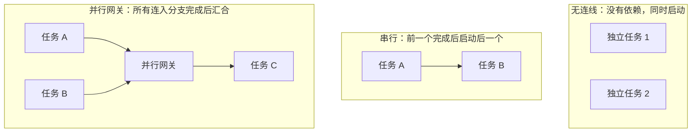
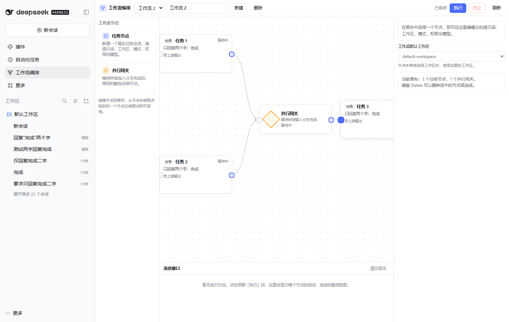
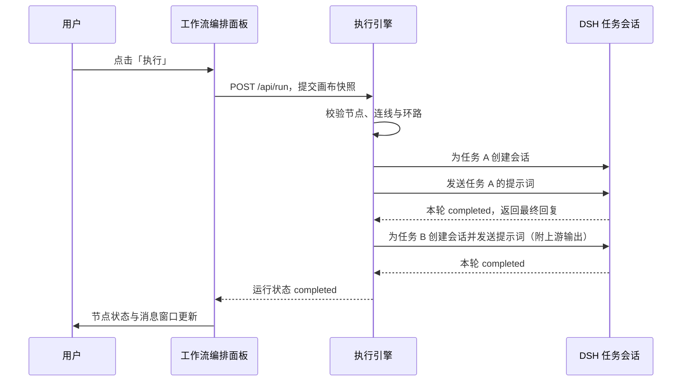

[文档首页](../README.md) / [用户文档](README.md)

# 执行与监控

点击顶部「执行」后，宿主半区会按画布快照调度任务节点、创建真实任务会话，并把每一步写进消息窗口。这篇文档说明三种常见拓扑的执行语义、节点与运行状态、并发与超时、日志怎么读，以及运行中的编辑和刷新会发生什么。

## 启动一次运行

1. 确认画布结构正确、任务都有提示词。
2. 点击「执行」。客户端会先保存当前画布，再把**当前定义的一份快照**提交给宿主。
3. 宿主校验工作流（见 [搭建工作流：校验规则](building-workflows.md#校验规则)）；不通过时顶部显示「启动失败：工作流校验失败：…」，不会创建任何会话。
4. 校验通过后，消息窗口立刻出现第一行日志：`工作流「名称」开始执行（N 个节点）`。
5. 画布节点从「等待中」进入「运行中」，全部节点结束后运行状态变为「已完成」「失败」或「已停止」。

约束：

- 同一个工作流同一时间只能有一次运行；运行中再点「执行」会被拒绝（面板上按钮本身就是禁用的）。
- 不同工作流可以同时运行；面板一次只展示**当前选中工作流**最近一次运行，切回其他工作流可以看到它自己的运行记录。
- 运行中「终止」才可用，运行结束后自动恢复为禁用。

## 三种常见拓扑

### 1. 不连线：同时启动

没有输入连线的任务节点互为独立分支，运行开始时一起进入调度。实际同时运行的任务数受并发上限约束（见下文）。

### 2. `A → B`：串行

A 完成后才启动 B。B 的提示词默认会带上 A 的最终回复（上游上下文为 `带上游任务输出（默认）` 时）。

### 3. `A、B → 并行网关 → C`：汇合

A、B 同时启动；并行网关要等**所有**连入分支都成功完成才激活，然后同时触发它后面的节点（这里是 C）。只要有一条分支未成功（失败、取消或跳过），网关就不会激活，它后面的节点会被跳过。




*图 7：`任务 1`、`任务 2` 分别连入并行网关，网关再连到 `任务 3`；属性区显示「3 个任务节点，1 个并行网关」。*


*图 8：`任务 1`、`任务 2` 都完成后，并行网关记录「已汇合（2 条分支）」，随后 `任务 3` 启动并完成。*

## 节点状态

| 状态 | 含义 |
| --- | --- |
| 等待中 | 还没轮到执行：前序未完成、在并发队列中，或尚未启动 |
| 运行中 | 已创建任务会话并发送提示词，等待本轮结束 |
| 已完成 | 本轮以 `completed` 结束，最终回复被收集为输出 |
| 失败 | 创建会话失败、模型报错、轮次中止、超时等（错误原因写在节点和日志里） |
| 已取消 | 工作流被终止且该节点正在运行（`cancel-tasks` 模式），或终止时尚未启动 |
| 已跳过 | 前序节点未成功完成，或网关存在未完成的前序分支，节点不会启动 |

并行网关没有「运行中」阶段：它要么等待，要么直接变为「已完成」（所有分支都成功）或「已跳过」（存在未成功分支）。

## 运行状态

整条工作流的最终状态只有三种结果值（运行中不算结果）：

| 状态 | 判定 |
| --- | --- |
| 已完成 | 所有节点都成功完成 |
| 失败 | 有任务失败，或有节点因前序失败被跳过；错误写入运行记录 |
| 已停止 | 收到过终止请求（`detach` 或 `cancel-tasks` 都算） |

终止优先于失败：只要收到过终止请求，最终状态就是「已停止」。

## 并发上限与超时

- **并发上限 8**：最多 8 个任务节点同时运行。就绪节点多于 8 个时排队，等有任务结束后再按节点在画布定义中的顺序启动。
- **单节点超时 6 小时**：任务轮次开始后，如果会话长时间空闲超过 6 小时，宿主会请求取消该会话，节点记为失败，错误为「任务超时（超过 360 分钟），已请求终止」。
- **启动宽限 8 秒**：会话创建后 8 秒内既没有进入新轮次、会话又处于空闲状态，节点直接失败，错误为「任务未能开始执行：会话处于空闲状态且没有新的轮次」。
- **等待上限 6 小时 8 秒**：从节点启动到收到结果的等待总时长超过该值仍未结束，节点以「任务等待超时」失败。
- 超时针对**单个任务节点**，不是整条工作流；其他不相关分支会继续执行到结束。

## 一次串行执行的时序



## 消息窗口怎么读

每行日志四列：

| 列 | 说明 |
| --- | --- |
| 时间 | `HH:mm:ss`，宿主时钟 |
| 级别 | `INFO` 正常进展，`WARN` 警告/主动停止，`ERROR` 失败 |
| 节点 | 产生日志的节点名；工作流级日志（开始、结束）没有这一列 |
| 消息 | 具体事件，含节点名、会话 ID、提示词字数、错误原因 |

一次 `A → B` 串行执行的日志示例（`任务 2` 因附带上游上下文，字数大于提示词本身）：

```text
12:50:41  INFO   工作流「工作流 1」开始执行（2 个节点）
12:50:41  INFO   任务 1   任务「任务 1」开始执行
12:50:41  INFO   任务 1   已为任务「任务 1」创建会话 session-22f6…
12:50:41  INFO   任务 1   任务「任务 1」提示词已发送（9 字）
12:50:44  INFO   任务 1   任务「任务 1」完成（会话 session-22f6…）
12:50:44  INFO   任务 2   任务「任务 2」开始执行
12:50:44  INFO   任务 2   已为任务「任务 2」创建会话 session-8354…
12:50:44  INFO   任务 2   任务「任务 2」提示词已发送（93 字）
12:50:46  INFO   任务 2   任务「任务 2」完成（会话 session-8354…）
12:50:46  INFO   工作流执行完成
```

> 为便于阅读，示例中的会话 ID 做了截断；实际日志里是完整的 `session-…`。

网关汇合会额外出现一行：`并行网关「并行网关」已汇合（2 条分支）`。失败、跳过、取消的日志见 [终止与错误处理](stopping-and-errors.md)。

日志容量：

- 面板显示的日志最多保留最近 800 行，超出后旧行被丢弃。
- 已结束的运行会持久化最近 400 行日志，连同节点状态和错误一起保存。
- 「清空显示」只影响当前屏幕，不删除运行记录；刷新或切换工作流后仍可能重新看到记录中的日志。

## 工作区里的真实任务会话

- 每个任务节点启动时都会在所选工作区（或默认工作区）里**新建一个真实 DSH 任务会话**，不是模拟执行。
- 会话标题由 DSH 根据提示词自动生成，例如提示词「只回复两个字：完成」对应的会话标题可能是「回复“完成”两个字」；插件不会重命名会话，节点名和会话标题可能不同。
- 会话创建后会立即出现在工作区的任务列表里；刷新页面后仍在。
- 一次运行结束后，任务会话本身仍然保留在工作区，可以点「打开任务会话」继续查看或对话。
- 再次执行工作流会为每个任务节点**再创建新的会话**，不会复用上一次的会话。
- 删除工作流不会删除工作区里的历史任务会话。

## 打开任务会话

有两条路径：

1. 选中已完成/运行中的任务节点，在属性区点「打开任务会话」跳到该会话；如果当前界面环境不支持跳转，会退化为复制会话 ID。
2. 到 DSH 左侧工作区的任务列表里，按自动生成的标题找到对应会话。

运行中的节点在创建会话后立即显示会话 ID，不必等它完成。

## 运行期间编辑与刷新

- **运行使用快照**：点击「执行」时的画布定义被提交并保存，之后你对节点、提示词、连线、权限的任何修改都不会影响本次运行；修改会自动保存，供**下一次**执行使用。
- **刷新页面**：画布（节点、连线、提示词、设置）来自数据文件，刷新后仍在；当前运行由宿主半区继续调度，面板刷新后会重新读取并显示运行状态与日志。
- **重启 DSH**：进行中的运行只存在宿主内存里，重启后该次运行无法恢复（画布和已结束的运行记录不受影响）；已结束的运行记录会持久化，最近保留 20 次。
- **切换工作流**：面板轮询的是运行状态，切换后会显示对应工作流最近一次运行的节点状态与日志；其他工作流的运行在后台继续。

## 下一步

- 中途停止、失败与跳过的完整规则：读 [终止与错误处理](stopping-and-errors.md)。
- 运行记录存在哪里、保留多久：读 [数据与常见问题](data-and-faq.md)。
- 调整节点字段让执行更符合预期：读 [搭建工作流](building-workflows.md)。
