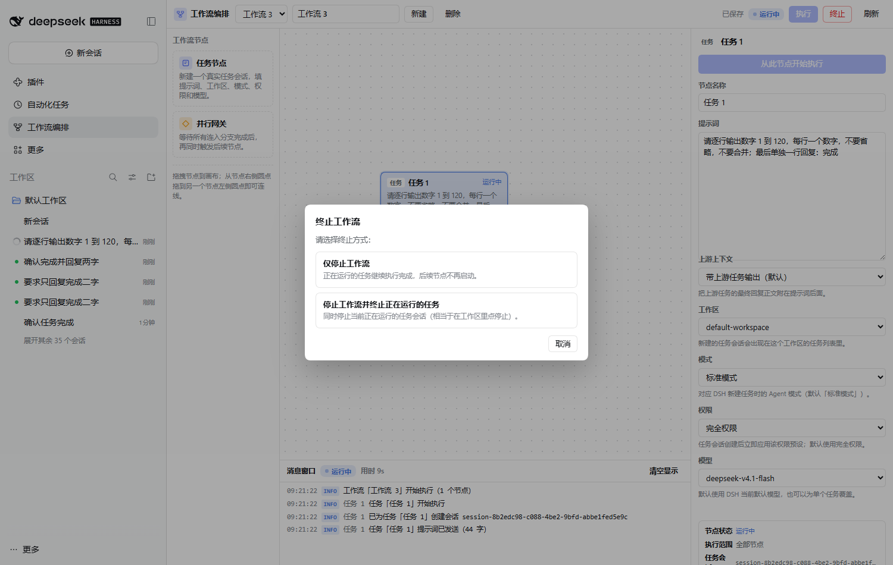
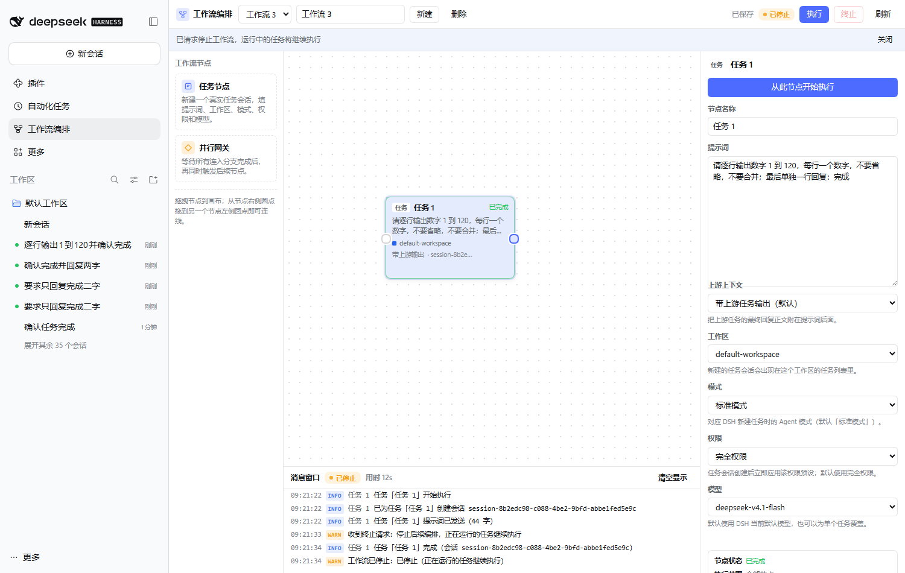
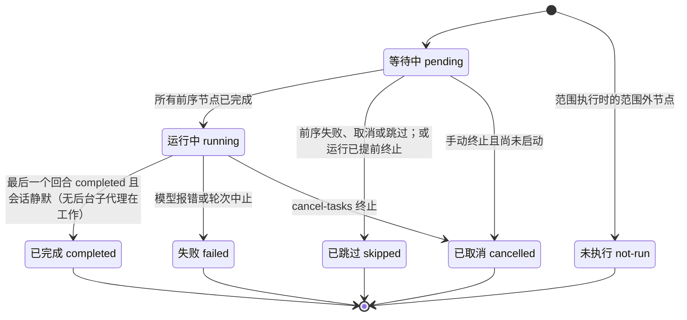
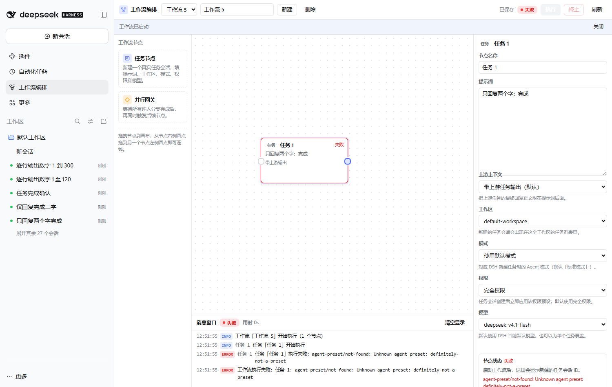

[文档首页](../README.md) / [用户文档](README.md)

# 终止与错误处理

运行中的工作流可以主动终止，判断/终止节点也可以按编排提前结束运行；节点还可能因为模型报错、会话异常或超时而失败。这篇文档说明手动终止与提前结束的差别、两种手动终止模式、失败后为什么会「跳过」下游、错误在界面上的呈现位置，以及常见错误的含义与处理办法。

## 终止工作流

运行中时顶部「终止」按钮可用。点击后弹出「终止工作流」对话框，提供两种方式：

*图 9：终止对话框：可以选择「仅停止工作流」或「停止工作流并终止正在运行的任务」，底部是「取消」。*

| 方式 | 对正在运行的任务 | 对尚未启动的任务节点 | 运行结果 |
| --- | --- | --- | --- |
| **仅停止工作流**（`detach`） | 继续执行到完成 | 不再启动，标记为「已取消」 | 工作流「已停止」，错误为「已停止（正在运行的任务继续执行）」 |
| **停止工作流并终止正在运行的任务**（`cancel-tasks`） | 立即请求取消任务会话；正在等后台子代理的任务还会尽力停止这些子代理，节点变为「已取消」 | 不再启动，标记为「已取消」 | 工作流「已停止」，错误为「已终止（正在运行的任务已停止）」 |

两种方式的共同点：

- 点击后立即生效，不能再启动**新的**任务节点；已经排队但没开始的任务不会再开始。
- 面板顶部提示「已请求停止工作流，运行中的任务将继续执行」或「已请求停止工作流并终止运行中的任务」。
- 消息窗口会写入一行 `WARN`：「收到终止请求：…」。
- 一次运行只需要终止一次；重复点击不会重复发送请求。
- 终止不是删除：运行记录会保留（最近 20 次），任务会话和画布也都会保留；之后可以重新执行。

### 仅停止工作流（detach）

适合「不想再启动后续节点，但正在跑的任务让它跑完」的场景。正在运行的任务会一直执行到本轮结束，节点最终仍可能是「已完成」；随后工作流收尾为「已停止」。

*图 10：选择「仅停止工作流」后，运行中的任务节点继续执行并变为「已完成」，消息窗口最后出现「工作流已停止：已停止（正在运行的任务继续执行）」。*

### 停止并终止正在运行的任务（cancel-tasks）

除了停止后续编排，还会取消每个正在运行节点的任务会话（效果等同于在工作区里点停止）。如果节点正在等它派发的后台子代理，还会尽力停止这些子代理。节点变为「已取消」，错误为「任务未成功完成：已中止（user）」或「任务已被终止」。适合任务跑飞、输出过长或明显不符合预期的情况。

正处于「等待用户回复」的节点同样会被这种方式终止：提问被中止，节点变为「已取消」。如果只是不想回答某个问题、但想让任务继续，不要用这种方式——回答提问（可以选择跳过）才是让节点继续的正路。

*图 11：选择「停止工作流并终止正在运行的任务」后，节点状态变为「已取消」，日志包含「已请求终止任务…的会话」与「任务「任务 1」已取消：任务未成功完成：已中止（user）」。*

## 判断/终止节点触发的提前结束

除了手动点「终止」，编排本身也可以提前结束整次工作流：

| 触发方式 | 行为 | 整体状态 |
| --- | --- | --- |
| 判断节点判定 `STOP` | 判断节点完成并记录判定；整次运行提前结束，未启动节点变「已跳过」 | 已完成（终止前无真实失败时） |
| 终止节点到达 | 终止节点完成；整次运行提前结束，未启动节点变「已跳过」 | 已完成（终止前无真实失败时） |
| 手动「终止」 | 停止后续编排，按对话框选择处理在途任务 | 已停止 |

共同点：

- 都是**整次运行**级别，不会只结束某个分支；后续节点不再启动。
- 未启动节点显示「已跳过」，错误为「工作流已提前终止」，**不算失败**。
- 在途任务默认继续跑完；判断/终止节点可以配置「同时终止在途任务会话」，此时这些节点按「已取消」收尾。
- 如果提前终止之前已经发生过真实失败，整体仍记为「失败」；终止之后在途任务才失败，只记在节点上，不把整体翻成失败。
- 提前终止不会删除运行记录、任务会话或画布；之后可以重新执行。

手动「终止」与提前结束的优先级：运行已经提前结束、正在等在途任务收尾时再点「终止」，仍按手动终止处理，最终状态变为「已停止」。

## 节点状态机

并行网关、终止节点使用同一张状态图，但它们不会进入「运行中」：所有前序完成时直接变为「已完成」，存在未完成前序时直接变为「已跳过」。判断节点与任务节点一样会进入「运行中」。工作流被**手动终止**后，尚未启动的节点进入「已取消」而不是「已跳过」；被**判断/终止节点提前结束**时，尚未启动的节点进入「已跳过」，错误为「工作流已提前终止」。

「等待用户回复」不是独立状态，而是「运行中」的子状态：任务会话向你提问且尚未得到回答时，节点显示为「等待用户回复」，回答后自动回到「运行中」并继续执行（详见 [执行与监控：等待用户回复](running-and-monitoring.md#等待用户回复)）；`cancel-tasks` 终止时它与其他运行中节点一样变为「已取消」。

「未执行」（`not-run`）只在「从此节点开始执行」的运行里出现：它表示该节点不在本次执行范围，不会创建任务会话，也不算失败、不参与整体状态判定。详见 [执行与监控：从节点开始执行的范围](running-and-monitoring.md#从节点开始执行的范围)。

## 失败与跳过如何级联

调度规则是「所有前序都成功完成，节点才启动」：

1. 某个任务节点失败（或已取消、已跳过）。
2. 它直接相连的后继任务节点不会启动，标记为「已跳过」，错误为「前序任务未成功完成」，日志级别 `WARN`。
3. 跳过继续沿这条分支向下传播；与失败分支**无关**的其他分支继续正常执行到结束。
4. 并行网关只要有一条前序分支未成功，就不会激活：网关节点变为「已跳过」，错误为「前序分支未成功，网关未激活」，日志为「并行网关「X」未激活：存在未完成的前序分支」。
5. 网关被跳过后，它后面的节点也全部「已跳过」，整条汇合分支都不会执行。

最终状态判定顺序：

- 只要收到过**手动**终止请求（`detach` 或 `cancel-tasks`）→ 已停止；
- 否则运行被判断/终止节点提前结束 → 终止前有真实失败则「失败」，否则「已完成」；
- 否则只要有节点失败或被跳过 → 失败；
- 否则 → 已完成（「未执行」不算失败）。

补充：`cancel-tasks` 造成的任务取消**不会**被算作「失败」；但手动终止本身已经让运行成为「已停止」。失败分支留下的错误会写入运行记录，`detach` 模式下正在运行的任务完成后，节点可以仍是「已完成」，但整条工作流仍显示「已停止」。提前终止造成的「已跳过」也不计入失败；运行记录的 `terminated` 字段单独标记这次提前结束。

## 错误在哪里显示

| 位置 | 显示内容 |
| --- | --- |
| 消息窗口 | `ERROR` 行：节点失败原因、工作流执行失败汇总；`WARN` 行：跳过、取消、权限/模型降级 |
| 画布节点 | 节点边框和状态变成红色「失败」或灰色「已取消」「已跳过」 |
| 右侧属性区 | 「节点状态」显示失败，下方红色文字显示具体错误；会话 ID（如果已创建）仍可打开 |
| 顶部工具栏 | 运行状态徽标显示「失败」或「已停止」；提前结束时旁边显示「提前终止（由「X」）」 |
| 顶部通知条 | 启动失败（校验失败、工作流正在运行等）会以红色通知条显示「启动失败：…」 |

*图 12：任务节点因 `agent-preset/not-found` 失败：节点显示「失败」，属性区红色文字给出错误原因，消息窗口出现两行 `ERROR` 日志。*

注意：**校验失败不会产生运行记录**，只在通知条出现；运行期错误才会进入消息窗口和节点状态。

## 常见错误与处理

| 错误信息（关键字） | 含义 | 处理建议 |
| --- | --- | --- |
| `工作流校验失败：…` | 节点/连线/提示词不满足启动条件，或存在环 | 按提示补齐提示词、给网关补输入输出连线、删除形成环的连线 |
| `判断节点「…」还没有填写提示词` / `判断节点「…」缺少输入连线` / `判断节点「…」的上游没有可评估的任务` | 判断节点配置不完整 | 给判断节点补提示词、连上上游任务；确保它前面至少有一个任务节点 |
| `判断节点「…」的上游上下文不能选择「完全不传」` | 判断节点看不到可评估的内容 | 把上游上下文改为「带上游任务输出」或「带上游任务会话摘要」 |
| `终止节点「…」缺少输入连线` / `终止节点「…」不应有输出连线` | 终止节点连线不合法 | 给它连入前序节点，并删除从终止节点连出的连线 |
| `该工作流正在运行（run …）` | 同一工作流已有运行 | 等待结束或先终止，再点「执行」 |
| `工作流不存在` | 工作流已被删除或数据文件被清空 | 刷新页面，重新新建工作流 |
| `agent-preset/not-found: Unknown agent preset: …` | 节点上的模式（Agent 预设）在宿主中不存在，常见于手工改过数据文件或宿主预设被移除 | 选中节点，把「模式」改回可用的预设（如「标准模式」） |
| `创建任务会话失败：未返回会话 ID` | 宿主创建会话没有返回有效 ID | 检查 DSH 会话服务是否正常，重试执行 |
| `会话 … 未就绪` | 会话创建后暂时取不到 | 通常可重试；持续出现时重启 DSH 后重试 |
| `任务未能开始执行：会话处于空闲状态且没有新的轮次` | 创建会话后 8 秒内没有开始新轮次 | 检查模型/凭据、DSH 是否繁忙；重试 |
| `任务超时（超过 360 分钟），已请求终止` | 单节点运行超过 6 小时 | 拆分任务、换更快的模型，或缩短提示词 |
| `任务等待超时` | 等待结果超过 6 小时 8 秒 | 同上 |
| `任务未成功完成：已中止（user）` | 任务会话被用户或 `cancel-tasks` 终止 | 需要结果就重新执行；该轮不会自动重试 |
| `任务已被终止` | `cancel-tasks` 终止时，节点正在等待后台子代理结算 | 正常停止行为；需要结果就重新执行 |
| `该轮被拦截（会话已归档或未通过准入）` | 会话状态不允许继续本轮 | 重新执行；持续出现时检查 DSH 的会话准入与归档策略 |
| `权限预设「…」应用失败，沿用会话默认权限`（`WARN`） | 权限设置失败，但任务继续 | 检查该权限预设是否仍存在；不要求特定权限时可忽略 |
| `模型选择失败，沿用默认模型`（`WARN`） | 节点覆盖模型失败，任务继续用默认模型 | 确认模型仍可用；必要时重新选择模型 |
| `工作流执行异常：…` | 调度过程中的意外异常 | 记录错误信息并重试；反复出现请反馈给维护者 |

## 失败后怎么恢复

1. 看消息窗口最后几行 `ERROR`，确认是哪个节点、什么原因。
2. 修正节点字段（提示词、模式、权限、模型）或补全连线；修改会自动保存。
3. 重新点击「执行」。每次执行都是**全新的一次运行**，会为每个任务节点创建新的任务会话，旧会话仍留在工作区。
4. 没有「从失败处继续」或「自动重试」：插件不提供循环、重试和断点续跑；需要重跑整条工作流（不相关的分支会再次执行）。
5. 失败分支之外的节点若已经完成，其会话仍然可用；但再次执行时会重新创建会话，不会复用旧会话。

## 其他终止相关行为

- 没有正在运行的运行时，「终止」按钮禁用；如果直接调用接口，会返回「没有正在运行的工作流」。
- 运行结束后，终止按钮自动恢复禁用，「执行」重新可用。
- 卸载/停用插件时，宿主会尽力取消仍在运行的工作流（按 `cancel-tasks` 处理），避免留下无人管理的运行。
- 如果刷新页面，终止状态与日志会从宿主重新读取；页面刷新本身不会终止运行。
- 判断节点的判定文本、终止节点的原因会写入运行日志；刷新页面后仍可从运行记录里看到提前终止信息。

## 下一步

- 想先了解正常执行流程：读 [执行与监控](running-and-monitoring.md)。
- 想调整字段避免失败：读 [搭建工作流](building-workflows.md)。
- 错误与数据文件有关时：读 [数据与常见问题](data-and-faq.md)。
